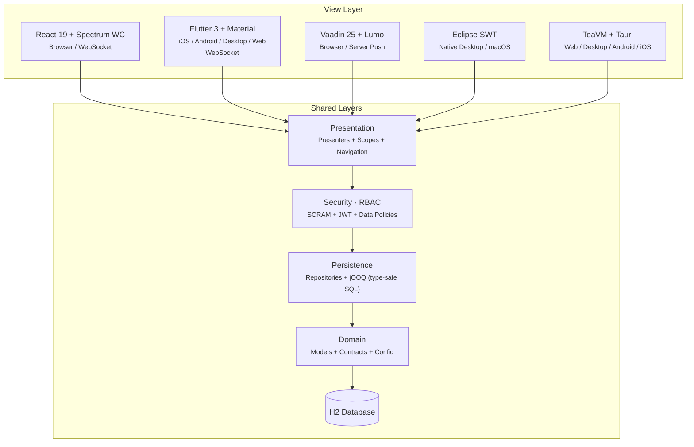
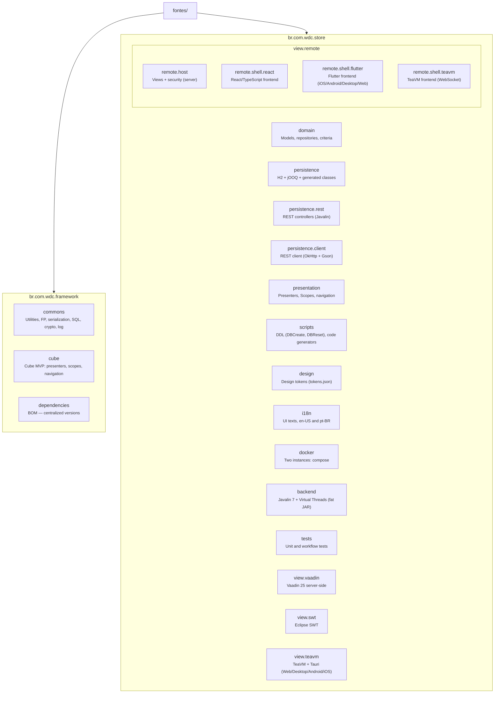
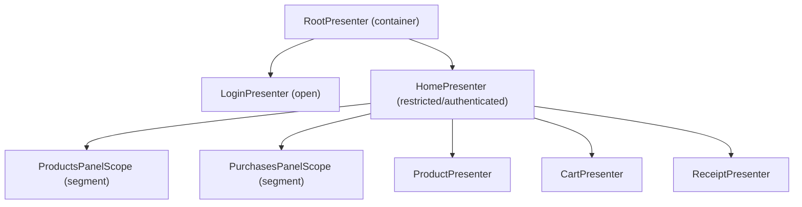

# WDC Cube Java v2

An architectural proposal for building applications with the **Cube MVP** pattern — a variation of Model-View-Presenter with hierarchical presenters, intent-based navigation and serializable scopes (the view state each presenter publishes).

This project serves as an **architectural reference** for new projects, demonstrating the complete implementation of an e-commerce system (WDC Store) with a Java backend and **five independent frontend implementations** — React (web/remote), Flutter (mobile/desktop/remote web), Vaadin (web/server-side), SWT (native desktop) and TeaVM (web/desktop/Android/iOS via Tauri) — proving that the view layer is fully decoupled from the presentation logic.

📄 [Cube MVP — Multiplatform Presentation Architecture in Java](docs/cube-mvp-multiplatform-architecture.md)  
📄 [Data Layer — Domain, Persistence and REST API](docs/data-layer.md)  
📄 [Remote Transaction — Client Identity and Transaction Ownership](docs/remote-transaction-identity-and-ownership.md)  
📄 [Security Architecture — Trust Boundaries, Authentication and Data Access Policies](docs/security-architecture.md)  
📄 [Bridge/Skeleton Protocol — the remote views on the wire](docs/bridge-skeleton-protocol.md)  
📄 [Running Several Instances — what they share, what each keeps, how to route them](docs/running-several-instances.md)  
📄 [Throughput and Memory Analysis](docs/throughput-and-memory-analysis.md)  
📄 [REST API contract — OpenAPI document](docs/openapi.json)  
📄 [Securing an Application with the WDC Framework — Guide](fontes/br.com.wdc.framework/docs/security-guide.md)  
📄 [Architecture Decision Records — why the code is the way it is](docs/adr/README.md)

## Architecture Overview



| Frontend | Technology | Transport | Module |
|----------|-----------|------------|--------|
| **Web (SPA)** | React 19 + TypeScript + Spectrum Web Components | WebSocket (JSON delta) | `view.remote` |
| **Mobile/Desktop/Web** | Flutter 3 + Material Design | WebSocket (JSON delta) | `view.remote` |
| **Web (SSR)** | Vaadin 25 + Lumo | Server Push (Atmosphere) | `view.vaadin` |
| **Native Desktop** | Eclipse SWT 3.135.0 | Direct, in memory | `view.swt` |
| **Multiplatform (TeaVM)** | TeaVM 0.16 + Tauri 2 + Bootstrap 5 | REST (OkHttp → JS) | `view.teavm` |

**Key features:**

- **View independence** — the same Presenters/Scopes feed React (web), Flutter (mobile/desktop/web), Vaadin (server-side web), SWT (native desktop) and TeaVM (web/desktop/Android/iOS)
- **No DI frameworks** — injection via `AtomicReference<T> BEAN` (static service locator); services receive their dependencies in the constructor
- **Virtual Threads** (Java 21+) — WebSocket connections with minimal memory consumption
- **RBAC security** — SCRAM-SHA-256 sign-in with JWT, failed sign-ins slowed down per account, role-based access control (ADMIN, CUSTOMER, MANAGER) enforced at the REST endpoints
- **Remote channel security** — each connection agrees on its own key (ECDH P-256 + HKDF-SHA256); sensitive values travel AES-256-GCM encrypted with an IV of their own; session ids and addresses are signed with HMAC-SHA256
- **Real-time communication** — bidirectional WebSocket with automatic keep-alive
- **External configuration** — TOML for every implementation

## Module Structure



### Framework

| Module | Description |
|--------|-----------|
| **framework.commons** | Functional interfaces with checked exceptions (`ThrowingFunction`, `ThrowingConsumer`, etc.), extensible serialization, SQL abstractions (`SqlDataSource`), utilities (`CoerceUtils`, `DateUtil`, `Defer`), cryptography (`ChannelCrypto` for the remote channel, `Base62`), multiplatform logging (`Log` — a lightweight facade with JUL and SLF4J backends), concurrency (`ScheduledExecutor`) |
| **framework.cube** | Engine of the Cube MVP pattern: `CubeApplication`, `CubePresenter`, `AbstractCubePresenter`, `Scope`/`Prop`/`ScopeSlot`, `CubePlace`, `CubeIntent`, `CubeNavigation` — no view concept: drawing a scope is up to each rendering technology |
| **framework.domain** | Generic domain abstractions: `Repository`, `Page`, `ModelCodec`, `Criteria`/`Criterion`, `Projection*`, base exceptions (`BusinessException`, `AccessDeniedException`, ...), security contracts (`SecurityContext`, `AuthenticationService`), the data access policy (`security.policy`: `DataPolicy`, `DataGrant`, `RowScope`, `Mask`), `AppConfig`, `TransactionService` |
| **framework.jooq** | JSON query helpers over jOOQ (`JsonQuery`, `JsonQueryBuilder`, `JsonChildQueryBuilder`), `CriterionTranslator`, `TransactionAwareConnectionProvider` |
| **framework.persistence** | CMT-style transactions in dual JTA/JDBC mode (`TransactionServiceImpl`, `TransactionScope`), `RemoteTransactionCoordinator` SPI |
| **framework.cube.remote** | Remote protocol of the Cube MVP engine: WebSocket backend (`ScopeSerializer`, `RemoteViewImpl`) and client bridges (Java, TeaVM, React, Flutter) |
| **framework.dependencies** | BOM-type POM for centralized management of dependency versions |

### Store — Backend

| Module | Description |
|--------|-----------|
| **domain** | One package per entity (`product`, `user`, `purchase`, `purchaseitem`), each with the fluent entity, its `Criterion`-based criteria, codec and repository interface; `InvalidCartItemException`, `Role` (the list of roles), `StoreConfig`, `StoreTransactions` |
| **persistence** | Groups `persistence.impl` — **jOOQ** implementation (type-safe DSL, classes generated in `br.com.wdc.store.persistence.impl.scheme.*` from the H2 schema), `*RepositoryImpl` classes that obtain the `DSLContext` via `StoreDSLContext.BEAN`, the framework's JSON query helpers, `StoreRepositoryBootstrap` for wiring —, `persistence.rest` (Javalin API; authorization by a data policy per entity — `UserDataPolicy`, `ProductDataPolicy`, `PurchaseDataPolicy`, `PurchaseItemDataPolicy`) and `persistence.client` (HTTP repositories over OkHttp) |
| **design** | The design tokens (W3C `tokens.json`): the palette, spacing, radii and type, generated for every view technology (`GenerateDesignTokens`) — [ADR 0027](docs/adr/0027-design-tokens.md) |
| **i18n** | The UI texts, one catalog per language (en-US, pt-BR); presenters put a `Message` (key + args) in the scopes and each view translates it — [ADR 0028](docs/adr/0028-ui-texts-in-one-catalog.md) |
| **presentation** | `StoreApplication` (subject, cart, `PLACES`), presenter hierarchy (Root → Open/Restricted guards → Login \| Home → Product/Cart/Receipt, with the Products/Purchases panels as segments of Home), scopes with observed `Prop`s, calls named by verb (`XxxQuery`, `XxxCreate`/`XxxSave`/`XxxUpdate`/`XxxDelete`, or a verb of their own like `CredentialsCheck`) over the repositories, `CartManager`, places with `XxxKeys` and navigation by intents |

### Store — Frontend (View Implementations)

> **Core principle:** every implementation uses exactly the same Presenters, Scopes and business rules. Only the rendering layer changes.

| Module | Description |
|--------|-----------|
| **view.remote** | Remote view via the browser — [details](fontes/br.com.wdc.store/br.com.wdc.store.view.remote/README.md) |
| **view.remote / remote.shell.react** | SPA in React 19 + TypeScript + Spectrum Web Components (`@swc-react`), bundled with Parcel. Bidirectional WebSocket communication, reconnection management, client-side security |
| **view.remote / remote.shell.flutter** | Flutter 3 + Material Design for iOS, Android, Desktop (macOS) and Web. Bidirectional WebSocket communication, same protocol as React — [details](fontes/br.com.wdc.store/br.com.wdc.store.view.remote/remote.shell.flutter/README.md) |
| **view.remote / remote.shell.teavm** | TeaVM frontend that communicates with the server over WebSocket |
| **backend** | Javalin 7 server with Virtual Threads, WebSocket dispatcher, REST controllers; database H2 (TCP or file) or PostgreSQL. Produces a fat JAR (~41 MB) |
| **view.remote / remote.host** | `StoreApplicationImpl`, whose views come from `framework.cube.remote` (a `RemoteViewImpl` for any scope, found by its `CLASS_ID`), and `RemoteHostBootstrap`, which writes the signing key (`[remote] signingKey`) into `application.local.toml` when absent. The channel security (`RemoteAppSecurity`, `RemoteDataSecurity` — HMAC signatures, a key per connection by ECDH + HKDF, AES-GCM) comes from `framework.cube.remote` |
| **view.vaadin** | Server-side web view with Vaadin 25 + Lumo theme + embedded Jetty 12 — [details](fontes/br.com.wdc.store/br.com.wdc.store.view.vaadin/README.md) |
| **view.swt** | Native desktop view with Eclipse SWT 3.135.0 — [details](fontes/br.com.wdc.store/br.com.wdc.store.view.swt/README.md) |
| **view.teavm** | Multiplatform (Web + Desktop + Android + iOS) with TeaVM 0.16 + Tauri 2 + Bootstrap 5 — Java compiled to JS — [details](fontes/br.com.wdc.store/br.com.wdc.store.view.teavm/README.md) |
| **persistence.rest** | REST controllers (Javalin) that expose repositories as HTTP endpoints, JWT security filter (`SecurityFilter`), authentication endpoints (`AuthApiController`) |
| **persistence.client** | REST client (OkHttp + Gson) that implements the repository interfaces and `AuthenticationService` over HTTP, with an automatic Bearer token |

## Prerequisites

- **Java 25** (LTS)
  - **Temurin 25** or **Microsoft JDK 25** — recommended
- **Maven 3.9+**
- **Node.js 20+** and **npm** (for the React frontend)
- **Flutter 3.x** (for the Flutter frontend — mobile/desktop/web)

## Build

### Backend (Java)

```bash
export JAVA_HOME=<path-to-jdk-25>  # e.g. /Library/Java/JavaVirtualMachines/temurin-25.jdk/Contents/Home
export PATH="$JAVA_HOME/bin:$PATH"

cd fontes
mvn clean package
```

The fat JAR is generated at:
```
fontes/br.com.wdc.cube.backend/target/br.com.wdc.cube.backend-1.0.0.jar
```

### Web frontends (artifacts in `work/frontend/`)

Four frontends compile to static files that the backend serves from
`work/frontend/`. Each one has its own `build.sh`, in a different module; the script
below calls all four in the right order:

```bash
./work/bin/build-frontends.sh             # all
./work/bin/build-frontends.sh react       # a single target
./work/bin/build-frontends.sh --skip-install   # does not reinstall the Maven modules before TeaVM
./work/bin/build-frontends.sh --list      # targets and prerequisites
```

A target whose tool is not installed is **skipped** rather than failing the whole set —
without Flutter on the PATH, the other three are still generated.

> The two TeaVM targets compile against the JARs in `~/.m2`, not against the reactor. Without
> reinstalling the modules first, they **silently** generate an app with the previous version
> of the domain — which opens normally and fails only on the call that changed. That is why the script
> reinstalls by default; `--skip-install` is for when you know `~/.m2` is up to date.

| Target | Module | Tool | Destination |
|------|--------|-----------|---------|
| `react` | `view.remote/remote.shell.react` | Node 20+ / npm | `work/frontend/remote.shell.react` |
| `flutter` | `view.remote/remote.shell.flutter/flutter.web` | Flutter 3.x | `work/frontend/remote.shell.flutter` |
| `teavm.shell` | `view.remote/remote.shell.teavm` | Maven + `JAVA25_HOME` | `work/frontend/remote.shell.teavm` |
| `teavm.web` | `view.teavm/teavm.web` | Maven + `JAVA25_HOME` | `work/frontend/teavm.web` |

`work/frontend/api.docs` and `work/frontend/openapi` are static pages — they have no build.

For development, each module also has its own watch mode
(`npm run watch` in React, `watch.sh` in the two TeaVM modules and in `flutter.web`), which
recompiles without going through this script.

### Frontend (Flutter — mobile/desktop)

```bash
cd fontes/br.com.wdc.store/br.com.wdc.store.view.remote/remote.shell.flutter/flutter.mobile

# List available devices
./deploy.sh list

# Run on the iOS simulator (iPhone)
./deploy.sh run ios-sim

# Run on the Android emulator
./deploy.sh run android-emu
```

The deploy script supports the targets: `ios`, `ios-sim`, `ipad-sim`, `android`, `android-emu`, `android-tablet-emu`, `all`.

## Running

### React Version (Web)

```bash
# The default work/config/application.toml points to H2 in TCP mode: start the H2 server first
./work/bin/start-h2-server.sh

# Via script (runs from work/, builds the JAR if it is missing)
./work/bin/start-server.sh [port]

# Or directly, with the work directory (--workdir= or STORE_WORKDIR; there is no default)
java -jar fontes/br.com.wdc.cube.backend/target/br.com.wdc.cube.backend-1.0.0.jar --workdir=work [port]
```

- **Application:** http://localhost:8080
- **Health checks:** http://localhost:8080/health/live and http://localhost:8080/health/ready (see [Operations](#operations))
- **Default port:** 8080 (configurable via `work/config/application.toml`, a CLI argument or the `SERVER_PORT` variable)

### Flutter Version (Mobile / Desktop / Web)

Requires the Javalin backend running (same port 8080 — WebSocket):

```bash
cd fontes/br.com.wdc.store/br.com.wdc.store.view.remote/remote.shell.flutter/flutter.mobile

# iOS Simulator
./deploy.sh run ios-sim

# Android Emulator (auto-corrects localhost → 10.0.2.2)
./deploy.sh run android-emu

# macOS Desktop
cd ../flutter.desktop
flutter run

# Web (served by the backend at /remote.shell.flutter)
cd ../flutter.web
./build.sh
```

### Vaadin Version (Web — Server-Side)

```bash
export JAVA_HOME=<path-to-jdk-25>
export PATH="$JAVA_HOME/bin:$PATH"

# Fat JAR produced by the build (cd fontes && mvn clean package); the module's work/ is its work directory
cd fontes/br.com.wdc.store/br.com.wdc.store.view.vaadin
java -jar target/br.com.wdc.store.view.vaadin-1.0.0.jar --workdir=work
```

- **Application:** http://localhost:8090 (default of `server.port`; the Vaadin config has its own H2 file database)
- Entirely server-side UI — no custom JavaScript/TypeScript code

## Tests

```bash
cd fontes
mvn test
```

Test structure:

| Base class | Purpose |
|-------------|------------|
| `BaseBusinessTest` | Business logic and repository tests |
| `BasePresentationTest` | Full workflow tests with view mocks |

**CI** (`.github/workflows/ci.yml`) runs on every push and pull request to `main`: `mvn clean install` with its tests, the React, React bridge, Flutter and Codename One tests, the four web frontends, then the compose setup with two instances checked by its `check.py` and by browser checks of the web frontends (Playwright).

## Configuration

Every Java host starts from an explicit **work directory**, given by `--workdir=<folder>` or `STORE_WORKDIR`; without one, or with a folder that does not exist, it refuses to start. Its subfolders are fixed: `config/` (`application.toml`; `application.local.toml`, next to it, overrides its keys), `data/`, `log/`, `temp/` and `frontend/`. The backend's is the repository's `work/` (`start-server.sh` passes it); the Vaadin and local SWT hosts each have their own `work/` inside their module.

```toml
[database]
# url = "jdbc:h2:file:..."   # default: H2 file database in the data directory
# username = "sa"
# password = "sa"
# reset = false

[server]
# port = 8080    # Javalin only

[security]
# jwt.secret = "your-secret-key"   # enables JWT authentication on the REST API

[management]
# token = "..."   # enables GET /metrics (Prometheus format), with Authorization: Bearer <token>

[remote]
# signingKey = "..."   # signs the remote session ids; generated into application.local.toml when absent

[cluster]
# peers = ["ws://store-a:8080", "ws://store-b:8080"]   # the mesh between instances (needs [security] jwt.secret)
```

## Operations

- **Health:** `GET /health/live` (the process answers; `/health` is the same) and `GET /health/ready` (the database answers too; 503 when it does not, so a load balancer takes the instance out). Both open.
- **Metrics:** `GET /metrics`, Prometheus format, only when `[management] token` is set and with `Authorization: Bearer <token>`: the JVM, every HTTP request by route as declared, sign-ins by outcome, sessions, remote view sessions and messages, remote transactions. Details in the [backend README](fontes/br.com.wdc.cube.backend/README.md#observability).
- **Several instances:** user sessions and sign-in challenges are in the database, so any instance answers for any session; with `[cluster] peers` the instances keep a WebSocket mesh and tell each other the sessions, product images and remote view sessions that change. What they share and how to route them: [running-several-instances.md](docs/running-several-instances.md); a compose setup with two instances, PostgreSQL, nginx and Prometheus: [`br.com.wdc.store.docker`](fontes/br.com.wdc.store/br.com.wdc.store.docker/README.md).

## Security (RBAC)

The system implements authentication and authorization in multiple layers:

### Authentication — SCRAM-SHA-256

```
Client                                     Server
  │                                          │
  │──── POST /api/auth/challenge ──────────→│  Nonce for this user (single-use, 60 s)
  │     { userName }                         │  + the salt and iterations of its verifier
  │←─── { nonce, salt, iterations } ────────│
  │                                          │
  │  SaltedPassword = PBKDF2(MD5(password),  │
  │                          salt, iterations)
  │  proof = ClientKey XOR                   │
  │          HMAC(StoredKey, "n=user,r=nonce")
  │                                          │
  │──── POST /api/auth/login ──────────────→│  Checks the proof against the stored
  │     { userName, proof, nonce }           │  SCRAM verifier; creates session + JWT
  │←─── { accessToken, refreshToken,        │
  │       publicKey, serverSignature } ─────│
  │                                          │
  │  checks serverSignature: the server      │
  │  holds the user's verifier               │
  │                                          │
  │──── Bearer token on /api/repo/* ───────→│  SecurityFilter resolves the JWT's session
```

The password never travels, and the database holds only SCRAM-SHA-256 verifiers, from which no one can sign in. Five failed sign-ins in a row make the account wait (30 s, doubling up to 15 min), and `/api/auth` is limited per client address; both answer 429 with `Retry-After`. Details: [security-architecture.md](docs/security-architecture.md#sign-in-with-scram-sha-256).

### Authorization — Roles and Permissions

Each entity has a **data access policy** (`persistence.rest`, `XxxDataPolicy`): per role, the rows reached, the fields read (as they are or masked) and the fields written.

| Role | Users | Products | Purchases and their items |
|-------|-----------|-----------|-----------|
| **ADMIN** | Every user: reads login, name and roles; creates, updates and deletes | Reads and writes | Every purchase: reads, creates, updates and deletes |
| **CUSTOMER** | Its own user | Reads | Its own: reads and creates — a purchase is a receipt; the price of an item comes from its product |
| **MANAGER** | Its own user in full; the others by name, with the login masked (`j***`) | Reads and writes | Its own: reads |

**Allow-wins** model: a user gets everything each of its roles allows, with the fields decided per row, by the grants that reach that row; what a request asks inside a relation (`purchase.user`, `purchase.items`) goes through the policy of that entity. Details: [docs/security-architecture.md](docs/security-architecture.md).

### Security Layers

| Layer | Component | Responsibility |
|--------|-----------|-----------------|
| **HTTP** | `SecurityFilter` | Validates the Bearer JWT, populates `SecurityContext.CURRENT` |
| **REST endpoint** | `XxxDataPolicy` + `*ApiController` | The entity's data policy checks each request (projected, filtered and written fields, rows reached) and shapes each returned row; `SecurityEnforcer.requireAuthenticated()` gives it the requester |
| **Transport** | `RemoteAppSecurity` / `RemoteDataSecurity` (`framework.cube.remote`), `ChannelCrypto` (`framework.commons`) | A key per connection (ECDH P-256, HKDF), AES-256-GCM per value; HMAC-SHA256 signatures |

In the hosts where the presenters run on the server (Vaadin, local SWT, remote host), the client only triggers actions and the presenter decides each query; the repositories are used directly.

### Configuration

```toml
[security]
jwt.secret = "your-secret-key-here"
```

If `jwt.secret` is not configured, the API runs without authentication (development/local test mode).

## Cube MVP Pattern

Cube MVP organizes the application into a **presenter hierarchy** with **intent**-based navigation:



Each presenter has a serializable **Scope** that is sent to the frontend over WebSocket. The frontend renders the received scope and sends events back to the corresponding presenter.

## Naming Conventions

| Type | Pattern | Example |
|------|--------|---------|
| jOOQ table (generated) | `En` + `Entity` | `EnProduct` / `EN_PRODUCT` |
| View State | `*Scope` | `ProductScope` |
| View Impl | `*ViewImpl` | `RemoteViewImpl` |
| Presenter | `*Presenter` | `CartPresenter` |
| Repository | `*RepositoryImpl` | `UserRepositoryImpl` |
| Criteria | `*Criteria` | `ProductCriteria` |
| Criteria applier | `ApplyConditions` (inner class of each `*RepositoryImpl`) | `ProductRepositoryImpl.ApplyConditions` |

## Main Dependencies

| Category | Technology | Version |
|-----------|-----------|--------|
| Language | Java (Temurin/Microsoft) | 25 (framework modules: release 21) |
| Build | Maven | 3.9+ |
| HTTP server | Javalin | 7.2.4 |
| Web UI (server-side) | Vaadin | 25.3.5 |
| Servlet Container | Jetty | 12 |
| Desktop UI (native) | Eclipse SWT (Cocoa macOS aarch64) | 3.135.0 |
| Mobile/Desktop/Web | Flutter + Dart | 3.x |
| Database | H2 | 2.5.252 |
| Data access | jOOQ | 3.21.9 |
| Serialization | Gson | 2.15.0 |
| Logging | SLF4J + Logback | 2.0.20 / 1.6.7 |
| Tests | JUnit | 4.13.2 |
| Frontend | React | 19 |
| UI Components | Spectrum Web Components (`@swc-react`) | 1.12 |
| Bundler | Parcel | 2.13.3 |
| Language (frontend) | TypeScript | ES2024 |

## License

This project is distributed under the [MIT License](https://github.com/mrcdom/wdc-cube-java-v2/blob/main/LICENSE).

Copyright (c) 2026 Marcelo Domingos / WeDoCode Consultoria LTDA
