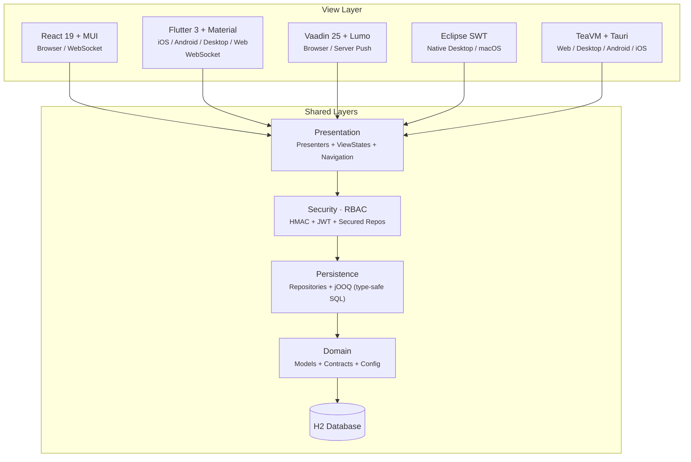
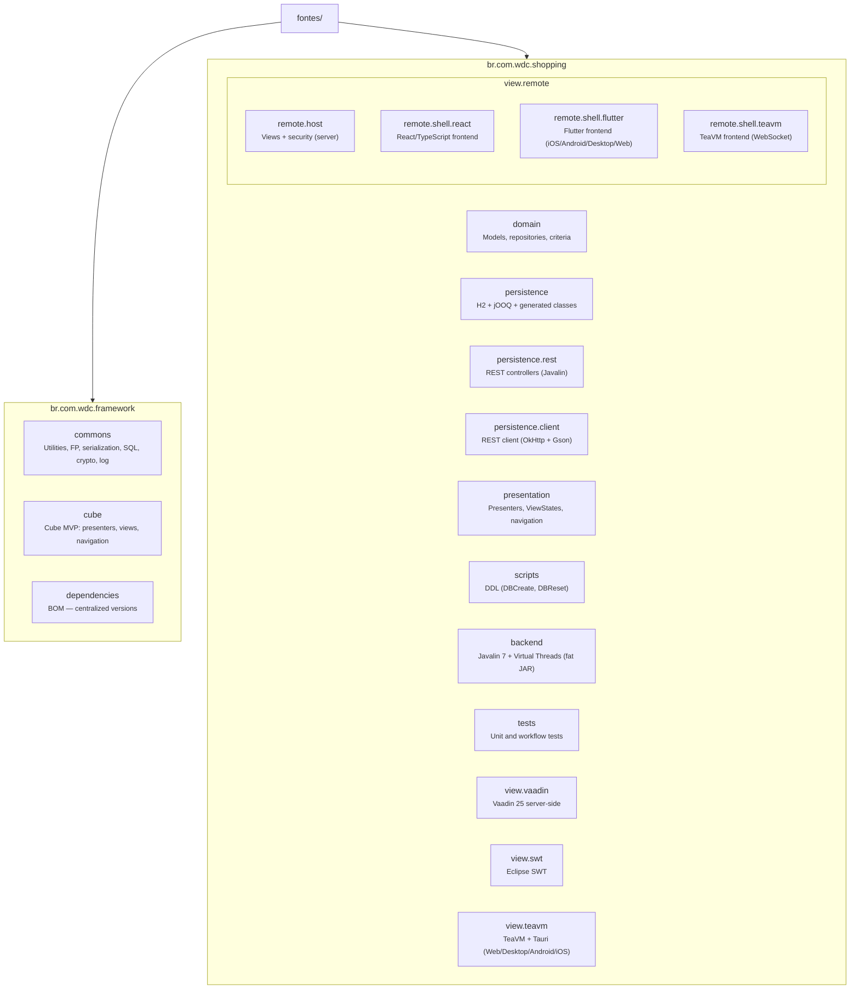
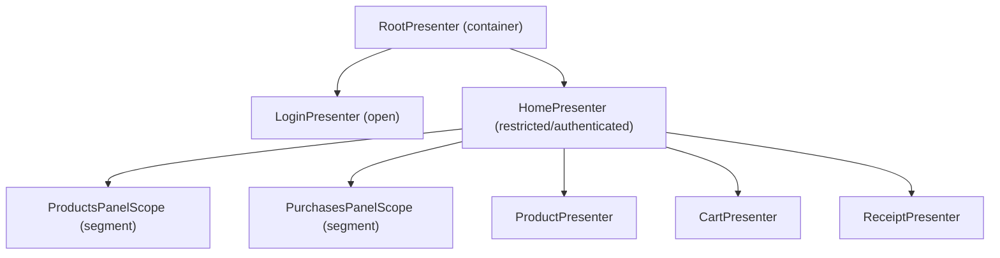

# WDC Cube Java v2

An architectural proposal for building applications with the **Cube MVP** pattern — a variation of Model-View-Presenter with hierarchical presenters, intent-based navigation and serialization of view state.

This project serves as an **architectural reference** for new projects, demonstrating the complete implementation of an e-commerce system (Shopping) with a Java backend and **five independent frontend implementations** — React (web/remote), Flutter (mobile/desktop/remote web), Vaadin (web/server-side), SWT (native desktop) and TeaVM (web/desktop/Android/iOS via Tauri) — proving that the view layer is fully decoupled from the presentation logic.

📄 [Cube MVP — Multiplatform Presentation Architecture in Java](docs/cube-mvp-multiplatform-architecture.md)  
📄 [Data Layer — Domain, Persistence and REST API](docs/data-layer.md)  
📄 [Remote Transaction — Client Identity and Transaction Ownership](docs/remote-transaction-identity-and-ownership.md)

## Architecture Overview



| Frontend | Technology | Transport | Module |
|----------|-----------|------------|--------|
| **Web (SPA)** | React 19 + TypeScript + MUI 9 | WebSocket (JSON delta) | `view.remote` |
| **Mobile/Desktop/Web** | Flutter 3 + Material Design | WebSocket (JSON delta) | `view.remote` |
| **Web (SSR)** | Vaadin 25 + Lumo | Server Push (Atmosphere) | `view.vaadin` |
| **Native Desktop** | Eclipse SWT 3.135.0 | Direct, in memory | `view.swt` |
| **Multiplatform (TeaVM)** | TeaVM 0.16 + Tauri 2 + Bootstrap 5 | REST (OkHttp → JS) | `view.teavm` |

**Key features:**

- **View independence** — the same Presenters/ViewStates feed React (web), Flutter (mobile/desktop/web), Vaadin (server-side web), SWT (native desktop) and TeaVM (web/desktop/Android/iOS)
- **No DI frameworks** — injection via `AtomicReference<T> BEAN` (static service locator); services receive their dependencies in the constructor
- **Virtual Threads** (Java 21+) — WebSocket connections with minimal memory consumption
- **RBAC security** — HMAC challenge-response authentication with JWT, role-based access control (ADMIN, CUSTOMER, MANAGER), repositories decorated with permission checks
- **Transport security** — RSA + PBKDF2 + AES-GCM for data exchange between the React client and the server
- **Real-time communication** — bidirectional WebSocket with automatic keep-alive
- **External configuration** — TOML for every implementation

## Module Structure



### Framework

| Module | Description |
|--------|-----------|
| **framework.commons** | Functional interfaces with checked exceptions (`ThrowingFunction`, `ThrowingConsumer`, etc.), extensible serialization, SQL abstractions (`SqlDataSource`), utilities (`CoerceUtils`, `DateUtil`, `Defer`), cryptography (`RSA`, `Base62`), multiplatform logging (`Log` — a lightweight facade with JUL and SLF4J backends), concurrency (`ScheduledExecutor`) |
| **framework.cube** | Engine of the Cube MVP pattern: `CubeApplication`, `CubePresenter`, `AbstractCubePresenter`, `CubeView`, `Scope`/`ScopeSlot`/`ScopeViews`, `CubePlace`, `CubeIntent`, `CubeNavigation` |
| **framework.domain** | Generic domain abstractions: `Repository`, `Page`, `ModelCodec`, `Criteria`/`Criterion`, `Projection*`, base exceptions (`BusinessException`, `AccessDeniedException`, ...), security contracts (`SecurityContext`, `AuthenticationService`, `PermissionModel`), `AppConfig`, `TransactionService` |
| **framework.jooq** | JSON query helpers over jOOQ (`JsonQuery`, `JsonQueryBuilder`, `JsonChildQueryBuilder`), `CriterionTranslator`, `TransactionAwareConnectionProvider` |
| **framework.persistence** | CMT-style transactions in dual JTA/JDBC mode (`TransactionServiceImpl`, `TransactionScope`), `RemoteTransactionCoordinator` SPI |
| **framework.cube.remote** | Remote protocol of the Cube MVP engine: WebSocket backend (`ScopeSerializer`, `RemoteViewImpl`) and client bridges (Java, TeaVM, React, Flutter) |
| **framework.dependencies** | BOM-type POM for centralized management of dependency versions |

### Shopping — Backend

| Module | Description |
|--------|-----------|
| **domain** | One package per entity (`product`, `user`, `purchase`, `purchaseitem`), each with the fluent entity, its `Criterion`-based criteria, codec and repository interface; `InvalidCartItemException`, `Role` (RBAC permissions), `ShoppingConfig`, `ShoppingTransactions` |
| **persistence** | Groups `persistence.impl` — **jOOQ** implementation (type-safe DSL, classes generated in `br.com.wdc.shopping.persistence.impl.scheme.*` from the H2 schema), `*RepositoryImpl` classes that obtain the `DSLContext` via `ShoppingDSLContext.BEAN`, the framework's JSON query helpers, `ShoppingRepositoryBootstrap` for wiring —, `persistence.rest` (Javalin API; authorization and the `userId` scope restriction via `SecurityEnforcer`) and `persistence.client` (HTTP repositories over OkHttp) |
| **presentation** | `ShoppingApplication` (subject, cart, `PLACES`), presenter hierarchy (Root → Open/Restricted guards → Login \| Home → Product/Cart/Receipt, with the Products/Purchases panels as segments of Home), scopes with observed `Prop`s, calls (`XxxQuery`/`XxxSave`/`XxxCall`) over the repositories, `CartManager`, places with `XxxKeys` and navigation by intents |

### Shopping — Frontend (View Implementations)

> **Core principle:** every implementation uses exactly the same Presenters, ViewStates and business rules. Only the rendering layer changes.

| Module | Description |
|--------|-----------|
| **view.remote** | Remote view via the browser — [details](fontes/br.com.wdc.shopping/br.com.wdc.shopping.view.remote/README.md) |
| **view.remote / remote.shell.react** | SPA in React 19 + TypeScript + MUI 9, bundled with Parcel. Bidirectional WebSocket communication, reconnection management, client-side security |
| **view.remote / remote.shell.flutter** | Flutter 3 + Material Design for iOS, Android, Desktop (macOS) and Web. Bidirectional WebSocket communication, same protocol as React — [details](fontes/br.com.wdc.shopping/br.com.wdc.shopping.view.remote/remote.shell.flutter/README.md) |
| **view.remote / remote.shell.teavm** | TeaVM frontend that communicates with the server over WebSocket |
| **backend** | Javalin 7 server with Virtual Threads, WebSocket dispatcher, REST controllers, embedded H2 database. Produces a fat JAR (~11 MB) |
| **view.remote / remote.host** | Server-side view implementations (`GenericViewImpl`), security (`AppSecurity` — RSA/PBKDF2/AES-GCM, `DataSecurity`), WebSocket SPI |
| **view.vaadin** | Server-side web view with Vaadin 25 + Lumo theme + embedded Jetty 12 — [details](fontes/br.com.wdc.shopping/br.com.wdc.shopping.view.vaadin/README.md) |
| **view.swt** | Native desktop view with Eclipse SWT 3.135.0 — [details](fontes/br.com.wdc.shopping/br.com.wdc.shopping.view.swt/README.md) |
| **view.teavm** | Multiplatform (Web + Desktop + Android + iOS) with TeaVM 0.16 + Tauri 2 + Bootstrap 5 — Java compiled to JS — [details](fontes/br.com.wdc.shopping/br.com.wdc.shopping.view.teavm/README.md) |
| **persistence.rest** | REST controllers (Javalin) that expose repositories as HTTP endpoints, JWT security filter (`SecurityFilter`), authentication endpoints (`AuthApiController`) |
| **persistence.client** | REST client (OkHttp + Gson) that implements the repository interfaces and `AuthenticationService` over HTTP, with an automatic Bearer token |

## Prerequisites

- **Java 25** (LTS)
  - **Temurin 25** or **Microsoft JDK 25** — recommended
- **Maven 3.9+**
- **Node.js 20+** and **npm** (for the React frontend)
- **Flutter 3.x** (for the Flutter frontend — mobile/desktop/web)

## Build

### Backend (Java)

```bash
export JAVA_HOME=<path-to-jdk-25>  # e.g. /Library/Java/JavaVirtualMachines/temurin-25.jdk/Contents/Home
export PATH="$JAVA_HOME/bin:$PATH"

cd fontes
mvn clean package
```

The fat JAR is generated at:
```
fontes/br.com.wdc.cube.backend/target/br.com.wdc.cube.backend-1.0.0.jar
```

### Web frontends (artifacts in `work/frontend/`)

Four frontends compile to static files that the backend serves from
`work/frontend/`. Each one has its own `build.sh`, in a different module; the script
below calls all four in the right order:

```bash
./work/bin/build-frontends.sh             # all
./work/bin/build-frontends.sh react       # a single target
./work/bin/build-frontends.sh --skip-install   # does not reinstall the Maven modules before TeaVM
./work/bin/build-frontends.sh --list      # targets and prerequisites
```

A target whose tool is not installed is **skipped** rather than failing the whole set —
without Flutter on the PATH, the other three are still generated.

> The two TeaVM targets compile against the JARs in `~/.m2`, not against the reactor. Without
> reinstalling the modules first, they **silently** generate an app with the previous version
> of the domain — which opens normally and fails only on the call that changed. That is why the script
> reinstalls by default; `--skip-install` is for when you know `~/.m2` is up to date.

| Target | Module | Tool | Destination |
|------|--------|-----------|---------|
| `react` | `view.remote/remote.shell.react` | Node 20+ / npm | `work/frontend/remote.shell.react` |
| `flutter` | `view.remote/remote.shell.flutter/flutter.web` | Flutter 3.x | `work/frontend/remote.shell.flutter` |
| `teavm.shell` | `view.remote/remote.shell.teavm` | Maven + `JAVA25_HOME` | `work/frontend/remote.shell.teavm` |
| `teavm.web` | `view.teavm/teavm.web` | Maven + `JAVA25_HOME` | `work/frontend/teavm.web` |

`work/frontend/api.docs` and `work/frontend/openapi` are static pages — they have no build.

For development, each module also has its own watch mode
(`npm run watch` in React, `watch.sh` in the two TeaVM modules and in `flutter.web`), which
recompiles without going through this script.

### Frontend (Flutter — mobile/desktop)

```bash
cd br.com.wdc.shopping/br.com.wdc.shopping.view.remote/remote.shell.flutter/flutter.mobile

# List available devices
./deploy.sh list

# Run on the iOS simulator (iPhone)
./deploy.sh run ios-sim

# Run on the Android emulator
./deploy.sh run android-emu
```

The deploy script supports the targets: `ios`, `ios-sim`, `ipad-sim`, `android`, `android-emu`, `android-tablet-emu`, `all`.

## Running

### React Version (Web)

```bash
# Via script
cd fontes/br.com.wdc.cube.backend
./start-server.sh [port]

# Or directly
java -jar target/br.com.wdc.cube.backend-1.0.0.jar [port]
```

- **Application:** http://localhost:8080
- **Health check:** http://localhost:8080/health
- **Default port:** 8080 (configurable via `work/config/application.toml`, a CLI argument or the `SERVER_PORT` variable)

### Flutter Version (Mobile / Desktop / Web)

Requires the Javalin backend running (same port 8080 — WebSocket):

```bash
cd br.com.wdc.shopping/br.com.wdc.shopping.view.remote/remote.shell.flutter/flutter.mobile

# iOS Simulator
./deploy.sh run ios-sim

# Android Emulator (auto-corrects localhost → 10.0.2.2)
./deploy.sh run android-emu

# macOS Desktop
cd ../flutter.desktop
flutter run

# Web (served by the backend at /remote.shell.flutter)
cd ../flutter.web
./build.sh
```

### Vaadin Version (Web — Server-Side)

```bash
export JAVA_HOME=<path-to-jdk-25>
export PATH="$JAVA_HOME/bin:$PATH"

cd br.com.wdc.shopping/br.com.wdc.shopping.view.vaadin
java -cp "$(mvn -q dependency:build-classpath -Dmdep.outputFile=/dev/stdout):target/classes" \
  br.com.wdc.shopping.view.vaadin.ShoppingVaadinMain
```

- **Application:** http://localhost:8090
- Entirely server-side UI — no custom JavaScript/TypeScript code

## Tests

```bash
cd fontes
mvn test
```

Test structure:

| Base class | Purpose |
|-------------|------------|
| `BaseBusinessTest` | Business logic and repository tests |
| `BasePresentationTest` | Full workflow tests with view mocks |

## Configuration

Both implementations use the `work/config/application.toml` file for external configuration:

```toml
[app]
# basedir = "work"

[database]
# url = "jdbc:h2:file:..."
# username = "sa"
# password = "sa"
# reset = false

[server]
# port = 8080    # Javalin only

[security]
# jwt.secret = "your-secret-key"   # enables JWT authentication on the REST API
```

Resolution: system property `shopping.config.file` → fallback to `work/config/application.toml`.

## Security (RBAC)

The system implements authentication and authorization in multiple layers:

### Authentication — HMAC Challenge-Response

```
Client                            Server
  │                                 │
  │──── GET /api/auth/challenge ───→│  Generates nonce with TTL
  │←─── { nonce, expiresAt } ──────│
  │                                 │
  │  passwordHash = MD5(password)   │
  │  digest = HMAC-SHA256(          │
  │    key=passwordHash,            │
  │    data=userName+nonce)         │
  │                                 │
  │──── POST /api/auth/login ─────→│  Validates digest + nonce
  │     { userName, digest, nonce } │  Creates session + JWT
  │←─── { accessToken,             │
  │       refreshToken,             │
  │       publicKey, expiresAt } ──│
  │                                 │
  │──── Bearer token on /api/repo/* │  SecurityFilter validates JWT
```

The password never travels in plain text — only the HMAC-SHA256 digest with a single-use nonce.

### Authorization — Roles and Permissions

| Role | Permissions |
|-------|-----------|
| **ADMIN** | `user:*`, `product:*`, `purchase:*`, `purchase-item:*`, `data:all` |
| **CUSTOMER** | `product:read`, `purchase:read/write`, `purchase-item:read/write` |
| **MANAGER** | `product:read/write`, `purchase:read`, `purchase-item:read` |

**Allow-wins** model: effective permission = union of all the user's roles.

### Security Layers

| Layer | Component | Responsibility |
|--------|-----------|-----------------|
| **HTTP** | `SecurityFilter` | Validates the Bearer JWT, populates `SecurityContext.CURRENT` |
| **Repository** | `*RepositoryImpl` (jOOQ) | Restricts the scope to the `userId` via criteria for non-admin users |
| **Presentation** | `SecurityContextDelegate` (proxy) | Propagates the `SecurityContext` to the current thread on each call |
| **Transport** | `AppSecurity` (React) | RSA + PBKDF2 + AES-GCM for sensitive data over WebSocket |

### Configuration

```toml
[security]
jwt.secret = "your-secret-key-here"
```

If `jwt.secret` is not configured, the API runs without authentication (development/local test mode).

## Cube MVP Pattern

Cube MVP organizes the application into a **presenter hierarchy** with **intent**-based navigation:



Each presenter has a serializable **Scope** that is sent to the frontend over WebSocket. The frontend renders based on the received state and sends events back to the corresponding presenter.

## Naming Conventions

| Type | Pattern | Example |
|------|--------|---------|
| jOOQ table (generated) | `En` + `Entity` | `EnProduct` / `EN_PRODUCT` |
| View State | `*Scope` | `ProductScope` |
| View Impl | `*ViewImpl` | `RootReactViewImpl` |
| Presenter | `*Presenter` | `CartPresenter` |
| Repository | `*RepositoryImpl` | `UserRepositoryImpl` |
| Criteria | `*Criteria` | `ProductCriteria` |
| Criteria applier | `Apply` + `Entity` + `Criteria` | `ApplyProductCriteria` |

## Main Dependencies

| Category | Technology | Version |
|-----------|-----------|--------|
| Language | Java (Temurin/Microsoft) | 21 |
| Build | Maven | 3.9+ |
| HTTP server | Javalin | 7.2.4 |
| Web UI (server-side) | Vaadin | 25.3.5 |
| Servlet Container | Jetty | 12 |
| Desktop UI (native) | Eclipse SWT (Cocoa macOS aarch64) | 3.135.0 |
| Mobile/Desktop/Web | Flutter + Dart | 3.x |
| Database | H2 | 2.5.252 |
| Data access | jOOQ | 3.21.9 |
| Serialization | Gson | 2.13.2 |
| Logging | SLF4J + Logback | 2.0.20 / 1.6.7 |
| Tests | JUnit | 4.13.2 |
| Frontend | React | 19 |
| UI Components | MUI | 9 |
| Bundler | Parcel | 2.13.3 |
| Language (frontend) | TypeScript | ES2024 |

## License

This project is distributed under the [MIT License](https://github.com/mrcdom/wdc-cube-java-v2/blob/main/LICENSE).

Copyright (c) 2026 Marcelo Domingos / WeDoCode Consultoria LTDA
