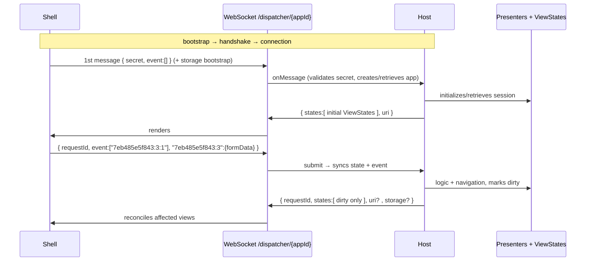

# Bridge/Skeleton Protocol Specification — Remote Presentation (Host/Shell)

> **Status:** normative. This is the source of truth for the protocol used by the *thin* clients (web browser, desktop applications, and mobile applications) that remotely access the presentation layer on the server.
>
> **Purpose of this document:** to capture every wire-level detail — identity, security, authority over ViewStates, page and site storage, connection lifecycle, refresh flow — so that the protocol can be faithfully reimplemented in **any** technology, on both client and server, on any platform.
>
> The specification is **independent of language and UI library**: it describes the wire contract and the observable behavior, not an implementation. Where it mentions platforms (browser, desktop, mobile), it is because the protocol was designed with the requirements of those platforms in mind. The reference implementations (host and client shells) live in this repository under the remote presentation modules; where this document diverges from them, **the implementations prevail** — report the divergence.

## Table of Contents

1. [Conceptual Model and Roles](#1-conceptual-model-and-roles)
2. [Terminology and Identifiers](#2-terminology-and-identifiers)
3. [Session Identity — the `appId`](#3-session-identity--the-appid)
4. [Server Cryptographic Material](#4-server-cryptographic-material)
5. [Entry Modes (Session Bootstrap)](#5-entry-modes-session-bootstrap)
6. [Security Handshake — Deriving the `secret`](#6-security-handshake--deriving-the-secret)
7. [WebSocket Channel — Lifecycle](#7-websocket-channel--lifecycle)
8. [Message Format — Client → Server](#8-message-format--client--server)
9. [Message Format — Server → Client](#9-message-format--server--client)
10. [Event Codes and Close Codes](#10-event-codes-and-close-codes)
11. [ViewState Serialization](#11-viewstate-serialization)
12. [Authority over ViewStates and View Garbage Collection](#12-authority-over-viewstates-and-view-garbage-collection)
13. [Navigation and URL Signing](#13-navigation-and-url-signing)
14. [Client Storage — Page and Site](#14-client-storage--page-and-site)
15. [Refresh (F5) Flow and Reconnection](#15-refresh-f5-flow-and-reconnection)
16. [Keep-Alive, Timeouts, Capacity, and Intervals](#16-keep-alive-timeouts-capacity-and-intervals)
17. [Cross-Platform Portability Notes](#17-cross-platform-portability-notes)
18. [Appendix — Literal Table of Constants](#18-appendix--literal-table-of-constants)

---

## 1. Conceptual Model and Roles

The protocol is analogous to a **Remote Desktop operating on the application's data layer** rather than on pixels. All logic — Presenters, ViewStates, business rules, navigation — lives in the **Host** (server). The **Shell** (client) is *thin*: it only renders serialized states and sends interaction events back.

| Role | Responsibility |
|---|---|
| **Host** | Holds the Presenter/ViewState tree, processes events, performs navigation, serializes state deltas, and is the **authority** over which views exist. |
| **Shell** | Establishes the session, performs the cryptographic handshake, renders ViewStates, emits user events, keeps local storage, reconnects after a drop. |
| **Bridge** | The code layer, on both sides, that speaks this protocol. On the client, a core reusable across UI platforms is desirable. |

**Fundamental invariants:**

- The Shell **never** contains business logic or navigation rules. It does not decide where to navigate; it **asks**, and the Host decides.
- Every renderable state is a **ViewState** identified by an `instanceId` (vsid). The Host sends only the *dirty* ViewStates (delta).
- The Host is the **only** authority over the existence and identity of views. The Shell never invents vsids.
- A special, fixed view, the **Browser View** (vsid `7b32e816a191:0`), is the root of the shell and the channel through which navigation, alerts, and keep-alive travel. (The name "Browser" designates the root view that "browses" between places; it does not refer to a web browser.)



---

## 2. Terminology and Identifiers

| Term | Definition |
|---|---|
| **`appId`** | Session identifier. Signed format `part1.part2` (see §3). Goes in the WebSocket path: `/dispatcher/{appId}`. |
| **`appSKey`** | The server's RSA public key for the handshake, as the string `"exponent:modulus"` in **base36**. |
| **`vsid` (View State ID / instanceId)** | Identity of a view instance. Format `"<classId>:<n>"`, e.g. `7eb485e5f843:3`, `7b32e816a191:0`. `n` is the instance number. |
| **`classId`** | Identity of the view's *class*: the `CLASS_ID` (a 12-digit hex string) declared by the scope class the view draws. It is `parts[0]` of the vsid. |
| **`secret`** | Session signature carrying the AES-GCM handshake material. Three-part format: `<rsa(pwd) base36>.<salt base64url>.<iv base64url>`. |
| **Browser View** | Singleton root view of the shell. `classId = 7b32e816a191`, fixed vsid `7b32e816a191:0`. |
| **`p.path`** | formData field carrying the route (the application's query path) in navigation events. |
| **`"#"`** | Reserved field inside each serialized ViewState object, whose value is that state's vsid. |

**vsid parsing rule inside an event:** an `event` item has the format `"<vsid>:<eventCode>"`. Since the `vsid` itself contains `:`, parsing uses the **last** `:` as the separator: everything before it is the vsid, the integer after it is the `eventCode`. E.g.: `"7b32e816a191:0:-1"` → vsid `7b32e816a191:0`, eventCode `-1`.

---

## 3. Session Identity — the `appId`

The `appId` is self-verifying (it contains a signed checksum), so the server detects forgery without consulting any storage.

**Formation (server):**

```
part1 = base62( 32 random bytes from a cryptographic generator )
part2 = base62( signAsHash( utf8_bytes(part1) ) )
appId = part1 + "." + part2
```

Where `signAsHash(bytes)` = `MD5( RSA-SHA256-signature( bytes, privateSigningKey ) )` — the signature is reduced by MD5 to a short hash (see §4).

**Validation (server, in the WebSocket `onConnect`):**

1. The path's `appId` must be non-empty.
2. Split on `.` (Base62 codec) → must yield **exactly 2** parts; otherwise → close with code `4001 reload_required`.
3. Recompute `expected = base62(signAsHash(utf8_bytes(part1)))` and compare it with `part2`. Mismatch → `4001 reload_required`.

This prevents a client from forging an arbitrary `appId`: without the server's private signing key, it is impossible to produce a valid `part2` for a chosen `part1`.

---

## 4. Server Cryptographic Material

The server keeps **two distinct RSA key pairs**, with separate purposes. Both are generated on first boot (512 bits in the development defaults) and persisted in a local configuration; **they must be replaced in production**.

| Pair | Format | Use |
|---|---|---|
| **Handshake RSA** | `"exponent:modulus"` in **base36** | The client encrypts the ephemeral AES password with the **public** key; the server decrypts it with the **private** key. *Textbook* RSA via modular exponentiation (`m^e mod n`), **without** OAEP/PKCS#1 padding. |
| **Signing RSA** | **URL-safe Base64** DER (X.509 *SubjectPublicKeyInfo* for the public key, PKCS#8 for the private key) | Signing/verifying the `appId` (part2) and the URL fragment (navigation). |

Signing constants:
- Algorithm: **RSA over SHA-256** signature (RSASSA-PKCS1-v1_5).
- `sign(bytes)` → raw RSA signature.
- `signAsHash(bytes)` → `MD5( RSA-SHA256-signature(bytes) )` — short hash used for `appId.part2` and for the URL fragment signature.
- `isSignatureValid(bytes, sig)` → verification with the public signing key.

The **public handshake key** (`appSKey` = `"exponent:modulus"` base36) is delivered to the client (via the `app_skey` cookie or the `appSKey` field of the init endpoint) so it can encrypt the AES password during the handshake.

---

## 5. Entry Modes (Session Bootstrap)

There are **two modes** for obtaining `appId` + `appSKey`. Both converge on the same WebSocket protocol. A client must support at least one of them.

### 5.1 Browser Mode (Cookies Planted by the Page)

For clients that load an HTML page served by the Host. Before serving `/{ctx}/index.html`, the server (`before` handler) plants cookies:

| Cookie | Value | MaxAge | Notes |
|---|---|---|---|
| `app_id` | `appId` (§3) | `10` (seconds) | Session identity, short-lived. |
| `app_skey` | `appSKey` (`"exponent:modulus"` base36) | `-1` (session cookie) | Public handshake key. |

Anti-cache headers: `Cache-Control: no-cache, no-store`, `Pragma: no-cache`, `Expires: 0`.

The cookie's `Secure` attribute is only set when the request is HTTPS (header `X-Forwarded-Proto == "https"` behind a proxy, or the `https` scheme). **Platform requirement:** over plain HTTP, browsers (e.g. Firefox) reject `Secure` cookies, which would throw the session into a `4001`/reload loop (without `app_id`, the WebSocket handshake does not validate). That is why `Secure` is conditional on the actual transport being HTTPS.

The client reads the cookies, **removes them** (path `/`), and writes back the `app_signature` cookie (the handshake signature — §6) so that it accompanies the WebSocket handshake (the WS connection is opened with credentials/cookies sending enabled).

### 5.2 Explicit Init Mode (`GET /api/session/init`)

For clients that have no page cookies (typically desktop and mobile applications). Endpoint:

```
GET /api/session/init          (and also GET /{ctx}/api/session/init)
```

Identical anti-cache headers. Responses:

- **Capacity reached:** HTTP `503` with body `{"error":"capacity_exceeded"}`.
- **OK:** HTTP `200`, `Content-Type: application/json`, body:

```json
{ "appId": "<appId>", "appSKey": "<exponent:modulus in base36>" }
```

No cookie or authentication header is required for this call. The client then opens the WebSocket and sends the `secret` in the **first message** (see §6/§8), since there is no `app_signature` cookie.

---

## 6. Security Handshake — Deriving the `secret`

The handshake establishes a session AES-256-GCM key. It runs **entirely on the client**; the server rebuilds the same key from the `secret`.

### 6.1 Client Steps

1. **Ephemeral password:** 12 random bytes → **URL-safe Base64 without padding** → string `pwd`.
2. **Salt:** 16 random bytes. **IV:** 12 random bytes (GCM nonce).
3. **AES-256 key derivation:**
   ```
   aesKey = PBKDF2( PRF=HMAC-SHA256, password=utf8_bytes(pwd), salt=salt,
                    iterations=250000, length=256 bits )
   ```
   > Note: the PBKDF2 input is the sequence of **UTF-8 bytes** of the string `pwd` (which is base64url ASCII). Implementations that derive from characters must ensure the equivalent encoding.
4. **RSA encryption of the password** (*textbook* RSA):
   ```
   m           = positive integer from  utf8_bytes( standard_Base64( utf8_bytes(pwd) ) )
   encrypted   = m ^ publicExponent  mod  publicModulus
   encBase36   = base36(encrypted)
   ```
   That is, the password is **re-encoded in standard Base64** (with padding), turned into UTF-8 bytes, interpreted as a positive integer, and encrypted by modular exponentiation. The result is in **base36**.
5. **Assembling the `secret`:**
   ```
   secret = encBase36 + "." + base64url_noPad(salt) + "." + base64url_noPad(iv)
   ```

This string is the `app_signature` cookie (browser mode) **and/or** the `secret` field of the first WebSocket message (both modes).

### 6.2 Server Reconstruction

On receiving the `secret`, the server splits it on `.`:
1. `part0` (base36) → integer → RSA decryption (with the private handshake key) → bytes → Base64 decoding → password bytes.
2. `part1` → salt (URL-safe Base64).
3. `part2` → IV (URL-safe Base64).

It derives the same `aesKey` via PBKDF2-HMAC-SHA256, 250000 iterations, 256 bits.

### 6.3 Symmetric Payload Encryption (AES-GCM)

After the handshake, sensitive protocol values (storage values and `accessToken`) travel encrypted:

- Transform: **AES-256-GCM**, **128-bit authentication tag**.
- **IV fixed per security session** (the handshake IV is reused in every operation of the session — there is no per-message IV in the protocol payload).
- Wire encoding: **standard Base64** (with padding). Conceptual functions: `b64Cipher(text)` / `b64Decipher(b64)`.

> **Portability warning:** the IV is constant per session. Reusing `(key, IV)` in GCM for multiple distinct plaintexts is a known weakness of GCM mode; the design accepts it because the primary confidentiality comes from the transport (TLS). A reimplementation **must** replicate the behavior (same IV) to interoperate, but should ideally always run over `wss://`/HTTPS.

### 6.4 Cryptography in the Browser (Secure Context)

**Platform requirement (browser):** browsers' native cryptography API is usually only available in a **secure context** (HTTPS or `localhost`). Over plain HTTP, the client must provide its own implementation of the primitives (PBKDF2-SHA256 250k → AES-256-GCM tag 128), with **identical** parameters, to remain interoperable with the server. Outside the browser (desktop/mobile apps), the platform's own cryptographic library is used.

---

## 7. WebSocket Channel — Lifecycle

### 7.1 Endpoint

```
ws(s)://<host>/dispatcher/{appId}          (and /{ctx}/dispatcher/{appId})
```

- The scheme derives from the originating transport: `http→ws`, `https→wss`.
- The `appId` travels **only in the path**. No custom header/cookie is mandatory besides the `app_signature` cookie (browser mode).
- **Subprotocol:** the client may open with the `"wdc"` subprotocol; the server does not require it. Recommended, not mandatory.
- In browser mode, the connection is opened with credentials/cookies sending enabled, so that the `app_signature` cookie accompanies the handshake.

### 7.2 Server Side — Behavior

The server keeps a map of active handlers per `appId`. Each handler holds `appId`, `appSignature`, pending signature/token flags, the current connection, and that connection's internal identifier.

- **onConnect:**
  1. Finds or creates the session handler.
  2. Validates the `appId` (non-empty, matches the path, signature checksum — §3). Failure → close with `4001 reload_required`.
  3. Reads the `app_signature` cookie: if present → stores it as `appSignature`; if absent → marks the signature as **pending** (validation is deferred to the 1st message, `secret` field).
  4. Enables automatic pings every 15 s.
  5. Registers the connection as active. If the session's application already exists → reattaches the connection and **reinitializes the session for reconnection** (§15).

- **onMessage:** parses the JSON. If the signature is pending, extracts `secret` (mandatory; absent → close `4001`) and `accessToken` (optional). Creates/retrieves the session's application (injecting `secret`/`accessToken` on creation), reattaches the connection, extends the session's life, and processes the request (§8).

- **onClose:** disables pings. If the closing connection is **not** the active one (the typical F5 case, in which a new connection replaced the old one), the close is **ignored**, so as not to bring down the freshly reconnected session. Otherwise, it detaches the connection; if the session is **not** authenticated **or** the server is in immediate-release mode → releases the session. Removes the handler.

- **onError:** a closed-channel error (abrupt disconnection) is routine and only logged; other errors produce a warning and an unexpected-error alert to the session.

### 7.3 Client Side — State Machine

Phases:

1. **Bootstrap** — obtains `appId` + `appSKey` (§5).
2. **Handshake** — derives `secret` (§6).
3. **Connecting** — opens the WebSocket.
4. **Connected** — sends the 1st message, receives the initial push, operates.
5. **Reconnecting** — on a drop, applies backoff and reconnects (§15).

A reusable client core must offer, at a minimum: waiting for the next message, or waiting for the response correlated with a specific `requestId` — discarding intermediate messages (whose ViewStates **have already been applied** to the local state before enqueueing, which makes discarding safe). Recommended response and connection timeout: **10 seconds**.

---

## 8. Message Format — Client → Server

Every message is **one JSON object**. Recognized fields (all optional, combinable):

| Field | Type | Meaning |
|---|---|---|
| `ping` | `boolean` | Keep-alive. If `true`, the server extends the session's life and answers the ping (§9.2); it does **not** process events. |
| `secret` | `string` | Handshake signature (§6). Mandatory in the 1st message when there is no `app_signature` cookie. Also used to update the secret. |
| `accessToken` | `string` | (Optional) auto-login token for clients without cookies. |
| `requestId` | 64-bit integer | Monotonically increasing id. Requests with `requestId <= lastRequestId` or null are **discarded** (idempotency/dedup). |
| `event` | `string[]` | List of events, each item `"<vsid>:<eventCode>"`. Repeated items are counted. |
| `"<vsid>"` | `object` | For each vsid present as a top-level key, the value is that view's **formData** (client→server synchronization). |
| `storage` | `object` | Client storage bootstrap (§14), with `session` / `persistent` / `persistent-secure` sub-objects. |

**formData convention:** presenter method parameter fields are prefixed with `p.` (e.g. `p.path`, `p.productId`, `p.password`); direct fields carry no prefix. Sensitive parameters (e.g. `p.password`) may be encrypted with `b64Cipher` before sending; the server decrypts them.

### 8.1 Examples

**First message (explicit init mode) — triggers the initial push:**
```json
{ "secret": "3f9x...z.AbC-.Xy12", "event": [] }
```
Optionally with a bootstrap `storage`.

**Start / initial route (event `-1` on the Browser View):**
```json
{
  "requestId": 1,
  "event": ["7b32e816a191:0:-1"],
  "7b32e816a191:0": { "p.path": "product?pr-id=42&sign=AbC123" }
}
```

**History navigation (event `-2`):** identical to the previous one with the eventCode changed to `-2`.

**View event submit (e.g. changing the quantity of a cart row, eventCode `2` on a `CartItemScope` view, classId `c8a1f0e2b7d4`):**
```json
{
  "requestId": 7,
  "event": ["c8a1f0e2b7d4:5:2"],
  "c8a1f0e2b7d4:5": { "p.quantity": 2 }
}
```

An event with no parameter (e.g. the cart's checkout, eventCode `1` on the `CartScope` view, classId `7eb485e5f843`) carries only the `event` item: `{ "requestId": 8, "event": ["7eb485e5f843:3:1"] }`.

**Keep-alive:**
```json
{ "ping": true }
```

---

## 9. Message Format — Server → Client

### 9.1 Response / State Push Envelope

A JSON object. Fields (all optional). The envelope is **not sent** if it is empty (`{}`).

| Field | Type | Meaning |
|---|---|---|
| `requestId` | 64-bit integer | Echoed when the response corresponds to a request. **Absent** in background flushes (asynchronous push). |
| `storage` | `object` | Client storage delta (§14). Per scope → per key → encrypted value (`b64Cipher`) or `null` (removal). |
| `uri` | `string` | Current navigation fragment/hash (with the `sign` parameter). Sent when navigation happened or the fragment changed. |
| `states` | `object[]` | Array of serialized *dirty* ViewStates. Each object has `"#"` = vsid (§11). |

**Example:**
```json
{
  "requestId": 7,
  "uri": "cart?sign=AbC123",
  "states": [
    { "#": "7eb485e5f843:3",
      "rowsViewIds": [ "c8a1f0e2b7d4:5" ],
      "total": 99.8,
      "errorCode": 0 },
    { "#": "c8a1f0e2b7d4:5",
      "id": 1, "name": "Product A", "price": 49.9, "quantity": 2 }
  ],
  "storage": { "persistent": { "authToken": "k8s2...==" } }
}
```

Notes:
- Before serializing the states, the server consolidates the derived state of all presenters once (`commitComputedState`), under a lock.
- A view born while another's state is being written (the scope of a child presenter, a segment, a row, requested for the first time) goes in the **same** response: the already-written state references it.
- Error fields (`errorCode`, `errorMessage`) live **inside** the fields of each ViewState, not in the envelope.
- `accessToken` may also appear in the server→client flow (AES-GCM-encrypted token) as an auto-login mechanism; the client decrypts it with `b64Decipher`.

### 9.2 Ping/Control Envelope

Sent in response to `{ ping: true }`. Conditional fields:

| Field | Type | Meaning |
|---|---|---|
| `releasedViews` | `string[]` | vsids of views released since the last send (*eager* GC on the client). |
| `activeViews` | `string[]` | Snapshot of **all** live views. Sent periodically (every ~5 min) for reconciliation/full GC on the client. |

---

## 10. Event Codes and Close Codes

### 10.1 Browser View Event Codes (`classId 7b32e816a191`)

| eventCode | Method | Semantics |
|---|---|---|
| `-1` | `onStart(path)` | Boot / initial route. Reads `p.path`, navigates, and resends all views. |
| `-2` | `onHistoryChanged(path)` | History/hash change (back/forward). Reads `p.path`, navigates. |
| `1` | `onAlertOk()` | Confirms/dismisses the current alert. |
| `2` | `onKeepAlive()` | Extends the session's life. (Alternative to the `{ping:true}` message.) |

Events of regular views use codes `>= 0` defined by each view. Negative eventCodes are reserved for the protocol. On the server, each code is that of the action the presenter bound on the scope (`action(1, ...)`, `actionOf(2, FormParam..., ...)`); a code the scope does not know is an error.

### 10.2 Alerts (Browser View Fields)

The Browser View state may carry a server-commanded alert:
- `alertId`: alert code; `-1` = unexpected error; `0` = none (after OK).
- `alertArgs`: `string[]` of arguments (for the unexpected error: only the message — the stack trace stays in the server log).

With `alertId != 0`, the client shows the alert and, when it is dismissed, fires event `1` (`onAlertOk`) on the Browser View.

### 10.3 WebSocket Close Codes

They use the range reserved for applications (`4000–4999`):

| Code | Reason | Expected client action |
|---|---|---|
| `4001` | `reload_required` | Invalid/forged `appId`, missing/bad signature, or 1st message without `secret`. The client **must** discard the persisted `appId` and reload/restart to obtain a new `appId`. |
| `4003` | `capacity_exceeded` | Server at its session limit. Equivalent to the init endpoint's HTTP `503 {"error":"capacity_exceeded"}`. |

---

## 11. ViewState Serialization

The ViewState is a view's public state, transmitted as a JSON object. The **observable contract** is:

- The object injects `"#"` as its **first** field, value = `instanceId` (vsid).
- Boolean fields are **always** present (even when `false`).
- `null` (non-boolean) fields are **omitted**.
- A field whose value is **another scope** (that of a child presenter, a segment) is serialized as `"<name>ViewId": <vsid of the view that draws it>`; a list of scopes (rows), as `"<name>ViewIds": [vsid, ...]`, in order. This is how references between views become pointers by id. E.g.: `contentViewId`, `productsPanelViewId`, `rowsViewIds`.
- Actions (`Action`, `ActionOf`, `ActionOf2`) do not appear on the wire: the client fires them by event code.
- Top-level strings are included **only if they are not empty/blank** (blank strings are omitted at this level).
- Numeric fields are always included.
- Dates are serialized in **ISO-8601**: date (`YYYY-MM-DD`), time (`HH:MM:SS[.sss]`), or date-time with an offset in **UTC**, depending on the type.
- Nested values (inside objects and arrays): objects → JSON object; lists → JSON array; scalars → direct values; nested strings are **not** filtered for emptiness.
- Fields marked as non-serializable or derived/transient do **not** appear on the wire.

**instanceId formation:** `"<classId>:<n>"`, where `classId` is the `CLASS_ID` declared by the scope's class. The Browser View is fixed at `7b32e816a191:0`. Other views use an incremental counter starting at `1`.

**Client-side application semantics:** each object in `states` **fully replaces** the previous ViewState of that vsid (total replace, not field-by-field merge). The client indexes by vsid; the `"#"` field is removed and the rest becomes the view's state.

---

## 12. Authority over ViewStates and View Garbage Collection

The **server is the authority** over which views exist. The client never creates vsids.

**On the server:**
- A `vsid → view` map is the authoritative list. Every view is registered when created.
- **Input validation:** when processing formData/events, the server only accepts vsids that exist in that map. An unknown vsid:
  - in state synchronization: is ignored;
  - in an event: the server resynchronizes **all** views at the end of the dispatch, to correct the out-of-sync client. This neutralizes forgery attempts.
- **Dirty tracking:** marking a view as dirty enqueues it for flushing (immediately while processing a submit; otherwise in the background flush every ~50 ms).
- **Delta collection:** the server atomically takes the dirty views to serialize into `states`.
- **Release:** when a view is removed, its vsid is enqueued and sent as `releasedViews` in the next ping response.

**On the client (view garbage collector):**
- Keeps the set of currently **mounted** views (rendered in the UI tree).
- `release(releasedViews)` — **eager GC (~15 s)**: removes from the local map each vsid released by the server that is **not** mounted.
- `sweep(activeViews)` — **full sweep (~5 min)**: removes from the local map every vsid that is **not** in `activeViews` **and** is not mounted.
- General rule: the client only removes a view if (1) it is not on the server's list **and** (2) it is not mounted. The Browser View is never removed.

---

## 13. Navigation and URL Signing

Navigation is **server-driven** and the URL is **signed** to prevent the client from forcing states it was not granted.

**Emission (server → client):** when updating the history, the server builds the intent (place + parameters), computes `sign = base62(signAsHash(utf8_bytes(intent.toString())))`, injects the `sign=<...>` parameter into the intent, and sends the result in the `uri` field. The address is the name of the deepest place plus its query string (`CubeIntent.toString()`), e.g. `product?pr-id=42&sign=AbC123`.

**Reception (client → server):** the client navigates by sending `p.path` (the URI with `sign`) via events `-1`/`-2` on the Browser View. The server:
1. Parses the path and **removes** the `sign` parameter (the received signature).
2. Recomputes `expected = base62(signAsHash(utf8_bytes(intent.toString())))`.
3. If the received signature ≠ expected → the URL was tampered with: the client's intent is **discarded** and the server navigates to its current state instead (the last place with the parameters the presenters publish; the root place when there is none), forcing a history update. This way, the client cannot forge navigation to arbitrary unsigned parameters/places.

**Reflection in the history (browser):** the `uri` field is applied to the browser history as a hash (`#`): *replace* on the first URI response and on navigation coming from back/forward; *push* in all other cases. The shell derives the initial route from the URL hash at boot.

---

## 14. Client Storage — Page and Site

This is the most subtle point of the specification. The model has **two scopes**, each with a **secure variant**, resulting in **three scopes on the wire**:

| Wire scope | Conceptual name | Lifetime | Backing (browser) | Backing (desktop/mobile, suggested) |
|---|---|---|---|---|
| `session` | **Page storage** | Survives F5; does **not** survive closing the tab. | browser session storage | per-session memory |
| `persistent` | **Site storage** | Survives reload and closing the tab/app (per origin/installation). | browser local storage | per-app file/preferences |
| `persistent-secure` | **Site storage (secure)** | Same as `persistent`. | browser local storage, encrypted at rest with a dedicated key | the platform's secret vault (e.g. Keychain on macOS/iOS, KeyStore on Android) |

**Invariant rules:**

1. **Every value traveling over the WebSocket is encrypted** with the session AES-GCM key (`b64Cipher`), **regardless of scope**. The `secure` variant does **not** change in-transit encryption — it is only a **hint** for the client to use a better-protected backing store **at rest**.
2. In the browser, a `persistent-secure` value ends up encrypted **twice** with different keys: at rest (dedicated local storage key) and in transit (PBKDF2-derived session key). They are orthogonal. At-rest encryption is a client detail, outside the wire contract.
3. There is no `session-secure` in the protocol — only `session`, `persistent`, `persistent-secure`.

**Isolation (synchronization namespace):** every key is prefixed by a `syncNamespace` in the format `~<shellId>:` (e.g. `~rr:`). The `~` marks the key as synchronizable; `<shellId>:` isolates one shell's data from the others in the same origin/installation. The prefix is **removed** when building the map sent in the bootstrap, and only keys with that prefix go into the bootstrap.

**Bootstrap (client → server):** in the first message, the client collects all keys of each scope, **encrypts each value** with `b64Cipher`, and builds:
```json
"storage": {
  "session":            { "key": "<encrypted value>" },
  "persistent":         { "key": "<encrypted value>" },
  "persistent-secure":  { "key": "<encrypted value>" }
}
```
Empty scopes are omitted; if everything is empty (or there is no `secret`), the `storage` field is omitted. Purpose: to allow the server to **restore the user's session** (e.g. auto-login via a persistent token).

> Server note: when loading the bootstrap, the `persistent` and `persistent-secure` scopes are both read into the **same** in-memory persistent storage on the server (asymmetry: on write/delta they are kept separate). Tampered values that fail to decrypt are silently ignored.

**Delta (server → client):** in any response, the server may command a write/removal:
```json
"storage": {
  "persistent": { "authToken": "<encrypted value>", "oldKey": null }
}
```
For each entry: non-empty string value → the client **decrypts** it (`b64Decipher`) and stores it; `null`/empty value → the client **removes** the key. This way the server controls writing and removal in any of the three scopes.

**In non-browser clients:** the `session` scope is browser-specific; a desktop/mobile client typically handles only `persistent` (per-app local storage) and `persistent-secure` (the platform's secret vault) in the bootstrap/delta.

---

## 15. Refresh (F5) Flow and Reconnection

The goal is that, for the user, an F5 (or a reconnection) is imperceptible: same session, same state.

### 15.1 What the Client Preserves Locally

| Item | Where (browser) | Why |
|---|---|---|
| `appId` | browser session storage (key `app_id`) | Survives F5 → allows reusing the **same session** on the server. |
| request counter | browser session storage (key `req_seq`) | Avoids `requestId` collisions after a reload. |
| session/persistent/secure storage | browser local storages | Reread by the client itself; resent encrypted to the server in the bootstrap. |

### 15.2 Sequence (Browser Mode)

1. The page reloads; the client is rebuilt.
2. **Retrieves `appId`:** reads the `app_id` cookie (if the server planted a new one) and removes it; then **prioritizes** the value in session storage. Since that storage survives F5, the **same `appId`** is reused. If there is neither a cookie nor a persisted value, it generates a local id marked as "fake".
3. **Retrieves the request counter** → restores the `requestId` sequence.
4. **Security:** if a new `app_skey` arrived, it redoes the handshake (new AES password, new `app_signature`). The secure storage is decrypted again using the at-rest encryption key persisted locally (which survives F5).
5. **Reconnects the WebSocket** to `/dispatcher/{appId}`; on open, resends `secret` + bootstrap `storage` and flushes pending requests.
6. **Restores the route:** derives the `path` from the URL hash and submits `p.path` with event `-1`. The server responds with `uri` (applied as a *replace* in the history).

### 15.3 Sequence (Server Side)

1. The server finds/creates the handler. The **application** (Presenters/ViewStates) persists in the session registry as long as it has not expired.
2. If the session's application is still alive: it reattaches the new connection and **reinitializes the session for reconnection**:
   - forces resending the `uri` (clears the last sent fragment);
   - marks the history as dirty;
   - clears the `releasedViews` queue;
   - marks **all** views as dirty → the next flush resends the **full state**.
3. **Old (superseded) connection:** the previous connection's `onClose` is ignored if it is no longer the active one, avoiding bringing down the freshly reconnected session.
4. **If the session expired** (removed by TTL without a connection): the application is **recreated** on the first message from `secret` + `storage` (bootstrap) + `event -1` (`p.path`), reconstituting the state. If the server is full → `4003 capacity_exceeded`.
5. **Dedup:** the per-session `lastRequestId` discards requests with an id `<=` the one already processed. In a recreated session, it restarts at `-1`.

### 15.4 Reconnection Backoff (Client)

When the connection drops (error/close ≠ 4001):
- `delay = min(2000 * attemptNumber, 120000)` ms (2 s per attempt, capped at 120 s).
- A 1 s timer runs a visible countdown; on reaching `0`, it tries to reconnect; if the connection comes back, it resets the counter.
- The user may force "try now" (immediate attempt).

### 15.5 Anti-Loop Guard

On receiving close `4001 reload_required`, the client **removes** the persisted `appId` and reloads — so the next boot obtains/generates a new `appId` instead of reusing the invalid one, avoiding a reload loop.

### 15.6 Reconnection in Non-Browser Clients

A minimal client core may not implement automatic reconnection — in that case, it exposes a hook to clear the ViewState map and leaves the reconnection policy to each shell. A desktop/mobile shell that wants parity with the browser must: persist the `appId` and the request counter, and on reconnecting redo `init → handshake → WS → bootstrap(storage) → event -1`. Alternatively, it rebuilds the session from scratch via a new init.

---

## 16. Keep-Alive, Timeouts, Capacity, and Intervals

| Parameter | Value | Side |
|---|---|---|
| Automatic WS pings | 15 s | server |
| Application keep-alive | 15 s (`{ping:true}` message; 80 ms debounce) | client |
| Background flush (dirty views) | 50 ms | server |
| Expiration check | 30 s | server |
| `activeViews` send (sweep) | 5 min | server |
| Session TTL (default) | 3 min | server |
| Eager view GC (via `releasedViews`) | ~15 s | client |
| Response timeout | 10 s | client |
| WS connection timeout | 10 s | client |
| "submitting" spinner | appears after 200 ms, disappears after ≤15 s | client |
| Reconnection backoff | `min(2000·n, 120000)` ms | client |

**Configurable TTL (server):**
- TTL `= 0` → **immediate** release on disconnection.
- TTL `> 0` → keeps the session alive for N seconds after the drop, waiting for reconnection.
- default → 3 min.

**Capacity:**
- Configurable maximum number of sessions (`-1` = unlimited). On reaching the limit: the init endpoint responds HTTP `503 {"error":"capacity_exceeded"}`; the WebSocket closes with `4003`.

**Release on disconnection:** if the session is **not** authenticated **or** the server is in immediate-release mode, it is released right away. If authenticated and with a TTL, it stays cached waiting for reconnection until it expires without a connection.

---

## 17. Cross-Platform Portability Notes

This protocol was designed for multiple client platforms: **web browser, desktop, and mobile**. To reimplement it in any technology (client or server), respect the following:

**What is immutable (the wire contract):**
- `appId` formation and validation (§3).
- `secret` format = `<rsa(pwd) base36>.<salt b64url>.<iv b64url>` (§6).
- Cryptographic primitives: *textbook* RSA via modular exponentiation with the public key `"exponent:modulus"` base36; PBKDF2-HMAC-SHA256, **250000 iterations**, **256-bit** output; AES-256-GCM, **128-bit tag**, **IV fixed per session** in the protocol payload; Base64 encodings (standard for payload, URL-safe without padding for salt/IV).
- WebSocket path `/dispatcher/{appId}` and (optional) `wdc` subprotocol.
- Message fields in both directions (§8, §9), including `"#"` in the ViewState and `"<vsid>:<eventCode>"` in `event`, parsed on the **last** `:`.
- Reserved event codes (`-1`, `-2`, `1`, `2`) and close codes (`4001`, `4003`).
- Three storage scopes (`session`, `persistent`, `persistent-secure`), with in-transit encryption for **all** of them and `secure` as an at-rest hint.
- URL fragment signature (`sign`) — the client must **never** try to navigate to unsigned paths; it only echoes the `p.path` it received.

**What is free per platform:**
- How to obtain `appId`/`appSKey`: cookies (browser mode) **or** the init endpoint (explicit mode). A desktop/mobile client typically uses the **explicit init mode**.
- Backing of the storage scopes: on desktop/mobile, `session` = memory; `persistent` = file/preferences; `persistent-secure` = the platform's secret vault (Keychain on macOS/iOS, KeyStore on Android, an equivalent secret store on desktop).
- Reconnection: implement backoff and `appId` reuse (parity with the browser) **or** recreate the session via a new init.
- Rendering: the view reads the ViewState (indexed by vsid) and emits events via `submit(vsid, eventCode, formData)`; the UI technology is irrelevant to the protocol.

**Platform requirements to observe:**
- **Browser:** native cryptography usually requires a secure context (HTTPS/localhost); over plain HTTP, an own implementation of the primitives is needed, with identical parameters. `Secure` cookies only work over HTTPS. Route reflection uses the URL hash (`#`).
- **Desktop/mobile:** with no page cookies, use the init endpoint; use the platform's secret vault for `persistent-secure`; persist `appId`/request counter for transparent reconnection.

**Known pitfalls:**
- The payload IV is **fixed per session** — replicate this to interoperate, but require `wss://`/HTTPS in production.
- PBKDF2 receives the password as the UTF-8 bytes of the base64url string (not the 12 raw bytes).
- The password is RSA-encrypted **after** being re-wrapped in standard Base64 (not the raw password bytes).
- `event` parsing uses the **last** `:` (the vsid contains `:`).
- The client-side ViewState is a **total replace** per vsid, not a merge.
- The client is subordinate: it never invents vsids, never navigates without `sign`, and only garbage-collects views the server no longer lists **and** that are not mounted.

---

## 18. Appendix — Literal Table of Constants

| Constant | Value |
|---|---|
| Browser View classId | `7b32e816a191` |
| Browser View vsid | `7b32e816a191:0` |
| vsid field in the ViewState | `#` |
| Route field in the formData | `p.path` |
| Method parameter prefix | `p.` |
| Init endpoint | `GET /api/session/init` → `{appId, appSKey}` |
| WebSocket endpoint | `ws(s)://host/dispatcher/{appId}` |
| WS subprotocol | `wdc` (optional) |
| Cookies (browser mode) | `app_id` (MaxAge 10s), `app_skey` (MaxAge -1), `app_signature` (written by the client) |
| Keys persisted on the client (browser) | `app_id`, `req_seq` (in session storage) |
| Storage scopes on the wire | `session`, `persistent`, `persistent-secure` |
| Storage namespace prefix | `~<shellId>:` (e.g. `~rr:`) |
| Reserved eventCodes | `-1` start, `-2` historyChanged, `1` alertOk, `2` keepAlive |
| Close codes | `4001 reload_required`, `4003 capacity_exceeded` |
| Capacity response (init) | HTTP `503 {"error":"capacity_exceeded"}` |
| Handshake RSA | `"exponent:modulus"` base36; textbook RSA (modular exponentiation) |
| Signing RSA | URL-safe Base64 DER (X.509 / PKCS#8); RSA signature over SHA-256 |
| `signAsHash` | `MD5( RSA-SHA256-signature(bytes) )` |
| `appId` | `base62(32 rnd bytes) + "." + base62(signAsHash(part1))` |
| PBKDF2 | HMAC-SHA256, 250000 iterations, 256 bits |
| Ephemeral password | 12 random bytes → base64url without padding |
| Salt / IV | 16 bytes / 12 random bytes |
| Payload encryption | AES-256-GCM, 128-bit tag, IV fixed per session, standard Base64 |
| `secret` format | `<rsa(pwd) base36>.<salt b64url>.<iv b64url>` |
| Automatic WS pings | 15 s |
| Client keep-alive | 15 s (80 ms debounce) |
| Background flush | 50 ms |
| Expiration check | 30 s |
| Sweep (`activeViews`) | 5 min |
| Default TTL | 3 min |
| Reconnection backoff | `min(2000·n, 120000)` ms |
| Response/connection timeout | 10 s |

---

*The reference implementations (host and client shells) live in this repository under the remote presentation modules. See also [cube-mvp-multiplatform-architecture.md](cube-mvp-multiplatform-architecture.md).*
