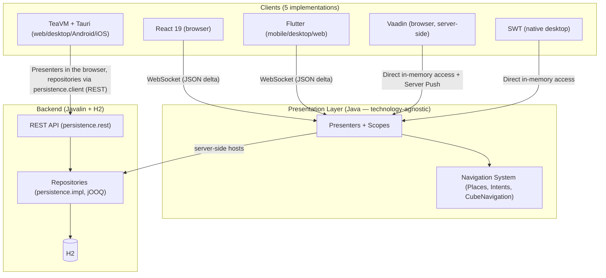
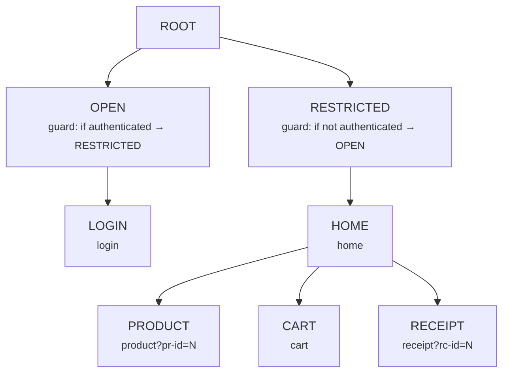
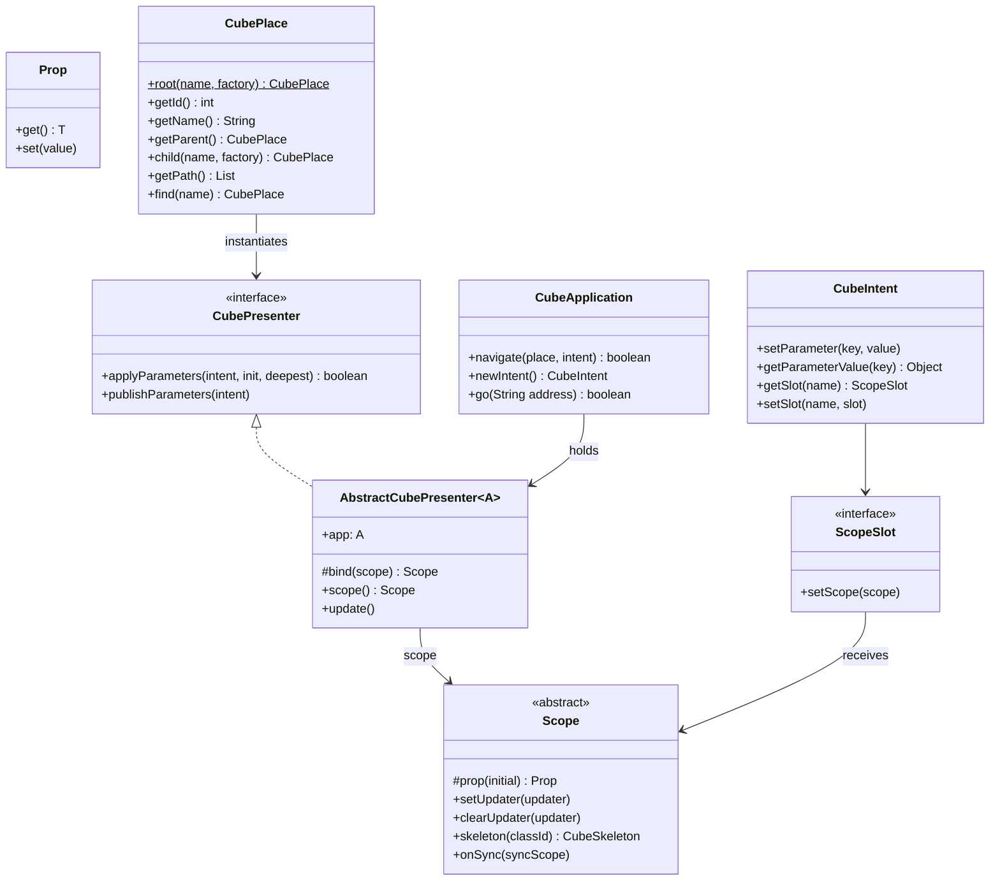
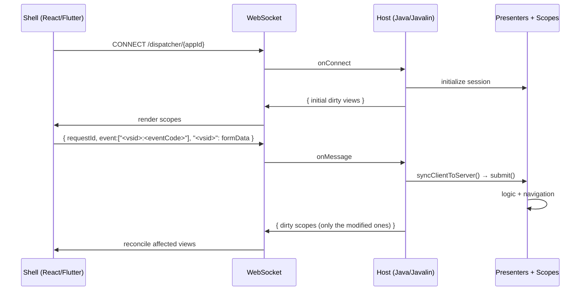

# Cube MVP — Multiplatform Presentation Architecture in Java

[Background](#background)  
[Core Requirements](#core-requirements)  
[The Technology Stack](#the-technology-stack)  
[Java and the Type System](#java-and-the-type-system)  
[Javalin — The HTTP Server](#javalin--the-http-server)  
[Architecture of the Reference Application](#architecture-of-the-reference-application)  
[Layered Perspective](#layered-perspective)  
[The Cube MVP Pattern](#the-cube-mvp-pattern)  
[State View](#state-view)  
[Control Structures](#control-structures)  
[Route Control — Places and Intents](#route-control--places-and-intents)  
[Access Control — Navigation Guards](#access-control--navigation-guards)  
[Class Diagram](#class-diagram)  
[View Compositions — Slots](#view-compositions--slots)  
[The View Layer — Five Independent Implementations](#the-view-layer--five-independent-implementations)  
[Remote Presentation — The Host/Shell Protocol](#remote-presentation--the-hostshell-protocol)  
[The Scope as a Serialization Contract](#the-scope-as-a-serialization-contract)  
[Conclusions](#conclusions)  
[Future Work](#future-work)

---

## Background

This project is the Java realization of the Hierarchical Passive View architecture defined in 2015 ([reference](https://docs.google.com/document/d/1Rcbt3gIjdX50j2gr2zqs9VqTQVg8527h9lOUF1xrhag/edit?tab=t.0#heading=h.3wkx7ie3r9yu)). WDC Cube Java v2 keeps the same presentation logic — the same Presenters, the same Scopes, the same business and navigation rules — and runs it on five completely independent frontend implementations:

| Implementation | Technology | Platforms |
|---|---|---|
| `view.remote / remote.shell.react` | React 19 + TypeScript + Spectrum Web Components (`@swc-react`) | Web (browser) |
| `view.remote / remote.shell.flutter` | Flutter + Dart | Web, Desktop, Mobile |
| `view.vaadin` | Vaadin 25 + Java | Web (server-side push) |
| `view.swt` | Eclipse SWT + Java | Native desktop (Windows, Linux, macOS) |
| `view.teavm` | TeaVM + Tauri 2 + Java | Web, Desktop, Android, iOS |

The central principle of the architecture is that the presentation layer knows nothing about which technology renders the interface. The view is a pluggable artifact — an implementation of a Java contract that receives a scope and reports actions.

This article describes how this architecture was consolidated, which problems were solved, which innovations emerged (especially the Remote Presentation protocol), and what remains as future work.

---

## Core Requirements

The following requirements guided the project's architectural decisions and make it possible to assess what has been achieved and what remains challenging.

**Navigation logic independent of the View library** ✅  
The navigation system based on `CubeNavigation`, `CubePlace` and `CubeIntent` is pure Java and references no UI technology.

**Maximize the portion of code committed only to long-lived technologies** ✅  
Java has existed for more than 30 years. The presentation layer — Presenters and Scopes — lives in a Maven module with no UI dependencies.

**Software construction model independent of the runtime environment** ✅  
The same presentation logic compiles and runs in the browser (React, TeaVM, Vaadin), on the desktop (SWT, Flutter, TeaVM/Tauri) and on mobile (Flutter, TeaVM/Tauri).

**Consistent representation of state in the browser URL** ✅  
The navigation system serializes the active state into the query string. The Remote Presentation protocol synchronizes the URL hash between shell and host.

**Accurate state restoration after F5** ✅  
Each implementation rebuilds the state from the URL in the `applyParameters` cycle. Remote mode uses the `appId` (session id) to reconnect to the server-side session.

**Test all navigation flows through mock views** ✅  
Views are created by each rendering technology from its own catalog (scope class → view factory); the presenters never see it. In tests, the mock application is one more technology: its catalog has a mock view for each scope class, and navigation runs without any UI.

**More than one implementation for the same view** ✅  
This is the main validation point of the architecture: five implementations coexisting on top of the same Presenters.

**Contracts and type systems for traceability** ✅  
Java offers static compile-time checking. Each view's constructor takes the scope type it draws (`new CartViewVaadin(app, (CartScope) s)` in the catalog), so a view reads the scope's typed fields and fires its typed actions.

**Managing the scope of state propagation in compositions** ✅  
Slots (`ScopeSlot`) are lambdas that encapsulate assigning a child's scope to a specific composition point of the parent, without exposing the parent Presenter.

**Technology-independent View composition** ✅  
The slot concept is technology-agnostic. Each view implementation handles the slot in its own way.

**Keeping complexity under control** ✅  
The Presenter hierarchy divides responsibilities. Each Presenter handles a fragment of the application's total state.

---

## The Technology Stack

The server-side technology stack — where the logic lives — is deliberately minimalist:

| Category | Technology | Version |
|---|---|---|
| Language | Java (Temurin/Microsoft) | 25 (the framework modules compile with release 21) |
| Build | Maven | 3.9+ |
| HTTP server | Javalin | 7.2.4 |
| Database | H2 | 2.5.252 |
| Data access | jOOQ | 3.21.9 |
| Serialization | Gson | 2.15.0 |
| Logging | SLF4J + Logback | 2.0.20 / 1.6.7 |
| Tests | JUnit | 4.13.2 |

Notably absent from this list is any dependency injection framework (Spring, CDI, Guice). Injection is done through a static `AtomicReference<T>` — a simple, transparent service locator. This choice removes a layer of magic that, in Spring-ecosystem applications, usually obscures the execution flow and makes instrumenting view factories harder.

### Java and the Type System

Java offers a robust static type system with native tooling support (global refactoring, symbol traceability, code navigation). Compile-time checking eliminates an entire class of integration errors between Presenter and View — if the Presenter type expected by the view implementation does not match the one declared by the system, the compiler rejects the build.

### Javalin — The HTTP Server

Javalin is a lightweight HTTP framework for Java/Kotlin. In this project it plays two distinct roles:

1. **REST API** (`persistence.rest`) — exposes the domain repositories for consumption by the `persistence.client` module, used by the client-side view implementations (TeaVM).
2. **WebSocket** (`view.remote / remote.host`) — the bidirectional channel of the Remote Presentation protocol. Each WebSocket connection is handled by a Virtual Thread (Java 21), allowing it to scale to thousands of simultaneous sessions without the overhead of traditional threading.

---

## Architecture of the Reference Application

The reference application is a simplified e-commerce system: **WDC Store**. It is deliberately functional — it supports login, browsing a product catalog, a cart and receipt generation — but kept small enough that the architecture is the focus, not business complexity.

The modules are organized into two groups:

**Framework** — a generic, reusable library:

| Module | Responsibility |
|---|---|
| `framework.commons` | Functional interfaces with checked exceptions, extensible serialization, SQL abstraction, cryptography (`ChannelCrypto`: the remote channel's ECDH, HKDF and AES-GCM), Base62, multiplatform logging |
| `framework.domain` | Generic domain abstractions: `Repository`, `Page`, criteria, projections, `TransactionService`, security, and the resource calls (`ResourceQuery`, `ResourceCreate`/`Save`/`Update`/`Delete`) |
| `framework.persistence` | Neutral persistence support (`javax.sql.DataSource` + `jakarta.transaction`): `TransactionServiceImpl`, `TransactionScope`, `RemoteTransactionCoordinator` |
| `framework.cube` | Cube MVP engine: presenters, views, navigation, intents, slots |
| `framework.cube.remote` | Remote Presentation protocol: scope serialization, WebSocket dispatcher, bridges for React/Flutter/TeaVM |
| `framework.jooq` | jOOQ support: JSON query helpers (`JsonQuery`, `JsonQueryBuilder`, `JsonChildQueryBuilder`); the `DSLContext` is injected by the application (no global holder) |
| `framework.dependencies` | Maven BOM for centralized versions |

**WDC Store** (`br.com.wdc.store`) — the application itself:

| Module | Responsibility |
|---|---|
| `store.domain` | Domain models, repositories, query criteria |
| `store.persistence` | H2 + jOOQ (generated classes) |
| `store.persistence.rest` | REST controllers (Javalin) |
| `store.persistence.client` | REST client (OkHttp + Gson) |
| `store.presentation` | Presenters, Scopes, navigation — **technology-agnostic** |
| `store.view.*` | Five frontend implementations |

---

## Layered Perspective



The separation is structural, not just conceptual: the `store.presentation` module has no dependency on any UI technology. It depends only on `framework.cube` and `store.domain` (plus the `jsr305` annotations). Any technology capable of drawing a `Scope` — installing an updater on it and firing its actions — can be plugged in.

---

## The Cube MVP Pattern

Cube MVP is a variation of Passive View with two core principles:

1. **The View has access to the Scope, but not to the Presenter.** The Scope is a plain Java object with public fields (`Prop`s and actions) — the view state the Presenter publishes for its screen. The Presenter feeds the Scope's `Prop`s; setting a different value requests the redraw by itself.

2. **No cross-queries between Presenter and View.** The Presenter notifies the View through the Scope: a change in a `Prop` calls `update()` on the view that draws that scope. The View notifies the Presenter by firing the Scope's actions (the `onXxx` fields). These communications return no values.

The name "Cube" reflects the third dimension of the architecture: besides the Presenter/View axis, there is the **hierarchy** axis — Presenters are composed into a tree, each node responsible for a portion of the application's total state.

### The Presenter

Every navigable Presenter extends `AbstractCubePresenter<StoreApplication>`. Its Scope lives in its own file, next to it:

```java
// CartScope.java — the scope, read by the view for rendering. Each observed field is a Prop:
// set() compares with equals and, if it changed, requests a redraw — the presenter does not call update() afterwards
public class CartScope extends Scope {
    // classId of the bridge protocol: identifies the remote view that draws this scope
    public static final String CLASS_ID = "7eb485e5f843";

    // A row of the cart: a segment with its own view and actions (see below)
    public static class CartItemScope extends Scope { /* ... */ }

    public final Prop<List<CartItemScope>> rows = prop(Collections.emptyList());
    public final Prop<Double> total = prop(0.0);
    public final Prop<Integer> errorCode = prop(0);
    public final Prop<String> errorMessage = prop();

    // Actions the view fires (the remote serializer ignores them)
    public Action onBuy = Action.NOOP;
    public Action onOpenProducts = Action.NOOP;
}
```

```java
public class CartPresenter extends AbstractCubePresenter<StoreApplication> {

    // bind: the presenter is notified when a scope prop changes
    public final CartScope scope = bind(new CartScope());

    private ScopeSlot ownerSlot;

    public CartPresenter(StoreApplication app) {
        super(app);
        // Bound once; the guard sends unhandled failures to the app and republishes the address at the end
        // With an event code: the scope's skeleton dispatches event 1 from a remote client to it
        this.scope.onBuy = action(1, this::buy);
        this.scope.onOpenProducts = action(3, () -> new HomeKeys(this.app).flip());
    }

    // Called by the navigation engine when activating this Presenter
    @Override
    public boolean applyParameters(CubeIntent intent, boolean initialization, boolean deepest) {
        this.syncRows();   // brings scope.rows and scope.total in line with the cart

        // The parent puts the scope into one of its Prop<Scope>; the parent's view is the one that requests this scope's view
        this.ownerSlot = new CartKeys(this.app, intent).parentSlot();
        this.ownerSlot.setScope(this.scope);
        return true;
    }

    // Action body: handles only the expected failures, no generic try/catch
    private void buy() {
        // business logic...
        this.scope.errorCode.set(0);   // the change already requests the redraw
    }
}
```

The Presenter never creates nor releases a view: it only feeds the scope and hands it to the parent through the slot. `framework.cube` has no view concept at all — the view belongs to the rendering technology, which keeps its own catalog (scope class → view factory) and map of live views; its `viewOf(scope)` creates the view the first time it is requested and installs it as the scope's updater (`scope.setUpdater(...)`), without the Presenter knowing which UI technology is in use. The scope's static `CLASS_ID` is the bridge protocol classId, and the remote skeleton belongs to the scope (`scope.skeleton(CLASS_ID)`), which dispatches each event to the action bound with that code.

Every Presenter is navigable (`AbstractCubePresenter<A>`, managed by the navigation engine). A piece of the screen that does not need its own navigation — such as the products and purchases panels of the Home — **does not get a Presenter**: it is a **smaller scope**, declared as a public static inner class of the scope of whoever shows it:

```java
public class HomeScope extends Scope {

    public static class ProductsPanelScope extends Scope {
        public static final String CLASS_ID = "a1b2c3d4e5f6";

        public final Prop<List<ProductInfo>> products = prop();
        public ActionOf<Long> onOpenProduct = ActionOf.noop();
    }

    public final Prop<ProductsPanelScope> productsPanel = prop();
    // ...
}
```

The `HomePresenter` binds the segment's actions (`actionOf(productsPanel, 1, FormParam.asLong("p.productId"), this::openProduct)`) and only puts it into the scope (`scope.productsPanel.set(productsPanel)`). The rendering technology chooses the view: the Home view requests the panel's view with its own `viewOf(scope)` while it draws, which creates it the first time from the technology's catalog. From then on, a change in the segment redraws only its own view (until then, it redraws the owner). When the Home view draws without it — the segment left the `Prop`, or the Home view itself was let go — the technology releases it. The remote host registers nothing: `RemoteViewImpl.forScope` makes a remote view for any scope, using its `CLASS_ID`. The view never knows the Presenter — it only reads the scope and fires its actions —, so one Presenter can orchestrate several segments without a class per segment.

In remote mode the segment is a view like any other: it has its own `classId`, its own skeleton (the code-based dispatch of the actions bound on it), and the parent references it by the view id (`"productsPanelViewId"`).

**List rows are segments too.** Each cart row is a `CartScope.CartItemScope`, with its own view and actions bound to the item itself (`onRemove`, `onModifyQuantity(quantity)` — the row does not send the product id back: it *is* the item). The `CartScope` holds `Prop<List<CartItemScope>> rows`, which the serializer writes as `"rowsViewIds": [...]`, in order. The `CartPresenter` reuses the row by product id while the item stays, creates the row for a new item (the view is born when the cart requests it), and drops the row of an item that left from the list — the cart's view, drawing without it, releases its view; changing a quantity redraws only that row, and the total (`CartScope.total`) comes from the server.

---

## State View

The reference application has 8 *places* organized in 4 hierarchical levels:



An address is the name of the deepest place plus its query string (`CubeIntent.toString()`); place names are unique in the tree, so the path comes from the tree, not from the address. States are additive. The address `product?pr-id=42` implies the chained activation of `RootPresenter → RestrictedPresenter → HomePresenter → ProductPresenter`. Each Presenter in the chain receives the intent and extracts the parameters that concern it.

The dynamic part of the URL — the query-string parameters — is encapsulated in `CubeIntent`, and each place reads and writes it through a typed keys class (`XxxKeys`, built on the framework's `CubeKeys`):

```java
// Navigate to the detail of product 42, starting from the current state
new ProductKeys(app)
        .withProductId(42L)
        .flip();
```

**Each place has a keys class, which declares the place** from the place of the keys it extends — the class tree is the place tree, and the path to a place is given by it:

```java
public class HomeKeys extends RestrictedKeys {
    public static final String PREFIX = "hm";
    public static final CubePlace PLACE = RestrictedKeys.PLACE.child("home", HomePresenter::new);
    // ...
}

public final class ProductKeys extends HomeKeys {
    public static final String PREFIX = "pr";
    public static final CubePlace PLACE = HomeKeys.PLACE.child("product", ProductPresenter::new);

    private static final class P {
        static final String PRODUCT_ID = PREFIX + "-id";   // only this class knows the name
    }

    public Long productId() { /* 0 or more, or null: the address comes from outside, the getter never throws */ }
    public ProductKeys withProductId(Long id) { /* null (or the default) removes the name from the address */ }
}
```

- **Two-letter prefix per class**, unique within the application; every name it declares starts with it (`pr-id`). `PlaceKeysTest` checks this.
- **A child place inherits the parent's getters** to read what the upper levels passed down; the only name deliberately reused is the composition slot (`parentSlot()`).
- **Without an intent, the keys start from the current state** (`app.newIntent()`); inside `applyParameters`, a redirect uses the in-flight intent: `new HomeKeys(app, intent).flip()`.
- A place declared in a static field only enters the tree when its class loads; that is why `StoreApplication.PLACES` lists them all.

---

## Control Structures

### Route Control — Places and Intents

The `CubeNavigation` navigation engine performs transitions between states as follows:

1. For each `CubePlace` on the path to the destination (`place.getPath()`, from the root down), it checks whether an instance of the corresponding Presenter already exists.  
2. If not, it instantiates one through the place's factory.  
3. It invokes `applyParameters(intent, initialization, deepest)` on each Presenter in the chain, in hierarchy order.  
4. It invokes `release()` on the Presenters that are not part of the active state, in reverse order (from deepest to shallowest).  
5. It calls `app.updateHistory()` so the host republishes the address.

The views are not redrawn by the engine: each `Prop` a Presenter changes requests the redraw of the view that draws its scope. `commitComputedState()` (an opportunity to synchronize derived state) is called on all Presenters once per paint cycle, before the dirty views are drawn: by each technology's flush of dirty views (Vaadin, SWT, teavm.web) and by the remote host before it serializes the dirty scopes. What it changes is painted in the same cycle.

The actions of one application run **one at a time**: every guarded action runs inside `CubeApplication.runExclusively`, so an action that starts while another waits on I/O waits for it, and an action that runs another on the same thread runs it at once.

When navigating from `product?pr-id=5` to `cart`, the sequence is:

- `applyParameters` invoked for `Root`, `Restricted`, `Home`, `Cart`  
- `release()` invoked for `Product`  

Presenters shared between the previous state and the new one are not recreated — they are only notified with `applyParameters(intent, false, ...)`.

### Access Control — Navigation Guards

`OpenPresenter` and `RestrictedPresenter` act as guards. Each one checks a condition at the start of `applyParameters` and, if it is not met, redirects to another state:

```java
@Override
public boolean applyParameters(CubeIntent intent, boolean initialization, boolean deepest) {
    if (this.app.getSubject() != null) {
        // User already authenticated — redirect to the restricted area
        new RestrictedKeys(this.app, intent).flip();
        return false;
    }
    // Continue normal navigation...
    return true;
}
```

Returning `false` interrupts the navigation chain — the deeper Presenters are not activated.

---

## Class Diagram



The application is a graph of `AbstractCubePresenter` instances. Each instance knows only its own Scope (the `scope` field, bound with `bind`). There is no view in the diagram on purpose: the view of each Scope is created by the rendering technology, from its own catalog, the first time it is requested, and it reaches the Scope only through the updater it installs (`setUpdater`, taken back with `clearUpdater`). The Presenter never references a view.

---

## View Compositions — Slots

A slot is a composition point declared by the parent Presenter that lets a child Presenter fit into the scope tree without direct coupling between them.

```java
// HomeScope holds the child Presenter's scope (product, cart, receipt)
public final Prop<Scope> content = prop();

// HomePresenter declares a content slot
private final ScopeSlot contentSlot = this::setContent;

private void setContent(Scope content) {
    this.scope.content.set(content);   // redraws only if it changed
}
```

The `contentSlot` slot is registered in the `CubeIntent` before moving on to the child Presenter:

```java
@Override
public boolean applyParameters(CubeIntent intent, boolean initialization, boolean deepest) {
    // ...
    if (!deepest) {
        // Propagate the slot to the child Presenter
        new HomeKeys(this.app, intent)
                .withParentSlot(this.contentSlot);
    }
    return true;
}
```

The child Presenter receives the slot and uses it to fit in:

```java
// ProductPresenter receives the slot and hands over its scope
this.ownerSlot = new ProductKeys(this.app, intent).parentSlot();
this.ownerSlot.setScope(this.scope);
```

The parent view requests the view of whatever scope is there — its own `viewOf(scope.content.get())`, while it draws — regardless of which child Presenter put it there. The host only draws the root Presenter's scope (`app.viewOf(getRootPresenter().scope)`); every other view is requested by the view that holds the scope, and a held view it no longer requests is released. Until a scope gets a view, a change in it redraws the owner (the scope that holds it in a `Prop` adopts it); after that, only its own view. In remote mode, a `Prop<Scope>` field goes out in the JSON as `"<field>ViewId"` (`content` → `"contentViewId"`). This mechanism works identically in all five view implementations.

---

## The View Layer — Five Independent Implementations

### What a View Is

`framework.cube` has no view type: a view is whatever a rendering technology draws a Scope with — a Vaadin component, an SWT composite, a DOM element, a remote view. Each technology has its own base class (`AbstractViewVaadin`, `AbstractViewSwt`, `AbstractViewTeaVM`, `RemoteViewImpl`), its own catalog (scope class → view factory) and its own map of live views. What it needs from the Scope is the updater hook: `scope.setUpdater(...)` when it starts drawing the scope, `scope.clearUpdater(...)` when it stops.

### The Lifecycle of a View

1. Someone requests a scope's view with `viewOf(scope)` — the host, for the root scope, or the view that holds the scope in a `Prop`, while it draws. The first time, the technology's catalog instantiates the view with `(app, scope)`, installs it as the scope's updater, and it is drawn once.  
2. The view stores a reference to the application and to the Scope — never to the Presenter.  
3. When the updater is called (a `Prop` of the scope changed), the view is marked dirty; its next drawing reads the Scope's fields and reconciles the interface.  
4. When the user interacts, the view fires the Scope's `onXxx` action, which the Presenter bound.  
5. When the view that held it draws without requesting it (the scope left the `Prop` — a navigation replaced the content, a row left the list), and no other view holds it, the technology releases it: the updater is taken back, the widget goes away (component removed, composite disposed, element removed from the DOM; the remote host tells the client with `releasedViews`), and the views it held are released in turn. The Presenter takes no part.

### The Implementations

**view.swt** — Native desktop implementation with Eclipse SWT (Windows, Linux, macOS). Each view extends `AbstractViewSwt` and uses the declarative `SwtDom` DSL to build compositions. `update()` only marks the view dirty (`app.markDirty(this)`); a render timer on the UI thread (`Display.timerExec`) flushes the dirty views by calling their `doUpdate()`. The view reads the scope through a supplier that the factory in the application's catalog wires, together with the actions (`StoreSwtApplication`):

```java
var cartView = app.onUiThread((CartScope s) -> {
        var v = new CartViewSwt(app); v.scopeSupplier = () -> s;
        v.onOpenProducts = s.onOpenProducts::run; v.onBuy = s.onBuy::run;
        v.rowViews = () -> s.rows.get().stream()
                .map(app::viewOf)
                .filter(Objects::nonNull)
                .toList();
        return v; });
```

```java
public class CartViewSwt extends AbstractViewSwt {

    public Supplier<CartScope> scopeSupplier;
    public Runnable onOpenProducts;
    public Runnable onBuy;
    /** The rows' views, in the cart's order: each row is a view of its own ({@link CartItemViewSwt}). */
    public Supplier<List<AbstractViewSwt>> rowViews;

    @Override
    public void doUpdate() {
        // ... first render ...
        var scope = this.scopeSupplier != null ? this.scopeSupplier.get() : null;
        var rows = new ArrayList<Composite>();
        for (var rowView : this.rowViews.get()) {
            // Held in this drawing: a row view not held again is released after it
            rows.add(this.hold(rowView).getElement());
        }
        // ... toggles the empty/filled cards, syncs the error banner, the rows and the total
    }
}
```

**view.vaadin** — Browser implementation via Vaadin Flow (server-side push). Vaadin manages the Atmosphere transport (WebSocket/Long Polling) and the reconciliation of components in the DOM. The application flushes the dirty views inside `ui.access()` to guarantee thread safety on updates:

```java
public class CartViewVaadin extends AbstractViewVaadin<CartScope> {

    // The drawn scope lives in the base class's scope field
    public CartViewVaadin(StoreVaadinApplication app, CartScope scope) {
        super("cart", app, scope, new VerticalLayout());
    }

    @Override
    public void doUpdate() {
        // ... first render ...
        var rows = this.scope.rows.get();
        this.syncRows(rows);
        // ... toggles the empty/filled panes and updates the total from this.scope.total.get()
    }
}
```

**view.teavm** — The Java views are compiled to JavaScript by the TeaVM plugin. In the browser, the result is a complete SPA. For desktop, Android and iOS, the SPA is packaged in a WebView via Tauri 2 (Rust). The views extend `AbstractVDomView` and implement `render()` returning a `VNode` tree; the cart delegates the tree to a `CartSharedView` (in `teavm.commons`) and wires the scope's actions into it:

```java
public class CartView extends AbstractVDomView<CartScope> {

    private final CartSharedView shared;

    public CartView(StoreTeaVMApplication app, CartScope scope) {
        super("cart", app, scope);

        this.shared = new CartSharedView();
        this.shared.scopeSupplier = () -> scope;
        this.shared.onBack = () -> safeAction("Back", scope.onOpenProducts::run);
        this.shared.onBuy = () -> safeAction("Buy", scope.onBuy::run);
        // The rows are views of their own (CartItemView): the cart lays their elements out in its order
        this.shared.rowElements = () -> scope.rows.get().stream()
                .map(row -> this.viewOf(row) instanceof AbstractViewTeaVM<?> v ? v.getElement() : null)
                .filter(Objects::nonNull)
                .toList();
    }

    @Override
    protected VNode render() {
        return shared.renderTree();
    }
}
```

**view.remote / remote.shell.react** — React shell in TypeScript. Each view is a `BaseViewClass` registered under the scope's `CLASS_ID`; it renders the scope received over WebSocket and emits events back by code (`bridge.submit(vsid, eventCode)`). A row is a view of its own, created from its vsid:

```tsx
const ON_BUY = 1
const ON_BACK = 3

export type CartScope = {
  rowsViewIds?: string[]
  total?: number
  errorMessage?: string
}

class CartViewClass extends BaseViewClass<ViewProps, CartScope> {
  override render({ className }: ViewProps) {
    const rows = this.scope.rowsViewIds ?? []
    // ... header, error banner, empty state ...
    return (
      <div className={className}>
        {rows.map((rowId) => (
          <React.Fragment key={rowId}>{bridge.createView(rowId)}</React.Fragment>
        ))}
        {/* ... total, "Continue shopping" (emitBack) and "Checkout" (emitBuy) buttons ... */}
      </div>
    )
  }

  readonly emitBack = () => {
    bridge.submit(this.vsid, ON_BACK)
  }

  readonly emitBuy = () => {
    bridge.submit(this.vsid, ON_BUY)
  }
}

export default BaseViewClass.FC(CartViewClass, "7eb485e5f843")
```

**view.remote / remote.shell.flutter** — Flutter shell in Dart. The same WebSocket protocol, but with Flutter widgets for rendering; each view is a `BaseView` whose `State` reads the `scope` map and submits events by code:

```dart
const _onBuy = 1;
const _onBack = 3;

class CartView extends BaseView {
  const CartView({super.key, required super.vsid});

  static const viewId = '7eb485e5f843';

  @override
  State<CartView> createState() => _CartViewState();
}

class _CartViewState extends BaseViewState<CartView> {
  @override
  Widget build(BuildContext context) {
    final rows = (scope['rowsViewIds'] as List?)?.cast<String>() ?? [];
    final total = (scope['total'] as num?)?.toDouble() ?? 0.0;
    return PageCard(
      children: [
        ...rows.map(slot),
        // ... total (formatCurrency(total)), "Continue shopping" and "Checkout" buttons
      ],
    );
  }

  void _emitBack() => submit(_onBack);
  void _emitBuy() => submit(_onBuy);
}
```

---

## Remote Presentation — The Host/Shell Protocol

The Remote Presentation protocol transfers scopes and receives events, making the client a thin shell with no business logic.

### Analogy with Remote Desktop

The protocol is analogous to a Remote Desktop, but it operates on the application's data layer instead of pixels. The server holds all the logic — Presenters, scopes, business rules, navigation. The client renders serialized scopes and sends interaction events back.



### Channel Security

The protocol implements session encryption in two layers:

1. **A key per connection**: every WebSocket connection starts with a handshake in which the shell and the host exchange ephemeral ECDH P-256 public keys, with the protocol version; both derive the connection's AES-256 key with HKDF-SHA256, salted with the session id. No long-lived ciphering key exists, so a recorded connection cannot be deciphered later. A shell the host does not speak is refused and told it is out of date.
2. **AES-GCM values**: after the handshake, the sensitive values (client storage, `p.password`) travel encrypted with the connection key, each with a random IV of its own.

Additionally, the session id (`appId`) and the navigation address (the `sign` parameter) are signed with HMAC-SHA256 under a key only the server has (`[remote] signingKey`), preventing a client from forging a session or navigating to places it was not granted. See [bridge-skeleton-protocol.md](bridge-skeleton-protocol.md) for the wire-level details.

### Delta Serialization of Scopes

A crucial property of the protocol is that only the scopes that changed (*dirty*) are sent in each cycle. This is possible because each scope drawn for a client has a `RemoteViewImpl` whose `update()` marks it dirty (`app.markDirty(this)`) — and a `Prop` change calls `update()` on the view that draws the scope. The host collects only the marked views, serializes their scopes to JSON and transmits the delta.

The Scope is serialized by the framework's `ScopeSerializer`, which inspects the `public` fields via reflection:

```json
{
  "#": "7eb485e5f843:3",
  "rowsViewIds": ["c8a1f0e2b7d4:4", "c8a1f0e2b7d4:5"],
  "total": 99.8,
  "errorCode": 0
}
```

The `"#"` field is the `instanceId` (`"<CLASS_ID>:<n>"`) that binds the JSON scope to the corresponding view instance in the shell. A `null` value (here, `errorMessage`) is omitted; each row is a view of its own, sent as its own scope.

### Virtual Threads for Scalability

Each WebSocket session is managed by a Virtual Thread (Java 21). Unlike platform threads, Virtual Threads are lightweight enough to allocate one per active session — the server can hold thousands of simultaneous sessions without the overhead of traditional thread pools.

---

## The Scope as a Serialization Contract

Besides being what the view reads for rendering, the `Scope` serves as the serialization contract for remote mode.

The `Scope` does not implement serialization: its fields are `Prop`s (and the actions, plain fields). Serialization is done exclusively by the framework's `ScopeSerializer`:

- Iterates over all `public` fields of the Scope via reflection
- Skips `static` and `transient` fields, and the actions (`Action`, `ActionOf`, `ActionOf2`)
- Writes a `Prop` field as its value; omits `null` values and blank top-level strings
- Injects `"#": instanceId` as the first field of the JSON object
- Serializes a `Scope` field as `"<name>ViewId": vsid` and a list of scopes as `"<name>ViewIds": [vsid, ...]` (reference by ID)
- Supports primitives, `String`, collections, `Map`, `Record` and POJOs with public fields

The `Scope` itself never implements serialization logic — that is the framework's responsibility, not the application code's.

---

## Conclusions

The architectural model has proven robust over a decade of significant technological evolution — and, more importantly, it has expanded into domains that were initially future work.

The principles that proved most durable:

**The Presenter hierarchy as the unit of modularity.** Dividing the application state into hierarchical Presenters keeps complexity localized. Adding a new module means creating a new Presenter and its keys class (which declares the place), listing it in `StoreApplication.PLACES` and implementing a view in each technology of interest — without touching the rest of the application.

**The Scope as the boundary between logic and presentation.** The Scope is at once simple (public Java fields) and powerful (automatic serialization, incremental diff in remote mode). It solves the data transfer problem without creating separate value transfer objects — the same object serves the Presenter to feed the view and the remote protocol to transmit it.

**The slot as a coupling-free composition mechanism.** The slot isolates the parent Presenter from the child. The parent does not know which type of child Presenter will be in the slot — only that it will receive a `Scope`. The child does not know which part of the parent screen it will be in.

**The view catalog as an extension point.** Each rendering technology's catalog (scope class → view factory) is the only point of variability between view implementations. Registering other factories per scope class is enough to swap the entire UI layer — and the remote host does not even register: `RemoteViewImpl.forScope` draws any scope by its `CLASS_ID`. Since the technology also decides when a view goes away, the presentation layer carries no view lifecycle at all.

The **Remote Presentation mode** is the central innovation: it demonstrates that the separation between presentation logic and rendering is not just a good architectural practice — it is a physical property of the architecture. The Presenter genuinely does not know where the view runs: it may be a local process in the same JVM, a browser thousands of miles away, or a mobile device connected over WebSocket.

The choice of Java was decisive. The static type system eliminates an entire class of integration errors and makes the code more traceable. The JVM platform, with Virtual Threads, allows remote mode to scale at a viable computational cost. The Maven build produces deterministic results. And the longevity of the language ensures that code written today will still be understandable in 2036.

---

## Future Work

- **Dynamic module loading**: the architecture supports the concept, but there is no reference implementation for lazy loading of Java modules in remote mode.  
- **Persistent drafts**: the application instance in the backend may be discarded for several reasons — server restart, closing and reopening the page, session expiration. On resuming, the Presenter could use an identifier present in the URL to fetch previously saved draft data from external storage (database, Redis, etc.). To the user, it would be imperceptible that this is a new application instance in the backend — the form state would be preserved exactly as it was left.  
- **Porting remote mode to other environments**: the host/shell protocol is documented well enough to be implemented in Swift (native iOS) or Kotlin (native Android) without Flutter.  
- **End-to-end integration tests of the remote protocol**: navigation flows are tested through mock views. It would be valuable to add tests that exercise the full cycle — WebSocket → Presenter → serialized Scope → deserialization in the shell.
