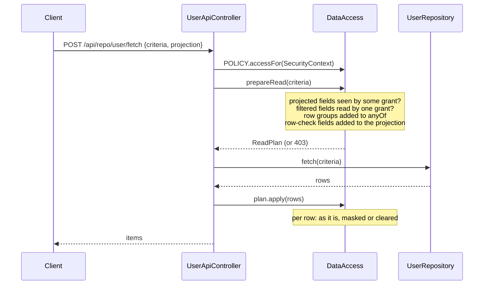

# Data Access Policy — Who Reads and Writes What Through the REST API

> **Status (11/2026):** the mechanism is in the framework (`br.com.wdc.framework.domain.security.policy`), and the four entities of the store are under it — `UserDataPolicy`, `ProductDataPolicy`, `PurchaseDataPolicy`, `PurchaseItemDataPolicy`. It is the only authorization of the REST API: `Role` is the list of roles, and there are no `entity:operation` permissions.

## The Problem

The REST repository API is flexible on purpose: the client sends any criteria and any projection, and gets back exactly the fields it asked for. That is what lets teavm.web run the same presenters as the server without a transfer object per screen.

The same flexibility is a risk at a boundary open to external clients. Anyone holding a token can build a request by hand. Without a policy, each controller has to defend itself by hand — remove the password from the projection in every read endpoint, add `userId = me` to the criteria of a user who may see only their own rows — and each new field or endpoint depends on someone remembering the rule. Nor is there a way to say that a role reads a field only partially (a document number with the last digits), or only on some rows.

The policy replaces that with a declaration per entity: per role, which rows, which fields, which masks, which writes. **The projection stays the contract.** No transfer object is created: the client asks with the projection it already uses, and the policy decides whether that projection is allowed.

## Where It Applies

**Only at the REST repository API.** That is the trust boundary: the request is assembled by a client the server does not control — teavm.web, whose presenters run in the browser, or any HTTP client.

Where the presenters run on the server (Vaadin, local SWT, the remote host behind React, Flutter and the TeaVM remote shell), the presenter is server code: it picks the criteria, the projection and what goes into its scope, and the user cannot change any of that. Those hosts use the repositories directly, without a policy. The presenter still owns two duties there:

- **Ownership of ids coming from the client.** An id in the intent or in the form data was chosen by the user; the presenter checks that the record belongs to them.
- **What goes into the scope.** In the remote hosts the scope crosses the wire, so it must not carry a field the screen does not show. When the screen shows a masked value, the presenter applies the mask (the same `Mask` functions are available to it).

## The Model

A **`DataPolicy`** gives each **role** one or more **`DataGrant`s** over an entity. A grant says:

| Part | Meaning |
|------|---------|
| `rows(scope)` | Which rows it reaches — every row by default, or a `RowScope` (the requester's own user, their purchases) |
| `read(projection)` | Fields read as they are. Only these can be used in filters and orderings |
| `mask(projection, mask)` | Fields read through a `Mask` — textual fields only |
| `create(projection)` | Fields that may be set when creating a row |
| `update(projection)` | Fields that may be changed in a reachable row |
| `delete()` | The reachable rows may be deleted |

A field is a value, a **relation** to one row of another entity (`purchase.user`, `item.product`) or a **collection** of rows of another entity (`purchase.items`). In a grant, a relation or a collection is one field: reading it means reading the key of the related row (or rows); what is read **inside** it is decided by the policy of the other entity — see [Relations](#relations).

The key is never declared: whoever reads a row reads its key, and the key is never written, because it identifies the row.

A role that reaches different rows with different fields has one grant for each. The MANAGER, for instance, reads its own user in full and the others by name, with the login masked:

```java
public static final DataPolicy<User, UserCriteria> POLICY = DataPolicy.on(USER)
        .grant(Role.ADMIN.name(), g -> g
                .read(new User()
                        .withUserName(PV.str)
                        .withName(PV.str)
                        .withRoles(PV.str))
                .create(...)
                .update(...)
                .delete())
        .grant(Role.CUSTOMER.name(), g -> g
                .rows(OWN)
                .read(ownUser()))
        .grant(Role.MANAGER.name(), g -> g
                .rows(OWN)
                .read(ownUser()))
        .grant(Role.MANAGER.name(), g -> g
                .read(new User()
                        .withName(PV.str))
                .mask(new User()
                        .withUserName(PV.str), Mask.keepFirst(1)))
        .build();
```

The fields are declared with **projections**, the same objects a query uses: a renamed field breaks the policy at compile time. The password appears in no read grant, so no role reads it back.

An **`EntityDescriptor`** tells the policy what it cannot infer: each field's wire name, how to get and set it, which entity field each criteria field filters (`userId` → `id`, or the relation `user` of a purchase), which fields each provisioned ordering sorts by, and, for a relation or a collection, the policy of the other entity. That policy is given as a `Supplier`, because entities refer to each other — the purchase to its items, the item to its purchase.

## Rules

### Roles combine row by row

The model is **allow-wins**: a user gets every grant of every role, and a request passes when some grant allows it. The fields, though, are decided **per row**: a returned row shows what the grants that **reach that row** allow.

The reason is a combination that no single role grants. Say SUPPORT reads everyone's name and CUSTOMER reads its own document number. Adding up the columns of both roles and the rows of both would hand a user with both roles **everyone's document**. Per row, the other users' rows are reached only by SUPPORT, so they come with the name alone.

Per field of each row:

1. some grant that reaches the row reads it → **as it is**;
2. otherwise, some grant that reaches it masks it → **masked**;
3. otherwise → **absent** (cleared).

To decide which grants reach a row, each `RowScope` is written twice, and both must agree: `restrict(group, sc)` as criteria, so the database returns only reachable rows; `covers(row, sc)` in memory, on the returned row. What `covers` reads is declared as a projection (`RowScope.projection()`), which may go into relations — the items of one's own purchases read `purchase.user`. It is fetched even when the client did not ask for it, then cleared before the response.

### Filtering and sorting count as reading

Filtering by a field reveals its values: `startingWith("1")`, `startingWith("12")`, ... reads a document number one digit at a time without ever projecting it. Hence:

- every field the criteria filters (including inside its alternative groups) or sorts by must be **read as it is** by one grant — a masked field cannot be filtered or sorted;
- only the rows of the grants that read **all** those fields are returned.

So the MANAGER filtering by login gets only its own row (the only grant that reads the login as it is), while sorting by name reaches everyone. No grant reading all the filtered fields → **403**, naming them.

### Writing

- **Create**: one grant must allow every field set in the new row, and reach it.
- **Update**: one grant must reach the **stored** row, allow every changed field, and **still reach the row after the change**. A grant over one's own rows cannot hand a row to someone else by changing its owner.
- **Delete**: only the rows of grants that delete, filtered by fields those grants read.
- **A masked value is never written**: a grant that masks a field cannot also write it — the builder refuses that declaration. A client that echoes a masked value back gets a 403, never an overwrite.
- **A relation is written by its key only**: a purchase sent with `user: {id, name}` is refused — it would look like a write of the user, which it is not.
- **What the server decides is not writable**: a customer's grant over purchase items leaves `price` out. The price of a new item is the price of its product at that moment, filled in by the repository; a client that sends one gets a 403.

### Refusing, not trimming

A forbidden request gets **403** with the fields at fault: `not allowed to read user fields [password]`. Quietly trimming the request would make a screen show blanks with no one knowing why.

The client does **not** receive the policy. A correct client — a presenter built for its roles — never asks for what its roles do not allow, so the 403 is treated like any unexpected error (`RootPresenter.alertUnexpectedError`). The list of fields is there for whoever reads the server log or debugs the request.

### No projection means "everything allowed"

A read without a projection (`GET /api/repo/user/{id}`, a `fetch` without `projection`) gets every value field some grant of the requester sees, and its relations by key, with the per-row rules above; collections stay out. It never fails because of a field. The purchase, purchase item and product endpoints have documented default shapes of their own (a purchase with its items, for instance), which go through the policy like any projection a client sends.

### Without security

When no `AuthenticationService` is configured (local and test modes), there is no requester and `accessFor(null)` lets everything through. The password is still cleared from every user response, with or without security.

## Relations

Each entity has **one set of rules, wherever it appears**. A purchase's buyer goes through `UserDataPolicy`, its items through `PurchaseItemDataPolicy`, an item's product through `ProductDataPolicy` — whether the user is fetched on its own or inside a purchase. Otherwise the same row would have two sets of rules, and the looser one would win.

**Reading.** The owner's grant decides whether the relation is read at all — that is, its key. What the projection asks inside it goes through the other entity's policy:

- the fields asked inside must be seen by some grant of the other entity — `purchase.user.password` is a 403, even for an ADMIN, because no user grant reads a password;
- each related row is shaped by the grants of its own entity that reach it, row by row;
- the rows of a **collection** are also restricted by the other entity's policy: the policy adds its row groups to the criteria of the collection (`ProjectionList`), which the repository translates in the subquery — a purchase's items come only from items its reader reaches;
- a relation asked by its key alone comes back with the key alone, even when more was fetched for a row check.

**Writing.** A relation is written by its key only. The rows of a collection sent with a new owner — the items of a new purchase, which the repository inserts with it — are created through the other entity's policy, **as children of that owner**: the descriptor names the relation of each child that points back (`items` → `purchase`), and it is set before the child is checked, so "items of my purchases" reaches the items of the purchase being created.

A row scope that reads through a relation may have to look it up on a write. An item sent on its own to `purchase-item/insert` comes with its purchase by key; `PurchaseItemDataPolicy.OWN` then fetches the owner of that purchase to decide.

## What the Policies Refuse

The REST tests with authentication on (`UserDataPolicyRestTest`, `PurchaseDataPolicyRestTest`) exercise each of these:

| Request | Answer |
|---------|--------|
| A customer reads, counts or fetches by id another user, purchase or purchase item — with or without the owner in the projection | Not found / not counted |
| Any role projects a password, directly or through `purchase.user` | 403 |
| A customer updates or deletes a purchase or an item, its own included — a purchase is a receipt | 403 |
| A customer creates a purchase for someone else, or adds an item to someone else's purchase | 403 |
| A customer sends the price of an item | 403; the repository fills in the product's price |
| A customer writes products, or uploads a product image | 403 |
| A manager filters users by login, or sorts them by login | Only its own row |

## Alternative Groups in the Criteria (`anyOf`)

Combining row scopes needs a disjunction **across fields**: "my user, or the users of my store". The fields of a criteria always join with `AND`, and `or()` only joins the requests of a single field. So `Criteria` has **alternative groups**:

```java
// CUSTOMER and (jdoe or jroe), or admin
var criteria = new UserCriteria()
        .withAnyOf(
                new UserCriteria().roles().eq("CUSTOMER")
                        .withAnyOf(
                                new UserCriteria()
                                        .withUserName("jdoe"),
                                new UserCriteria()
                                        .withUserName("jroe")),
                new UserCriteria()
                        .withUserName("admin"));
```

The criteria matches when its own fields match **and** at least one group matches. A group is a criteria of the same entity, may have groups of its own, and a group with no field matches every row. The projection and ordering of a group are ignored. Each entity's `ApplyConditions` translates the groups with the same `apply`, through `CriterionTranslator.anyOf`.

The policy uses them to restrict the rows. When one of the eligible grants reaches every row, nothing is added. Otherwise each distinct `RowScope` becomes a group, and each group carries the groups the criteria already had, so they still hold inside the reachable rows:

```
criteria: fields AND (a1 OR a2)
policy:   fields AND ( (own AND (a1 OR a2)) OR (store AND (a1 OR a2)) )
```

### Server-side only

**The groups do not travel.** Each entity codec refuses them on both sides of the wire — `CriterionCodec.refuseAnyOf` when writing (the HTTP client fails before sending) and an `anyOf` key read by the server is a 400 — instead of skipping them and answering with a looser filter than the one built. They are not in the OpenAPI document.

The reason is the one behind the [provisioned orderings](data-layer.md#ordering-provisioned-concepts-not-fields): a client free to send any tree of `OR`s over any columns sends, sooner or later, the query no index supports. What a client actually needs from a disjunction across columns is a **search** — a term looked up in the name, the login, the document. That is a criteria field of its own, whose columns the repository chooses, translated by `CriterionTranslator.translateAny(columns, criterion)`: each column gets all of the field's requests, and the columns join with `OR`. The disjunction stays a provisioned concept, added on request with the index that supports it.

## How a Request Flows



The controller calls one `DataAccess` method per operation: `prepareRead` (fetch, fetch-page, fetch-by-id), `restrictCount`, `checkCreate`, `checkUpdate` (with a loader for the stored row) and `restrictDelete`.

## Where the Pieces Live

| Piece | Module | Why there |
|-------|--------|-----------|
| `DataPolicy`, `DataGrant`, `DataAccess`, `RowScope`, `Mask`, `EntityDescriptor` | `framework.domain` (`security.policy`) | Contracts with no technology, next to `SecurityContext` |
| `Criteria.anyOf`, `CriterionCodec.refuseAnyOf` | `framework.domain` (`criteria`) | A capability of every criteria on the server; refused on the wire |
| `CriterionTranslator.anyOf`, `CriterionTranslator.translateAny` | `framework.jooq` | The single translation to SQL — of the groups, and of a search field over several columns |
| `UserDataPolicy`, `ProductDataPolicy`, `PurchaseDataPolicy`, `PurchaseItemDataPolicy` | `persistence.rest` (`security`) | The policies apply only at the REST boundary |
| Price of a new item | `persistence.impl` (`PurchaseItemRepositoryImpl.priceOf`) | The server decides what an item costs, in every host |
| `SecurityContext.roles()` | `framework.domain`; filled by `AccessContext` | The policy grants by role name |

## Coverage

- the mechanism, with relations and collections, with unit tests (`DataPolicyTest`) and REST tests with authentication on (`UserDataPolicyRestTest`, `PurchaseDataPolicyRestTest`);
- `anyOf` in the four entities, server-side only: translated and tested locally (`UserRepositoryTest`), refused by the client and by the server over REST (`RestUserRepositoryTest`);
- `CriterionTranslator.translateAny`, for a future search field (`CriterionTranslatorTest`);
- the four entities: each controller goes through its policy, and through nothing else — `Role` is the list of roles, and `SecurityEnforcer.requireAuthenticated()` only says who the requester is.

## Decisions

| Topic | Decision |
|-------|----------|
| Where it applies | Only at the REST API; presenters on the server are trusted |
| Profiles | The existing roles (ADMIN, CUSTOMER, MANAGER) |
| Declaration | Java, with projections for the fields and criteria for the rows |
| Permissions | No `entity:operation` permissions: the policy is the only authorization, `Role` the list of roles |
| Several roles | Resolved row by row |
| Forbidden request | 403 naming the fields |
| Policy on the client | Not sent; the 403 is an unexpected error |
| Filter and ordering | Only fields read as they are |
| Writing | Fields per grant for create and update; row scope on update and delete; masked values never written |
| No projection | Everything the requester may read |
| Masks | Textual fields only |
| Relations | Each entity follows its own policy wherever it appears; the owner's grant decides the key |
| Purchases | A receipt: customers read and create their own; only an ADMIN changes or deletes |
| Items of a new purchase | Created through the item policy, as items of that purchase |
| Price of an item | Not writable by a customer; the repository fills in the product's price |
| Disjunction of row scopes | Alternative groups (`anyOf`) in every criteria, server-side only; a client's search over several columns is a provisioned field (`translateAny`) |
