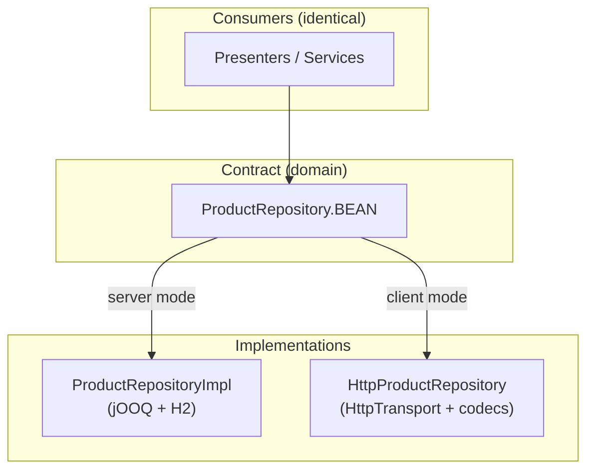
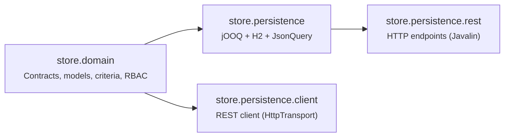
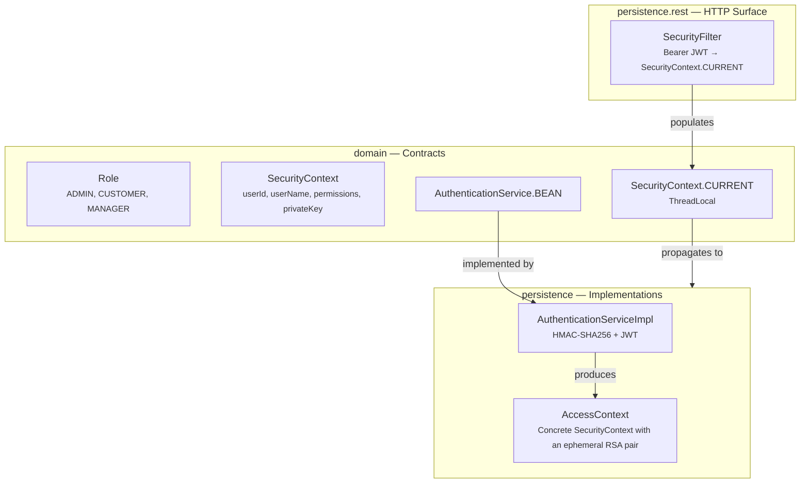
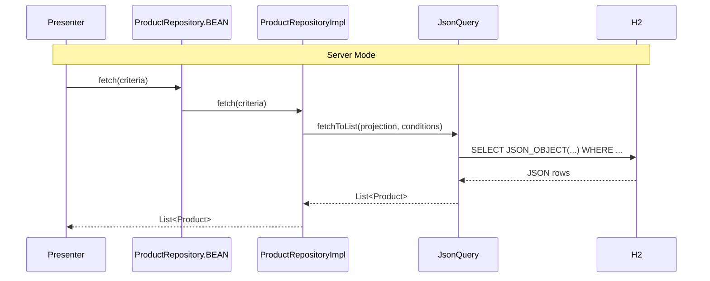
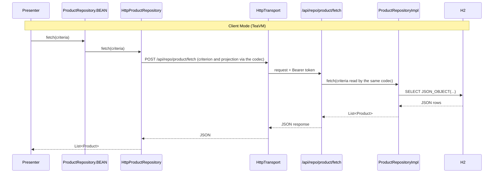

# Data Layer — Domain, Persistence and REST API

[Context](#context)  
[The Problem This Architecture Solves](#the-problem-this-architecture-solves)  
[Module Overview](#module-overview)  
[The Domain Module — The Contract](#the-domain-module--the-contract)  
[Repositories as Injectable Interfaces](#repositories-as-injectable-interfaces)  
[Criteria — Queries without SQL Strings](#criteria--queries-without-sql-strings)  
[Selective Projection — Load Only What You Need](#selective-projection--load-only-what-you-need)  
[The Persistence Module — The Implementation](#the-persistence-module--the-implementation)  
[JsonQuery — Declarative Bean↔Table Mapping](#jsonquery--declarative-beantable-mapping)  
[Lazy Relations — Subqueries without N+1](#lazy-relations--subqueries-without-n1)  
[RBAC Security — Permissions as a Domain Contract](#rbac-security--permissions-as-a-domain-contract)  
[The persistence.rest Module — The HTTP Surface](#the-persistencerest-module--the-http-surface)  
[The persistence.client Module — The HTTP Mirror](#the-persistenceclient-module--the-http-mirror)  
[Full Symmetry — the Same Code, Two Worlds](#full-symmetry--the-same-code-two-worlds)  
[Complete Flow — From the View to the Database](#complete-flow--from-the-view-to-the-database)  
[Transactions — Atomicity and Dual JTA/JDBC Mode](#transactions--atomicity-and-dual-jtajdbc-mode)  
[Client-Driven Remote Transactions](#client-driven-remote-transactions-over-rest)  
[Conclusions](#conclusions)  

---

## Context

Every system that deals with data faces the same dilemma: where does the SQL go? How do you isolate the domain from the database technology? What do you do when part of the views runs on the server and another part runs on the client (browser, mobile)?

This document describes how the WDC Store project solves these problems through a four-module architecture with a sharp separation of responsibilities — and how that separation lets **the same domain code run both with direct database access and over HTTP**, without any modification.

---

## The Problem This Architecture Solves

Imagine you have five frontend implementations for the same system. Some run on the server (Vaadin, SWT, remote mode) and access the database directly. Others run on the client (TeaVM compiled to JavaScript) and must access the data over HTTP.

The natural question is: how does the business code — Presenters, services, rules — stay **identical** in both cases?

The answer lies in the contract: repository interfaces that the domain defines, and that can be implemented in two ways — one that talks to the database through jOOQ, another that talks to the server over HTTP. Whoever uses the repository does not know which implementation is underneath.



---

## Module Overview



| Module | External dependencies | Responsibility |
|--------|-----------------------|-----------------|
| `domain` | SLF4J, Commons IO | Models, interfaces, criteria, RBAC |
| `persistence` | jOOQ, H2, Gson, framework.jooq | SQL implementation of the repositories |
| `persistence.rest` | Javalin, swagger-core | Exposes repositories as an HTTP API |
| `persistence.client` | OkHttp (JVM transport only) | Consumes the HTTP API as repositories |

---

## The Domain Module — The Contract

The `domain` module is **purely conceptual**. It knows nothing about databases, HTTP, or any persistence framework. It only defines what exists in the system.

### Criterion: one field, several requests

Each filterable field of an `XxxCriteria` is a `Criterion`, and the field's type decides what can be requested of it:

| Class | Adds | For |
|---|---|---|
| `Criterion` | `eq` `ne` `in` `isNull` `isNotNull` | what is compared only by identity — enum, boolean, foreign key |
| `ComparableCriterion` | `gt` `ge` `lt` `le` `between` | number, date, timestamp |
| `TextCriterion` | `like` `ilike` `containing` `startingWith` | text |

```java
var criteria = new ProductCriteria();
criteria.productId().in(1L, 2L, 3L);

new UserCriteria().userName().startingWith("adm");
```

This rules out, at compile time, a `between` on a field with no useful ordering: whoever declares the field knows the column type and picks the class.

**Successive requests accumulate, and by default they hold together (`AND`).** That is what makes `ge(start)` followed by `le(end)` — as they come from two screen fields — mean a range, and `ne(1)` with `ne(2)` exclude both. Were `OR` the default, these cases would return almost the whole table with nothing pointing to the error. An alternative is requested with `or()`, and the disjunction applies **within** the field; across fields it is always `AND`:

```java
criteria.userName().or().eq("admin");
criteria.userName().eq("jdoe");       // (userName = 'admin' OR userName = 'jdoe')
```

**A null value adds no request**, instead of erasing the previous ones — this preserves the habit of building a filter from a screen, where empty means "do not filter by this". To erase, `clear()`; to compare against null, `isNull()`. The `withXxx(value)` shortcuts exist too, and are `xxx().eq(value)`.

The translation to jOOQ is written **once**, in `CriterionTranslator`. What remains for each entity is to say which column corresponds to each field and, when the domain type differs from the column type, how to convert the value:

```java
return CriterionTranslator.and(Arrays.asList(
        CriterionTranslator.translate(enProduct.ID, criteria.productId()),
        CriterionTranslator.translate(enProduct.NAME, criteria.name()),
        // The column is NUMERIC and the domain speaks Double: the conversion belongs to the field,
        // and applies equally to eq, between and in.
        CriterionTranslator.translate(enProduct.PRICE, criteria.price(), BigDecimal::valueOf)));
```

A field that is not a column of the table — `PurchaseCriteria.productId`, which lives in the items — comes out as `EXISTS`, but the inner condition also comes from the translator, so `in`, `between` and the disjunction work there the same way.

> **Careful when migrating:** `criteria.productId()` is never `null` — the field always exists, whether set or not. Testing `criteria.productId() == null` compiles and is always false. What decides is `hasProductId()`. That is how two `delete` guards — the ones that prevent wiping the whole table — silently stopped working during the migration, without the compiler saying a thing.

**On the wire**, the field becomes an object carrying the requests, not a bare value:

```json
"price": { "or": true, "p": [ { "o": "GE", "v": [10.0] }, { "o": "IS_NULL" } ] }
```

A bare value would not be enough: a field carries several requests, each with its own operator and arity, and the disjunction belongs to the field. Reducing that to `"price": 10.0` would discard everything but equality, and silently. A bare value is still accepted on read, as equality.

### The OpenAPI specification is derived from the domain

The document served at `GET /openapi.json` does not describe the criteria by hand: it **derives** them. For each
entity there is a schema — `ProductCriteria`, `UserCriteria`, … — whose fields come from `Criteria.criterions()` and whose
`orderBy` carries the `enum` of that entity's `OrderBy`. The family of each field (identity, comparable, text) is read
from the class of the `Criterion` itself.

This exists for a concrete reason: the specification has fallen behind once already. While the lists were written by
hand, the criterion format changed and the document kept describing the old one, without anything breaking — code that only
describes does not fail when what it describes changes. By deriving, adding a field to the criterion makes it show up in the
documentation in the same build.

`OpenApiSpecTest` closes the rest: it checks that the documented fields and orderings are exactly those of the domain.
Note what this test does **not** cover — removing a field from the criterion removes it from both sides, and the test keeps
passing. What it catches is the specification falling behind the domain, which is the defect that actually occurred.

### Ordering: provisioned concepts, not fields

The `OrderBy` of each `XxxCriteria` is **not** a list of sortable fields with a direction. Each constant is a **whole ordering** — a concept — whose name states the effect obtained, and the translation decides which columns achieve it:

```java
public enum OrderBy {
    OLDEST_FIRST,          // insertion order
    NEWEST_FIRST,
    NAME_A_TO_Z,           // ORDER BY NAME asc, ID asc
    CHEAPEST_FIRST,        // ORDER BY PRICE asc, ID asc
    MOST_EXPENSIVE_FIRST,
}
```

Each entry names the **perceived effect**, not the column and direction: the caller does not pick a field and a direction, it picks an ordering that the application provisioned.

**The list is short on purpose.** A new ordering comes in by decision, and it comes in together with the index that supports it — that keeps explicit what the database must withstand. Offering free ordering by any field would look generous and would produce a full scan on the first large query. The indexes live in `DBCreate`, next to the table, with a comment stating which ordering each one serves.

Two practical consequences of the design:

- **The choice of columns lives in the repository**, not in the criterion. `MOST_RECENT_PURCHASE_FIRST` orders by `BUYDATE desc, ID desc`; the caller does not need to know that.
- **Every ordering by a non-unique field breaks ties by the key.** Without that, two runs of the same query may return the rows in different orders — and, with slicing, bring different sets.

### Transport of the projected collection

Everything described so far — expressive criterion, ordering and slicing of the child collection — works the same with direct access and over REST, because the whole projection travels. The subtle point is the **projected collection**: a `ProjectionList` is not a list of results, it is *one* item shape plus the criterion that filters it and the slice to apply. On the wire, it becomes an envelope, distinct from the result array by its very format:

```json
// projection (client → server)
"items": {
  "shape":  { "id": 1, "amount": 1, "product": { "id": 1 } },
  "where":  { "productId": { "p": [ { "o": "EQ", "v": [7] } ] }, "orderBy": "MOST_EXPENSIVE_FIRST" },
  "limit":  5,
  "offset": 1
}

// result (server → client) — the usual array
"items": [ { "id": 10, ... }, { "id": 11, ... } ]
```

The reader decides by the token: an object is a projection, an array is a result — the same `items` field serves both directions, and the result format is unchanged. The `where` reuses the item's codec (`CriterionCodec`), so `in`, `between` and the disjunction work in the sub-criterion as they do at the top level. `ProjectionCollectionCodec` handles the envelope; the child entity's codec handles the criterion contents — the two collaborate.

The envelope is what makes "the items of product X, ordered, first 5" reach the server as such — without it, `writeEntity` would carry only the shape of the items, and REST would return all of them, unfiltered and unordered. The collection tests live in the `Abstract*RepositoryTest` classes and run in both modes, so parity is verified, not assumed.

### Ordered and sliced child collection

A 1:N collection declared with `addBeanListField` can be ordered and sliced by the projection itself. The order comes from the `OrderBy` of the criterion the collection carries; the slice, from `withLimit`/`withOffset`:

```java
var items = pv.singletonList(itemPrj, new PurchaseItemCriteria()
                .withOrderBy(PurchaseItemCriteria.OrderBy.MOST_EXPENSIVE_FIRST))
        .withOffset(1)
        .withLimit(2);

var prj = new Purchase()
        .withId(pv.i64)
        .withItems(items);
```

For the repository to know how to translate the `OrderBy`, it registers the translation once:

```java
.setOrdering(PurchaseItemRepositoryImpl::orderingOf)
```

**The shape of the SQL is not free.** The collection comes out of a subquery correlated with the parent row (`child.fk = parent.id`), and that rules out the obvious path — wrapping the collection in a derived table, where a plain `ORDER BY ... LIMIT` would fit. A derived table cannot see the outer scope, and the correlation is out of reach: *column parent.id not found*. `LATERAL` does not work either — H2 only accepts it after a table on the left in the `FROM`.

What works, and what the framework emits:

```sql
(select LISTAGG(<projection>, ',') WITHIN GROUP (ORDER BY "pi2"."ID" desc)
   from "EN_PURCHASEITEM" "pi2"
  where "pi2"."PURCHASEID" = "p1"."ID"                    -- correlation with the parent
    and "pi2"."ID" in (select "pi3"."ID"                  -- slice: correlated subquery,
          from "EN_PURCHASEITEM" "pi3"                    -- which can see the parent
         where "pi3"."PURCHASEID" = "p1"."ID"
         order by "pi3"."ID" desc
         offset ? rows fetch next ? rows only))
```

That is: the **order goes inside the aggregation** (`LISTAGG ... WITHIN GROUP` in H2, `string_agg(... ORDER BY ...)` in PostgreSQL), and the **slice comes out as an `IN` over the primary key** — the PK comes from the table generated by jOOQ, with no declaration. The `IN` repeats the collection's filter, so the cut falls on the already-filtered set.

Without ordering or slicing, the query is the plain one — same SQL, same plan.

A dialect that cannot order inside the aggregate **refuses** the request with an exception, instead of returning the collection out of order: a wrongly ordered result passes as correct, and the error would only show up far away. H2 and PostgreSQL — the two the application uses — honor the order.

### An association projected only by its key generates no subselect

A 1:1 relation declared with `addBeanField` normally becomes a correlated subselect. But the most common projection brings the association **only to load the id** — and that id is already in the row, in the foreign key column. Fetching it from the other side is a query to find out what is already known.

By declaring the key in the relation, the framework builds the object from the row itself:

```java
.addBeanField("product", pi -> pi.product(), (pi, v) -> pi.withProduct(v), ProductRepositoryImpl.QUERY,
        cq -> cq.dsl().where().and(cq.getChildTable().ID.eq(cq.getSuperTable().PRODUCTID)),
        key -> key.addI64("id", t -> t.PRODUCTID))
```

The names declared in `key` are those of the **child's JSON** (`"id"`), and the columns are those of **this** table (`PRODUCTID`) — that is how the reader on the other side recognizes the object.

The shortcut is conditional: `JsonQuery.projectsBeyond(...)` asks whether the association's projection requests anything beyond the key. If it does, the query takes the subselect path. With `PurchaseItem.newProjection()`, which projects `purchase` and `product` with id only, the two per-row subselects disappear:

```sql
-- without the key declaration: two correlated subselects per row
KEY 'product' VALUE (select ... from "EN_PRODUCT" "p2" where "p2"."ID" = "pi1"."PRODUCTID")

-- with it: the key comes from the row itself
KEY 'product' VALUE JSON_OBJECT(KEY 'id' VALUE "pi1"."PRODUCTID")
```

### Organization: one package per entity

Packages follow the **entities**, not the class types. Each entity gathers in a single package everything that concerns it — model, query criterion, serialization codec and repository contract:

```
domain/
  product/      Product, ProductCriteria, ProductCodec, ProductRepository
  user/         User, UserCriteria, UserCodec, UserRepository
  purchase/     Purchase, PurchaseCriteria, PurchaseCodec, PurchaseRepository
  purchaseitem/ PurchaseItem, PurchaseItemCriteria, PurchaseItemCodec, PurchaseItemRepository

  exception/    InvalidCartItemException
  security/     Role
  StoreConfig, StoreTransactions
```

This way, touching an entity means touching a single folder, and a new entity is born as a complete package — instead of four files scattered across four technical packages.

### Models

Simple POJOs with encapsulated state and a **fluent API** — the same surface as the `XxxCriteria`: an accessor `field()` and a setter `withField(...)` that returns `this`. No persistence annotations, no mandatory inheritance (only `KeyedEntity`, which exposes the identity key to the serialization cycle detector):

```java
public class Product implements KeyedEntity {

    private Long id;

    public Long id() {
        return id;
    }

    public Product withId(Long id) {
        this.id = id;
        return this;
    }

    // ... name, price, description, image follow the same pair

    @Override
    public Long key() {
        return id;
    }
}
```

This keeps construction readable in a single expression, including relations:

```java
var prj = new PurchaseItem()
        .withId(pv.i64)
        .withAmount(pv.i32)
        .withPurchase(new Purchase()
                .withId(pv.i64));
```

No `@Entity`, `@Column`, `@JsonProperty`. The model is pure Java. The one that knows how to map it to the database is the `persistence` module. The one that knows how to serialize it to JSON is the `persistence.rest` module.

### Repositories as Injectable Interfaces

Each entity has a repository interface that defines the available operations:

```java
public interface ProductRepository {
    AtomicReference<ProductRepository> BEAN = new AtomicReference<>();

    boolean insert(Product product);
    boolean update(Product newEntity, Product oldEntity);
    boolean insertOrUpdate(Product entity);
    int delete(ProductCriteria criteria);
    int count(ProductCriteria criteria);
    List<Product> fetch(ProductCriteria criteria);

    // Lookup by key: a ProductCriteria with equality on the primary key.
    default Product fetchById(Long productId, Product projection) {
        var found = fetch(new ProductCriteria()
                .withProductId(productId)
                .withProjection(projection != null ? projection : newProjection()), 0, 1);
        return found.isEmpty() ? null : found.get(0);
    }
}
```

The `default` lives in the entity's interface because that is what knows which criterion field is the
key; the generic `Repository` only knows the type `C`. With that, looking up by key is the
same query as the others, with the same handling of projection, security and transaction.

The static `BEAN` field is the injection point — a lightweight Service Locator based on `AtomicReference`. The concrete implementation is registered during application bootstrap:

```java
// Server mode (direct database access):
ProductRepository.BEAN.set(new ProductRepositoryImpl());

// Client mode (access over HTTP):
ProductRepository.BEAN.set(new HttpProductRepository(transport, new ProductCodec()));
```

All code that consumes products simply does:

```java
var products = ProductRepository.BEAN.get().fetch(criteria);
```

And it does not know — nor needs to know — how those products arrived.

---

## Criteria — Queries without SQL Strings

Instead of receiving filters as loose parameters or SQL strings, each repository works with a typed criterion object. The criterion is a class with a fluent API:

```java
var criteria = new ProductCriteria()
    .withProductId(42L)
    .withOffset(0)
    .withLimit(20)
    .withOrderBy(ProductCriteria.OrderBy.NAME_ASC);
```

**Why is this good?**

1. **Type-safe** — there is no `fetch("name like ?", "%java%")`. If the field does not exist, it does not compile.
2. **Serializable** — the same `ProductCriteria` object travels as JSON between `persistence.client` and `persistence.rest`. The endpoint receives the criterion, deserializes it, and executes. There is no manual parameter mapping.
3. **Composable** — the `persistence` layer implements `ApplyConditions`, which translates the criterion into a jOOQ `Condition`. This lets one repository's filter be reused inside another's subqueries.

---

## Selective Projection — Load Only What You Need

An uncommon and very powerful feature: the caller controls which fields are loaded. The projection is an object of the same type as the model, where non-null fields mean "I want this field":

```java
// I only need id and name — no price, description or image
var projection = new Product();
projection.id = 0L;
projection.name = "";

var products = ProductRepository.BEAN.get().fetchById(42L, projection);
// Generated SQL: SELECT JSON_OBJECT('id', p.ID, 'name', p.NAME) FROM EN_PRODUCT p WHERE p.ID = 42
```

Without the projection, jOOQ would generate `SELECT JSON_OBJECT('id',...,'name',...,'price',...,'description',...,'image',...)` — including the `image` field, which may be a heavy blob. The projection makes this surgical.

The same mechanism works when serializing the criterion for HTTP: the `"projection"` field goes in the POST body, and the server applies the same filter before running the query.

---

## The Persistence Module — The Implementation

The `persistence` module implements the repositories using **jOOQ** as a type-safe query builder, **H2** as the embedded database and the **JsonQueryBuilder** framework (module `framework.jooq`) for declarative bean↔table mapping.

### JsonQuery — Declarative Bean↔Table Mapping

Instead of an annotation-based ORM, the mapping is defined in code, in a static, immutable object called `QUERY`. Each repository defines its own:

```java
public static final JsonQuery<Product, EnProduct> QUERY = new JsonQueryBuilder<Product, EnProduct>()
        .setAlias("p")
        .setBeanFactory(Product::new)
        .setTableFactory(EN_PRODUCT::as)
        .addI64("id",          p -> p.id,          (p, v) -> p.id = v,          t -> t.ID)
        .addStr("name",        p -> p.name,        (p, v) -> p.name = v,        t -> t.NAME)
        .addF64("price",       p -> p.price,       (p, v) -> p.price = v,       t -> t.PRICE)
        .addStr("description", p -> p.description, (p, v) -> p.description = v, t -> t.DESCRIPTION)
        .addBin("image",       p -> p.image,       (p, v) -> p.image = v,       t -> t.IMAGE)
        .build();
```

Each line describes a field with lambda functions:
- `getter` — how to read the field from the bean (for projection)
- `setter` — how to write the field into the bean (after deserialization)
- `column` — which jOOQ table column corresponds to it

`JsonQueryBuilder` uses these descriptors to:
1. Generate `SELECT JSON_OBJECT(...)` including only the fields with a non-null getter in the projection
2. Deserialize the JSON returned by the database straight into the bean, without reflection
3. Reuse the same mapping in lazy relation subqueries

**The query the database receives for a `fetch` without partial projection:**

```sql
SELECT JSON_OBJECT(
    'id',          p.ID,
    'name',        p.NAME,
    'price',       p.PRICE,
    'description', p.DESCRIPTION
) FROM EN_PRODUCT p
WHERE p.ID = 42
```

> The `image` field is omitted because it is `byte[]` — heavy binary served by a dedicated endpoint.

---

### Lazy Relations — Subqueries without N+1

The classic ORM problem is N+1: loading a list of purchases and, for each purchase, firing a separate query to fetch its items. `JsonQueryBuilder` solves this with **declarative correlated subqueries**:

```java
public static final JsonQuery<Purchase, EnPurchase> QUERY = new JsonQueryBuilder<Purchase, EnPurchase>()
        // ... direct fields ...
        .lazy(qb -> {
            // 1:1 relation — Purchase → User
            qb.addBeanField("user", p -> p.user, (p, v) -> p.user = v,
                    UserRepositoryImpl.QUERY, cq -> {
                        var enPurchase = cq.getSuperTable();
                        var enUser = cq.getChildTable();
                        cq.dsl().where()
                            .and(enUser.ID.eq(enPurchase.USERID));
                    });

            // 1:N relation — Purchase → Items
            qb.addBeanListField("items", p -> p.items, (p, v) -> p.items = v,
                    PurchaseItemRepositoryImpl.QUERY, cq -> {
                        var enPurchase = cq.getSuperTable();
                        var enPurchaseItem = cq.getChildTable();
                        cq.dsl().where()
                            .and(enPurchaseItem.PURCHASEID.eq(enPurchase.ID));
                    });
        })
        .build();
```

`lazy(...)` declares that these fields are loaded only when the projection includes them. When included, the framework generates a single query with correlated subselects:

```sql
SELECT JSON_OBJECT(
    'id',    pu.ID,
    'user',  (SELECT JSON_OBJECT('id', u.ID, 'name', u.NAME)
              FROM EN_USER u WHERE u.ID = pu.USERID),
    'items', (SELECT JSON_ARRAYAGG(JSON_OBJECT('id', pi.ID, 'amount', pi.AMOUNT, ...))
              FROM EN_PURCHASEITEM pi WHERE pi.PURCHASEID = pu.ID)
) FROM EN_PURCHASE pu WHERE ...
```

**One query. Zero N+1. Regardless of how many purchases are returned.**

---

## RBAC Security — Permissions as a Domain Contract

The security architecture is defined in the `domain` module — not in the persistence layer, not in HTTP. This ensures that access rules are central and independent of where the request originated.



The authentication flow uses **HMAC challenge-response** so the password never travels in plain text:

```
1. Client → GET /api/auth/challenge
   ← { nonce: "abc123", expiresAt: "..." }

2. digest = HMAC-SHA256(key=sha256(password), data=userName+nonce)

3. Client → POST /api/auth/login { userName, digest, nonce }
   ← { accessToken, refreshToken, publicKey, expiresAt }

4. Subsequent requests: Authorization: Bearer <accessToken>
```

`SecurityContext.CURRENT` propagates the context through a `ThreadLocal` — any code running on the same thread (including repositories) can check permissions without receiving extra parameters.

Permissions are defined in the `entity:operation` format:

```java
public enum Role {
    ADMIN(Set.of("user:*", "product:*", "purchase:*", "purchase-item:*", "data:all")),
    CUSTOMER(Set.of("user:read", "product:read", "purchase:read", "purchase:write",
            "purchase-item:read", "purchase-item:write")),
    MANAGER(Set.of("user:read", "product:read", "product:write", "purchase:read", "purchase-item:read"));
}
```

`*` grants every operation on the entity. Without `data:all`, the REST endpoints restrict reads of users and purchases to the authenticated user's own records.

---

## The persistence.rest Module — The HTTP Surface

The `persistence.rest` module exposes the repositories as a uniform HTTP API via Javalin. There is no business logic here — only serialization, authentication and delegation.

### Uniform Contract

All entities follow the same endpoint pattern:

| Method | Path | Body | Response |
|--------|------|-------|----------|
| `POST` | `/api/repo/product/insert` | `Product` | `boolean` |
| `POST` | `/api/repo/product/update` | `{ newEntity, oldEntity }` | `boolean` |
| `POST` | `/api/repo/product/delete` | `ProductCriteria` | `int` |
| `POST` | `/api/repo/product/count` | `ProductCriteria` | `int` |
| `POST` | `/api/repo/product/fetch` | `ProductCriteria` | `List<Product>` |
| `POST` | `/api/repo/product/fetch-by-id` | `{ id, projection }` | `Product` |
| `GET` | `/api/repo/product/{id}` | — | `Product` (404 if it does not exist) |

> The last two exist for consumers of the API from outside. This project's HTTP client
> does **not** use them: its `fetchById` is the interface's `default`, which builds the criterion and goes
> through `/fetch`. They are covered by `FetchByIdEndpointTest`.

The criterion and the projection travel as JSON in the body — a structure identical to the Java object. There is no manual mapping between HTTP parameters and domain objects.

### SecurityFilter

A before-filter registered on `/api/repo/*` extracts the JWT from the `Authorization: Bearer` header, validates it via `AuthenticationService`, and populates `SecurityContext.CURRENT`. The after-handler clears the context at the end of each request. The image endpoints (`/product/{id}/image`) are public — no authentication.

---

## The persistence.client Module — The HTTP Mirror

The `persistence.client` module implements the same repository interfaces from `domain`, but each call becomes an HTTP request. Almost everything lives in `HttpRepository`, the generic base: the seven contract operations have the same shape for every entity, and only the `basePath` and the codec change.

```java
public class HttpProductRepository extends HttpRepository<Product, ProductCriteria, Long>
        implements ProductRepository {

    public HttpProductRepository(HttpTransport transport, ModelCodec<Product, ProductCriteria> codec) {
        super(transport, codec, "/api/repo/product");
    }

    // Only what is specific to the entity: the image, which travels as bytes, not JSON.
    @Override
    public byte[] fetchImage(Long productId) {
        return transport().getBytes(basePath() + "/" + productId + "/image");
    }
}
```

**There is no reflection-based mapping.** Serialization uses the domain's own codecs (`JsonStreamWriter`/`JsonStreamReader`), the same ones the server side uses to read — that is what guarantees criterion and projection cross the wire with the same meaning on both sides:

```java
public List<E> fetch(C criteria, int offset, int limit) {
    var writer = new JsonStreamWriter();
    writer.beginObject();
    codec.writeCriteriaFields(writer, criteria);     // the whole expressive criterion
    writeProjection(writer, codec.getProjection(criteria));
    if (offset > 0) writer.name("offset").value(offset);
    if (limit > 0) writer.name("limit").value(limit);
    writer.endObject();

    var responseJson = transport.postJson(basePath + "/fetch", writer.result());
    // ... reads "items" with codec.readEntityList
}
```

### The transport is an interface

`HttpTransport` (in `framework.commons.http`) is what the repository sees: `postJson`, `getJson`, `getBytes`, `putBytes`. Two implementations:

| Implementation | Where | How |
|---|---|---|
| `OkHttpTransport` | JVM (tests, remote SWT) | OkHttp |
| `FetchHttpTransport` | browser (`teavm.web`) | the browser's own `fetch`, via TeaVM |

That is why `persistence.client` runs compiled to JavaScript: nothing in it depends on OkHttp — that dependency lives only in the JVM transport. `OkHttpTransport` handles the Bearer token (via `setAccessTokenSupplier`) and the remote transaction's `X-Tx-Id` (via `setTransactionIdSupplier`).

The **bootstrap** is a single call that registers all implementations in the BEANs:

```java
RestRepositoryBootstrap.initialize(transport, storage);
// From here on, ProductRepository.BEAN.get() returns HttpProductRepository
```

Besides the four repositories, it registers the `AuthenticationService` (HMAC challenge-response login
against the API) and `StoreTransactions.BEAN` (`RestTransactionService`, the client-driven remote
transaction).

---

## Full Symmetry — the Same Code, Two Worlds

This is the central point of the architecture. The code that consumes repositories — Presenters, services, business rules — is **literally the same Java file** running in two completely different contexts:

```
Server mode (Vaadin, SWT, remote mode):
  ProductRepository.BEAN → ProductRepositoryImpl → jOOQ → H2

Client mode (TeaVM):
  ProductRepository.BEAN → HttpProductRepository → HttpTransport → /api/repo/product/fetch → ProductRepositoryImpl → jOOQ → H2
```

The `CartPresenter` that fetches products to display in the cart does not have a single line of code that differs between the two modes. The difference lies only in the bootstrap — in which implementation is registered in the `BEAN`.

---

## Complete Flow — From the View to the Database

The diagram below shows the path of a product query started by the Presenter, in both modes:





From the Presenter's point of view, the two sequences are indistinguishable.

---

## Transactions — Atomicity and Dual JTA/JDBC Mode

A business operation is rarely a single SQL statement. Completing a purchase, for example, inserts the purchase row **and** one row for each item. If the insertion fails halfway, what is left in the database? In *autocommit* mode — where each `INSERT` is committed on its own — an **orphan purchase** is left, with no items. The classic solution is the transaction: either everything is committed, or nothing is.

The project solves this with a **programmatic transaction layer in the style of EJB CMT (Container-Managed Transaction)**, with a rare property: the same domain code works with a **direct JDBC** transaction (default) or **JTA/XA** (Narayana), switched by configuration — and **without the repositories changing a single line**.

### The contract — `TransactionService`

The abstraction lives in `framework.domain.transaction` (pure contract, no technology). The transaction boundary is always the supplied work (a lambda): on normal return it **commits**, on any exception it **rolls back** and rethrows. The `TransactionContext` handed to the work serves to mark rollback and for introspection.

```java
// per-module holder, populated by the backend (e.g.: StoreTransactions.BEAN.get())
StoreTransactions.BEAN.get().required(tx -> {
    purchaseRepository.insert(purchase);   // purchase + items
    if (businessRuleFailed) {
        tx.setRollbackOnly();              // aborts without throwing an exception
    }
});
```

The propagation attributes mirror EJB (each with a `void` form and a value-returning `…Call` form, avoiding lambda overload ambiguity):

| Propagation | Behavior |
|------------|---------------|
| `required` | Joins the active transaction or opens a new one |
| `requiresNew` | Suspends the active one, opens a new one, resumes at the end |
| `mandatory` | Requires an active transaction (otherwise `TransactionRequiredException`) |
| `supports` | Participates if there is one; otherwise runs without a transaction |
| `notSupported` | Suspends the active one and runs without a transaction |
| `never` | Forbids an active transaction (otherwise `TransactionNotAllowedException`) |

### The engine — `TransactionScope` (dual mode)

The implementation (`framework.persistence`) is a *frame* bound to the thread (`ThreadLocal`) that operates in two modes, decided at runtime:

- **JDBC** (default): manages the transaction directly on the `Connection` (`autoCommit=false`, `commit`/`rollback`). No external coordinator.
- **JTA**: delegates `begin`/`commit`/`rollback` to a `TransactionManager` (Narayana); the connection, obtained from a *JTA-aware* `DataSource`, is enlisted as an **XA** resource — enabling 2PC when there is more than one resource.

Re-entrant `required` calls share the **same physical connection** as the *owner*; only the *owner* commits/closes (participants are no-ops).

### How the repositories take part — unchanged

The `*RepositoryImpl` classes stay declarative: they use the shared `DSLContext` and never touch connections or transactions. The link happens at a single point — the `DSLContext` is built on top of a **`TransactionAwareConnectionProvider`** (in `framework.jooq`):

- **inside a transaction**: it hands out the current `TransactionScope`'s connection → all queries in the block share the same physical transaction;
- **outside**: it borrows a standalone connection from the pool (autocommit).

The result: wrapping an operation in `required(...)` makes atomic every query the repositories run inside it — in JDBC and in JTA — without any change to the repositories.

### Where the transaction is opened

The boundary sits in the **write use cases**, not in the repositories:

- **Host flow** (server-side presenters): completing the purchase (`CartManager.doPurchase`) wraps the `insert` of the purchase+items. It is *null-safe* — in environments without a `TransactionService` (e.g.: TeaVM in the browser, which uses HTTP repositories) it runs directly.
- **REST flow** (`persistence.rest`): a `RepositoryApiRoutes.transactional(...)` decorator wraps the write handlers (`insert`/`update`/`delete`) when the routes are registered, preserving the original exception type so that Javalin's *exception mappers* keep working. This decorator has **two behaviors**: without `X-Tx-Id`, it opens an isolated transaction per request (the case above); with `X-Tx-Id`, it joins a client-driven remote transaction (next section).

### Configuration and neutrality

The mode is chosen in `application.toml`:

```toml
[database]
# "jta" = Narayana TransactionManager + Agroal pool enlisted in XA
# "non-jta" = direct JDBC (autocommit per statement) — default
transaction = "jta"
```

One principle guides the separation: **the concrete technology (Agroal, Narayana, XA driver) lives in the host** (`cube.backend`), which builds the `DataSource` and the `TransactionManager` and injects them into neutral holders. The `framework.persistence` module stays agnostic — it depends only on `javax.sql.DataSource` and `jakarta.transaction` (standards), never on a pool or TM implementation. Swapping Agroal/Narayana for another stack is a change isolated to the host.

### Per-module context (hexagonal)

There is no global holder for `DataSource` or `TransactionService`. Each **module** exposes its holders as an SPI — `StoreDSLContext` (DSLContext) and `StoreTransactions` (TransactionService) — populated by the **backend (composition root)**, which knows all modules. `TransactionServiceImpl` receives the module's `DataSource` at construction (`Supplier<DataSource>`), so each module has its transaction bound to **its own** database.

Whether the backend gives two modules the same `DataSource` (shared database) or distinct databases is its decision — **transparent to the module**, which only uses its own holder. The JTA `TransactionManager` remains **single per JVM** (coordinator): it is what lets a transaction span several modules/datasources in XA — that is why it is *not* contextualized per module.

---

## Client-Driven Remote Transactions (over REST)

The previous section makes atomic a block that runs **inside a boundary**: a use case in the Host, or *one* REST write request (the `transactional` decorator). But what about a frontend that talks to the backend **over HTTP** (React, Flutter — using the `persistence.client` repositories) and needs **several separate REST calls** — insert the purchase, then insert each item — to be atomic? Each HTTP call is its own request, with its own connection on the server; the per-request decorator cannot span them all.

The solution keeps the physical transaction **alive across requests** on the server, identified by a `txId`, while the client demarcates the boundary remotely. The key point: this reuses the **same `TransactionService` contract** — `StoreTransactions.BEAN.get().required(...)` works identically in-process (Host) or over HTTP (client). Just like the repositories, **the transaction boundary is symmetric** between the two worlds.

### The client — `RestTransactionService`

On the client, `StoreTransactions.BEAN` resolves to `RestTransactionService` (an implementation of `TransactionService` over HTTP, in `persistence.client`). A `required(...)`:

1. does `POST /api/tx/begin` → receives the `txId` and binds it to the thread (`ThreadLocal`);
2. propagates the `txId` in the **`X-Tx-Id`** header on every repository call in the block (via `HttpTransport.setTransactionIdSupplier`) — the server joins them into the same physical transaction;
3. on normal return does `POST /api/tx/commit`; on exception (or after `setRollbackOnly`), `POST /api/tx/rollback`.

The propagation matrix (`requiresNew`, `mandatory`, `supports`, `notSupported`, `never`) mirrors the in-process implementation — single-threaded, like the server coordinator.

### The server — `RemoteTransactionCoordinator`

On the server side, `TxApiController` exposes `/api/tx/{begin,commit,rollback}`, delegating to a `RemoteTransactionCoordinator`. It keeps, per `txId`, a **suspended** `TransactionScope` (a live physical transaction, with no owning thread):

| Operation | Effect |
|----------|--------|
| `begin` | opens the tx, suspends it and returns the `txId` |
| `resume` / `suspend` | binds/unbinds the tx on the thread serving each request |
| `commit` / `rollback` | finish it and remove it from the registry |

The link to the writes is the `transactional` decorator mentioned above: when the request carries `X-Tx-Id`, it `resume`s the remote tx, runs the handler and `suspend`s — **without committing** (the boundary belongs to the client). Without `X-Tx-Id`, it falls into the case of the previous section (isolated tx per request).

```
client (RestTransactionService)           server (TxApiController + coordinator)
  begin ─────────────────────────────────▶ opens physical tx, suspends, returns txId
  insert(purchase) [X-Tx-Id: txId] ───────▶ resume → runs in the tx → suspend
  insert(item)     [X-Tx-Id: txId] ───────▶ resume → runs in the tx → suspend
  commit           [X-Tx-Id: txId] ───────▶ resume → COMMIT → remove
```

It works in **both modes** of `TransactionScope`: JDBC (keeps a single connection open across requests) and JTA (suspend/resume on the `TransactionManager`).

### Where each piece lives (and why)

The coordinator is a **purely server-side persistence** SPI — that is why it lives in `framework.persistence.transaction`, **not** in `framework.domain`. The presentation layer (the frontends) depends transitively on the domain; exposing a server mechanism there would be a leak. The domain holds only the **demarcation** contract (`TransactionService`/`TransactionContext`), which the use cases do use.

The `RemoteTransactions.COORDINATOR` holder lives in `persistence.rest` (server side), populated by the **composition roots** — `BusinessContext` (backend) and `TestEnvironment` (tests) — bound to the module's `DataSource`. `StoreTransactions` (domain) holds only the application's `TransactionService`. It is the same hexagonal principle as the previous section: the neutral contract in the domain, the technology and server-side holders outside it.

### Security and lifecycle

- **Authentication and owner:** the `/api/tx/*` routes sit behind the same filter as `/api/repo/*` (registered only when security is enabled). The **owner** (`ownerKey`, derived in `TxApiController.currentOwnerKey`) is `user:<userId>` when authenticated, or `anon:<X-Client-Id>` with security disabled — separate namespaces so an anonymous client cannot collide with (or impersonate) a real user. The coordinator revalidates the owner on `resume`/`commit`/`rollback` — another user cannot hijack a tx by its `txId`.
- **Atomicity guard:** if a write arrives **without** `X-Tx-Id` but the owner **has an open remote transaction** (`hasOpenTransactionForOwner`, O(1) index), the `transactional` decorator **rejects** it (`409 Conflict`, via `TransactionConflictException`) instead of autocommitting an orphan write outside the transaction — a server-side defense against the client failing to propagate the header.
- **Caps (pool protection):** a **global** and a **per-owner** cap on open transactions at `begin` (each one holds a connection); exceeding them → `429`. This keeps one client from monopolizing/exhausting the pool.
- **Abandoned txs:** each `txId` holds a live connection/transaction until the end. A *reaper* rolls back and removes by **idleness** (60s) **or** by **absolute lifetime** (10 min — stops the client that "pings" to never expire), with a lazy sweep on `begin`.
- **Idempotency:** `commit`/`rollback` remember the outcome for a retention window — a retry (previous response lost) with the same outcome is a successful no-op; the opposite conflicts (`409`). `GET /api/tx/status` (`open`/`committed`/`rolledback`/`unknown`) disambiguates.
- **Concurrency:** a tx is single-threaded; concurrent use of the same `txId` is rejected — the client must serialize a transaction's requests.
- **Observability:** the coordinator exposes `stats()` (gauges of open txs/owners + cumulative counters) and logs reaper runs/rejections.
- **Configuration:** timeouts (idle/lifetime), outcome retention and caps come from `application.toml` (`[database]` → `remoteTransaction.*`, in seconds), via `RemoteTransactionOptions.fromConfig`; when absent → the coordinator's defaults.

> **In-depth design:** who owns a transaction, how that identifier is generated with uniqueness (local strategy vs. server-issued), the trust model against forged ids and the evolution toward **ownership per context (tab)** are in [Remote Transaction — Client Identity and Transaction Ownership](remote-transaction-identity-and-ownership.md).

---

## Conclusions

The WDC Store data layer shows that it is possible to have **zero duplication of business logic** between a server frontend and a client frontend, as long as the boundary is defined in the right place — in the repository interfaces.

The points that make this architecture robust:

- **Domain without infrastructure dependencies** — models and interfaces that any module can reference without dragging in unwanted dependencies
- **Typed, serializable criteria** — the same object that builds the SQL query travels as JSON between client and server, with no manual mapping
- **Declarative JsonQuery** — bean↔table mapping without runtime reflection, with selective projection and lazy relations that eliminate N+1
- **Security as a domain contract** — permissions defined in `Role`, propagated via `SecurityContext.CURRENT`, checked in the REST controllers
- **Symmetric transaction** — the same `TransactionService.required(...)` makes writes atomic in-process (Host) or across several REST calls (client), without the use case knowing which world it runs in
- **Bootstrap symmetry** — switching from server mode to client mode is a single initialization line

The practical consequence: when a new frontend is added to the system, it inherits all data-access behavior for free — including security, projection and pagination — simply by registering the appropriate implementation in the BEAN.
