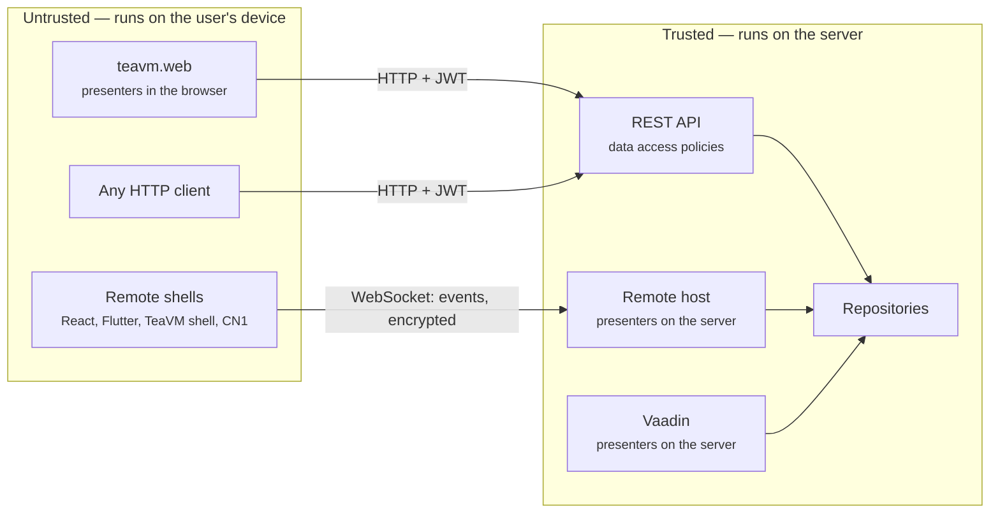
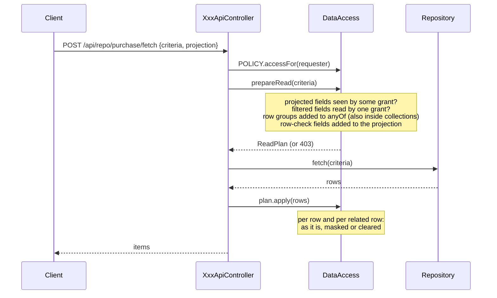

# Security Architecture

How WDC Store protects its data and its sessions, and why it is built this way: the trust boundaries of each kind of host, authentication, the authorization of the REST API by data access policies, the security of the remote presentation channel, and the limitations an adopter has to weigh. It is written for software architects evaluating or extending the design; the hands-on guide for developers who use the framework is [Securing an Application with the WDC Framework](../fontes/br.com.wdc.framework/docs/security-guide.md).

## Table of Contents

- [Scope and Threat Model](#scope-and-threat-model)
- [Trust Boundaries per Host](#trust-boundaries-per-host)
- [Authentication](#authentication)
- [Authorization at the REST API — Data Access Policies](#authorization-at-the-rest-api--data-access-policies)
- [Authorization Where the Presenters Run on the Server](#authorization-where-the-presenters-run-on-the-server)
- [The Remote Presentation Channel](#the-remote-presentation-channel)
- [Remote Transactions](#remote-transactions)
- [Known Limitations and Hardening](#known-limitations-and-hardening)
- [Decisions](#decisions)

---

## Scope and Threat Model

**What is protected:** the users' credentials and personal data, each customer's purchases, the catalog (against unauthorized changes), and the integrity of what is recorded — a customer must not set the price it pays, nor record a purchase in someone else's name.

**Who is considered:**

| Actor | Can do | Must not be able to |
|-------|--------|---------------------|
| Anonymous client | Reach the login, the public product images and the static pages | Read or write any repository |
| Authenticated customer with a **modified client** | Send any request its token allows — any criteria, any projection, any event payload | Read other users' data, write beyond its role, choose prices |
| Manager | Run the catalog | Change purchases or users |
| Administrator | Everything on the data | Read passwords back |
| Network observer | See the traffic | Read credentials or session data — assumes TLS in production |

Every client is assumed to be modifiable. In particular, the teavm.web frontend runs the presenters **in the browser**, so its code is no more trustworthy than a hand-written HTTP call.

Out of scope: denial of service, the hosting infrastructure, and the security of the database server itself.

---

## Trust Boundaries per Host

The same presenters run in five kinds of hosts, and the boundary between trusted and untrusted code is not in the same place in each:



| Host | Where the presenters run | What crosses the boundary | Who authorizes |
|------|--------------------------|---------------------------|----------------|
| **teavm.web** | Browser | Repository calls: criteria, projections, entities | The **data access policy** of each entity, at the REST API |
| **Remote shells** (React, Flutter, TeaVM shell, Codename One) | Server | Events with their form data; scopes back | The **presenter**: it builds every query; the ids it receives in events are untrusted |
| **Vaadin** | Server | Vaadin's own component events | The presenter |
| **SWT (local)** | Same process as the data | Nothing | — (a desktop application with direct database access) |
| **External HTTP clients** | — | Repository calls | The data access policies |

Hence the two authorization mechanisms below: **data access policies** where the client composes the request, and **presenter responsibility** where the server does.

---

## Authentication

### Sign-in with SCRAM-SHA-256

The password never travels, and the database holds nothing that signs anyone in. The sign-in is **SCRAM-SHA-256** (RFC 5802 and 7677), the scheme PostgreSQL uses ([ADR 0024](adr/0024-scram-sign-in.md)):

```
1. POST /api/auth/challenge { userName }   → { nonce, salt, iterations, expiresAt }   nonce single-use, 60 s, for this user
2. digest         = MD5(password) as a signed integer in base 36          (PasswordUtil.hashPassword)
   SaltedPassword = PBKDF2-HMAC-SHA256(digest, salt, iterations)
   ClientKey      = HMAC(SaltedPassword, "Client Key")
   AuthMessage    = "n=<userName>,r=<nonce>"
   proof          = ClientKey XOR HMAC(SHA-256(ClientKey), AuthMessage)
3. POST /api/auth/login { userName, proof, nonce }
                                           → { userId, accessToken, refreshToken, publicKey, expiresAt, serverSignature }
4. the client checks serverSignature = HMAC(HMAC(SaltedPassword, "Server Key"), AuthMessage)
5. Authorization: Bearer <accessToken>     on every repository call
```

`Scram` and `ScramVerifier` (`framework.domain.security`) compute both sides through the `CryptoProvider`, so the server, the JVM clients and the browser run the same code; they are tested against the RFC 7677 vector.

- **What the server stores** is a verifier, `SCRAM-SHA-256$<iterations>:<salt>$<StoredKey>:<ServerKey>` in `EN_USER.PASSWORD`, with a random 16-byte salt and 4096 iterations kept per verifier. `PasswordVerifiers` is the only place that makes one. The StoredKey checks a proof and the ServerKey signs the answer; neither signs anyone in, and guessing a password from them costs one PBKDF2 run per guess.
- **The server checks** that the proof, XORed with `HMAC(StoredKey, AuthMessage)`, hashes to the StoredKey, in constant time. The nonce is consumed on use, expires in 60 seconds and is good only for the user it was made for, so a captured proof cannot be replayed.
- **The client checks** the server's signature before keeping the session: a server that does not hold the user's verifier cannot compute it.
- **An unknown user** gets a made-up salt, the same for the same name, and its proof is checked against a decoy verifier: the answers and the work do not tell whether a login exists. Every refusal is the same 401.
- **Older databases** stored the MD5 digest itself. Since the digest is the input of the key derivation, `DBCreate` converts each one to the verifier of the same password on the first start (H2 and PostgreSQL), without knowing any password.

### Limits on guessing

| Limit | Where | Rule | Answer |
|-------|-------|------|--------|
| Failed sign-ins per account | `LoginThrottle`, in the database (`EN_LOGIN_FAILURE`) | 5 free failures in a row, then a wait of 30 s doubling up to 15 min; a success clears the count; failures older than 1 h are forgotten | 429 |
| `/api/auth` requests per client address | `AuthRateLimit`, in each instance's memory | `[security] auth.requestsPerMinute` (default 60, `0` = none), fixed window per minute | 429 |

Both answer **429** with the wait in `Retry-After` and in the body (`retryAfter`); the REST client throws `TooManyRequestsException` back, and the login screen says how long to wait. The per-account count holds whichever way the sign-in comes in — the REST API or a view whose presenters run on the server — and across instances, since it is in the database. It is a wait, not a lock: someone who knows a login can make its owner wait, never lock them out.

### Sessions and tokens

| Token | Form | Lifetime | Where it lives |
|-------|------|----------|----------------|
| Access token | JWT (HS256; claims `sid`, `sub`, `usr`, `exp`) | 30 minutes | Client memory / secure client storage |
| Refresh token | Random UUID, one per device | 7 days; **rotated** on each refresh | Server session cache; secure client storage |
| Persistent token ("remember me", remote hosts) | JWT without `sid` | 30 days | The client's `persistent-secure` storage |

An access token names its session (`sid`) and is accepted only while **that session** is live in the server's in-memory cache (`AccessContextCache`); the session holds the user's role names and an ephemeral RSA-2048 key pair. Each device has its own session, with its own key; logout removes the session of its refresh token, and that device's access token stops working with it. The persistent token has no session, so it does not open the API; it only starts a new session (`loginWithPersistentToken`), which an access token cannot do.

On the server side the requester is a `SecurityContext` — user id, user name, **role names**, the session's private key — set by `SecurityFilter` in a `ThreadLocal` for each request and cleared afterwards. The authentication contracts (`AuthenticationService`, `SecurityContext`) are in the framework; the implementation (`AuthenticationServiceImpl`) is the application's.

### Passwords sent by clients

When a client creates or changes a user, the password goes encrypted with the session's RSA public key (RSA-OAEP, SHA-256), returned at login; `UserApiController` decrypts it with the session's private key and stores its verifier (`PasswordVerifiers.fromPassword`). A password that does not decrypt with the session's key is refused (400), never stored as it came.

---

## Authorization at the REST API — Data Access Policies

### The problem

The REST repository API is flexible on purpose: the client sends any criteria and any projection, and gets back exactly the fields it asked for. That is what lets teavm.web run the same presenters as the server without a transfer object per screen. At a boundary open to modified clients, the same flexibility means that a check written by hand per endpoint — "remove the password from this projection", "add `userId = me` to that criteria" — has to be remembered for every new field and endpoint, and gives no way to say that a role reads a field only partially, or only on some rows.

**The design:** one declaration per entity — per role, which rows, which fields, which masks, which writes — applied to every request. **The projection stays the contract**: no transfer object is created; the client asks with the projection it already uses, and the policy decides whether it may.

### The model

A **`DataPolicy`** gives each **role** one or more **`DataGrant`s** over an entity:

| Part | Meaning |
|------|---------|
| `rows(scope)` | Which rows it reaches — every row by default, or a `RowScope` (the requester's own user, their purchases) |
| `read(projection)` | Fields read as they are. Only these can be used in filters and orderings |
| `mask(projection, mask)` | Fields read through a `Mask` — textual fields only |
| `create(projection)` | Fields that may be set when creating a row |
| `update(projection)` | Fields that may be changed in a reachable row |
| `delete()` | The reachable rows may be deleted |

The key is never declared: whoever reads a row reads its key, and the key is never written. A field is a value, a **relation** to one row of another entity (`purchase.user`) or a **collection** (`purchase.items`); in a grant, a relation or a collection is one field — reading it means reading the related key. An **`EntityDescriptor`** tells the policy what it cannot infer: each field's wire name, the criteria field → entity field mapping, the fields each provisioned ordering sorts by, the related entities' policies, and the default shape of a read.

The store's policies (`persistence.rest.security`):

| Role | Users | Products | Purchases and items |
|------|-------|----------|---------------------|
| ADMIN | Every user: login, name, roles; creates, updates, deletes | Reads and writes | Every purchase: reads, creates, updates, deletes |
| CUSTOMER | Its own user | Reads | Its own: reads and creates — a purchase is a receipt; no price on items |
| MANAGER | Its own user in full; the others by name, login masked | Reads and writes | Its own: reads |

No grant reads a password: it is written when a user is created or changed, and never read back.

### Rules

**Roles combine row by row.** The model is *allow-wins* — a user gets every grant of every role — but the fields of a returned row are those the grants **that reach that row** allow. Adding up the columns of every role and the rows of every role would hand a user who is SUPPORT (everyone's name) and CUSTOMER (its own document) **everyone's document**; per row, the other users' rows are reached only by SUPPORT. Per field of each row: read as it is by a reaching grant → as it is; else masked by a reaching grant → masked; else → absent.

Each `RowScope` is written twice, and both must agree: `restrict(group, sc)` as criteria, so the database returns only reachable rows; `covers(row, sc)` in memory, on each returned row. What `covers` reads is declared as a projection (`RowScope.projection()`), possibly through relations, fetched for the check and cleared before the response.

**Filtering and sorting count as reading.** `startingWith("1")`, `startingWith("12")`, ... reads a document number one digit at a time without ever projecting it. Every field the criteria filters (including inside alternative groups) or sorts by must be **read as it is** by one grant, and only the rows of the grants that read all of them are returned. The manager filtering users by login reaches only its own row.

**Writing.**

- Create: one grant allows every field sent, and reaches the new row.
- Update: one grant reaches the **stored** row, allows every changed field, and **still reaches the row after the change** — a grant over one's own rows cannot hand a row to someone else.
- Delete: only the rows of grants that delete, filtered by fields those grants read.
- A grant that masks a field cannot write it (refused when the policy is built), so a masked value echoed back is a 403, never an overwrite.
- A relation is written by its key only.
- What the server decides is not writable: the price of an item is the price of its product, read by a subquery in the `INSERT` itself, and recomputed by an update that touches the price or the product. A price sent by anyone, the ADMIN included, is not used.

**Refusing, not trimming.** A forbidden request is a **403 naming the fields** (`not allowed to read user fields [password]`). Quietly trimming would make a screen show blanks with nobody knowing why. The client is not sent the policy: a correct client never asks for what its roles do not allow, so a 403 is an unexpected error, and the field list serves whoever reads the log.

**No projection means "the default shape, trimmed".** A read without a projection gets the entity's default shape (`EntityDescriptor.Builder.defaultShape`; every field but the collections when none is declared; the receipt with its items for a purchase), trimmed to what the requester may read — never refused, since the client asked for nothing in particular. A shape "all the way through the relations" has no natural end (items point back to their purchase) and would grow on its own as a role gains access.

### Relations

Each entity has **one set of rules wherever it appears**: a purchase's buyer goes through the user policy, its items through the item policy, an item's product through the product policy. Otherwise the same row would have two sets of rules, and the looser would win.

- **Reading.** The owner's grant decides whether the relation is read (its key). The fields asked inside go through the related entity's policy, row by row — `purchase.user.password` is a 403 even for an ADMIN. The rows of a collection are restricted by the related policy too: its row groups are added to the collection's criteria, which the repository translates in the subquery.
- **Writing.** A relation is written by its key only. The rows of a collection sent with a new owner — the items of a new purchase — are created through the related policy **as children of that owner** (the descriptor names the back-reference, `items` → `purchase`), so "items of my purchases" reaches the items of the purchase being created. A row scope that needs a relation not sent may look it up on a write: an item inserted on its own comes with its purchase by key, and `PurchaseItemDataPolicy.OWN` fetches that purchase's owner.

### Alternative groups in the criteria, server-side only

Restricting rows by several scopes ("my rows, or my store's") needs a disjunction **across fields**; the fields of a criteria join with `AND` and `or()` only joins the requests of one field. So every `Criteria` has **alternative groups** (`anyOf`): the criteria matches when its fields match and at least one group matches. The policy adds one group per distinct row scope, each carrying the groups the criteria already had:

```
criteria: fields AND (a1 OR a2)
policy:   fields AND ( (own AND (a1 OR a2)) OR (store AND (a1 OR a2)) )
```

**The groups do not travel.** The codecs refuse them on both sides of the wire (the client fails before sending; an `anyOf` key reaching the server is a 400). A client free to send any tree of `OR`s over any columns sends, sooner or later, the query no index supports — the same reason the orderings are provisioned. A client's search over several columns is a criteria field of its own, translated by the repository with `CriterionTranslator.translateAny`.

### How a request flows



The controller calls one `DataAccess` method per operation — `prepareRead`, `restrictCount`, `checkCreate`, `checkUpdate` (with a loader for the stored row), `restrictDelete` — and nothing else: the policies are the only authorization of the REST API. Without an `AuthenticationService` (local and test modes) there is no requester, and `accessFor(null)` lets everything through.

### Where the pieces live

| Piece | Module | Why there |
|-------|--------|-----------|
| `DataPolicy`, `DataGrant`, `DataAccess`, `RowScope`, `Mask`, `EntityDescriptor` | `framework.domain` (`security.policy`) | Contracts with no technology, next to `SecurityContext` |
| `Criteria.anyOf`, `CriterionCodec.refuseAnyOf` | `framework.domain` (`criteria`) | Every criteria has them on the server; the wire refuses them |
| `CriterionTranslator.anyOf`, `translateAny` | `framework.jooq` | The single translation to SQL |
| `UserDataPolicy`, `ProductDataPolicy`, `PurchaseDataPolicy`, `PurchaseItemDataPolicy` | `persistence.rest` (`security`) | The policies apply only at the REST boundary |
| Price of an item | `persistence.impl` (`PurchaseItemRepositoryImpl`, `insertRow` and `update`) | The server decides it, in every host, for every role |

### What the policies refuse (tested)

`UserDataPolicyRestTest` and `PurchaseDataPolicyRestTest` run against the REST API with authentication on:

| Request | Answer |
|---------|--------|
| A customer reads, counts or fetches by id another user, purchase or item — with or without the owner in the projection | Not found / not counted |
| Any role projects a password, directly or through `purchase.user` | 403 |
| A customer updates or deletes a purchase or an item, its own included | 403 |
| A customer creates a purchase for someone else, or adds an item to someone else's purchase | 403 |
| A customer sends the price of an item | 403; the price comes from the product |
| A customer writes products or uploads a product image | 403 |
| A manager filters or sorts users by login | Only its own row |

---

## Authorization Where the Presenters Run on the Server

In the remote, Vaadin and local hosts there is no policy: the presenter is server code, and it chooses every query, every projection, and what goes into its scope. Two duties come with that:

1. **Ids that come from the client are untrusted.** A remote shell sends events with form data over the WebSocket, and a modified shell sends whatever it wants. The navigation the server builds from an event is signed by the server itself, so the signature does not vouch for the id inside it. Every query that takes an id from an event must be scoped to the user: `ReceiptQuery` looks up a purchase by id **and** buyer, so another user's receipt is "not found" (`StoreWorkflowTest.aReceiptOfAnotherUser_isNotFound`).
2. **The scope crosses the wire.** In the remote hosts, whatever the presenter puts in its scope reaches the client. It must not carry a field the screen does not show; a value the screen shows masked is masked by the presenter.

Navigation itself is protected: in the remote hosts and in Vaadin, the URL the client sends back is checked against the server's signature, and a tampered one is replaced by the current state ([protocol, §13](bridge-skeleton-protocol.md#13-navigation-and-url-signing)). In teavm.web, which signs on the client, the signature only guards against stale links; the REST policies are what protect the data.

---

## The Remote Presentation Channel

Between a remote shell and the host (full specification: [bridge-skeleton-protocol.md](bridge-skeleton-protocol.md)):

| Mechanism | What it gives |
|-----------|---------------|
| **Signed session id** (`appId`, §3) | HMAC-SHA256 with a key only the server has; a client cannot forge a session id, and a forged one closes the socket |
| **Handshake** (§6) | Each connection agrees on its own AES-256 key: ephemeral ECDH P-256, then HKDF-SHA256 salted with the session id. No long-lived ciphering key exists, so a recorded connection cannot be deciphered later |
| **Versioned protocol** (§6.1) | The handshake carries the protocol version; a client the host does not speak is refused with `unsupported-protocol` and told it is out of date, instead of failing in no clear way |
| **Encryption of sensitive values** (§6.3) | The client storage values and sensitive parameters (the typed password) are AES-256-GCM encrypted with the connection key, each with an IV of its own; the scopes and the events themselves are not — they rely on TLS |
| **Signed navigation** (§13) | A client cannot navigate to a place or parameters the server did not grant |
| **Client storage scopes** (§14) | `session`, `persistent`, `persistent-secure`; the secure one is also encrypted at rest (or kept in the platform's vault) |

The authentication token of a remote host — the persistent token — is kept in `persistent-secure` and used by `RootPresenter` to restore the session on the next visit.

---

## Remote Transactions

A REST client can make several calls atomic (`/api/tx/begin`, `commit`, `rollback`, with the `X-Tx-Id` header). A transaction belongs to its owner — `user:<id>` when authenticated, `anon:<X-Client-Id>` without security — and a write without the header while its owner has a transaction open is refused, so a lost header cannot split an atomic block. The ownership model and its evolution: [remote-transaction-identity-and-ownership.md](remote-transaction-identity-and-ownership.md).

---

## Known Limitations and Hardening

The reference implementation favors clarity over a hardened deployment. Before production, weigh these:

| Area | As implemented | Consequence | Hardening |
|------|----------------|-------------|-----------|
| Password storage | SCRAM-SHA-256 verifiers, 4096 PBKDF2 iterations | A database leak costs one PBKDF2 run per guessed password | More iterations as clients allow (each verifier keeps its count); a server-side pepper |
| Per-address limit | In each instance's memory; the address is the connection's | With N instances, up to N times the limit; behind a proxy every client is the proxy | Limit per address at the proxy |
| Persistent token revocation | Removed from the client on logout; not revocable on the server | A copied token is valid for 30 days | A server-side list of persistent tokens |
| Sessions | In memory, one server | A restart ends every session; no horizontal scaling | A shared session store |
| Remote channel cryptography | Sensitive values are ciphered per connection (ECDH P-256, HKDF, AES-GCM); scopes and events are not encrypted by the protocol | Their confidentiality rests on TLS | Run only over HTTPS/WSS; keep `[remote] signingKey` secret, and share it only among instances that must accept each other's sessions |
| Data policies | Apply only at the REST API | Server-side presenters must scope client-provided ids themselves | Review each query that takes an id from an event |

---

## Decisions

| Topic | Decision |
|-------|----------|
| Where authorization lives | At the REST API, by data access policies; in server-side hosts, in the presenter |
| Roles | ADMIN, CUSTOMER, MANAGER; a role carries no permissions — the policies grant by role name |
| Policy declaration | Java, with projections for the fields and criteria for the rows |
| Several roles | Resolved row by row |
| Forbidden request | 403 naming the fields; the client is not sent the policy |
| Filter and ordering | Only fields read as they are |
| Writing | Fields per grant for create and update; the row scope on update (before and after) and delete; masked values never written; relations by key |
| No projection | The entity's default shape, trimmed to what the requester may read |
| Masks | Textual fields only |
| Relations | Each entity follows its own policy wherever it appears |
| Purchases | A receipt: customers read and create their own; only an ADMIN changes or deletes |
| Price of an item | Decided by the server, from the product, in the `INSERT` and in an update of the price or the product |
| Disjunction of row scopes | Alternative groups (`anyOf`) in every criteria, server-side only; a client's search over columns is a provisioned field (`translateAny`) |
