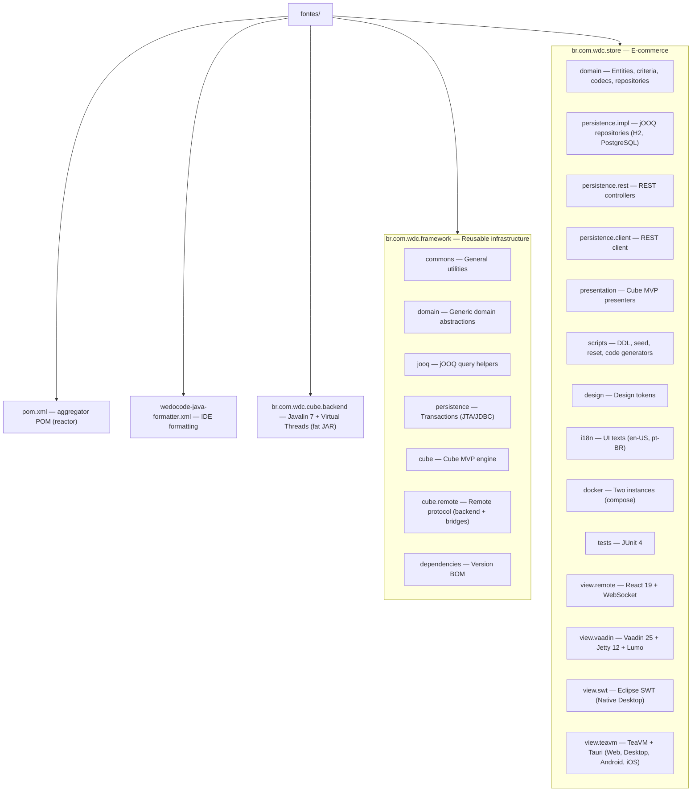

# fontes/

Source code root of the **WDC Store** project — a reference e-commerce application built with the **Cube MVP** architecture on Java 25.

---

## Structure



---

## Framework Modules (`br.com.wdc.framework`)

| Module | Purpose |
|--------|-----------|
| **commons** | Functional interfaces (`ThrowingRunnable`, `ThrowingConsumer`, etc.), multiplatform logging (`Log` — a lightweight facade with JUL and SLF4J backends), extensible serialization, SQL abstractions, cryptography, general-purpose utilities. |
| **domain** | Generic domain abstractions: `Repository`, `Page`, `ModelCodec`, `Criteria`/`Criterion`, `Projection*`, base exceptions, security contracts (`SecurityContext`, `AuthenticationService`), the data access policy (`security.policy`), `AppConfig`, `TransactionService`. |
| **jooq** | Query helpers over jOOQ (`JsonQuery`, `JsonQueryBuilder`, `JsonChildQueryBuilder`), `CriterionTranslator`, `TransactionAwareConnectionProvider`. |
| **persistence** | CMT-style transaction control (`TransactionServiceImpl`, `TransactionScope`) in dual JTA/JDBC mode, remote transaction coordinator SPI. |
| **cube** | Implementation of the Cube MVP architectural pattern — hierarchical scopes, presenter lifecycle and navigation; no view concept: drawing a scope is up to each rendering technology. |
| **cube.remote** | Remote protocol of the Cube MVP engine: WebSocket backend and the client bridges (Java, TeaVM, React, Flutter). |
| **dependencies** | BOM-type POM that centralizes the versions of the framework modules and of external dependencies (jOOQ, Agroal, Narayana, H2, PostgreSQL, Gson, SLF4J, Logback, Commons, etc.). |

## Application Modules (`br.com.wdc.store`)

| Module | Layer | Purpose |
|--------|--------|-----------|
| **design** | Design | The design tokens (`tokens.json`), generated for every view technology. |
| **i18n** | Application | The UI texts, one catalog per language (en-US, pt-BR), generated for every view technology. |
| **domain** | Domain | One package per entity (`product`, `user`, `purchase`, `purchaseitem`), each with the entity, its criteria, codec and repository interface. |
| **persistence.impl** | Infrastructure | Repository implementations with jOOQ (`*RepositoryImpl`) over H2 or PostgreSQL; generated schema classes in `persistence.impl.scheme`. |
| **persistence.rest** | Infrastructure | REST controllers (Javalin) that expose repositories as HTTP endpoints. |
| **persistence.client** | Infrastructure | REST client (OkHttp + the domain codecs) that implements repositories over HTTP. |
| **presentation** | Application | Presenters that orchestrate the business logic and connect the domain to the views via Cube MVP. |
| **scripts** | Infrastructure | Table creation DDL, seed data (`DBReset`), test and startup support, the code generators (jOOQ classes, design tokens, UI texts, `docs/openapi.json`). |
| **backend** (`fontes/br.com.wdc.cube.backend`) | Server | Javalin 7 + Virtual Threads, WebSocket dispatcher; database H2 (TCP or file) or PostgreSQL; health and metrics; the mesh between instances (`cluster`). Fat JAR (~41 MB). |
| **docker** | Deployment | Compose setup with two backend instances, PostgreSQL, nginx and Prometheus (not a Maven module). |
| **tests** | Test | JUnit 4 suite: repository contract tests (jOOQ and REST), presentation workflows, transactions. |
| **view.remote** | UI (Web) | React 19 + Spectrum Web Components frontend (plus Flutter and TeaVM remote shells), bidirectional WebSocket communication; a key agreed per connection (ECDH P-256 + HKDF) with AES-256-GCM, HMAC-SHA256 signatures. |
| **view.vaadin** | UI (Web) | Vaadin 25 + Lumo theme frontend, embedded Jetty 12 server, purely server-side UI with automatic push. |
| **view.swt** | UI (Desktop) | Native desktop frontend with Eclipse SWT 3.135.0 that reuses the same presenters. |
| **view.teavm** | UI (Multiplatform) | Java frontend compiled to JavaScript via TeaVM 0.16, packaged as a native app (Desktop, Android, iOS) via Tauri 2. |

---

## Build

```bash
export JAVA_HOME=<path-to-jdk-25>  # e.g. /Library/Java/JavaVirtualMachines/temurin-25.jdk/Contents/Home
export PATH="$JAVA_HOME/bin:$PATH"
cd fontes/
mvn clean install
```

Requirements: **Java 25** (LTS) and **Maven 3.9+**.
