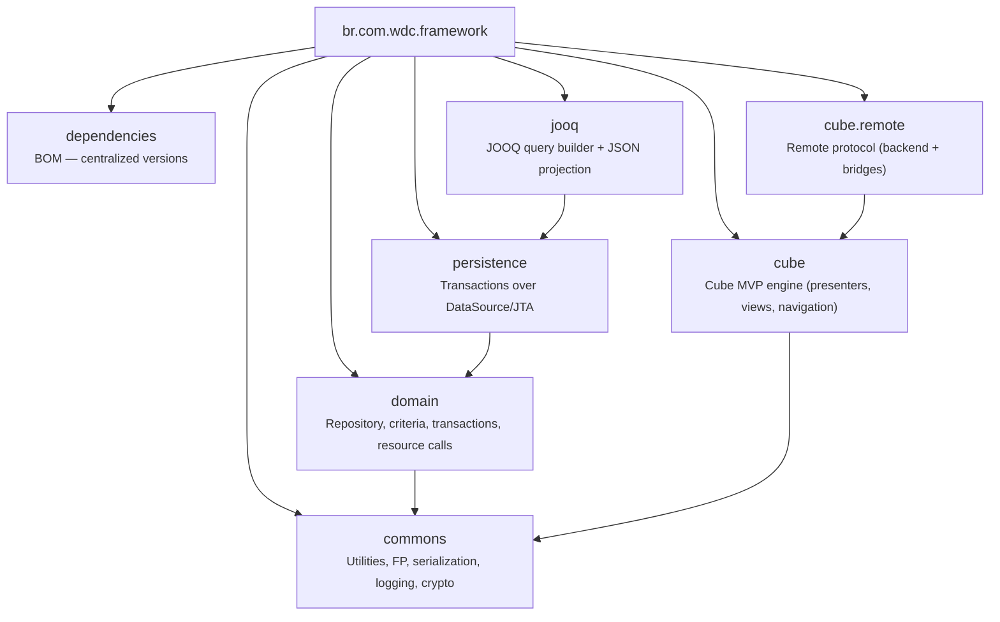

# WDC Framework

Reusable infrastructure for Java 21 applications based on the **Cube MVP** pattern.

---

## Modules



| Module | Purpose |
|--------|---------|
| [`dependencies`](br.com.wdc.framework.dependencies/) | BOM POM — centralizes the versions of all external dependencies |
| [`commons`](br.com.wdc.framework.commons/) | Functional interfaces, cross-platform logging, extensible serialization, SQL, crypto, utilities |
| [`domain`](br.com.wdc.framework.domain/) | Generic domain abstractions — `Repository`, `Page`, criteria, projections, `TransactionService`, security, and the resource calls (`ResourceQuery`, `ResourceCreate`/`Save`/`Update`/`Delete`: an action on a resource as an object, named by an HTTP-like verb) |
| [`persistence`](br.com.wdc.framework.persistence/) | Neutral persistence support (`javax.sql.DataSource` + `jakarta.transaction`): `TransactionServiceImpl`/`TransactionScope` (JTA or plain JDBC) and the server side of client-driven remote transactions (`RemoteTransactionCoordinator`) |
| [`jooq`](br.com.wdc.framework.jooq/) | Declarative query builder over JOOQ with JSON projection and multi-database dialects |
| [`cube`](br.com.wdc.framework.cube/) | Cube MVP pattern engine — hierarchical presenters, views, slots, intent-based navigation |
| [`cube.remote`](br.com.wdc.framework.cube.remote/) | Remote communication protocol — server (Javalin/WebSocket) and bridges for the clients (Java, React, TeaVM, Flutter) |

---

## Principles

- **Zero DI frameworks** — injection via `AtomicReference<T> BEAN` (static service locator)
- **Cross-platform** — commons and cube compile for the JVM, Android (Kotlin/Java) and JavaScript (TeaVM)
- **No heavy transitive dependencies** — each module declares only the bare minimum
- **Java 21** — records, sealed interfaces, Virtual Threads where applicable. The framework bytecode targets 21 (`maven.compiler.release`) so as not to force a newer version on consumers; the repository's demos and backend compile at 25

## Build

```bash
cd fontes/br.com.wdc.framework
JAVA_HOME=$JAVA25_HOME mvn clean install
```

## Publishing to Maven Central

The modules are published as `io.github.mrcdom.wdc.java:framework-*` (namespace `io.github.mrcdom`, verified through the GitHub account). `framework-parent` does not inherit from the root pom, so framework consumers resolve only this tree, without the demos (`br.com.wdc.store`, `br.com.wdc.cube.backend`).

```xml
<dependencyManagement>
    <dependencies>
        <dependency>
            <groupId>io.github.mrcdom.wdc.java</groupId>
            <artifactId>framework-dependencies</artifactId>
            <version>2.0.0</version>
            <type>pom</type>
            <scope>import</scope>
        </dependency>
    </dependencies>
</dependencyManagement>
```

| Directory | artifactId |
|-----------|------------|
| `br.com.wdc.framework.dependencies` | `framework-dependencies` (BOM) |
| `br.com.wdc.framework.commons` | `framework-commons` |
| `br.com.wdc.framework.domain` | `framework-domain` |
| `br.com.wdc.framework.persistence` | `framework-persistence` |
| `br.com.wdc.framework.jooq` | `framework-jooq` |
| `br.com.wdc.framework.cube` | `framework-cube` |
| `br.com.wdc.framework.cube.remote/remote.backend` | `framework-cube-remote-backend` |
| `br.com.wdc.framework.cube.remote/remote.bridge.java` | `framework-cube-remote-bridge-java` |
| `br.com.wdc.framework.cube.remote/remote.bridge.teavm` | `framework-cube-remote-bridge-teavm` |

`remote.bridge.react` (TypeScript) and `remote.bridge.flutter` (Dart) are not Maven artifacts and are left out.

Prerequisites, once per machine:

- portal token (central.sonatype.com → *Generate User Token*) in `~/.m2/settings.xml`:

  ```xml
  <server>
      <id>central</id>
      <username>…</username>
      <password>…</password>
  </server>
  ```

- GPG key in `gpg-agent`, published to a keyserver (the same one used for the Kotlin version works).

Publishing:

```bash
cd fontes/br.com.wdc.framework
JAVA_HOME=$JAVA25_HOME mvn -Prelease clean deploy
```

The `release` profile attaches sources and javadoc, signs everything and uploads the bundle to the portal, where it sits as *validated*; the release is manual (*Publish* at central.sonatype.com → Deployments). To check without uploading: `mvn -Prelease clean verify -Dgpg.skip`. It is worth running after bumping the version, which is the one in `framework-parent` and in the modules' `<parent>` (internal references use `${project.version}`).
