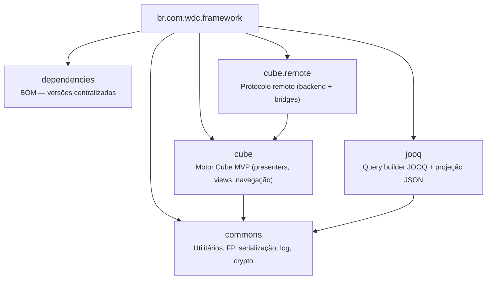

# WDC Framework

Infraestrutura reutilizável para aplicações Java 21 baseadas no padrão **Cube MVP**.

---

## Módulos



| Módulo | Propósito |
|--------|-----------|
| [`dependencies`](br.com.wdc.framework.dependencies/) | POM BOM — centraliza versões de todas as dependências externas |
| [`commons`](br.com.wdc.framework.commons/) | Interfaces funcionais, logging multiplataforma, serialização extensível, SQL, crypto, utilitários |
| [`jooq`](br.com.wdc.framework.jooq/) | Query builder declarativo sobre JOOQ com projeção JSON e dialetos multi-banco |
| [`cube`](br.com.wdc.framework.cube/) | Motor do padrão Cube MVP — presenters hierárquicos, views, slots, navegação por intents |
| [`cube.remote`](br.com.wdc.framework.cube.remote/) | Protocolo de comunicação remota — servidor (Javalin/WebSocket) e bridges para thin-clients (React, TeaVM) |

---

## Princípios

- **Zero DI frameworks** — injeção via `AtomicReference<T> BEAN` (service locator estático)
- **Multiplataforma** — commons e cube compilam para JVM, Android (Kotlin/Java) e JavaScript (TeaVM)
- **Sem dependências transitivas pesadas** — cada módulo declara apenas o mínimo necessário
- **Java 21** — records, sealed interfaces, Virtual Threads onde aplicável

## Build

```bash
cd fontes/br.com.wdc.framework
JAVA_HOME=$JAVA21_HOME mvn clean install
```

## Publicação no Maven Central

Os módulos saem como `io.github.mrcdom.wdc.java:framework-*` (namespace `io.github.mrcdom`, verificado pela conta do GitHub). O `framework-parent` não herda do pom raiz, então quem consome o framework resolve só esta árvore, sem os demos (`br.com.wdc.shopping`, `br.com.wdc.cube.backend`).

```xml
<dependencyManagement>
    <dependencies>
        <dependency>
            <groupId>io.github.mrcdom.wdc.java</groupId>
            <artifactId>framework-dependencies</artifactId>
            <version>2.0.0</version>
            <type>pom</type>
            <scope>import</scope>
        </dependency>
    </dependencies>
</dependencyManagement>
```

| Diretório | artifactId |
|-----------|------------|
| `br.com.wdc.framework.dependencies` | `framework-dependencies` (BOM) |
| `br.com.wdc.framework.commons` | `framework-commons` |
| `br.com.wdc.framework.domain` | `framework-domain` |
| `br.com.wdc.framework.persistence` | `framework-persistence` |
| `br.com.wdc.framework.jooq` | `framework-jooq` |
| `br.com.wdc.framework.cube` | `framework-cube` |
| `br.com.wdc.framework.cube.remote/remote.backend` | `framework-cube-remote-backend` |
| `br.com.wdc.framework.cube.remote/remote.bridge.java` | `framework-cube-remote-bridge-java` |
| `br.com.wdc.framework.cube.remote/remote.bridge.teavm` | `framework-cube-remote-bridge-teavm` |

O `remote.bridge.react` (TypeScript) e o `remote.bridge.flutter` (Dart) não são artefatos Maven e ficam de fora.

Pré-requisitos, uma vez por máquina:

- token do portal (central.sonatype.com → *Generate User Token*) no `~/.m2/settings.xml`:

  ```xml
  <server>
      <id>central</id>
      <username>…</username>
      <password>…</password>
  </server>
  ```

- chave GPG no `gpg-agent`, publicada num keyserver (a mesma da versão Kotlin serve).

Publicação:

```bash
cd fontes/br.com.wdc.framework
JAVA_HOME=$JAVA21_HOME mvn -Prelease clean deploy
```

O perfil `release` anexa fontes e javadoc, assina tudo e envia o bundle ao portal, onde ele fica como *validated*; a liberação é manual (*Publish* em central.sonatype.com → Deployments). Para conferir sem enviar: `mvn -Prelease clean verify -Dgpg.skip`. Vale a pena rodar depois de bumpar a versão, que é a do `framework-parent` e dos `<parent>` dos módulos (as referências internas usam `${project.version}`).
