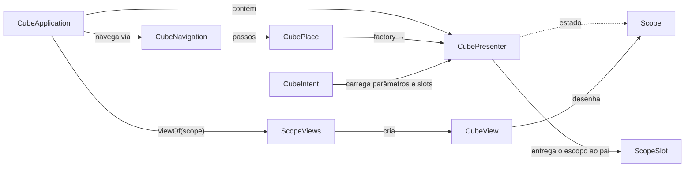

# WDC Framework — Cube

Motor do padrão **Cube MVP** — gerencia presenters hierárquicos, views, navegação por intents e estado reativo.

---

## Conceitos



### Ciclo de Navegação

1. O app declara a árvore de places como constantes: `CubePlace.root("public", RootPresenter::new)` e, abaixo dela, `ROOT.child("home", HomePresenter::new)`. O caminho de cada place sai da árvore, e o nome é único nela.
2. Monta um `CubeIntent` com parâmetros (key-value, query-string compatível).
3. Chama `app.navigate(place, intent)` — ou `app.go("home?x=1")`, que acha o place pelo nome (nome desconhecido vai para a raiz). O motor percorre `place.getPath()` da raiz até o destino:
   - Instancia os presenters que faltam pela factory do place.
   - Invoca `applyParameters(intent, initialization, deepest)` em cada presenter.
   - Remove presenters que não fazem mais parte da hierarquia (chama `release()`).
   - Invoca `commitComputedState()` para todos.
5. O host desenha o escopo do presenter raiz (`app.viewOf(rootPresenter.state)`); cada view pede a dos escopos que o seu segura (`app.viewOf(state.content.get())`). A UI é atualizada por `CubeView.update()`, chamado quando uma `Prop` do escopo muda.

---

## Classes Principais

| Classe/Interface | Responsabilidade |
|------------------|-----------------|
| `CubeApplication` | Singleton da app — mantém mapa de presenters e atributos, coordena navegação; `viewOf(scope)` cria a view do escopo na primeira vez que é pedida (e a desenha uma vez), `releaseView(scope)` a libera junto com as dos escopos dentro dele, `liveViews()` lista as views vivas |
| `CubePresenter` | Contrato para presenters gerenciados pela navegação |
| `AbstractPresenter<A>` | Base comum — app, `bind(state)` (vincula o escopo; ele passa a compartilhar o mapa de eventos do presenter), `scope()`, `update()` (pede o redesenho do escopo), `release()` (libera a view do escopo e as internas), `detach(segment)` (libera a view de um escopo menor que saiu — inclusive uma linha de uma lista) e as ações guardadas (`action`, `actionOf`, `actionOf2`, com ou sem código de evento). O presenter nunca cria view |
| `AbstractCubePresenter<A>` | Presenter de um place — `applyParameters`/`publishParameters`; `view()` devolve a view do escopo, se já houver |
| `CubeView` | Interface da view — `instanceId()`, `update()`, `release()` |
| `ScopeSlot` | Onde um presenter filho se mostra no pai: `setScope(scope)` põe o escopo do filho num `Prop<Scope>` do pai (`content`). Viaja no intent (`CubeIntent.setSlot/getSlot`) |
| `ScopeViews` | Catálogo da camada de view: classe do escopo → fábrica `(app, scope) -> CubeView` (`register`), com busca pelas superclasses e um `fallback`. Cada host monta o seu e o entrega com `CubeApplication.setScopeViews` |
| `CubePlace` | Nó da árvore de places — nome (único na árvore), pai, caminho, factory de presenter; o id cresce com a profundidade |
| `CubeIntent` | Encapsula destino (place) + parâmetros tipados (parse de query-string) |
| `CubeKeys<A>` | Base das classes de chaves do app: uma por place, declara o place e lê/escreve o intent com acessores tipados; `flip()` navega até o place |
| `CubeNavigation<T>` | Engine que executa transições: cria, reutiliza e destrói presenters |
| `CubeSkeleton` | Interface para comunicação remota: `submit(eventCode, formData)`, `syncState()`. Ninguém a implementa à mão: `Scope.skeleton(classId)` despacha cada evento para a ação ligada com aquele código, e `Scope.onSync(...)` define o `syncState` |
| `FormParam<T>` | Como uma ação lê um valor do `formData` do evento: nome do campo + conversão (`asLong`, `asInteger`, `asString`, `of`) |
| `Scope`, `Prop<T>` | Estado da view: campos observados são `Prop`s (`prop(...)`); `set` de um valor diferente pede o redesenho sozinho — da view do escopo ou, enquanto ele não tem uma, do escopo dono que o segura num `Prop`. `setSilently` é para a view que consome uma mensagem de exibição única enquanto desenha. Cada escopo com view remota declara `public static final String CLASS_ID` (o classId do protocolo bridge). `Scope.drawnBy(view)` é o escopo que só carrega uma view já existente — usado por shells que reconstroem escopos a partir do que o host remoto envia |
| `Action`, `ActionOf<T>`, `ActionOf2<T, U>` | Ações que a view dispara, guardadas como campos do Scope; `NOOP`/`noop()` marcam a ação ainda não ligada |
| `PresenterBase` | Interface raiz: `commitComputedState()` + `release()` |

---

## Utilitários

| Classe | Descrição |
|--------|-----------|
| `QueryStringBuilder` | Serializa parâmetros de `CubeIntent` em query-string |
| `QueryStringParser` | Deserializa query-string para `CubeIntent` |
| `ArrayUtils` | Operações em arrays |
| `ReflectArrayCompat` | Compatibilidade com reflexão em arrays (TeaVM) |

---

## Coordenadas Maven

```xml
<dependency>
    <groupId>io.github.mrcdom.wdc.java</groupId>
    <artifactId>framework-cube</artifactId>
    <version>2.0.0</version>
</dependency>
```
