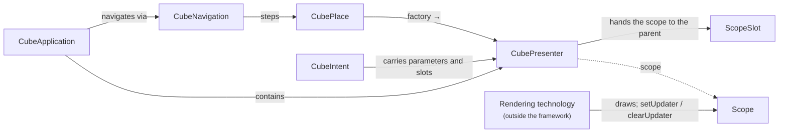

# WDC Framework — Cube

Engine of the **Cube MVP** pattern — manages hierarchical presenters, intent-based navigation and reactive scopes. It has no view concept: what draws a scope (a component, a widget, a remote view) is up to each rendering technology.

---

## Concepts



### Navigation Cycle

1. The app declares the place tree as constants: `CubePlace.root("public", RootPresenter::new)` and, below it, `ROOT.child("home", HomePresenter::new)`. Each place's path comes from the tree, and its name is unique within it.
2. Builds a `CubeIntent` with parameters (key-value, query-string compatible).
3. Calls `app.navigate(place, intent)` — or `app.go("home?x=1")`, which finds the place by name (an unknown name goes to the root). The engine walks `place.getPath()` from the root to the destination:
   - Instantiates the missing presenters through the place's factory.
   - Invokes `applyParameters(intent, initialization, deepest)` on each presenter.
   - Releases the presenters that are not part of the hierarchy (calls `release()`, deepest first).
   - Calls `app.updateHistory()` so the host republishes the address.
4. The rendering technology draws the root presenter's scope; each of its views asks for the views of the scopes it holds while it draws, and lets go of the ones it no longer holds. When it starts drawing a scope it installs the scope's updater (`scope.setUpdater(...)`), called when a scope `Prop` changes, and takes it back (`scope.clearUpdater(...)`) when it stops. `commitComputedState()` (derived state) is not part of the navigation: every host calls it on all presenters (`CubeApplication.commitComputedState()`) once per paint, before drawing — the remote host before writing the dirty scopes, and Vaadin, SWT and teavm.web before their own drawing (ADR 0022).

---

## Main Classes

| Class/Interface | Responsibility |
|-----------------|----------------|
| `CubeApplication` | App singleton — keeps the map of presenters and attributes, coordinates navigation |
| `CubePresenter` | Contract for presenters managed by navigation |
| `AbstractPresenter<A>` | Common base — app, `bind(scope)` (binds the scope; it then shares the presenter's event map), `scope()`, `update()` (requests a redraw of the scope) and the stored actions (`action`, `actionOf`, `actionOf2`, with or without an event code). The presenter only makes scopes: it never creates nor releases a view |
| `AbstractCubePresenter<A>` | Presenter of a place — `applyParameters`/`publishParameters`; knows no view: it hands the scope to the parent's slot |
| `ScopeSlot` | Where a child presenter shows up in the parent: `setScope(scope)` puts the child's scope into a `Prop<Scope>` of the parent (`content`). Travels in the intent (`CubeIntent.setSlot/getSlot`) |
| `CubePlace` | Node of the place tree — name (unique in the tree), parent, path, presenter factory; the id grows with depth |
| `CubeIntent` | Encapsulates the destination (place) + typed parameters (query-string parsing) |
| `CubeKeys<A>` | Base of the app's key classes: one per place, declares the place and reads/writes the intent with typed accessors; `flip()` navigates to the place |
| `CubeNavigation<T>` | Engine that executes transitions: creates, reuses and destroys presenters |
| `CubeSkeleton` | Interface for remote communication: `classId()`, `submit(eventCode, eventQtde, formData)`, `syncScope(formData)`. Nobody implements it by hand: `Scope.skeleton(classId)` dispatches each event to the action bound to that code, and `Scope.onSync(...)` defines `syncScope` |
| `FormParam<T>` | How an action reads a value from the event's `formData`: field name + conversion (`asLong`, `asInteger`, `asString`, `of`) |
| `Scope`, `Prop<T>` | The state of a piece of screen that a presenter publishes: observed fields are `Prop`s (`prop(...)`); `set` of a different value requests the redraw by itself — through the updater the rendering technology installed (`setUpdater`, taken back with `clearUpdater`, which only clears it if it is still the same) or, while nothing draws the scope, through the owning scope that holds it in a `Prop`. `setSilently` is for the view that consumes a one-time display message while drawing. Each scope drawn remotely declares `public static final String CLASS_ID` (the bridge protocol classId) |
| `Action`, `ActionOf<T>`, `ActionOf2<T, U>` | Actions the view fires, stored as Scope fields; `NOOP`/`noop()` mark an action not yet bound. The actions of one application run one at a time (`CubeApplication.runExclusively`) |
| `PresenterBase` | Root interface: `commitComputedState()` (run by every rendering technology once per paint cycle) + `release()` |

---

## Utilities

| Class | Description |
|-------|-------------|
| `QueryStringBuilder` | Serializes `CubeIntent` parameters into a query string |
| `QueryStringParser` | Deserializes a query string into a `CubeIntent` |
| `ArrayUtils` | Array operations |
| `ReflectArrayCompat` | Compatibility with reflection on arrays (TeaVM) |

---

## Maven Coordinates

```xml
<dependency>
    <groupId>io.github.mrcdom.wdc.java</groupId>
    <artifactId>framework-cube</artifactId>
    <version>2.0.0</version>
</dependency>
```
