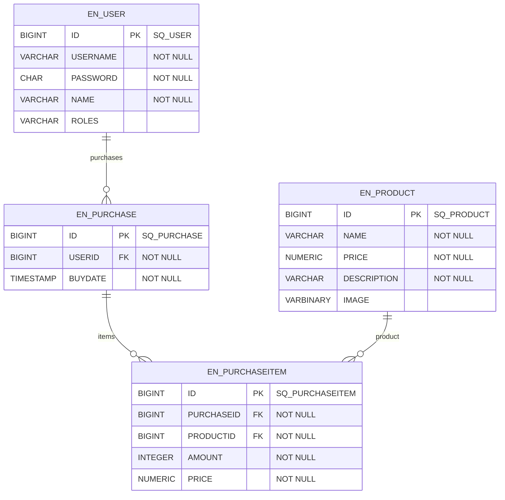

# WDC Store — Persistence

The persistence layer of the Shopping system. It implements the repositories defined in the `domain` module using **jOOQ** and the **JsonQueryBuilder** framework for declarative bean↔table mapping with JSON projection and lazy relations. The database is **H2** or **PostgreSQL** (chosen by the dialect passed to the bootstrap).

## Dependencies

| Artifact | Role |
|----------|-------|
| `br.com.wdc.shopping.domain` | Entities, repository interfaces, criteria |
| `framework-jooq` | JsonQueryBuilder (declarative mapping), `CriterionTranslator`, `TransactionAwareConnectionProvider` |
| `framework-persistence` | `TransactionServiceImpl` (dual JTA/JDBC) |
| `framework-commons` | Utilities (`Defer`, `ScheduledExecutor`, ...) |
| `org.jooq:jooq` | Type-safe query builder and SQL execution |
| `com.google.code.gson:gson` | JSON deserialization (JSON_OBJECT projection) |
| `commons-io` | I/O utilities |
| `h2`, `postgresql` (optional) | Drivers for `LocalDataSource`; whoever uses it declares them |

## Package Structure

```mermaid
graph TD
    root["br.com.wdc.shopping.persistence.impl"]
    root --> Bootstrap["ShoppingRepositoryBootstrap.java<br/><small>Initializes DSLContext + BEANs + TransactionService</small>"]
    root --> DslHolder["ShoppingDSLContext.java<br/><small>BEAN holder of the module's DSLContext</small>"]
    root --> LocalDs["LocalDataSource.java<br/><small>Unpooled DataSource for the local views</small>"]

    root --> concurrent["concurrent/"]
    concurrent --> SchedAdapter["ScheduledExecutorAdapter.java"]

    root --> security["security/ — authentication (authorization lives in the REST endpoints)"]
    security --> AccessCtx["AccessContext"]
    security --> AccessCache["AccessContextCache"]
    security --> AuthImpl["AuthenticationServiceImpl"]
    security --> JwtUtil["JwtUtil (HMAC-SHA256)"]
    security --> Nonce["NonceStore"]

    root --> scheme["scheme/ — Code generated by jOOQ"]
    scheme --> Tables["Tables.java, Sequences.java, Routines.java"]
    scheme --> tbls["tables/"]
    tbls --> EnUser["EnUser.java"]
    tbls --> EnProduct["EnProduct.java"]
    tbls --> EnPurchase["EnPurchase.java"]
    tbls --> EnPurchaseitem["EnPurchaseitem.java"]

    root --> repository["repository/ — Implementations"]
    repository --> UserRepo["UserRepositoryImpl"]
    repository --> ProductRepo["ProductRepositoryImpl"]
    repository --> PurchaseRepo["PurchaseRepositoryImpl"]
    repository --> PurchaseItemRepo["PurchaseItemRepositoryImpl"]

    root --> util["util/"]
    util --> BaseRepo["BaseRepositoryImpl<br/><small>dsl() → ShoppingDSLContext.BEAN</small>"]
```



## Architecture

### Patterns Used

| Pattern | Implementation | Purpose |
|--------|--------------|------------|
| **Repository** | `XxxRepositoryImpl extends BaseRepositoryImpl implements XxxRepository` | Per-entity data access facade |
| **JsonQuery (Declarative)** | `public static final JsonQuery<B, T> QUERY` | Declarative bean↔table mapping with JSON projection |
| **ApplyConditions** | Inner class `ApplyConditions` | Maps each criteria field to its column; `CriterionTranslator` builds the `Condition` |
| **Ordering** | `orderingOf(table, criteria)` | Translates the criteria's `OrderBy` into `ORDER BY` columns |
| **Lazy Relations** | `addBeanField` / `addBeanListField` | 1:1 and 1:N relations via correlated subquery |

### Query Flow

```
1. The presentation layer calls:
   ProductRepository.BEAN.get().fetch(criteria, offset, limit)

2. ProductRepositoryImpl.fetch():
   - Gets the projection bean (criteria.projection() or newProjection())
   - Delegates to QUERY.fetchToList(projection, (t, q) -> { where, orderBy, limit, offset })

3. JsonQueryBuilder:
   - Generates a SELECT with JSON_OBJECT for the fields active in the projection
   - Applies WHERE conditions via ApplyConditions and ORDER BY via orderingOf
   - For lazy fields (relations), generates correlated subqueries
   - Executes via the jOOQ DSLContext
   - Deserializes JSON → Bean via Gson's streaming JsonReader, calling the fluent setters

4. Returns List<Product> to the caller
```

### Write Flow

```
1. The presentation layer calls:
   ProductRepository.BEAN.get().insert(product)

2. ProductRepositoryImpl.insert():
   - Gets the DSLContext via dsl() (ShoppingDSLContext.BEAN.get())
   - Generates the ID via sequence (dsl.nextval(SQ_PRODUCT)) if needed
   - Builds the INSERT with dsl.insertInto(EN_PRODUCT).set(...) for non-null fields only
   - Executes directly via jOOQ
```

`update(newBean, oldBean, projection)` writes only the fields in the projection whose value differs from `oldBean` (`Repository.changed(...)`); `delete` refuses criteria without the key.

### Transactions

Repositories do not demarcate transactions. The `DSLContext` uses `TransactionAwareConnectionProvider`: inside `ShoppingTransactions.BEAN.get().required(...)` the queries share the scope's connection; outside it, each one takes a standalone pool connection (autocommit).

## Main Components

### JsonQuery — Declarative Mapping

Each repository defines a static `QUERY` that describes the complete bean↔table mapping:

```java
public static final JsonQuery<User, EnUser> QUERY = new JsonQueryBuilder<User, EnUser>()
        .setAlias("u")
        .setBeanFactory(User::new)
        .setTableFactory(EN_USER::as)
        .setDSLContextSupplier(UserRepositoryImpl::dsl)
        .setOrdering(UserRepositoryImpl::orderingOf)
        .addI64("id", u -> u.id(), (u, v) -> u.withId(v), t -> t.ID)
        .addStr("userName", u -> u.userName(), (u, v) -> u.withUserName(v), t -> t.USERNAME)
        .addStr("password", u -> u.password(), (u, v) -> u.withPassword(v), t -> t.PASSWORD)
        .addStr("name", u -> u.name(), (u, v) -> u.withName(v), t -> t.NAME)
        .addStr("roles", u -> u.roles(), (u, v) -> u.withRoles(v), t -> t.ROLES)
        .build();
```

The builder uses the generics `<B, T extends Table<?>>` — removing the need for a reflection-based table factory.

### Lazy Relations (1:1 and 1:N)

Relations are defined in the `lazy(...)` block and are only loaded when the corresponding field is present in the projection:

```java
.lazy(qb -> {
    // 1:1 relation: Purchase → User
    qb.addBeanField("user", p -> p.user(), (p, v) -> p.withUser(v),
            UserRepositoryImpl.QUERY, cq -> {
                var enPurchase = cq.getSuperTable();
                var enUser = cq.getChildTable();
                cq.dsl().where()
                    .and(enUser.ID.eq(enPurchase.USERID))
                    .and(UserRepositoryImpl.applyConditions(cq));
            });

    // 1:N relation: Purchase → Items
    qb.addBeanListField("items", p -> p.items(), (p, v) -> p.withItems(v),
            PurchaseItemRepositoryImpl.QUERY, cq -> {
                var enPurchase = cq.getSuperTable();
                var enPurchaseItem = cq.getChildTable();
                cq.dsl().where()
                    .and(enPurchaseItem.PURCHASEID.eq(enPurchase.ID))
                    .and(PurchaseItemRepositoryImpl.applyConditions(cq));
            });
})
```

- `addBeanField` → generates a scalar subquery (1:1 relation)
- `addBeanListField` → generates a subquery that returns a JSON array (1:N relation)
- `cq.getSuperTable()` → aliased parent table
- `cq.getChildTable()` → aliased child table
- `cq.dsl()` → SelectConditionStep for composing JOINs

`addBeanField` also takes an optional relation key (`key -> key.addI64("id", t -> t.PURCHASEID)`, in `PurchaseItemRepositoryImpl`): when the association is projected by its key only, the id comes from the row's foreign-key column, without a subquery.

### ApplyConditions — Criteria Translation

Each repository exposes a static `applyConditions` method that translates business criteria into a jOOQ `Condition`. This allows composition across repositories (e.g.: a userId filter propagated via subquery). The entity only maps field → column; walking the `Criterion` operators (`eq`, `in`, `between`, `containing`, `or()`, ...) and combining them with `AND` is done once, in the framework's `CriterionTranslator`:

```java
// Static method for use in other repositories' subqueries
public static Condition applyConditions(JsonChildQueryBuilder<?, EnUser> cq) {
    if (cq.getCriteria() instanceof UserCriteria criteria) {
        return new ApplyConditions(cq.getChildTable(), cq.getCtx()).apply(criteria);
    }
    return DSL.noCondition();
}

// Inner class that builds the conditions
private static class ApplyConditions {
    EnUser enUser;
    QueryContext ctx;

    public Condition apply(UserCriteria criteria) {
        if (criteria == null) {
            return DSL.noCondition();
        }
        return CriterionTranslator.and(Arrays.asList(
                CriterionTranslator.translate(enUser.ID, criteria.userId()),
                CriterionTranslator.translate(enUser.USERNAME, criteria.userName()),
                CriterionTranslator.translate(enUser.NAME, criteria.name()),
                CriterionTranslator.translate(enUser.ROLES, criteria.roles())));
    }
}
```

The `QueryContext` manages unique aliases for tables in nested subqueries, avoiding collisions.

### Selective Projection

The projection bean controls which fields are loaded. `null` fields in the projection bean are ignored in the query:

```java
// Full projection (all fields)
var projection = QUERY.newProjectionBean();

// Partial projection (only id and name)
var projection = new User()
        .withId(0L)      // != null → included
        .withName("");   // != null → included
// userName, password → null → excluded from the query
```

### ShoppingRepositoryBootstrap

Receives the module's `DataSource` from the composition root, builds the jOOQ `DSLContext` (over a `TransactionAwareConnectionProvider`) into `ShoppingDSLContext.BEAN`, registers all repositories in the static `BEAN`s and sets `ShoppingTransactions.BEAN` to a `TransactionServiceImpl` bound to the same `DataSource`. Every registration is undone by the `Defer` passed in:

```java
// H2 dialect, no SQL logging (tests, local views)
ShoppingRepositoryBootstrap.initialize(dataSource, cleanUp);

// With SQL logging (jOOQ logs via SLF4J DEBUG)
ShoppingRepositoryBootstrap.initialize(dataSource, true, cleanUp);

// Explicit dialect (H2 or POSTGRES)
ShoppingRepositoryBootstrap.initialize(dataSource, logSql, SQLDialect.POSTGRES, cleanUp);

// Authentication (backend): AuthenticationService.BEAN with JWT
ShoppingRepositoryBootstrap.initializeSecurity(jwtSecret, cleanUp);
```

The `logSql` setting enables `Settings.withExecuteLogging(true)` in jOOQ, which logs every executed SQL statement via `org.jooq.tools.LoggerListener` at DEBUG level. With `POSTGRES`, schema rendering is turned off and names are rendered in lowercase.

`initializeSecurity()` only sets up authentication (`AuthenticationServiceImpl`). Authorization — permission checks and restricting non-admins to their own userId — is done in the REST endpoints (`persistence.rest`), not in the repositories.

### jOOQ Tables (Generated)

The classes in `br.com.wdc.shopping.persistence.impl.scheme` (`Tables`, `Sequences`, `tables.EnUser`, ...) are generated by the jOOQ Code Generator from the H2 schema. Each table class (e.g.: `EnUser`) is a `TableImpl<Record>` with typed fields:

```java
// Use as a static reference
import static br.com.wdc.shopping.persistence.impl.scheme.tables.EnUser.EN_USER;

// Alias for subqueries
var enUser = EN_USER.as("u");
enUser.ID    // TableField<Record, Long>
enUser.NAME  // TableField<Record, String>
```

### Image Handling (ProductRepositoryImpl)

`ProductRepositoryImpl` uses jOOQ directly for image operations (binary field), with no workarounds needed — the Agroal connection pool implements full JDBC 4.x, including `createBlob()`:

```java
// Insert with image
dsl.insertInto(EN_PRODUCT)
        .set(EN_PRODUCT.ID, product.id())
        .set(EN_PRODUCT.IMAGE, product.image())  // byte[] directly via jOOQ
        .execute();

// Standalone image update
dsl.update(EN_PRODUCT)
        .set(EN_PRODUCT.IMAGE, image)
        .where(EN_PRODUCT.ID.eq(productId))
        .execute();
```

## Conventions

| Type | Pattern | Example |
|------|--------|---------|
| Table (jOOQ) | `En` + Entity | `EnUser`, `EnProduct` |
| Table constant | `EN_` + ENTITY | `EN_USER`, `EN_PRODUCT` |
| Sequence | `SQ_` + ENTITY | `SQ_USER`, `SQ_PRODUCT` |
| Repository | Entity + `RepositoryImpl` | `UserRepositoryImpl` |
| Static query | `QUERY` | `UserRepositoryImpl.QUERY` |
| Static conditions | `applyConditions(cq)` | Composition across repositories |
| Static ordering | `orderingOf(t, criteria)` | Translation of `OrderBy` → `ORDER BY` |
| Criteria inner class | `ApplyConditions` | Translation of criteria → Condition |

## Database Schema


