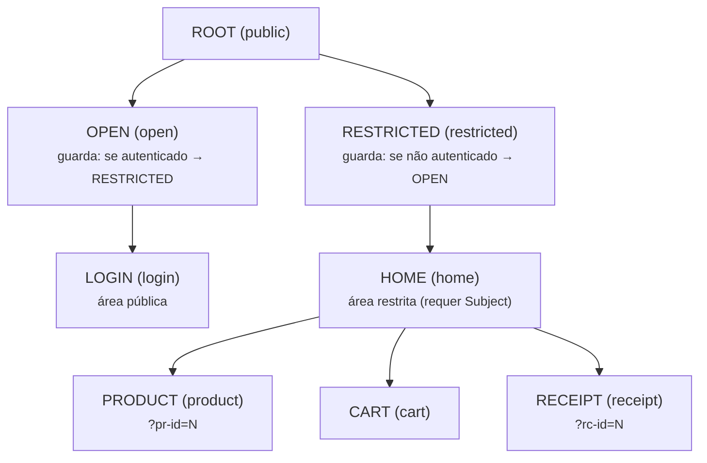
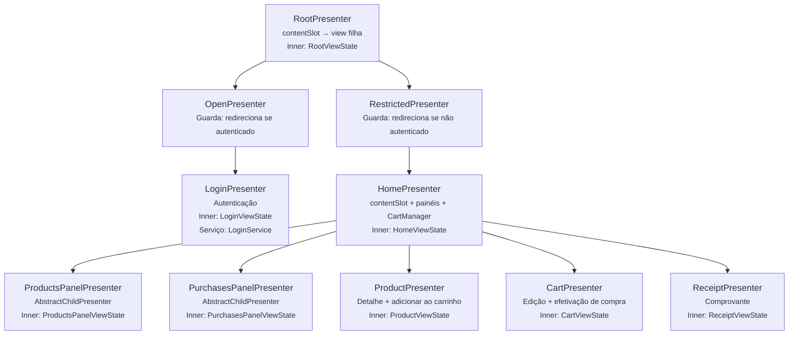
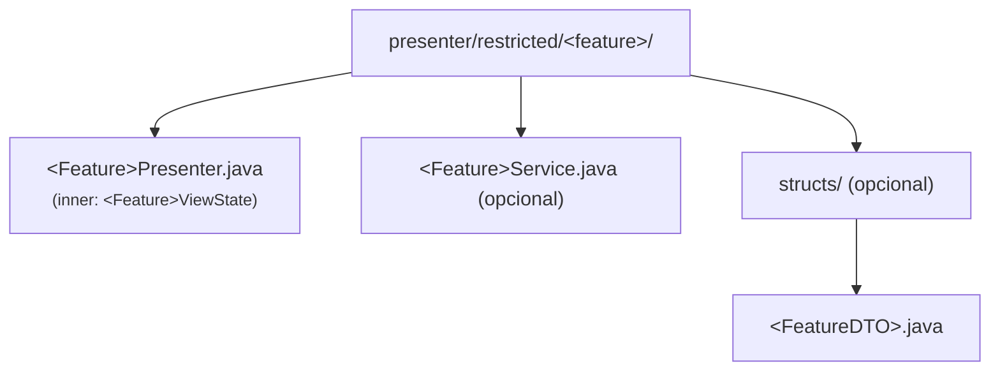

# WDC Shopping — Presentation

Camada de apresentação do sistema Shopping, implementada com o padrão **Cube MVP**. Contém os presenters, view states, serviços de apresentação, DTOs e o sistema de navegação. Esta camada é agnóstica de tecnologia de view — não depende de React, Javalin ou qualquer framework de UI.

## Dependências

| Artefato | Papel |
|----------|-------|
| `br.com.wdc.shopping.domain` | Modelos de domínio, repositórios, critérios |
| `br.com.wdc.framework.cube` | Motor Cube MVP (presenters, views, navegação) |
| `slf4j-api` | Logging |
| `jsr305` | Anotações `@Nullable` (scope provided) |

## Estrutura de Pacotes

```mermaid
graph TD
    root["br.com.wdc.shopping.presentation"]
    root --> ShoppingApp["ShoppingApplication.java"]
    root --> ProxyWrapper["ProxyRepositoryWrapper.java"]

    root --> exception["exception/"]
    exception --> WrongParams["WrongParametersException.java"]
    exception --> ProductNotFound["ProductNotFoundException.java"]
    exception --> PurchaseNotFound["PurchaseNotFoundException.java"]

    root --> presenter["presenter/"]
    presenter --> RootK["RootKeys.java"]
    presenter --> RootP["RootPresenter.java (+ RootViewState)"]

    presenter --> open["open/"]
    open --> OpenP["OpenPresenter.java"]
    open --> login["login/"]
    login --> LoginP["LoginPresenter.java (+ LoginViewState)"]
    login --> LoginSvc["LoginService.java"]
    login --> LoginStructs["structs/Subject.java"]

    presenter --> restricted["restricted/"]
    restricted --> RestrictedP["RestrictedPresenter.java"]
    restricted --> home["home/"]
    home --> HomeP["HomePresenter.java (+ HomeViewState)"]
    home --> HomeStructs["structs/PurchaseInfo.java"]
    home --> products_panel["products/"]
    products_panel --> ProdPanelP["ProductsPanelPresenter.java (+ ViewState)"]
    home --> purchases_panel["purchases/"]
    purchases_panel --> PurchPanelP["PurchasesPanelPresenter.java (+ ViewState)"]
    purchases_panel --> PurchPanelSvc["PurchasesPanelService.java"]

    restricted --> products["products/"]
    products --> ProductP["ProductPresenter.java (+ ProductViewState)"]
    products --> ProductSvc["ProductService.java"]
    products --> ProductStructs["structs/ProductInfo.java"]

    restricted --> cart["cart/"]
    cart --> CartP["CartPresenter.java (+ CartViewState)"]
    cart --> CartMgr["CartManager.java"]
    cart --> CartStructs["structs/CartItem.java"]

    restricted --> receipt["receipt/"]
    receipt --> ReceiptP["ReceiptPresenter.java (+ ReceiptViewState)"]
    receipt --> ReceiptSvc["ReceiptService.java"]
    receipt --> ReceiptStructs["structs/ReceiptForm.java, ReceiptItem.java"]
```



## Hierarquia de Navegação

O sistema possui 8 places organizados em 4 níveis:



Cada place tem uma classe de chaves (`XxxKeys`, no pacote do seu presenter) que **declara o place** a partir do place das chaves que ela estende — `RootKeys → RestrictedKeys → HomeKeys → ProductKeys` — e é a única que conhece os nomes que o place lê e escreve no intent, todos com o prefixo de duas letras dela (`pr-id`, `rc-id`). Os getters validam e nunca lançam (o endereço vem de fora); o setter tira o nome do endereço quando recebe o padrão. `ShoppingApplication.PLACES` lista todos os places, o que carrega as classes antes de um endereço ser resolvido por nome. A convenção completa está no Javadoc de `RootKeys`; o `PlaceKeysTest` confere prefixos e árvore.

```java
// Navegar para o detalhe de um produto, a partir do estado atual
new ProductKeys(app).withProductId(productId).flip();

// Dentro do applyParameters: ler, e redirecionar com o intent em trânsito
var keys = new ProductKeys(this.app, intent);
if (keys.productId() == null) {
    new HomeKeys(this.app, intent).flip();
    return false;
}
```

Os presenters `OpenPresenter` e `RestrictedPresenter` funcionam como **guardas de navegação**: redirecionam automaticamente com base na presença/ausência do `Subject`.

## Hierarquia de Presenters



### Dois tipos de presenter

| Tipo | Classe base | Ciclo de vida | Uso |
|------|------------|---------------|-----|
| **Presenter navegável** | `AbstractCubePresenter<ShoppingApplication>` | Gerenciado pelo sistema de navegação via `applyParameters` | Places com sua classe de chaves (`XxxKeys`) |
| **Presenter filho (painel)** | `AbstractChildPresenter<ShoppingApplication>` | Gerenciado manualmente pelo presenter pai via `initialize()`/`release()` | Painéis embutidos na Home |

## Componentes do Módulo

### ShoppingApplication

Classe abstrata que estende `CubeApplication`. Mantém o estado global:

- `subject` — usuário autenticado (`Subject`)
- `securityContext` — contexto de segurança (`SecurityContext`) com roles e permissões
- `cart` — carrinho de compras (`CartManager`)
- `createDelegate(Class, Object)` — hook para criação de proxies de repositório (ver `ProxyRepositoryWrapper`)
- `go(String)` / `go(CubeIntent)` — navegação programática
- `alertUnexpectedError(...)` — exibição de erros via `RootPresenter`

### ProxyRepositoryWrapper

Classe utilitária que cria proxies dinâmicos (via `java.lang.reflect.Proxy`) para repositórios, envolvendo cada chamada com o `SecurityContext`. Usado em ambientes JVM multi-threaded (desktop, servidor). Não compatível com TeaVM/GraalVM native.

### ViewState (inner class)

Cada presenter define um `ViewState` como **classe estática interna** (`public static class XxxViewState extends ViewState`). Cada campo observado é uma `Prop`, criada com `prop(...)`; o presenter liga o estado a si com `bind(...)`, e então `set` de um valor diferente (`equals`) pede o redesenho sozinho — o presenter não chama `this.update()` depois. A view lê com `get()`. A serialização remota é automática (`ViewStateSerializer`, via reflection dos campos públicos, escrevendo o valor de cada `Prop`):

```java
public static class ProductViewState extends ViewState {
    public final Prop<ProductInfo> product = prop();
    public final Prop<Integer> errorCode = prop(0);
    public final Prop<String> errorMessage = prop();
}

public final ProductViewState state = bind(new ProductViewState());
```

**Mexer dentro de um valor já atribuído** (um item de uma lista) não passa pela prop: aí, ou se atribui um valor novo, ou se chama `this.update()` — como no `CartPresenter`, cujo carrinho altera os itens no lugar.

O JSON gerado pelo serializer usa `"#"` como chave para o `instanceId`:

```json
{ "#": "view-instance-id", "product": {...}, "errorCode": 0, "errorMessage": null }
```
```

### Services

Serviços são classes com injeção de dependências via construtor (`ShoppingApplication` ou repositório específico), fazendo a ponte entre a camada de apresentação e os repositórios:

| Serviço | Responsabilidade |
|---------|------------------|
| `LoginService` | Autenticação via HMAC challenge-response (usa `AuthenticationService`) |
| `ProductService` | Carga de produtos (por ID, lista sem descrição) |
| `PurchasesPanelService` | Consulta de compras (paginação, contagem) |
| `ReceiptService` | Carga de recibos |

### DTOs (structs)

Objetos `Serializable` usados para transferir dados entre camadas. Cada DTO possui:

- **Campos públicos** (sem getters/setters)
- **`projection()`** — retorna uma instância do modelo de domínio indicando quais campos carregar
- **`create(Model)`** — factory method que converte do modelo de domínio para o DTO

| DTO | Pacote | Campos principais |
|-----|--------|------------------|
| `Subject` | `open/login/structs/` | id, nickName |
| `ProductInfo` | `restricted/products/structs/` | id, image, name, description, price |
| `CartItem` | `restricted/cart/structs/` | id, image, name, price, quantity |
| `PurchaseInfo` | `restricted/home/structs/` | id, date, total, items (nomes) |
| `ReceiptForm` | `restricted/receipt/structs/` | date, total, items |
| `ReceiptItem` | `restricted/receipt/structs/` | id, description, value, quantity |

### Constantes

- **`XxxKeys`** (uma por place, em `presenter/**`) — os nomes que cada place lê e escreve no intent, tipados; substituem as antigas `PlaceParameters`/`PlaceAttributes`

### CartManager

Gerenciador de carrinho in-memory com sistema de eventos:

- `addProduct(ProductInfo, quantity)` — adiciona ou incrementa item
- `modifyProductQuantity(productId, quantity)` — altera quantidade
- `removeProduct(productId)` — remove item
- `commit(Subject)` — persiste a compra diretamente via repositórios
- `addCommitListener(Runnable)` / `addChangeListener(Runnable)` — listeners para recarregar painéis

## Convenções

### Organização de pacotes por feature

Cada feature segue a estrutura:


### Padrão de um Presenter

```java
public class XxxPresenter extends AbstractCubePresenter<ShoppingApplication> {

    // 1. Logger
    private static final Logger LOG = LoggerFactory.getLogger(XxxPresenter.class);

    // 2. ViewState (inner class — campos observados são Props; serialização via reflection)
    public static class XxxViewState extends ViewState {
        public final Prop<Integer> errorCode = prop(0);
        public final Prop<String> errorMessage = prop();
        // ... campos específicos
    }

    // 3. Factory de view (injetada pelo skeleton)
    public static Function<XxxPresenter, CubeView> createView;

    // 4. Estado público
    public final XxxViewState state = new XxxViewState();

    // 5. Campos internos
    private CubeViewSlot ownerSlot;

    // 6. Constructor
    public XxxPresenter(ShoppingApplication app) { super(app); }

    // 7. Cube API (applyParameters, publishParameters)
    // 8. User Actions (onXxx)
    // 9. Messages (alertXxx, errorXxx)
}
```

### Padrão de erros

Os presenters não lançam exceções para a view. Em vez disso, usam `errorCode` + `errorMessage` no ViewState — e o `set` já pede o redesenho:

```java
private void alertProductNotFound() {
    this.state.errorCode.set(3);
    this.state.errorMessage.set("Código do produto não localizado.");
}
```

Erros inesperados não precisam de `try/catch`: as ações são guardadas. Cada ação é um campo do ViewState, ligado uma vez no construtor do presenter; a guarda manda a falha não tratada ao `RootPresenter` (via `app.alertUnexpectedError`) e, ao fim, republica o endereço:

```java
public static class CartViewState extends ViewState {
    // ...
    public ActionOf<Long> onRemoveProduct = ActionOf.noop();
    public Action onBuy = Action.NOOP;
}

public CartPresenter(ShoppingApplication app) {
    super(app);
    this.state.onRemoveProduct = actionOf(this::removeProduct);
    this.state.onBuy = action(this::buy);   // buy() só trata InvalidCartItemException e OfflineException
}
```

A view dispara a ação pelo state (`presenter.state.onBuy.run()`), e o skeleton remoto mapeia o código do evento para ela.
