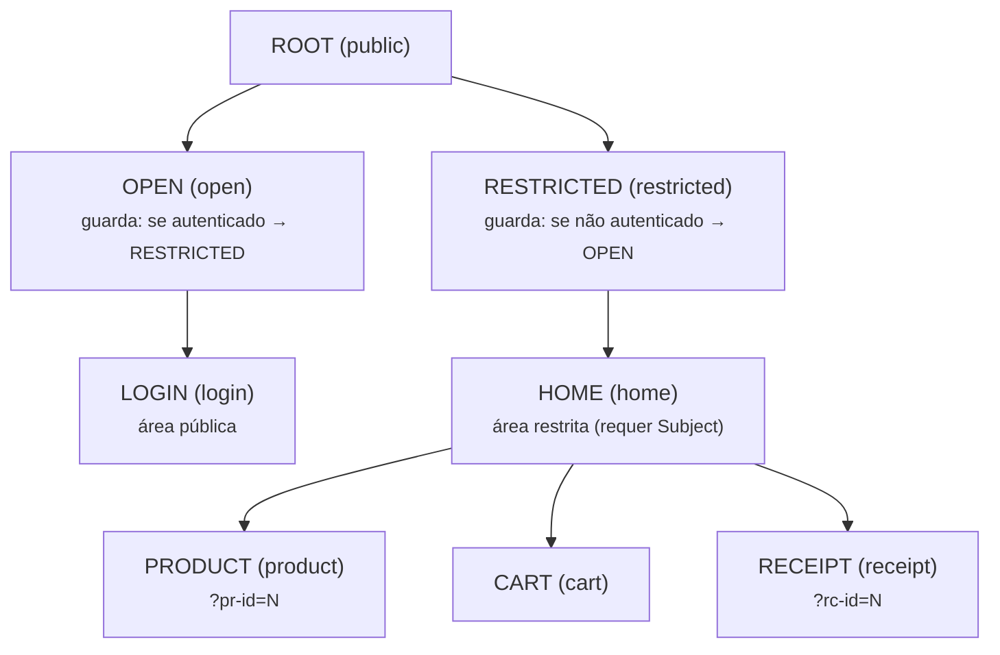
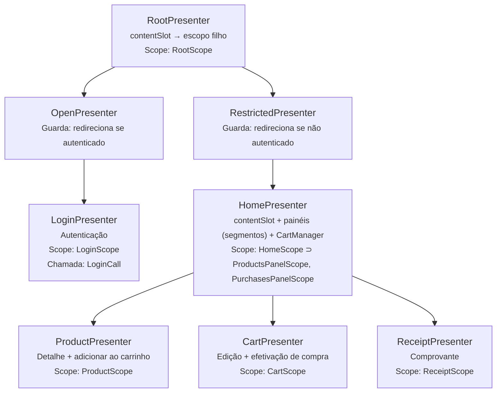
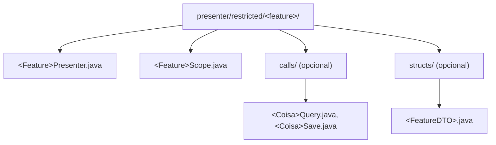

# WDC Shopping — Presentation

Camada de apresentação do sistema Shopping, implementada com o padrão **Cube MVP**. Contém os presenters, escopos, chamadas (calls), DTOs e o sistema de navegação. Esta camada é agnóstica de tecnologia de view — não depende de React, Javalin ou qualquer framework de UI.

## Dependências

| Artefato | Papel |
|----------|-------|
| `br.com.wdc.shopping.domain` | Modelos de domínio, repositórios, critérios |
| `br.com.wdc.framework.cube` | Motor Cube MVP (presenters, views, navegação) |
| `slf4j-api` | Logging |
| `jsr305` | Anotações `@Nullable` (scope provided) |

## Estrutura de Pacotes

```mermaid
graph TD
    root["br.com.wdc.shopping.presentation"]
    root --> ShoppingApp["ShoppingApplication.java"]

    root --> exception["exception/"]
    exception --> WrongParams["WrongParametersException.java"]
    exception --> ProductNotFound["ProductNotFoundException.java"]
    exception --> PurchaseNotFound["PurchaseNotFoundException.java"]

    root --> presenter["presenter/"]
    presenter --> RootK["RootKeys.java"]
    presenter --> RootP["RootPresenter.java"]
    presenter --> RootS["RootScope.java"]

    presenter --> open["open/"]
    open --> OpenP["OpenPresenter.java"]
    open --> login["login/"]
    login --> LoginP["LoginPresenter.java"]
    login --> LoginS["LoginScope.java"]
    login --> LoginCalls["calls/LoginCall.java"]
    login --> LoginStructs["structs/Subject.java"]

    presenter --> restricted["restricted/"]
    restricted --> RestrictedP["RestrictedPresenter.java"]
    restricted --> home["home/"]
    home --> HomeP["HomePresenter.java"]
    home --> HomeS["HomeScope.java (com ProductsPanelScope e PurchasesPanelScope)"]
    home --> HomeStructs["structs/PurchaseInfo.java"]
    home --> HomeCalls["calls/PurchasesPageQuery.java"]

    restricted --> products["products/"]
    products --> ProductP["ProductPresenter.java"]
    products --> ProductS["ProductScope.java"]
    products --> ProductCalls["calls/ProductQuery.java, ProductListQuery.java"]
    products --> ProductStructs["structs/ProductInfo.java"]

    restricted --> cart["cart/"]
    cart --> CartP["CartPresenter.java"]
    cart --> CartS["CartScope.java (com CartItemScope)"]
    cart --> CartMgr["CartManager.java"]
    cart --> CartStructs["structs/CartItem.java"]

    restricted --> receipt["receipt/"]
    receipt --> ReceiptP["ReceiptPresenter.java"]
    receipt --> ReceiptS["ReceiptScope.java"]
    receipt --> ReceiptCalls["calls/ReceiptQuery.java"]
    receipt --> ReceiptStructs["structs/ReceiptForm.java, ReceiptItem.java"]
```



## Hierarquia de Navegação

O sistema possui 8 places organizados em 4 níveis:



Cada place tem uma classe de chaves (`XxxKeys`, no pacote do seu presenter) que **declara o place** a partir do place das chaves que ela estende — `RootKeys → RestrictedKeys → HomeKeys → ProductKeys` — e é a única que conhece os nomes que o place lê e escreve no intent, todos com o prefixo de duas letras dela (`pr-id`, `rc-id`). Os getters validam e nunca lançam (o endereço vem de fora); o setter tira o nome do endereço quando recebe o padrão. `ShoppingApplication.PLACES` lista todos os places, o que carrega as classes antes de um endereço ser resolvido por nome. A convenção completa está no Javadoc de `RootKeys`; o `PlaceKeysTest` confere prefixos e árvore.

```java
// Navegar para o detalhe de um produto, a partir do estado atual
new ProductKeys(app).withProductId(productId).flip();

// Dentro do applyParameters: ler, e redirecionar com o intent em trânsito
var keys = new ProductKeys(this.app, intent);
if (keys.productId() == null) {
    new HomeKeys(this.app, intent).flip();
    return false;
}
```

Os presenters `OpenPresenter` e `RestrictedPresenter` funcionam como **guardas de navegação**: redirecionam automaticamente com base na presença/ausência do `Subject`.

## Hierarquia de Presenters



### Presenters e segmentos

| O quê | Como | Uso |
|------|------|-----|
| **Presenter** | `AbstractCubePresenter<ShoppingApplication>`, gerenciado pela navegação via `applyParameters` | Places com sua classe de chaves (`XxxKeys`) |
| **Segmento** | escopo interno (`HomeScope.ProductsPanelScope`), ações ligadas pelo presenter, view pelo catálogo do host (`ScopeViews`, pedida com `app.viewOf(scope)`) | Painéis embutidos na Home: sem presenter próprio |

## Componentes do Módulo

### ShoppingApplication

Classe abstrata que estende `CubeApplication`. Mantém o estado global:

- `subject` — usuário autenticado (`Subject`)
- `cart` — carrinho de compras (`CartManager`)
- `go(String)` / `go(CubeIntent)` — navegação programática
- `alertUnexpectedError(...)` — exibição de erros via `RootPresenter`

### Repositórios e autorização

Os repositórios são usados pelo service locator do domínio, através dos acessos protegidos de `ShoppingCall` (`productRepository()` lê `ProductRepository.BEAN` a cada uso); a transação de uma gravação é aberta pelo `ShoppingSave`. A autorização (RBAC) fica na fronteira de confiança: nos endpoints REST (`SecurityEnforcer`), por onde passa o teavm.web, cujos presenters rodam no navegador. Nos hosts em que os presenters rodam no servidor (Vaadin, SWT local, host remoto), o cliente só dispara ações e o presenter decide cada consulta.

### Scope

Cada presenter tem o seu `Scope` em **arquivo próprio**, ao lado dele (`XxxScope.java`, como o `xxx.scope.ts` da versão TypeScript). Um escopo que só existe dentro dele — um painel da Home, a linha do carrinho — é classe interna pública estática dele (`HomeScope.ProductsPanelScope`, `CartScope.CartItemScope`). Cada campo observado é uma `Prop`, criada com `prop(...)`; o presenter liga o estado a si com `bind(...)`, e então `set` de um valor diferente (`equals`) pede o redesenho sozinho — o presenter não chama `this.update()` depois. A view lê com `get()`. O escopo declara o seu `CLASS_ID` (o classId do protocolo bridge); o presenter não cria view — cada host desenha o escopo com a view que o seu catálogo `ScopeViews` registra para a classe. A serialização remota é automática (`ScopeSerializer`, via reflection dos campos públicos, escrevendo o valor de cada `Prop`; um `Prop<Scope>`, como o `content` de Root e Home, sai como `"<campo>ViewId"`):

```java
public class ProductScope extends Scope {
    public static final String CLASS_ID = "48b693f67410";

    public final Prop<ProductInfo> product = prop();
    public final Prop<Integer> errorCode = prop(0);
    public final Prop<String> errorMessage = prop();
}

// no ProductPresenter
public final ProductScope state = bind(new ProductScope());
```

**Mexer dentro de um valor já atribuído** (um item de uma lista) não passa pela prop: aí, ou se atribui um valor novo, ou se chama `this.update()` — como no `CartPresenter`, cujo carrinho altera os itens no lugar.

O JSON gerado pelo serializer usa `"#"` como chave para o `instanceId`:

```json
{ "#": "view-instance-id", "product": {...}, "errorCode": 0, "errorMessage": null }
```
```

### Calls

Cada operação que o presenter pede aos repositórios é uma classe no pacote `calls/` do módulo (irmão de `structs/`), com o sufixo do que ela faz: `XxxQuery` para leitura, `XxxSave` para gravação e `XxxCall` para o que não é nem uma coisa nem outra (o login, que autentica). A requisição se acumula na instância por setters fluentes `withXxx(...)` e `run()` a responde; uma instância nova a cada uso:

```java
var product = new ProductQuery().withProductId(id).run();
```

A raiz é `ShoppingCall<R>`, que reúne numa seção logo no início os acessos protegidos aos repositórios (`productRepository()`, `purchaseRepository()`, ...), lidos do `BEAN` a cada uso, e declara `run()`. Abaixo dela:

- `ShoppingQuery<R>` — leitura: sem efeito colateral, pode ser repetida, sem transação própria.
- `ShoppingSave<R>` — gravação: o `run()` (final) abre a transação (ou entra na de quem chamou) e chama o `save()` da subclasse, então nenhuma gravação fica fora de uma.
 A resposta é um tipo que já existe; ou um struct do módulo (`structs/`), quando outras chamadas ou o escopo também o usam; ou uma classe interna da própria chamada, quando só leva a resposta de volta a quem chamou (`LoginCall.Result`).

| Chamada | Requisição | Resposta |
|---------|------------|----------|
| `LoginCall` | `withUserName`, `withPassword` | `LoginCall.Result` (HMAC challenge-response via `AuthenticationService`) |
| `ProductQuery` | `withProductId` | `ProductInfo` |
| `ProductListQuery` | `withLimit` | `List<ProductInfo>` (sem descrição) |
| `PurchasesPageQuery` | `withUserId`, `withPage`, `withPageSize` | `Page<PurchaseInfo>` (a mais recente primeiro) |
| `ReceiptQuery` | `withPurchaseId` | `ReceiptForm` |
| `PurchaseSave` | `withUserId`, `withItems` | `Long` (id da compra) |

### DTOs (structs)

Objetos `Serializable` usados para transferir dados entre camadas. Cada DTO possui:

- **Campos públicos** (sem getters/setters)
- **`projection()`** — retorna uma instância do modelo de domínio indicando quais campos carregar
- **`create(Model)`** — factory method que converte do modelo de domínio para o DTO

| DTO | Pacote | Campos principais |
|-----|--------|------------------|
| `Subject` | `open/login/structs/` | id, nickName |
| `ProductInfo` | `restricted/products/structs/` | id, image, name, description, price |
| `CartItem` | `restricted/cart/structs/` | id, image, name, price, quantity |
| `PurchaseInfo` | `restricted/home/structs/` | id, date, total, items (nomes) |
| `ReceiptForm` | `restricted/receipt/structs/` | date, total, items |
| `ReceiptItem` | `restricted/receipt/structs/` | id, description, value, quantity |

### Constantes

- **`XxxKeys`** (uma por place, em `presenter/**`) — os nomes que cada place lê e escreve no intent, tipados; substituem as antigas `PlaceParameters`/`PlaceAttributes`

### CartManager

Gerenciador de carrinho in-memory com sistema de eventos:

- `addProduct(ProductInfo, quantity)` — adiciona ou incrementa item
- `modifyProductQuantity(productId, quantity)` — altera quantidade
- `removeProduct(productId)` — remove item
- `commit(Subject)` — persiste a compra diretamente via repositórios
- `addCommitListener(Runnable)` / `addChangeListener(Runnable)` — listeners para recarregar painéis

## Convenções

### Organização de pacotes por feature

Cada feature segue a estrutura:


### Padrão de um Presenter

```java
public class XxxPresenter extends AbstractCubePresenter<ShoppingApplication> {

    // 1. Logger
    private static final Logger LOG = LoggerFactory.getLogger(XxxPresenter.class);

    // 2. Estado público — o XxxScope fica em XxxScope.java, ao lado (campos observados são Props; serialização via reflection) (bind: o escopo compartilha os eventos do presenter e é liberado com ele)
    public final XxxScope state = bind(new XxxScope());

    // 3. Campos internos
    private ScopeSlot ownerSlot;

    // 4. Constructor (liga as ações do state)
    public XxxPresenter(ShoppingApplication app) { super(app); }

    // 5. Cube API (applyParameters — termina com ownerSlot.setScope(this.state) —, publishParameters)
    // 6. User Actions (onXxx)
    // 7. Messages (alertXxx, errorXxx)
}
```

### Padrão de erros

Os presenters não lançam exceções para a view. Em vez disso, usam `errorCode` + `errorMessage` no Scope — e o `set` já pede o redesenho:

```java
private void alertProductNotFound() {
    this.state.errorCode.set(3);
    this.state.errorMessage.set("Código do produto não localizado.");
}
```

Erros inesperados não precisam de `try/catch`: as ações são guardadas. Cada ação é um campo do Scope, ligado uma vez no construtor do presenter; a guarda manda a falha não tratada ao `RootPresenter` (via `app.alertUnexpectedError`) e, ao fim, republica o endereço:

```java
public static class CartScope extends Scope {
    // ...
    public ActionOf<Long> onRemoveProduct = ActionOf.noop();
    public Action onBuy = Action.NOOP;
}

public CartPresenter(ShoppingApplication app) {
    super(app);
    this.state.onRemoveProduct = actionOf(this::removeProduct);
    this.state.onBuy = action(this::buy);   // buy() só trata InvalidCartItemException e OfflineException
}
```

A view dispara a ação pelo escopo que desenha (`state.onBuy.run()`), e o skeleton remoto do escopo (`scope.skeleton(CLASS_ID)`) mapeia o código do evento para ela.
