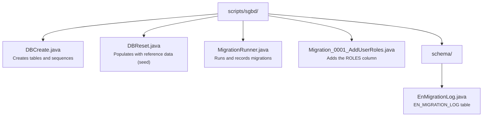

# br.com.wdc.shopping.scripts

The module responsible for the Shopping application's **database scripts**. It covers both creating the schema from scratch (bootstrap) and incrementally migrating from an earlier version to the current state.

## Purpose

| Scenario | Description |
|---------|-----------|
| **Bootstrap** | Creates all tables, sequences and initial data in an empty database. |
| **Migration** | Evolves an existing database from an earlier version to the current version, applying structural and data changes in order. |

## Current structure



## Hybrid SQL + Java approach

The scripts are implemented as **Java classes** that execute SQL via JDBC. This allows:

- Conditional logic (checking whether a table/column already exists before altering it)
- In-memory data transformation when the migration is complex
- Reuse of entities and repositories from the `persistence` module
- Explicit transaction control per step
- Unit tests over the migration logic

## Migration convention

Each migration script is a Java class whose public methods prefixed with `step` represent the sequential actions. `MigrationRunner` discovers these methods automatically, sorts them by the number after the prefix, skips the ones already executed (by querying `EN_MIGRATION_LOG`) and records each completed step.

### Migration class

```java
public class Migration_0001_AddPurchaseStatus {

    private final Connection connection;

    public Migration_0001_AddPurchaseStatus(Connection connection) {
        this.connection = connection;
    }

    public void step1_addStatusColumn() throws SQLException {
        try (var stmt = connection.createStatement()) {
            stmt.execute("ALTER TABLE PURCHASE ADD COLUMN STATUS VARCHAR(20) DEFAULT 'PENDING'");
        }
    }

    public void step2_populateDefaultValues() throws SQLException {
        // Java + SQL logic to transform existing data
    }

    public void step3_createIndex() throws SQLException {
        try (var stmt = connection.createStatement()) {
            stmt.execute("CREATE INDEX IDX_PURCHASE_STATUS ON PURCHASE(STATUS)");
        }
    }
}
```

### Running via MigrationRunner

```java
new MigrationRunner(connection)
    .run(new Migration_0001_AddPurchaseStatus(connection))
    .run(new Migration_0002_AnotherMigration(connection));
```

- Methods are sorted numerically by the number after `step` (e.g.: `step1` before `step10`)
- Steps already executed are skipped automatically (idempotence)
- Each successful step is recorded in the `EN_MIGRATION_LOG` table
- If a step fails, execution stops with a `SQLException`

**`XXXX`** in the class name is a sequential number (e.g.: `0001`, `0002`) that defines the order in which the scripts run.

## Dependencies

- `br.com.wdc.shopping.persistence` — entities and repositories
- `br.com.wdc.shopping.presentation` — domain constants
- H2 Database — JDBC driver (development/test environment)
- SLF4J + Logback — logging

## Execution

`DBCreate` is invoked at application startup and creates the tables (including `EN_MIGRATION_LOG`) if they do not exist. Incremental migrations run via `MigrationRunner` after the bootstrap. There is no external migration framework — control is handled directly by the Java code.
