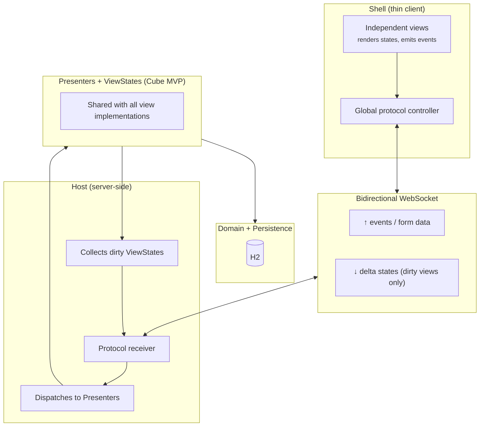
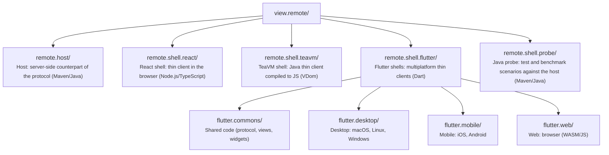
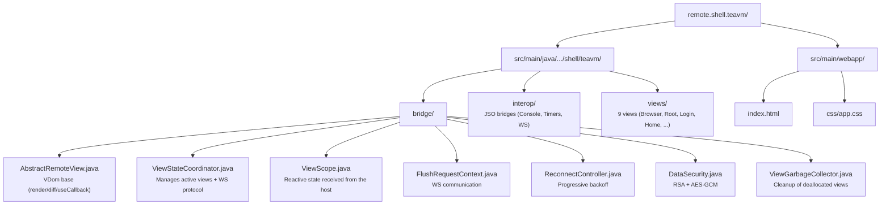
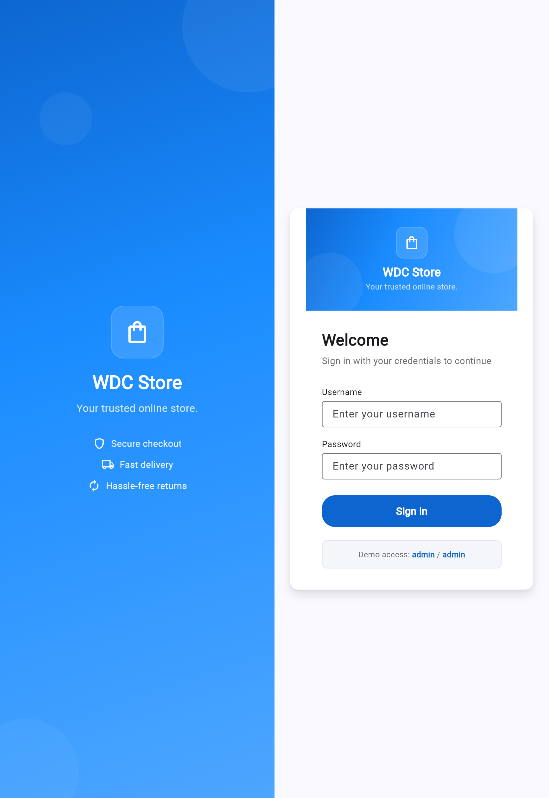
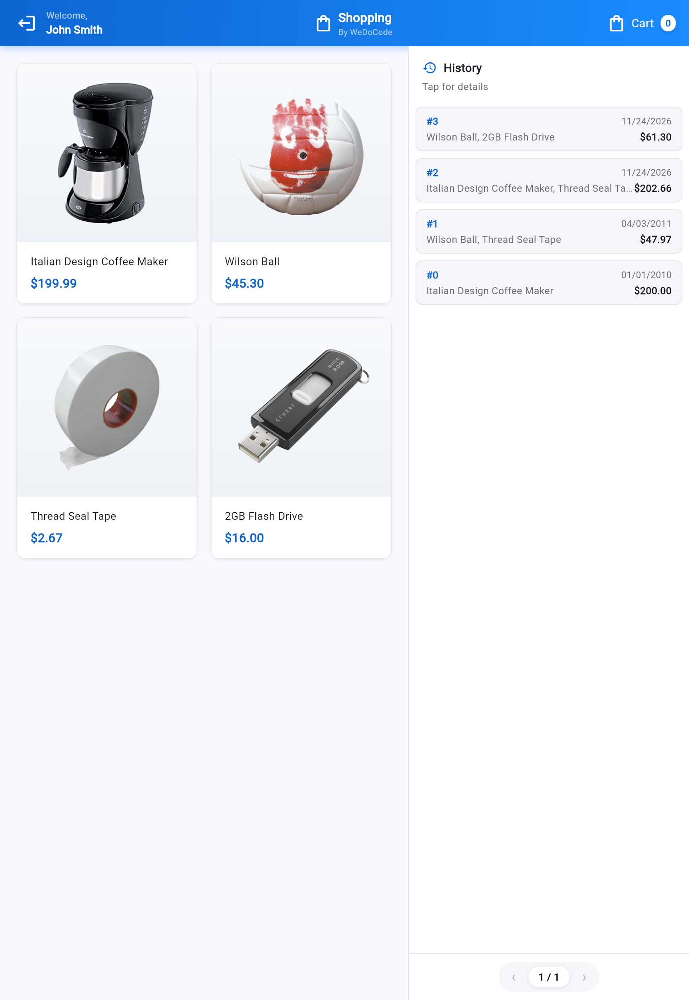
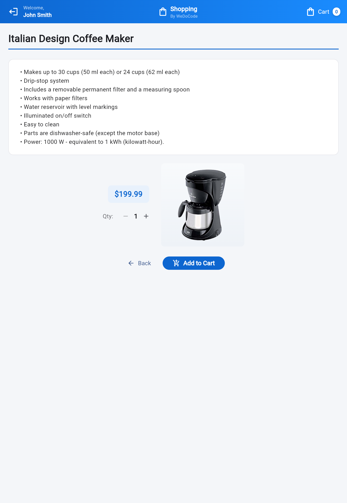
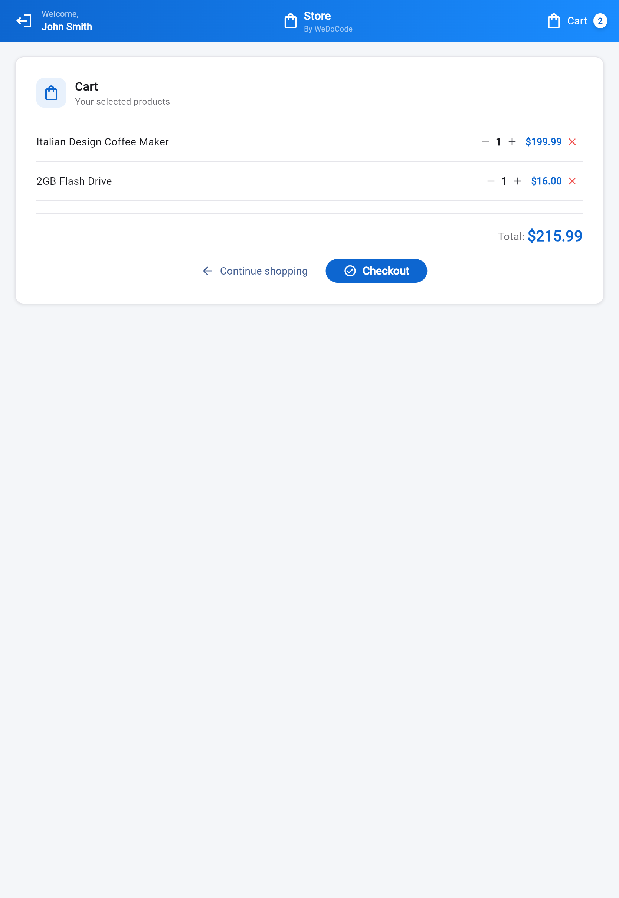
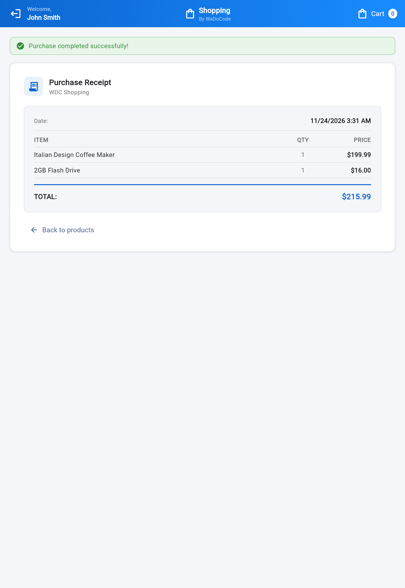

# br.com.wdc.shopping.view.remote

Implementation of the **Remote Presentation** technique for the **WeDoCode Shopping** application, based on the **Cube MVP** pattern.

## Concept

The module implements a proprietary **remote presentation** protocol — a concept analogous to Remote Desktop, but operating at the application's data layer instead of pixels. The server holds all business logic and view state; the client is a thin shell that only renders received states and emits user interaction events.

### How it works

1. **The client (shell)** has no business logic. It contains only the views, each one independent of the others. User interaction events are sent directly from these views. A global controller in the app uses the proprietary protocol to forward requests to the server and receive back the new states of the views that were modified on the backend — only the portions of data that became "dirty".

2. **The server (host)** is the counterpart of this protocol. It receives the requests coming from the client and forwards them to the presentation layer, invoking the methods on the Presenters that correspond to each view existing on the client side. After processing, it collects the ViewStates that changed and serializes only the deltas back.

The reference client is a browser (React), but the architecture supports any rendering technology — it could be a native desktop app, a mobile app, or any other surface capable of rendering components and capturing events.



## Comparison with the other view implementations

| Aspect | Remote (this module) | Vaadin (server-side) | JFX (desktop) | TeaVM (multiplatform) |
|---------|---------------------|----------------------|---------------|------------------------|
| **Where the UI runs** | Remote browser (thin shell) | Browser via Server Push | Local JVM | Browser / WebView (Tauri) |
| **Model** | Server-driven (delta states) | Server-driven (component tree) | Direct in-memory access | Client-side (SPA) |
| **Transport** | WebSocket (JSON delta) | Atmosphere (WebSocket/Push) | N/A (in-process) | REST (OkHttp → JS) |
| **Security** | RSA + AES-GCM + URL signing | HMAC-SHA256 URL signing | N/A (local process) | HMAC + JWT |
| **Scalability** | Virtual Threads (~1K per connection) | Automatic Server Push | Single instance | Client-side (SPA) |
| **UI code** | TypeScript (React) / Dart (Flutter) | Java | Java | Java (compiled to JS) |
| **Presenters** | Same | Same | Same | Same |
| **ViewStates** | Same | Same | Same | Same |

## Submodule structure



Future clients will follow the `remote.shell.<technology>` pattern.

### remote.host (Maven)

Server of the remote presentation protocol — receives events from the shell, dispatches them to the Presenters and returns the modified ViewStates:

| Class | Responsibility |
|--------|------------------|
| `ApplicationReactImpl` | Concrete `ShoppingApplication`; manages dirty views, event dispatch, JSON response generation |
| `ApplicationReactRegistry` | Registry of per-session instances, lifecycle and cleanup |
| `GenericViewImpl` | Abstract base: `instanceId`, `update()` (marks dirty), `syncClientToServer()`, `writeState()` |
| `BrowserPresenter` | Coordinates navigation and intent dispatch between views |
| `AppSecurity` | RSA + SHA256withRSA for signing navigation URLs |
| `DataSecurity` | Per-session AES-GCM (derived via PBKDF2, 250k iterations) for sensitive data |
| `ScopeSerializer` | Efficient serialization of ViewStates to JSON (dirty fields only) |
| `WebSocketConnection` | SPI — interface the backend implements to communicate with the shell |

### remote.shell.react (Node.js — Parcel)

Thin client that acts as the rendering surface in the browser:

- **React 19** + **MUI 9** (Material UI) for visual components
- Bidirectional **WebSocket** for communication with the host
- **No business logic** — each view renders the received ViewState and emits interaction events
- **Independent views** — each component is self-sufficient, with no coupling between views
- Built with **Parcel 2.13** — output copied to `remote.host/META-INF/resources/`

### remote.shell.teavm (Maven — TeaVM)

Thin client in Java compiled to JavaScript via TeaVM, using a **Virtual DOM** (VNode API) with Spectrum Web Components:

- Declarative **VNode API** — `render()` returns a virtual tree, the framework does an efficient diff
- Bidirectional **WebSocket** for communication with the host (same protocol as the React shell)
- **No business logic** — each view renders the ViewState received via `ViewScope` and emits events
- **useCallback(key, listener)** — cache of parameterized listeners for reference stability in the diff
- **Stable fields** — parameterless listeners extracted into `final` fields (zero cost in the diff)
- **Compact Css** — aliases (`u`/`c`/`icon`) for the design system's utility classes
- Built with **Maven + TeaVM plugin** — output in `target/classes/META-INF/resources/`



### remote.shell.flutter (Maven + Flutter/Dart)

Multiplatform Flutter shells — thin clients in Dart that share code via `flutter.commons`:

- **flutter.commons** — shared library: WebSocket protocol, RSA+AES-GCM security, views, widgets and design tokens
- **flutter.desktop** — native macOS/Linux/Windows app; built via `build.sh` (auto-detects the platform)
- **flutter.mobile** — iOS/Android app deployed via `deploy.sh` (supports simulators, emulators and physical devices)
- **flutter.web** — web app via Flutter WASM/JS

### remote.shell.probe (Maven/Java)

Runs programmatic scenarios against the remote host — used for throughput benchmarks, per-session memory measurement and behavioral validation:

- **`ConcurrentThroughputScenario`** — measures throughput with multiple parallel sessions
- **`MemoryPerSessionScenario`** — measures memory consumption per active session
- **`BuyProductScenario`** — validates the full purchase flow via the remote protocol
- Uses `remote.bridge.java` (framework) as the base for connecting to the host

## Communication flow

```
1. Shell connects: ws://host/dispatcher/{sessionId}
2. Security handshake:
   - Shell sends the app_signature cookie (RSA-encrypted AES password)
   - Host derives an AES-256 key via PBKDF2 (salt + 250k iterations)
3. Request/response cycle:
   - Shell → Host: { requestId, eventCode, formData }
   - Host:
     a. syncClientToServer() — updates form data in the views
     b. submit() — dispatches the event to the correct Presenter
     c. Presenter updates the ViewState → marks views dirty
     d. commitComputedState() — propagates derived states
     e. Serializes only dirty views → JSON delta
   - Host → Shell: { requestId, uri, states: [...] }
4. Shell applies the delta to the components (React reconciliation)
```

Only **modified (dirty) views** are sent in each response — minimal transfer, analogous to a Remote Desktop sending only the screen regions that changed.

## Security

### Layer 1: Navigation signing
- Each URL/intent includes a `sign` parameter = `Base62(MD5(SHA256withRSA(intent)))`
- The server validates it before navigating — prevents URL tampering

### Layer 2: Encryption of sensitive data
- AES-256 key derived per session via PBKDF2 (250,000 iterations)
- Sensitive fields (passwords, tokens) are AES-GCM encrypted in transit
- Each session has a unique key — compromising one does not affect the others

## Prerequisites

- **Java 25** (Temurin or Microsoft JDK)
- **Maven 3.9+**
- **Node.js 20+** (to build the client)

## Build

```bash
# 1. Build the shell (generates assets in remote.host/META-INF/resources/)
cd fontes/br.com.wdc.shopping/br.com.wdc.shopping.view.remote/remote.shell.react
npm install && npm run build

# 2. Maven build (host + backend)
cd fontes && mvn -q -DskipTests clean install
```

## Running

```bash
# Server (port 8080 by default)
cd fontes/br.com.wdc.cube.backend
java -jar target/br.com.wdc.cube.backend-1.0.0.jar

# Or via script
./start-server.sh
```

### Configuration

File `work/config/application.toml`:

```toml
[app]
# basedir = "work"

[database]
# url = "jdbc:h2:file:..."
# username = "sa"
# password = "sa"
# reset = false

[server]
# port = 8080
```

### Shell development

```bash
cd remote.shell.react
npm run watch   # Parcel in watch mode (hot reload)
```

## Virtual Threads

This module uses Virtual Threads (Java 21+) for HTTP and WebSocket handlers, reducing memory consumption per connection from ~1MB to ~1KB. Full details in [VIRTUAL_THREADS_STRATEGY.md](VIRTUAL_THREADS_STRATEGY.md).

## Screenshots

| Screen | Preview |
|------|---------|
| Login |  |
| Home / Products |  |
| Product Detail |  |
| Cart |  |
| Receipt |  |
| History |  |

## Conclusion

This module validates that the Cube MVP pattern supports **remote presentation**: all logic stays server-side in the **host**, and the **shell** is an interchangeable thin client that renders serialized states and captures interactions. The host/shell separation ensures that the same protocol infrastructure can feed different frontend technologies — all it takes is a new `remote.shell.<technology>` that implements ViewState rendering and event emission.
