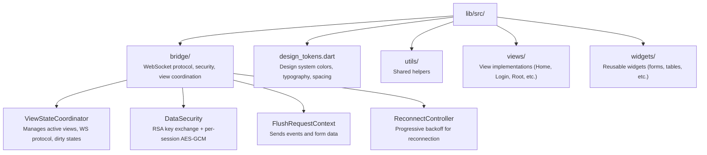

# flutter_commons

Shared library for the Flutter shells (desktop, mobile, web) of the **WeDoCode Store** application.

It contains all the infrastructure any Flutter shell needs to work as a thin client of the Remote Presentation protocol — no business logic, only protocol, rendering and interaction.

## Modules



## Usage

Referenced as a path dependency in the shells:

```yaml
dependencies:
  flutter_commons:
    path: ../flutter.commons
```

## External dependencies

| Package | Purpose |
|---------|-----|
| `web_socket_channel` | WebSocket communication with the host |
| `pointycastle` | RSA + AES-GCM cryptography |
