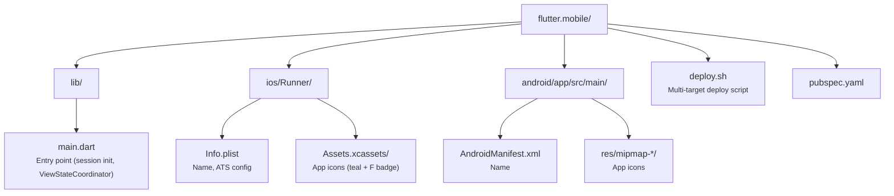

# Shopping Remote — Flutter Mobile

Mobile shell (iOS & Android) for the **WeDoCode Shopping** application, using the **Remote Presentation** protocol. The app is a thin client that renders ViewStates received from the server over WebSocket and emits user interaction events.

## Features

- **App name:** Shopping Remote
- **Icon:** Teal with the WDC cart + "F" badge (Flutter)
- **Platforms:** iPhone, iPad, Android phone, Android tablet
- **Protocol:** Bidirectional WebSocket with RSA + AES-GCM encryption
- **Session persistence:** Access token via SharedPreferences (auto-login)
- **Shared code:** Uses `flutter_commons` for protocol, views and widgets

## Prerequisites

- **Flutter 3.44+** (`flutter --version`)
- **Xcode 15+** (for iOS)
- **Android Studio** with SDK 34+ (for Android)
- **Backend running** on port 8080 (or the configured endpoint)

## Deploy

The `deploy.sh` script supports every target:

```bash
# List available devices
./deploy.sh list

# Run (debug mode with hot reload)
./deploy.sh run ios-sim              # iPhone Simulator
./deploy.sh run ipad-sim             # iPad Simulator
./deploy.sh run android-emu          # Android phone Emulator
./deploy.sh run android-tablet-emu   # Android tablet Emulator
./deploy.sh run ios                  # physical iPhone
./deploy.sh run android              # physical Android device

# Install (no hot reload)
./deploy.sh install ios-sim
./deploy.sh install ipad-sim

# Release build
./deploy.sh build ios
./deploy.sh build android
./deploy.sh build all
```

### Options

| Option | Description |
|-------|-----------|
| `--release` | Build in release mode |
| `--debug` | Build in debug mode (default for `run`) |
| `--endpoint=URL` | Backend endpoint (default: `http://localhost:8080`) |

> **Note:** For Android emulators, `localhost` is automatically replaced with `10.0.2.2`.

## Structure



## Dependencies

| Package | Purpose |
|---------|-----|
| `flutter_commons` | WS protocol, views, widgets, security |
| `shared_preferences` | Access token persistence |
