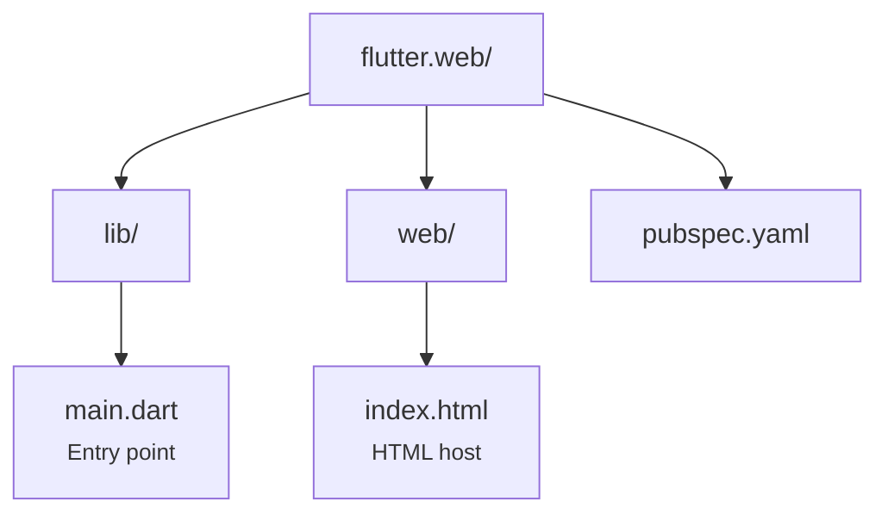

# Shopping Remote — Flutter Web

Web shell for the **WeDoCode Shopping** application, using the **Remote Presentation** protocol via Flutter compiled to WebAssembly/JS. A thin client that renders ViewStates received from the server over WebSocket.

## Features

- **Platform:** Browser (WebAssembly or JS)
- **Protocol:** Bidirectional WebSocket with RSA + AES-GCM encryption
- **Shared code:** Uses `flutter_commons` for protocol, views and widgets
- **Alternative to the React shell** — same functionality, implemented in Dart/Flutter

## Prerequisites

- **Flutter 3.44+** (`flutter --version`)
- **Backend running** on port 8080 (or the configured endpoint)

## Running

```bash
# Dev (hot reload)
flutter run -d chrome --dart-define=WDC_ENDPOINT=http://localhost:8080

# Release build
flutter build web --dart-define=WDC_ENDPOINT=http://localhost:8080
```

## Structure



## Dependencies

| Package | Purpose |
|---------|-----|
| `flutter_commons` | WS protocol, views, widgets, security |
