# Remote Shell TeaVM

Java thin client compiled to JavaScript via **TeaVM 0.16.0**, using a **Virtual DOM** (VNode API) with Spectrum Web Components. It communicates with `remote.host` over WebSocket — **no local business logic**.

## Concept

This module is an alternative implementation of the shell (thin client) of the Remote Presentation architecture. It replaces React as the rendering engine while keeping the same bidirectional WebSocket protocol:

- Receives serialized **ViewStates** from the host (deltas/dirty only)
- Renders using a Virtual DOM (efficient diff → real DOM)
- Emits user **interaction events** back to the host

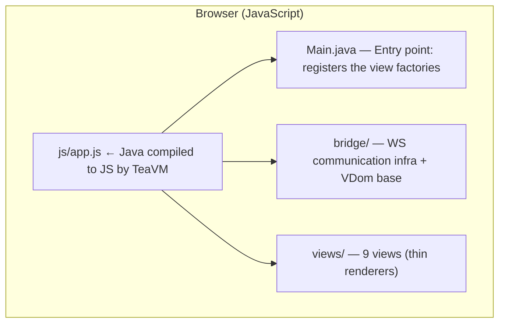

## Architecture

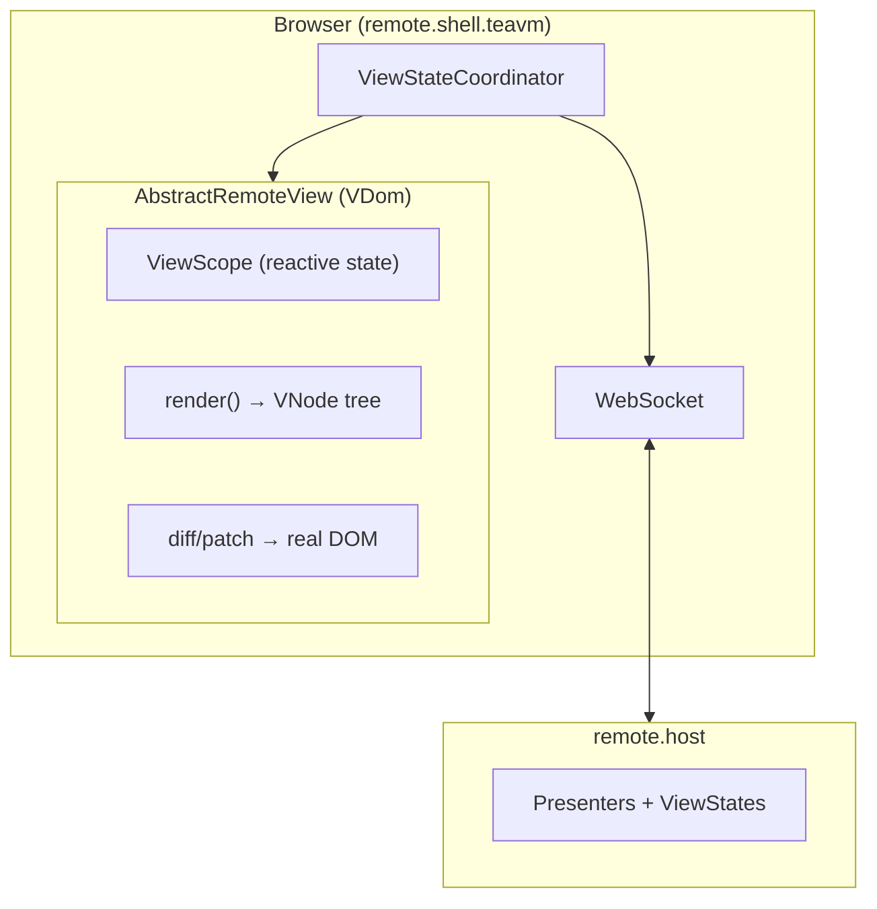

## Project Structure

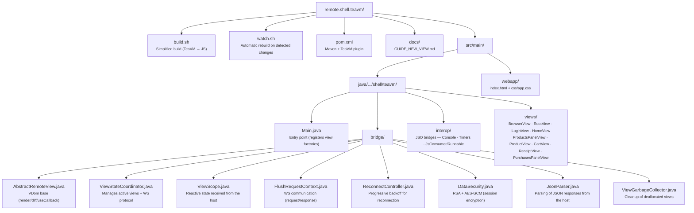

## Virtual DOM

Views extend `AbstractRemoteView` and implement `render()`, returning a `VNode` tree:

```java
@Override
protected VNode render() {
    var state = scope.state();
    return div(Css.ROOT).children(
        h5(Css.TITLE).text(state.title),
        spButton("accent")
            .on("click", onConfirm)
            .children(span().text("Confirm"))
    );
}
```

### Reference Optimizations

The event listener diff compares by **reference identity**:

1. **Stable fields** — listeners without parameters:
   ```java
   private final EventListener<Event> onBack = evt -> flush("back");
   ```

2. **`useCallback(key, listener)`** — cached parametric listeners:
   ```java
   .on("click", useCallback("remove-" + id, mkOnRemove(id)))
   ```

### Compact Css

```java
@SuppressWarnings({"java:S1214", "static-access"})
private interface Css {
    CssUtility u = CssUtility.INSTANCE;
    CssComponents c = CssComponents.INSTANCE;
    CssIcons icon = CssIcons.INSTANCE;

    String ROOT = u.PAGE_SCROLL_ROOT;
    String TITLE = clsx(c.CARD_TITLE, u.MB_12);
}
```

## Difference vs. app.teavm (teavm.web)

| Aspect | remote.shell.teavm | app.teavm (teavm.web) |
|---------|-------------------|----------------------|
| **Business logic** | None (thin client) | Complete (standalone SPA) |
| **Communication** | Bidirectional WebSocket | REST (XMLHttpRequest) |
| **State** | Received from the host (`ViewScope`) | Managed locally (Presenters) |
| **Presenters** | Server-side (remote.host) | Client-side (compiled together) |
| **Advantage** | Zero logic in the client | Works offline |

## Build

```bash
# Simple build
JAVA25_HOME=<path-to-jdk-25> ./build.sh

# Full build (installs the framework dependencies first)
JAVA25_HOME=<path-to-jdk-25> ./build.sh --full
```

### Output

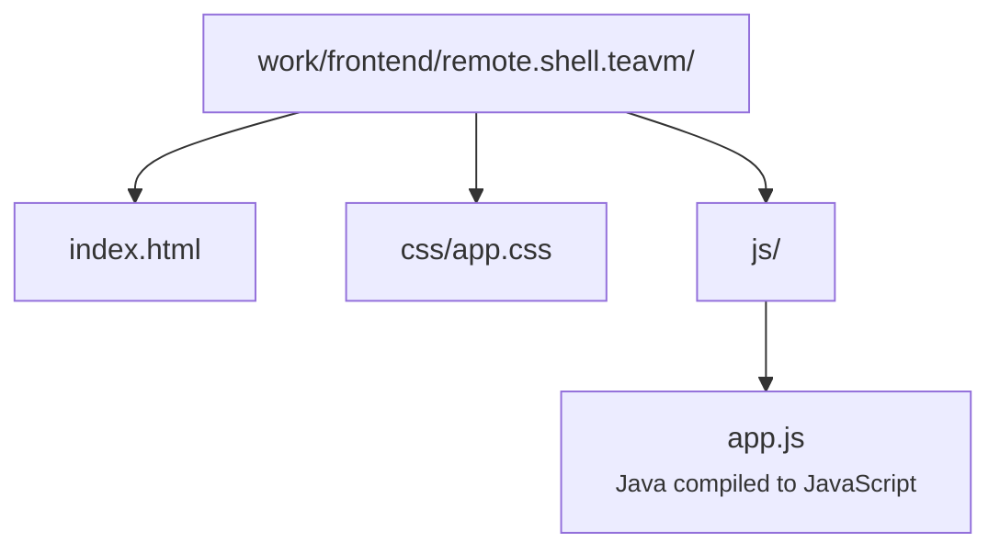

## Development

```bash
# Watch mode — automatic rebuild on save
./watch.sh
```

Requires `fswatch` installed (`brew install fswatch` on macOS).

## Running

The shell is served as a static resource by the backend:

```
http://localhost:8080/remote.shell.teavm
```

## Guides

- [How to create a new View](docs/GUIDE_NEW_VIEW.md) — step by step to implement a view in this project

## Screenshots

### Login

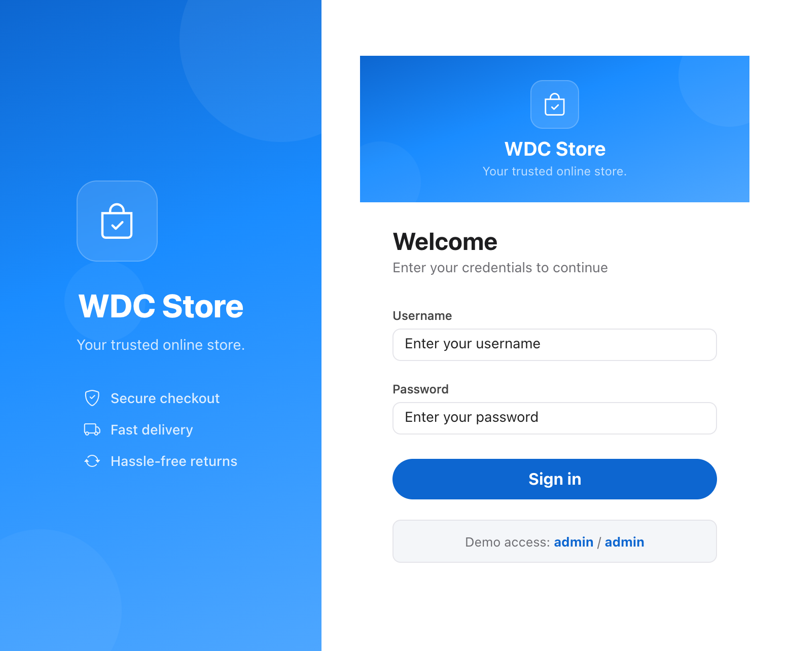

### Product List

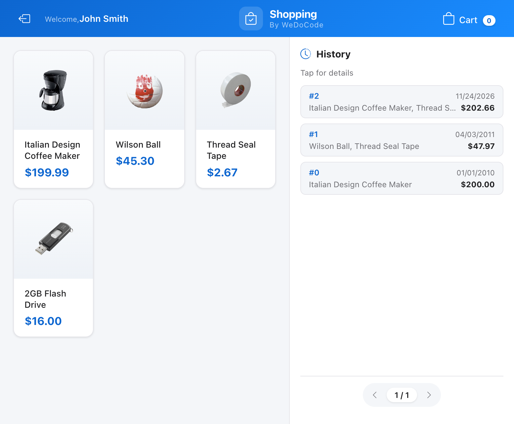

### Product Detail

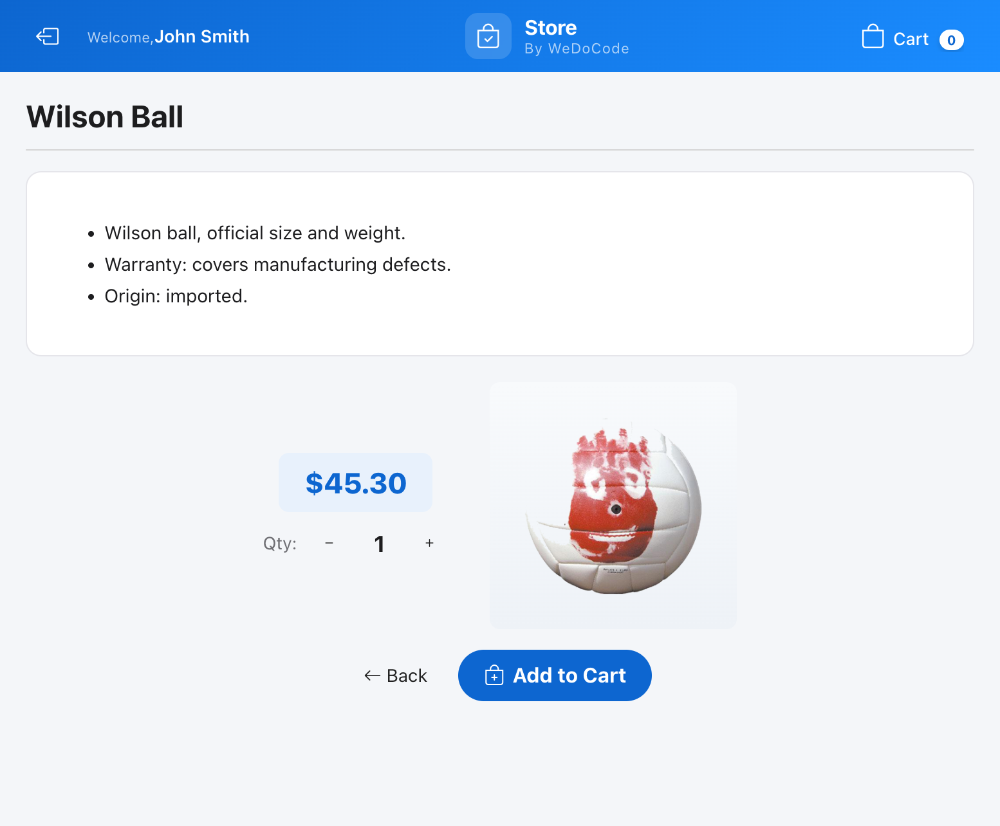

### Cart

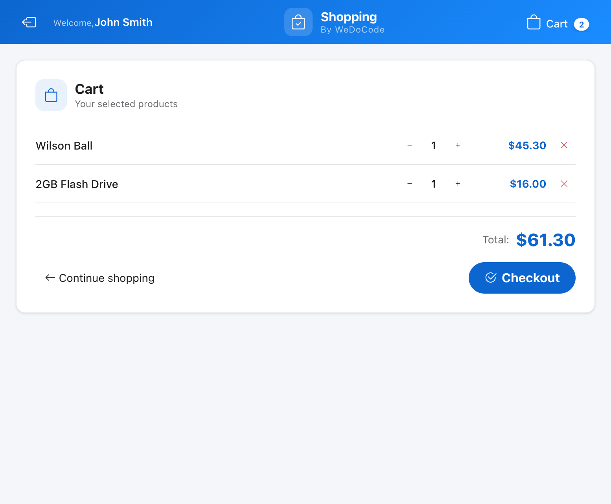

### Empty Cart

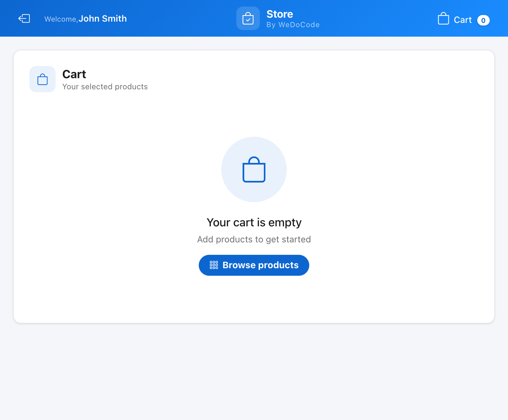

### Receipt

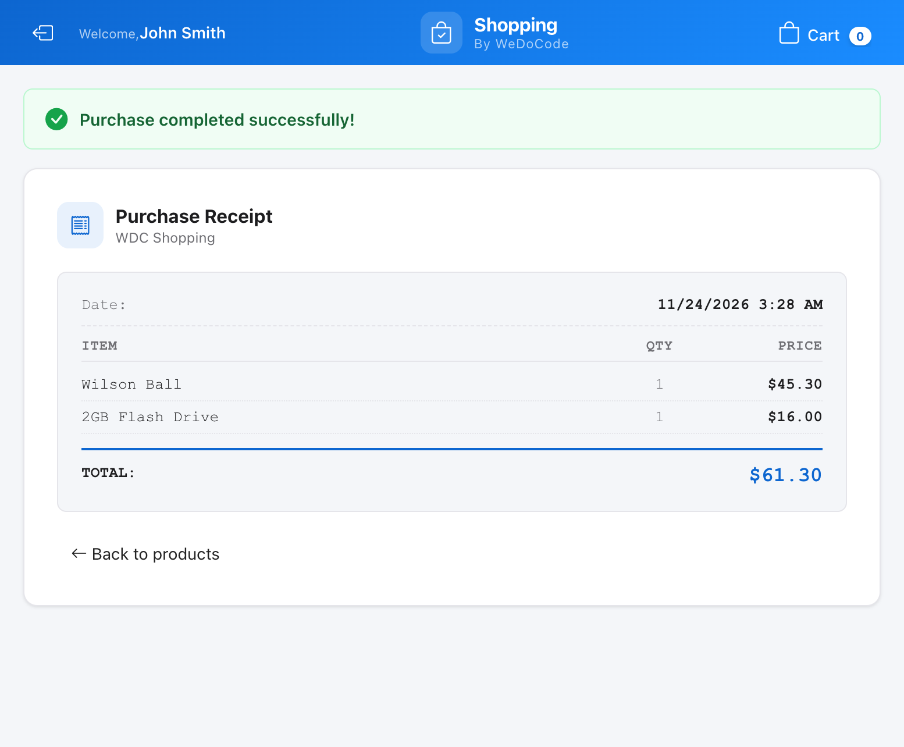

### Purchase History

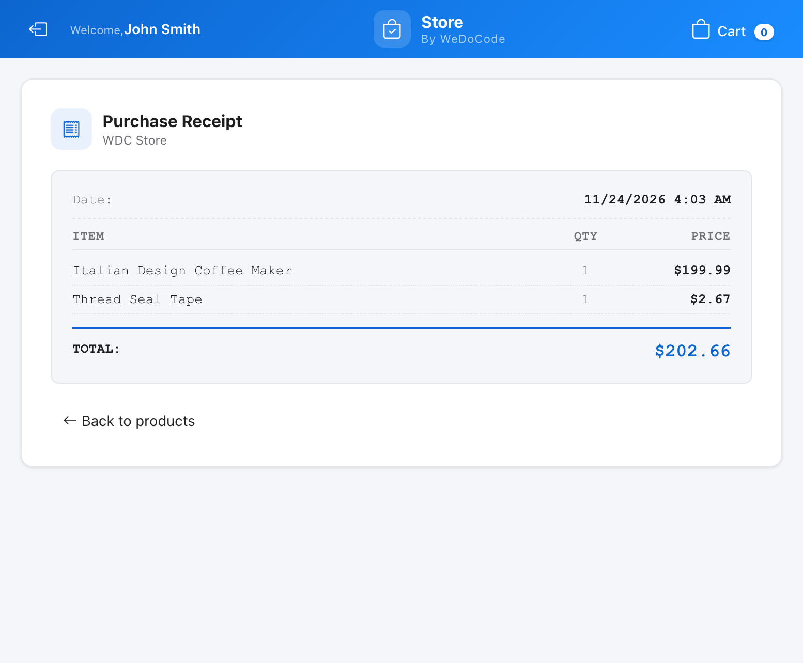
