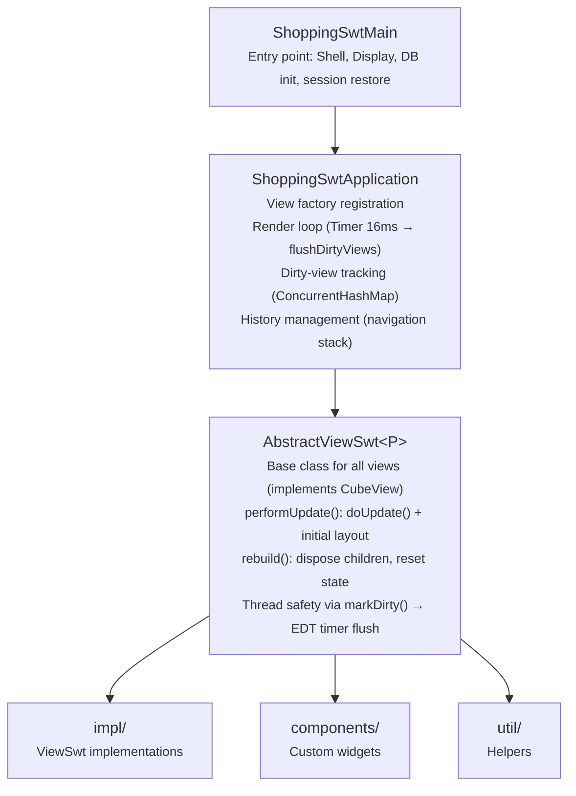
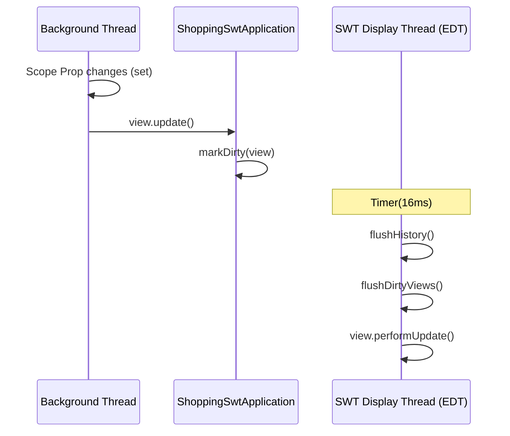
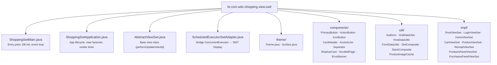
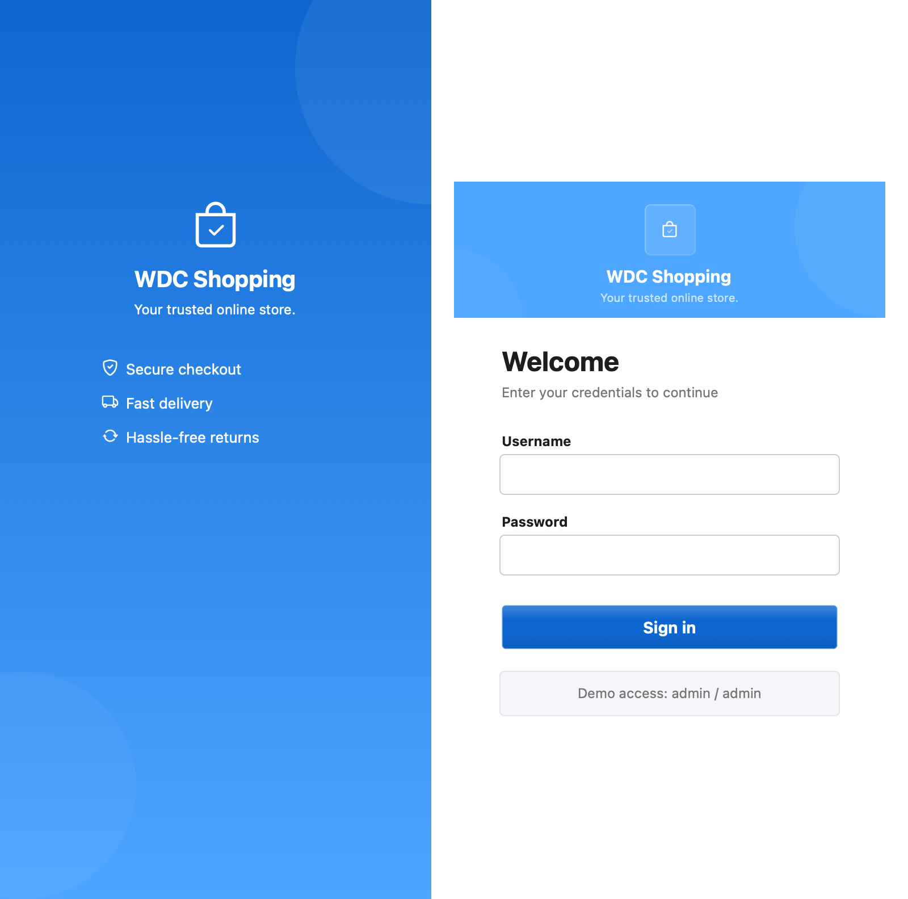
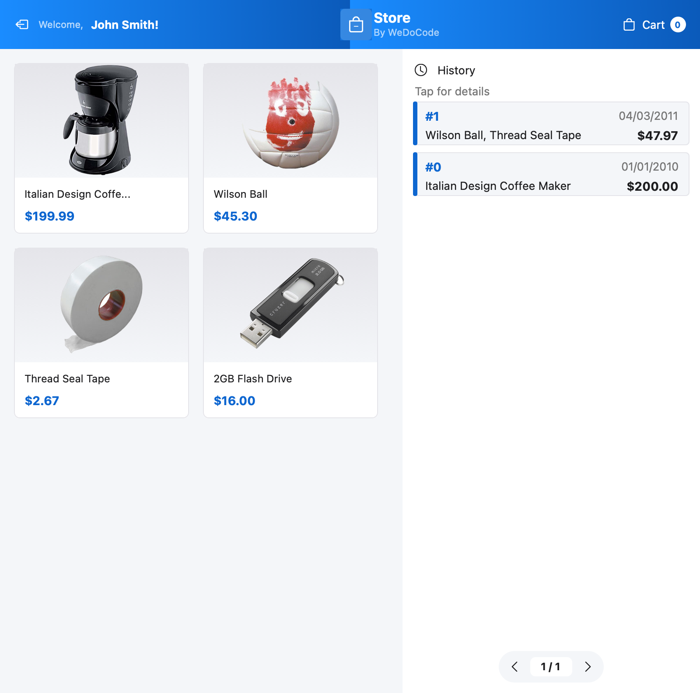
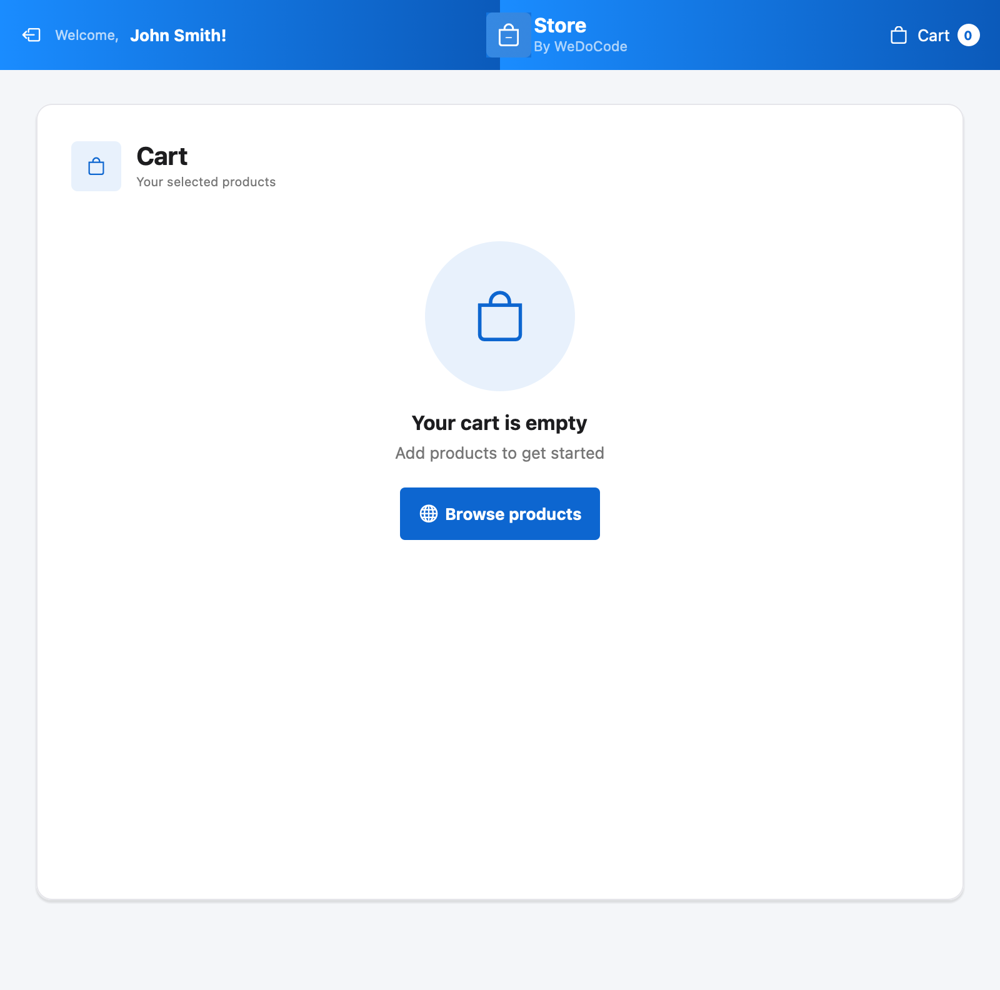
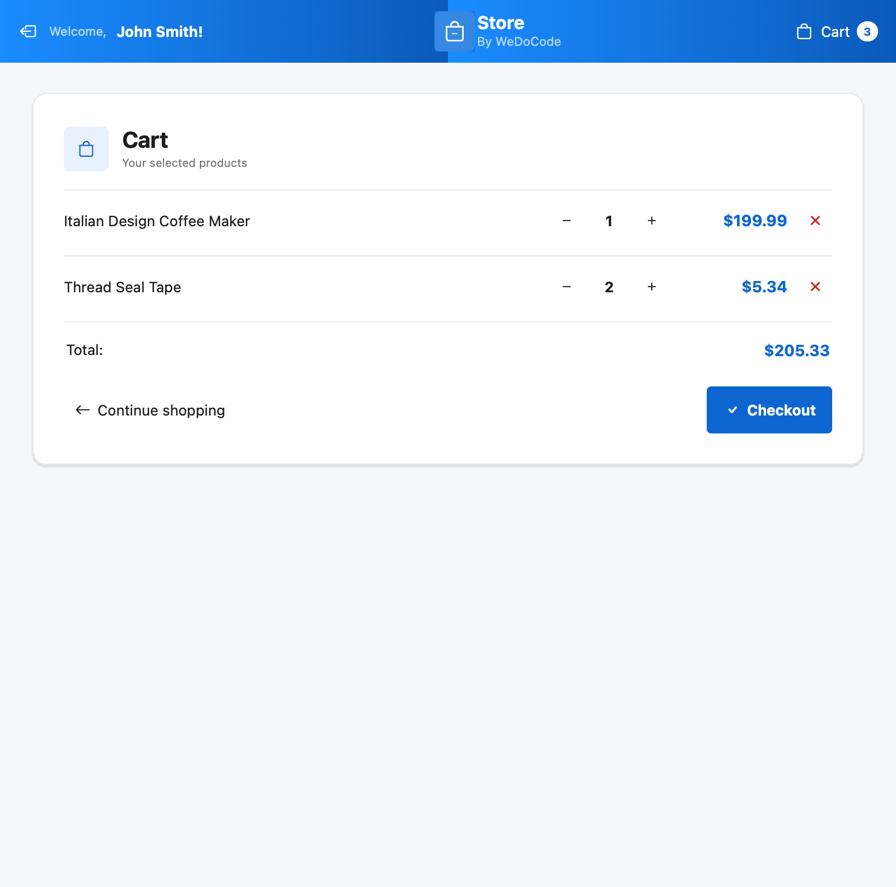
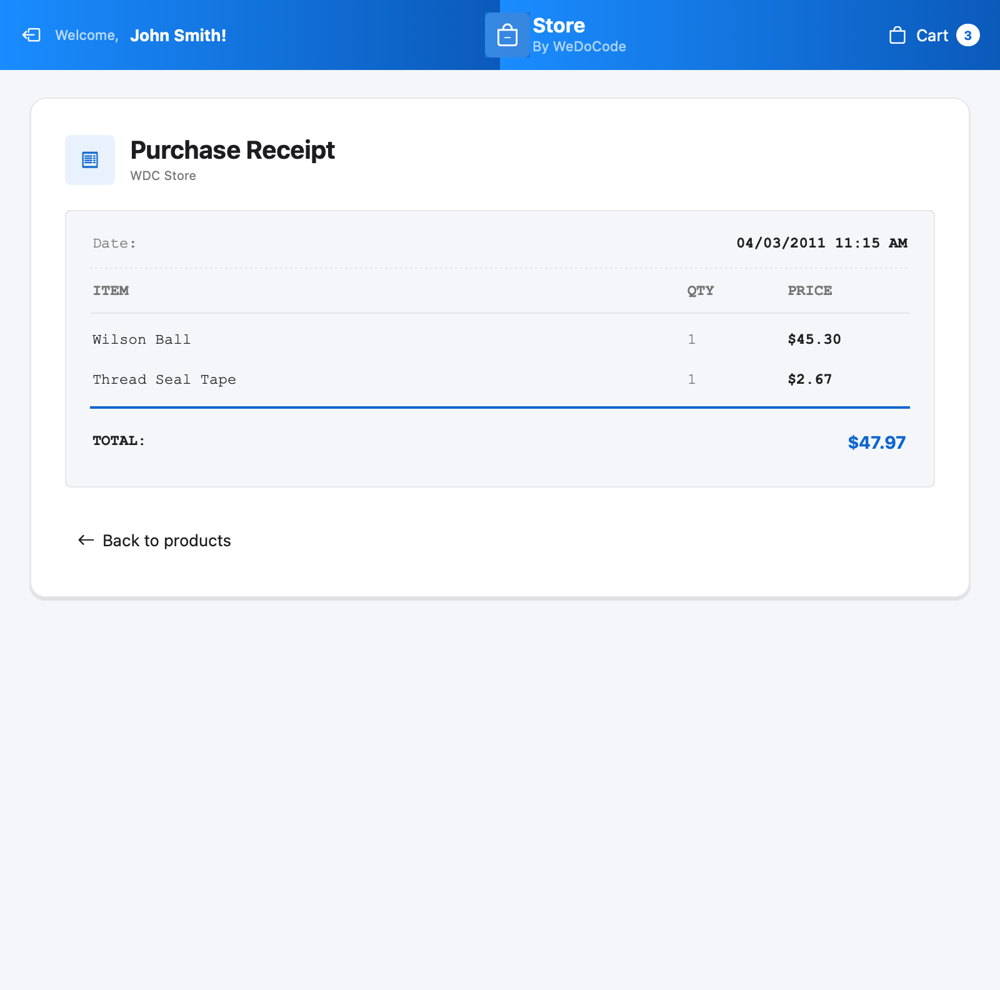
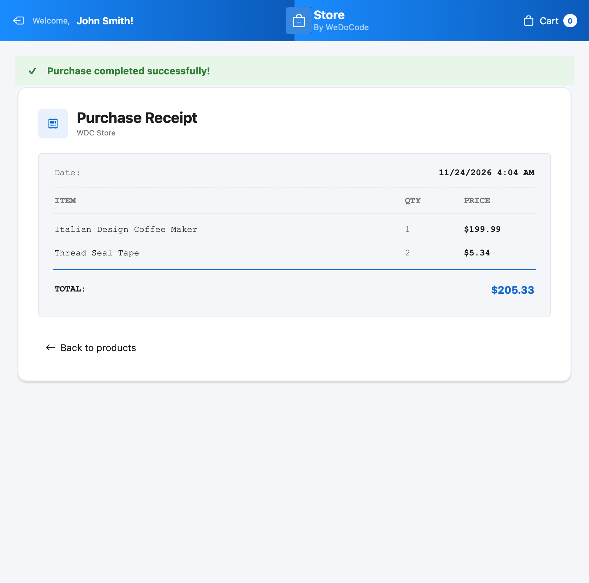

# WDC Shopping — SWT Desktop View

Native desktop implementation of WDC Shopping using **Eclipse SWT 3.135.0** (Cocoa/macOS aarch64).
It shares the same presentation layer (Cube MVP) with the other views (TeaVM, React, Flutter, Vaadin).

## Architecture



### Render Loop



### Package Structure



## Main Dependencies

| Dependency | Version | Purpose |
|-------------|--------|-----------|
| Eclipse SWT (Cocoa macOS aarch64) | 3.135.0 | Native GUI toolkit |
| br.com.wdc.shopping.presentation | 1.0.0 | Presenters e state (Cube MVP) |
| br.com.wdc.shopping.persistence | 1.0.0 | Repositories (JOOQ + H2) |
| H2 Database | — | Embedded database |
| Logback | — | Logging |

## Build

```bash
cd fontes/br.com.wdc.shopping/br.com.wdc.shopping.view.swt
JAVA_HOME=$JAVA25_HOME mvn clean compile -DskipTests
```

## Running

```bash
cd fontes/br.com.wdc.shopping/br.com.wdc.shopping.view.swt
JAVA_HOME=$JAVA25_HOME mvn exec:java \
  -Dexec.mainClass="br.com.wdc.shopping.view.swt.ShoppingSwtMain"
```

> The application includes an embedded backend (H2 + repositories) and requires no external server.

## Screenshots

### Login



### Home



### Cart (empty)



### Cart (with products)



### Receipt (history)



### Receipt (after purchase)


