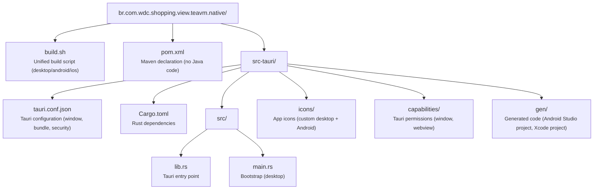
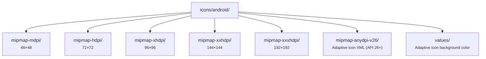
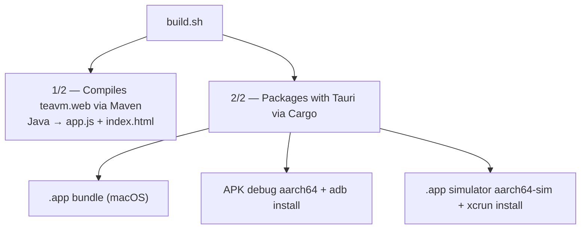

# WDC Shopping — TeaVM Native (Tauri)

A [Tauri 2](https://tauri.app/) project that packages the TeaVM SPA as a native application for **macOS**, **Android** and **iOS**. Tauri uses the operating system's native WebView (WKWebView on macOS/iOS, System WebView on Android), resulting in lightweight binaries — no embedded Chromium.

## Prerequisites

- **Rust** toolchain (`rustup`)
- **Tauri CLI**: `cargo install tauri-cli --version "^2"`
- **Java 25** + **Maven** (to compile the `teavm.web` module)
- **Android**: Android SDK (`ANDROID_HOME`), NDK, `adb`
- **iOS**: Xcode, `xcrun simctl`

## Build

The `build.sh` script automates the whole process: it compiles the `teavm.web` module (Java → JS) and then packages it with Tauri.

```bash
# Desktop (macOS)
./build.sh desktop

# Desktop in dev mode (hot reload via devUrl)
./build.sh desktop --dev

# Android — build + deploy to the connected device
./build.sh android --api-url http://192.168.1.8:8080 --deploy

# iOS — build + deploy to the simulator
./build.sh ios --api-url http://localhost:8080 --deploy
./build.sh ios --sim-name "iPhone 16 Pro" --deploy
```

### Options

| Option | Description |
|-------|-----------|
| `desktop` / `android` / `ios` | Target platform (1st argument) |
| `--dev` | Dev mode — desktop only, uses `devUrl` from `tauri.conf.json` |
| `--deploy` | Install and open on the device/simulator after the build |
| `--api-url <url>` | API server URL (default: `localhost:8080`; Android auto-detects the network IP) |
| `--sim-name <name>` | iOS simulator name (default: `"iPhone 16 Pro"`) |

## Structure



## Android Icons

The custom icons live in `src-tauri/icons/android/` and are copied automatically by `build.sh` to `src-tauri/gen/android/.../res/` before the build, overwriting Tauri's default icons:



## Build Flow


