# br.com.wdc.store.domain

The **pure domain** module of the WDC Store application. It defines the entities, repository contracts, query criteria, wire codecs, the business exception, the roles and the configuration holders — with no dependency on persistence or presentation frameworks.

The generic abstractions it builds on live in `br.com.wdc.framework.domain` (`framework-domain`): `Repository`, `Page`, `ModelCodec`, `Criteria`/`Criterion`, `Projection*`, the base exceptions (`BusinessException`, `AccessDeniedException`, `OfflineException`, ...), `AppConfig`, `TransactionService` and the security contracts (`SecurityContext`, `AuthenticationService`, `PasswordUtil`) and the data access policy (`security.policy`).

## Structure

The module is organized **by entity**: each entity package holds the four classes of that entity.

```mermaid
graph TD
    root["domain/"]
    root --> StoreConfig["StoreConfig.java<br/><small>Loads AppConfig, application directories, JWT secret</small>"]
    root --> StoreTx["StoreTransactions.java<br/><small>BEAN holder of the module's TransactionService</small>"]

    root --> product["product/"]
    product --> Product["Product"]
    product --> ProductCrit["ProductCriteria"]
    product --> ProductCodec["ProductCodec"]
    product --> ProductRepo["ProductRepository"]

    root --> user["user/"]
    user --> User["User"]
    user --> UserCrit["UserCriteria"]
    user --> UserCodec["UserCodec"]
    user --> UserRepo["UserRepository"]

    root --> purchase["purchase/"]
    purchase --> Purchase["Purchase"]
    purchase --> PurchaseCrit["PurchaseCriteria"]
    purchase --> PurchaseCodec["PurchaseCodec"]
    purchase --> PurchaseRepo["PurchaseRepository"]

    root --> purchaseitem["purchaseitem/"]
    purchaseitem --> PurchaseItem["PurchaseItem"]
    purchaseitem --> PurchaseItemCrit["PurchaseItemCriteria"]
    purchaseitem --> PurchaseItemCodec["PurchaseItemCodec"]
    purchaseitem --> PurchaseItemRepo["PurchaseItemRepository"]

    root --> exception["exception/"]
    exception --> InvalidCart["InvalidCartItemException<br/><small>extends framework BusinessException</small>"]

    root --> security["security/"]
    security --> Role["Role (ADMIN, CUSTOMER, MANAGER)"]
```



A new entity gets its own package with the complete set (`Xxx`, `XxxCriteria`, `XxxCodec`, `XxxRepository`).

## Principles

- **No infrastructure dependencies** — only the framework (`framework-commons`, `framework-domain`) and Commons IO
- **Fluent entities** — each entity implements `KeyedEntity`, with `private` fields, a `field()` accessor and a `withField(...)` setter that returns `this`; no persistence annotations
- **Repositories as interfaces** — registered via `AtomicReference<XxxRepository> BEAN` (lightweight Service Locator)
- **Typed criteria** — each entity has its own `XxxCriteria`, whose fields are `Criterion` objects, plus projection and a closed set of orderings
- **Roles, not permissions** — the `Role` enum lists the roles; what each one may do with the data is declared by the data access policies of the REST layer

## Entities

| Entity | Fields |
|--------|--------|
| `User` | `id`, `userName`, `password`, `name`, `roles` (comma-separated string) |
| `Product` | `id`, `name`, `price`, `description`, `image` |
| `Purchase` | `id`, `buyDate`, `user`, `items` |
| `PurchaseItem` | `id`, `amount`, `price`, `purchase`, `product` |

Entities are built by chaining setters, relations included:

```java
var item = new PurchaseItem()
        .withAmount(2)
        .withPrice(product.price())
        .withPurchase(new Purchase()
                .withId(purchaseId))
        .withProduct(product);
```

## Repositories

Each repository extends the generic `Repository<E, C, K>` from `framework.domain.repository`:

```java
public interface ProductRepository extends Repository<Product, ProductCriteria, Long> {
    AtomicReference<ProductRepository> BEAN = new AtomicReference<>();
    // newProjection() and fetchById(...) as default methods, plus entity-specific operations
}
```

The generic contract:

| Method | Notes |
|--------|-------|
| `boolean insert(E bean)` | |
| `boolean update(E newBean, E oldBean, E projection)` | Overloads `update(newBean)` and `update(newBean, oldBean)` |
| `boolean insertOrUpdate(E newBean, E oldBean)` | Inserts when `oldBean` is `null` |
| `int delete(C criteria)` | |
| `int count(C criteria)` | |
| `List<E> fetch(C criteria, int offset, int limit)` | Overloads `fetch(criteria)` and `fetch(criteria, limit)` |
| `Page<E> fetchPage(C criteria, int page, int pageSize)` | Default: `count` + `fetch` |
| `E fetchById(K id, E projection)` | Default in each entity repository: a criteria with equality on the key |
| `E newProjection()` | Projection with all the entity's shallow fields |

`ProductRepository` adds `fetchImage(Long)` and `updateImage(Long, byte[])`. The concrete implementation (jOOQ in `persistence.impl`, or the REST client in `persistence.client`) is placed in the `BEAN` at startup.

## Criteria

Each field of an `XxxCriteria` is a `Criterion` created with the criteria:

- `Criterion` — `eq`, `ne`, `in`, `isNull`, `isNotNull`
- `ComparableCriterion` — adds `gt`, `ge`, `lt`, `le`, `between`
- `TextCriterion` — adds `like`, `ilike`, `containing`, `startingWith`

Requests on a field accumulate with `AND`; `or()` makes the field disjunctive. A disjunction across fields goes in alternative groups, `withAnyOf(group, ...)`: each group is a criteria of the same entity, and at least one must match besides the outer fields. The groups are server-side only — the codecs refuse them on the wire. A field is **never `null`** — test it with `hasXxx()`. `withXxx(value)` is a shortcut for `xxx().eq(value)`, and `null` does not filter.

```java
var criteria = new ProductCriteria()
        .withProjection(projection)
        .withOrderBy(ProductCriteria.OrderBy.NAME_A_TO_Z);
criteria.name().containing("phone");
criteria.price().between(10.0, 100.0);

var page = ProductRepository.BEAN.get().fetch(criteria, 0, 20);
```

`OrderBy` is a per-entity enum of complete orderings (e.g. `OLDEST_FIRST`, `NEWEST_FIRST`, `CHEAPEST_FIRST`); offset and limit are arguments of `fetch`.

## Projection

A projection is an entity instance whose non-null fields mark the columns to load. `ProjectionValues` (framework) provides sentinel values for each type; each repository's `newProjection()` returns the projection of all shallow fields.

## Codecs

`XxxCodec` implements `ModelCodec<Xxx, XxxCriteria>`: streaming serialization of entities (full, projected, graph-tracked) and criteria over `ExtensibleObjectOutput`/`ExtensibleObjectInput`, with no reflection — the same code runs on the JVM and under TeaVM. It is the wire format used by `persistence.rest` and `persistence.client`.

## Configuration and transactions

`StoreConfig.loadConfig()` loads the framework's `AppConfig` from the path set via `-Dstore.config.file`, falling back to `config/application.toml`. `StoreConfig.Internals.configure(config)` resolves the application directories (`config/`, `data/`, `log/`, `temp/`) under `app.basedir` and the JWT secret.

`StoreTransactions.BEAN` holds the module's `TransactionService`, populated by the composition root.

## Security (RBAC)

`Role` is the list of roles (ADMIN, CUSTOMER, MANAGER). `Role.parse(...)` reads the user's `roles` column, ignoring unknown names, and `Role.names(...)` is what the security context carries. A role has no permissions of its own: what each one may do with the data is declared by the data access policies of the REST layer (`XxxDataPolicy`), by role name — the model is **allow-wins** ([docs/data-access-policy.md](../../../docs/data-access-policy.md)).

The authentication and context contracts (`AuthenticationService`, `SecurityContext` with its `CURRENT` ThreadLocal, `PasswordUtil`, `AccessDeniedException`) are in `br.com.wdc.framework.domain`.

## Dependencies

- `framework-commons` — serialization (`KeyedEntity`, `ExtensibleObjectOutput`/`Input`), logging
- `framework-domain` — generic domain abstractions
- Commons IO — I/O utilities
