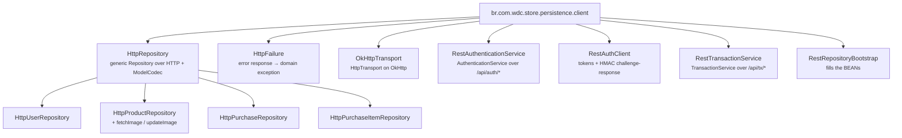

# persistence.client

The **HTTP client** of the WDC Store repositories. It implements the domain's repository, authentication and transaction contracts over the REST API (`persistence.rest`), so code written against `XxxRepository.BEAN` — presenters, resource calls — runs unchanged when the data is on the other side of HTTP.

The HTTP itself sits behind the `HttpTransport` interface (`framework.commons`): the repositories only build the request and read the answer, with the domain's codecs. On the JVM the transport is `OkHttpTransport`; in the browser, teavm.web plugs in its own (`FetchHttpTransport`).

> Full architectural view: [docs/data-layer.md → The persistence.client Module](../../../../docs/data-layer.md#the-persistenceclient-module--the-http-mirror).

## Dependencies

| Artifact | Role |
|----------|------|
| `br.com.wdc.store.domain` | Repository interfaces, codecs, `StoreTransactions`; brings `framework-domain` and `framework-commons` (`HttpTransport`, `ClientStorage`, JSON streaming) |
| `com.squareup.okhttp3:okhttp-jvm` | HTTP client used by `OkHttpTransport` (JVM only) |

There is no JSON library: the bodies are written and read by the domain's `ModelCodec`s over the framework's `JsonStreamWriter`/`JsonStreamReader`, the same code the server uses.

## Classes



### HttpRepository and the entity repositories

`HttpReadOnlyRepository<E, C, K>` implements the reads of `ReadOnlyRepository` once, and `HttpRepository<E, C, K>` extends it with the writes of `Repository`; each `HttpXxxRepository` only names its base path and adds what its interface has beyond it.

| Operation | HTTP | Path |
|-----------|------|------|
| `insert(entity)` | POST | `/api/repo/{entity}/insert` |
| `update(newEntity, oldEntity, projection)` | POST | `/api/repo/{entity}/update` |
| `delete(criteria)` | POST | `/api/repo/{entity}/delete` |
| `count(criteria)` | POST | `/api/repo/{entity}/count` |
| `fetch(criteria, offset, limit)` | POST | `/api/repo/{entity}/fetch` |
| `fetchPage(criteria, page, pageSize)` | POST | `/api/repo/{entity}/fetch-page` |

`fetchById` and `insertOrUpdate` are defaults of the interfaces, so they go through `fetch` and `insert`/`update`. `HttpProductRepository` also has `fetchImage(id)` → `GET /api/repo/product/{id}/image` and `updateImage(id, bytes)` → `PUT` on the same path (PNG bytes).

The criteria, projection and entities travel in the JSON written by the entity's codec (`ProductCodec`, ...), which the server reads back with the same codec.

### HttpFailure

The inverse of the server's exception mapping: an error response becomes the exception the server threw, so the caller of a remote repository gets what it would get from the local one.

| Status | Exception |
|--------|-----------|
| 400 | `InvalidRequestException` |
| 403 | `AccessDeniedException` |
| 409 | `TransactionConflictException` |
| 429 | `TransactionLimitExceededException` |
| other | `BusinessException` |

### OkHttpTransport

`HttpTransport` on OkHttp. It adds `Authorization: Bearer <token>` from the access-token supplier the authentication service registers, `X-Tx-Id` while a remote transaction is active (on every authenticated call: JSON, image reads and image writes), and `X-Client-Id` — an id per transport instance that identifies the owner of anonymous transactions on the server.

### RestAuthenticationService and RestAuthClient

`RestAuthenticationService` implements `AuthenticationService` over `/api/auth/*`; `RestAuthClient` holds the tokens and does the HMAC challenge-response.

| Method | Delegation |
|--------|-----------|
| `challenge()` | `GET /api/auth/challenge` → `ChallengeResult` |
| `login(userName, digest, nonce)` | `POST /api/auth/login` → `AuthResult` |
| `refresh(refreshToken)` | `POST /api/auth/refresh` → `AuthResult` |
| `logout(refreshToken)` | `POST /api/auth/logout` |
| `tryRestore()` | refreshes with the stored refresh token, if any (auto-login) |
| `createPersistentToken(...)` | the stored refresh token: for a REST client it *is* the persistent token |
| `loginWithPersistentToken(token)` | `refresh(token)` |
| `resolveToken(jwt)` | `null` — a server-side operation |

The tokens are kept in the secure view of the `ClientStorage` it receives (`storage.secure()`, AES-GCM).

```
1. GET  /api/auth/challenge            → { nonce, expiresAt }
2. digest = HMAC-SHA256(key = password hash, data = userName + nonce)
3. POST /api/auth/login { userName, digest, nonce }
                                       → { accessToken, refreshToken, publicKey, expiresAt }
4. next requests: Authorization: Bearer <accessToken>
```

### RestTransactionService

`TransactionService` for the client side: `required(...)` opens a remote transaction (`POST /api/tx/begin` → `txId`), the transport sends the `txId` in `X-Tx-Id` on every repository call of the block — which join the same physical transaction on the server — and it ends with `/api/tx/commit` or `/api/tx/rollback`. That makes several REST writes atomic. A nested `required` joins the active transaction. Details: [docs/data-layer.md → Client-Driven Remote Transactions](../../../../docs/data-layer.md#client-driven-remote-transactions-over-rest).

### RestRepositoryBootstrap

Fills the domain's `BEAN`s with the HTTP implementations, for a JVM client:

```java
var transport = new OkHttpTransport("http://localhost:8080");
RestRepositoryBootstrap.initialize(transport, storage);
// CryptoProvider.BEAN          → JceCryptoProvider
// UserRepository.BEAN          → HttpUserRepository        (and Product, Purchase, PurchaseItem)
// AuthenticationService.BEAN   → RestAuthenticationService
// StoreTransactions.BEAN       → RestTransactionService

RestRepositoryBootstrap.release();   // on shutdown
```

## Consumers

| Consumer | Context |
|----------|---------|
| **teavm.web** (`view.teavm/teavm.web`) | The presenters run in the browser: `TeaVMRepositoryBootstrap` registers the `HttpXxxRepository`s and `RestTransactionService` over its `FetchHttpTransport`, with its own authentication service |
| **Tests** (`store.tests`) | `RestXxxRepositoryTest` run the repository suite through `OkHttpTransport` against an embedded Javalin; `RemoteTransactionRestTest` covers the remote transaction |
