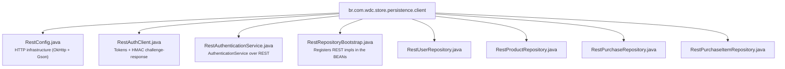
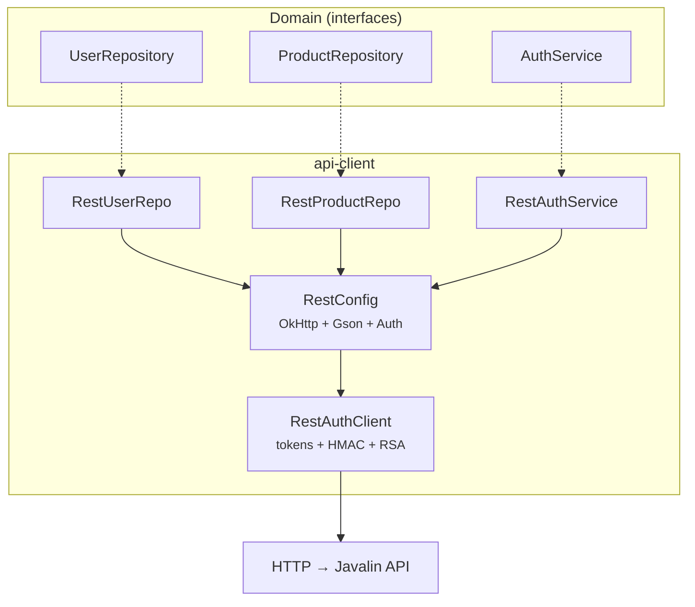

# persistence.client

The **REST client** module of the WDC Store application. It implements the domain's repository and authentication interfaces over HTTP, using **OkHttp** and **Gson**. It lets remote frontends (Android, integration tests) access the backend through the REST API with transparent JWT authentication.

## Dependencies

| Artifact | Role |
|----------|-------|
| `br.com.wdc.store.domain` | Domain models, repository interfaces, security contracts |
| `com.squareup.okhttp3:okhttp-jvm` | HTTP client (5.5.1) |
| `com.google.code.gson:gson` | JSON serialization/deserialization |
| `slf4j-api` | Logging |

## Package Structure



## Architecture

The module mirrors the server-side API, implementing the same domain interfaces:



## Components

### RestAuthenticationService

Implements `AuthenticationService` over REST. It supports credential authentication and **auto-login via a persistent token**:

| Method | Description |
|--------|-----------|
| `login(user, password)` | Authenticates by credentials; stores the refresh token in `clientPersistentStore().secure()` |
| `tryRestore()` | Tries to restore the session using the persisted refresh token (auto-login) |
| `loginWithPersistentToken(token)` | Renews the access token via the refresh token |
| `createPersistentToken()` | Returns the stored refresh token (for remote session bootstrap) |
| `resolveToken()` | Returns `null` — the token is resolved internally by `RestConfig` |

### RestConfig

HTTP infrastructure shared by all repositories:

| Method | Description |
|--------|-----------|
| `postJson(path, body)` | Authenticated POST (automatic Bearer token) |
| `postJsonNullable(path, body)` | Authenticated POST, returns `null` on 404 |
| `postJsonPublic(path, body)` | Unauthenticated POST (`/api/auth/*` endpoints) |
| `getJson(path)` | Unauthenticated GET |
| `getBytes(path)` | Authenticated binary GET (images) |
| `putBytes(path, data)` | Authenticated binary PUT (image upload) |
| `addProjection(body, projection)` | Serializes the field projection into the JSON body |

Gson configuration:
- `OffsetDateTimeAdapter` — dates as ISO-8601
- `CircularRefExclusionStrategy` — excludes `PurchaseItem.purchase` and `Product.image`
- Timeouts: 30s (connect, read, write)

### RestAuthClient

Client-side authentication manager:

| Method | Description |
|--------|-----------|
| `login(userName, passwordHash)` | Full flow: challenge → HMAC-SHA256 digest → login → stores tokens |
| `refresh()` | Renews tokens via the refresh endpoint |
| `logout()` | Invalidates tokens on the server and clears local state |
| `encryptPassword(plainPassword)` | Encrypts the password with RSA (the session's public key) |
| `accessToken()` | Returns the current token (used by `RestConfig` for auto-auth) |
| `isAuthenticated()` | Checks whether there is an active session |

**Authentication flow:**

```
1. GET /api/auth/challenge → { nonce, expiresAt }
2. digest = HMAC-SHA256(key=passwordHash, data=userName+nonce)
3. POST /api/auth/login { userName, digest, nonce }
   → { accessToken, refreshToken, publicKey, expiresAt }
4. Subsequent requests: Authorization: Bearer <accessToken>
```

### RestAuthenticationService

Implements the domain's `AuthenticationService` over HTTP:

| Method | Delegation |
|--------|-----------|
| `challenge()` | `GET /api/auth/challenge` → `ChallengeResult` |
| `login(userName, digest, nonce)` | `POST /api/auth/login` → `AuthResult` |
| `refresh(refreshToken)` | `POST /api/auth/refresh` → `AuthResult` |
| `logout(refreshToken)` | `POST /api/auth/logout` |
| `resolveToken()` | Returns `null` (server-side-only operation) |

On receiving tokens from login/refresh, it automatically updates the `RestAuthClient` so that subsequent repository calls include the Bearer token.

### RestRepositoryBootstrap

Bootstrap that registers all REST implementations in the domain's static `BEAN`s:

```java
var config = new RestConfig("http://localhost:8080");
RestRepositoryBootstrap.initialize(config);
// UserRepository.BEAN       → RestUserRepository
// ProductRepository.BEAN    → RestProductRepository
// PurchaseRepository.BEAN   → RestPurchaseRepository
// PurchaseItemRepository.BEAN → RestPurchaseItemRepository
// AuthenticationService.BEAN  → RestAuthenticationService

// On shutdown:
RestRepositoryBootstrap.release();
```

### REST Repositories

Each `RestXxxRepository` implements the corresponding domain interface, mapping operations to HTTP calls:

| Operation | HTTP | Path |
|----------|------|------|
| `insert(entity)` | POST | `/api/repo/{entity}/insert` |
| `update(newEntity, oldEntity)` | POST | `/api/repo/{entity}/update` |
| `insertOrUpdate(entity)` | POST | `/api/repo/{entity}/upsert` |
| `delete(criteria)` | POST | `/api/repo/{entity}/delete` |
| `count(criteria)` | POST | `/api/repo/{entity}/count` |
| `fetch(criteria)` | POST | `/api/repo/{entity}/fetch` |
| `fetchById(id, projection)` | POST | `/api/repo/{entity}/fetchById` |

`RestProductRepository` additionally has:
- `fetchImage(id)` → `GET /api/repo/product/{id}/image` (PNG bytes)
- `updateImage(id, data)` → `PUT /api/repo/product/{id}/image` (upload)

### Handling Circular References

Gson automatically excludes `PurchaseItem.purchase` and `Product.image` via `CircularRefExclusionStrategy`. To compensate:
- `RestPurchaseItemRepository` manually injects `purchaseId` into the JSON body before sending
- Product images are transferred through dedicated binary endpoints

## Usage

The module is used by:

| Consumer | Context |
|-----------|---------|
| **TeaVM Web** (`view.teavm/teavm.web`) | Client mode — compiled to JS, accesses the Javalin backend via REST |
| **Integration tests** (`store.tests`) | `RestXxxRepositoryTest` validates the API end-to-end |
| **Javalin** (`backend`) | Registers `RestAuthenticationService` for auth propagation |
