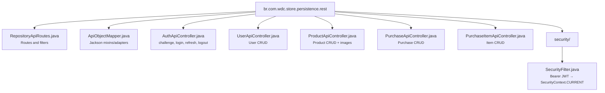

# persistence.rest

The **REST API** module of the WDC Store application. It exposes the domain repositories as HTTP endpoints via **Javalin**, with HMAC challenge-response authentication, JWT authorization and Jackson serialization.

## Dependencies

| Artifact | Role |
|----------|-------|
| `br.com.wdc.store.domain` | Domain models, repository interfaces, security contracts |
| `io.javalin:javalin` | HTTP framework (7.2.4) |
| `com.fasterxml.jackson` | JSON serialization |
| `slf4j-api` | Logging |

## Package Structure



## Endpoints

### Authentication (`/api/auth/`)

| Method | Path | Description |
|--------|------|-----------|
| GET | `/api/auth/challenge` | Generates a nonce with a TTL for HMAC challenge-response |
| POST | `/api/auth/login` | Validates the HMAC digest + nonce, returns `{accessToken, refreshToken, publicKey, expiresAt}` |
| POST | `/api/auth/refresh` | Renews tokens via `refreshToken` |
| POST | `/api/auth/logout` | Invalidates the refresh token |

### Repositories (`/api/repo/`)

All repository endpoints follow the same CRUD pattern:

| Method | Path | Description |
|--------|------|-----------|
| POST | `/api/repo/{entity}/insert` | Inserts an entity |
| POST | `/api/repo/{entity}/update` | Updates an entity |
| POST | `/api/repo/{entity}/upsert` | Insert or update |
| POST | `/api/repo/{entity}/delete` | Deletes by criteria |
| POST | `/api/repo/{entity}/count` | Counts by criteria |
| POST | `/api/repo/{entity}/fetch` | Fetches by criteria (with projection, pagination, ordering) |
| POST | `/api/repo/{entity}/fetchById` | Fetches by ID (with projection) |
| GET | `/api/repo/{entity}/{id}` | Fetches by ID (default projection) |

Where `{entity}` is: `user`, `product`, `purchase`, `purchase-item`.

#### Additional product endpoints

| Method | Path | Description |
|--------|------|-----------|
| GET | `/api/repo/product/{id}/image` | Image download (PNG) — **public, no authentication** |
| PUT | `/api/repo/product/{id}/image` | Image upload (bytes) |

## Security

### SecurityFilter

Before-filter registered on `/api/repo/*` (conditional — active only when `AuthenticationService.BEAN` is configured):

1. Extracts `Authorization: Bearer <token>` from the header
2. Validates the JWT via `AuthenticationService.resolveToken()`
3. Populates `SecurityContext.CURRENT` with the user's context (userId, roles, permissions)
4. Public routes (ending in `/image`) skip authentication
5. Returns 401 for missing/invalid tokens

`SecurityContext.CURRENT` is cleared automatically in an `after` handler registered by `RepositoryApiRoutes`.

### Error Handling

- `AccessDeniedException` → HTTP 403 (Forbidden)
- Missing/invalid token → HTTP 401 (Unauthorized)

### Password via RSA

`UserApiController` supports receiving a password encrypted with RSA (`RSA/ECB/OAEPWithSHA-256AndMGF1Padding`). If a `SecurityContext` with an RSA private key is present, the password is decrypted server-side before being persisted.

## Components

### RepositoryApiRoutes

Utility class (private constructor) that configures Javalin:

```java
RepositoryApiRoutes.configure(javalinConfig);
```

- Registers `SecurityFilter` as a before-filter (if auth is enabled)
- Registers a handler for `AccessDeniedException` → 403
- Registers an `after` handler to clear `SecurityContext.CURRENT`
- Registers the authentication endpoints (`AuthApiController`)
- Registers the CRUD endpoints for all entities

### ApiObjectMapper

Shared Jackson `ObjectMapper`, configured with:

| Setting | Effect |
|-------------|--------|
| `OffsetDateTime` ↔ ISO-8601 | Serializes dates as ISO strings |
| `PurchaseItem.purchase` → `@JsonIgnore` | Avoids a circular reference |
| `Product.image` → `@JsonIgnore` | Images served by a dedicated endpoint |
| `User.password` → `WRITE_ONLY` | The password is never returned in responses |
| `NON_NULL` inclusion | Null fields omitted |
| `FAIL_ON_UNKNOWN_PROPERTIES = false` | Tolerates unknown fields |

### Projection

The `fetch` and `fetchById` endpoints accept a `"projection"` field in the JSON body, indicating which of the entity's fields should be returned. `ApiObjectMapper.parseProjection()` converts the JSON into an instance of the domain model with the sentinel fields from `ProjectionValues`.
