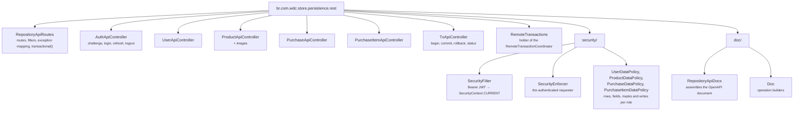

# persistence.rest

The **REST API** of the WDC Store repositories. It exposes the domain repositories as HTTP endpoints on **Javalin**, with HMAC challenge-response authentication, JWT authorization per permission, client-driven remote transactions and an OpenAPI document. The bodies are written and read by the domain's codecs (`ProductCodec`, ...) — the same ones the HTTP client (`persistence.client`) uses on the other side.

> Full architectural view: [docs/data-layer.md → The persistence.rest Module](../../../../docs/data-layer.md#the-persistencerest-module--the-http-surface).

## Dependencies

| Artifact | Role |
|----------|------|
| `br.com.wdc.store.domain` | Repository interfaces, codecs, `StoreTransactions`, security contracts |
| `framework-persistence` | `RemoteTransactionCoordinator` (the SPI behind `/api/tx/*`) |
| `io.javalin:javalin` | HTTP server |
| `io.swagger.core.v3:swagger-core` | OpenAPI model for `/openapi.json` |

The module depends on the repository *interfaces* only: the backend registers the jOOQ implementations (`persistence.impl`) in the `BEAN`s.

## Package Structure



## Endpoints

### Authentication (`/api/auth/`)

| Method | Path | Description |
|--------|------|-------------|
| GET | `/api/auth/challenge` | A single-use nonce with a TTL, for the HMAC challenge-response |
| POST | `/api/auth/login` | Checks the HMAC digest + nonce; returns `{accessToken, refreshToken, publicKey, expiresAt}` |
| POST | `/api/auth/refresh` | Renews the tokens with the `refreshToken` |
| POST | `/api/auth/logout` | Invalidates the refresh token |

### Repositories (`/api/repo/`)

Every entity has the same set:

| Method | Path | Description |
|--------|------|-------------|
| POST | `/api/repo/{entity}/insert` | Inserts an entity |
| POST | `/api/repo/{entity}/update` | Updates an entity (new values, old values for optimistic locking, projection) |
| POST | `/api/repo/{entity}/delete` | Deletes by criteria |
| POST | `/api/repo/{entity}/count` | Counts by criteria |
| POST | `/api/repo/{entity}/fetch` | Fetches by criteria, with projection, ordering, offset and limit |
| POST | `/api/repo/{entity}/fetch-page` | Fetches one page by criteria, with the total |
| POST | `/api/repo/{entity}/fetch-by-id` | Fetches by id, with projection |
| GET | `/api/repo/{entity}/{id}` | Fetches by id, default projection |

`{entity}` is `user`, `product`, `purchase` or `purchase-item`. The product also has:

| Method | Path | Description |
|--------|------|-------------|
| GET | `/api/repo/product/{id}/image` | Image download (PNG) — **public**, no authentication |
| PUT | `/api/repo/product/{id}/image` | Image upload (bytes) |

### Remote transactions (`/api/tx/`)

| Method | Path | Description |
|--------|------|-------------|
| POST | `/api/tx/begin` | Opens a transaction owned by the requester; returns `{txId}` |
| POST | `/api/tx/commit` | Commits the transaction named in `X-Tx-Id` |
| POST | `/api/tx/rollback` | Rolls it back |
| GET | `/api/tx/status` | Coordinator counters |

### OpenAPI

`GET /openapi.json` returns the OpenAPI 3.0 document. Each controller describes its own paths in private `*Doc()` methods next to the handlers; `RepositoryApiDocs` adds the shared schemas and assembles the whole.

## Transactions

The write handlers (`insert`, `update`, `delete`, the image upload) are wrapped by `RepositoryApiRoutes.transactional(...)`, which behaves in one of three ways:

- **With `X-Tx-Id`**: the write joins that client-driven remote transaction (resumed and suspended around the handler); the commit belongs to the client, through `/api/tx/commit`.
- **Without `X-Tx-Id`, while the requester has a remote transaction open**: the write is refused with 409 — the header got lost, and committing it on its own would break the block's atomicity.
- **Otherwise**: one transaction for the request (`StoreTransactions.BEAN.get().required(...)`), so a purchase and its items commit or roll back together.

The owner of a remote transaction is `user:<userId>` for an authenticated requester, or `anon:<X-Client-Id>` when security is off. `RemoteTransactions.COORDINATOR` is filled by the composition root (the backend, or the tests). Details: [docs/data-layer.md → Client-Driven Remote Transactions](../../../../docs/data-layer.md#client-driven-remote-transactions-over-rest) and [docs/remote-transaction-identity-and-ownership.md](../../../../docs/remote-transaction-identity-and-ownership.md).

## Security

When `AuthenticationService.BEAN` is registered, `RepositoryApiRoutes` registers the authentication endpoints and puts `SecurityFilter` before `/api/repo/*` and `/api/tx/*`:

1. Reads `Authorization: Bearer <token>`.
2. Resolves the JWT through `AuthenticationService.resolveToken()`.
3. Sets `SecurityContext.CURRENT` (userId, roles); an `after` handler clears it.
4. Routes ending in `/image` are public and skip it.
5. A missing or invalid token gets 401.

Each entity has a **data access policy** (`XxxDataPolicy`). Its controller gets the requester's access with `XxxDataPolicy.POLICY.accessFor(SecurityEnforcer.requireAuthenticated())` and calls one method per operation — `prepareRead` (whose plan shapes each returned row; fetch, fetch-page and fetch-by-id), `restrictCount`, `checkCreate`, `checkUpdate`, `restrictDelete`; the image upload is checked as an update of the product's `image`. The policy refuses with `AccessDeniedException` (403) naming the fields at fault, restricts the rows through the criteria's alternative groups — those of a projected collection too —, and decides each row's fields by the grants that reach it: as they are, masked, or absent. What a request asks inside a relation goes through the related entity's policy. The password is cleared from every user response. Details: [docs/security-architecture.md](../../../../docs/security-architecture.md).

Without an `AuthenticationService` (local or test mode), the checks are skipped: `accessFor(null)` lets everything through.

`UserApiController` accepts a password encrypted with the session's RSA public key and decrypts it before persisting.

### Error responses

The body is `{"error": "<message>"}`; `HttpFailure` in `persistence.client` turns it back into the same exception.

| Exception | Status |
|-----------|--------|
| `InvalidRequestException` (e.g. an ordering name this server does not know) | 400 |
| Missing or invalid token | 401 |
| `AccessDeniedException` | 403 |
| `TransactionConflictException` | 409 |
| `TransactionLimitExceededException` (cap of open remote transactions) | 429 |

## Usage

```java
Javalin.create(config -> RepositoryApiRoutes.configure(config, ""));
```

The `prefix` puts the API under a context (`/<context>/api/repo/...`), so a single-page app served under that context reaches it without CORS.
