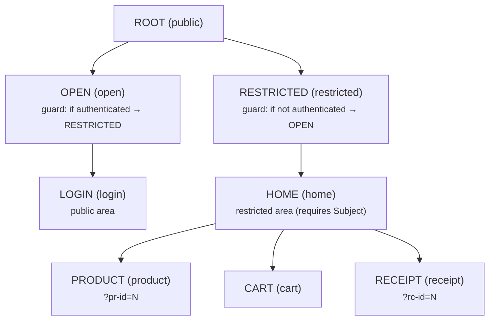
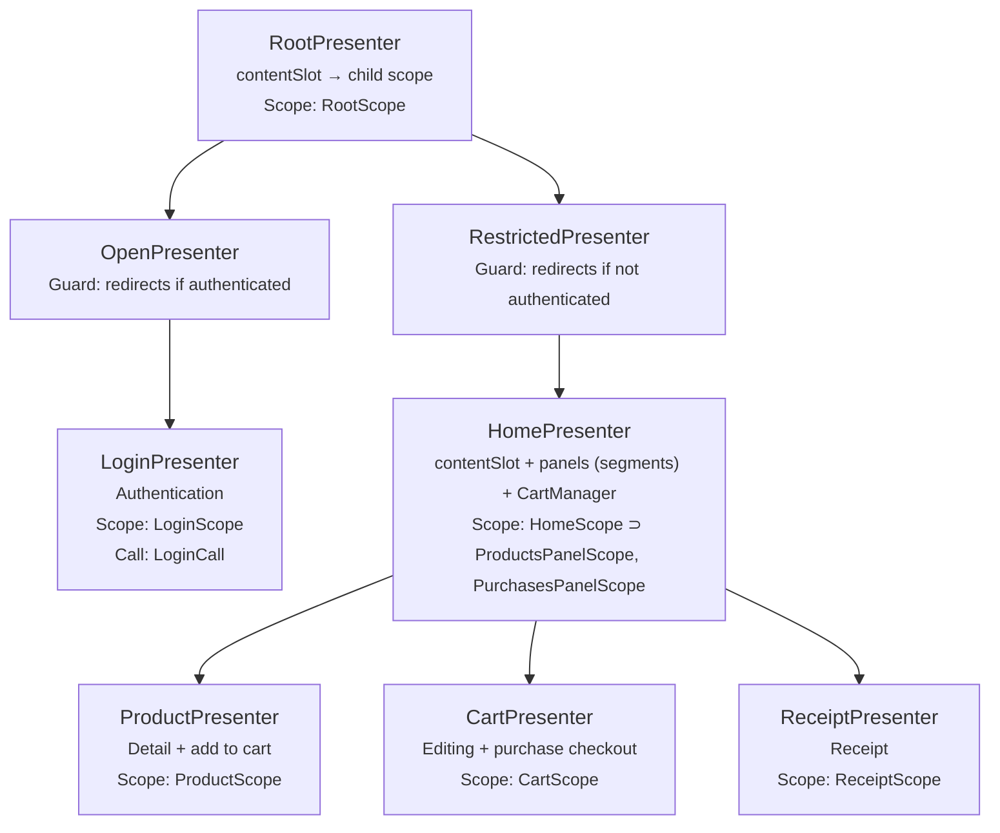
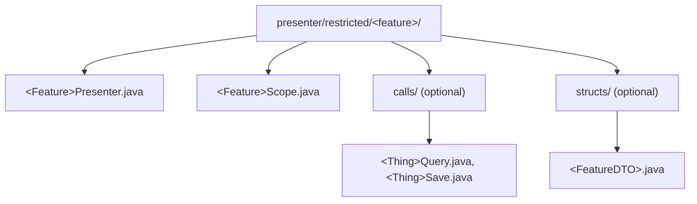

# WDC Store — Presentation

Presentation layer of the WDC Store system, implemented with the **Cube MVP** pattern. It contains the presenters, scopes, calls, DTOs and the navigation system. This layer is view-technology agnostic — it does not depend on React, Javalin or any UI framework.

## Dependencies

| Artifact | Role |
|----------|-------|
| `br.com.wdc.store.domain` | Entities, repositories, criteria |
| `framework-cube` | Cube MVP engine (presenters, scopes, views, navigation) |
| `jsr305` | `@Nullable` annotations (scope provided) |

Logging uses the framework's `Log` facade (`framework-commons`).

## Package Structure

```mermaid
graph TD
    root["br.com.wdc.store.presentation"]
    root --> StoreApp["StoreApplication.java"]
    root --> CallBases["StoreCall.java, StoreQuery.java, StoreSave.java"]
    root --> StorageKeys["StorageKeys.java"]

    root --> exception["exception/"]
    exception --> WrongParams["WrongParametersException.java"]
    exception --> ProductNotFound["ProductNotFoundException.java"]
    exception --> PurchaseNotFound["PurchaseNotFoundException.java"]

    root --> presenter["presenter/"]
    presenter --> RootK["RootKeys.java"]
    presenter --> RootP["RootPresenter.java"]
    presenter --> RootS["RootScope.java"]

    presenter --> open["open/"]
    open --> OpenP["OpenPresenter.java, OpenKeys.java"]
    open --> login["login/"]
    login --> LoginP["LoginPresenter.java, LoginKeys.java"]
    login --> LoginS["LoginScope.java"]
    login --> LoginCalls["calls/LoginCall.java"]
    login --> LoginStructs["structs/Subject.java"]

    presenter --> restricted["restricted/"]
    restricted --> RestrictedP["RestrictedPresenter.java, RestrictedKeys.java"]
    restricted --> home["home/"]
    home --> HomeP["HomePresenter.java, HomeKeys.java"]
    home --> HomeS["HomeScope.java (with ProductsPanelScope and PurchasesPanelScope)"]
    home --> HomeStructs["structs/PurchaseInfo.java"]
    home --> HomeCalls["calls/PurchasesPageQuery.java"]

    restricted --> products["products/"]
    products --> ProductP["ProductPresenter.java, ProductKeys.java"]
    products --> ProductS["ProductScope.java"]
    products --> ProductCalls["calls/ProductQuery.java, ProductListQuery.java"]
    products --> ProductStructs["structs/ProductInfo.java"]

    restricted --> cart["cart/"]
    cart --> CartP["CartPresenter.java, CartKeys.java"]
    cart --> CartS["CartScope.java (with CartItemScope)"]
    cart --> CartMgr["CartManager.java"]
    cart --> CartCalls["calls/PurchaseSave.java"]
    cart --> CartStructs["structs/CartItem.java"]

    restricted --> receipt["receipt/"]
    receipt --> ReceiptP["ReceiptPresenter.java, ReceiptKeys.java"]
    receipt --> ReceiptS["ReceiptScope.java"]
    receipt --> ReceiptCalls["calls/ReceiptQuery.java"]
    receipt --> ReceiptStructs["structs/ReceiptForm.java, ReceiptItem.java"]
```



## Navigation Hierarchy

The system has 8 places organized in 4 levels:



Each place has a keys class (`XxxKeys`, in its presenter's package) that **declares the place** from the place of the keys it extends — `RootKeys → RestrictedKeys → HomeKeys → ProductKeys` — and is the only one that knows the names the place reads and writes in the intent, all with its two-letter prefix (`pr-id`, `rc-id`). The getters validate and never throw (the address comes from outside); the setter removes the name from the address when it receives the default. `StoreApplication.PLACES` lists all places, which loads the classes before an address is resolved by name. The full convention is in the Javadoc of `RootKeys`; `PlaceKeysTest` checks prefixes and the tree.

```java
// Navigate to a product's detail, from the current state
new ProductKeys(app)
        .withProductId(productId)
        .flip();

// Inside applyParameters: read, and redirect with the in-transit intent
var keys = new ProductKeys(this.app, intent);
if (keys.productId() == null) {
    new HomeKeys(this.app, intent).flip();
    return false;
}
```

The `OpenPresenter` and `RestrictedPresenter` presenters act as **navigation guards**: they redirect automatically based on the presence/absence of the `Subject`.

## Presenter Hierarchy



### Presenters and segments

| What | How | Use |
|------|------|-----|
| **Presenter** | `AbstractCubePresenter<StoreApplication>`, managed by navigation via `applyParameters` | Places with their keys class (`XxxKeys`) |
| **Segment** | inner scope (`HomeScope.ProductsPanelScope`), actions bound by the presenter, view from the host's catalog (`ScopeViews`, requested with `app.viewOf(scope)`) | Panels embedded in Home: no presenter of their own |

## Module Components

### StoreApplication

Abstract class that extends `CubeApplication`. Holds the global state:

- `subject` — authenticated user (`Subject`)
- `cart` — shopping cart (`CartManager`)
- `go(String)` / `go(CubeIntent)` — programmatic navigation (from `CubeApplication`)
- `PLACES` — the list of all places
- `alertUnexpectedError(...)` — error display via `RootPresenter`

### Repositories and authorization

The repositories are used through the domain's service locator, via the protected accessors of `StoreCall` (`productRepository()` reads `ProductRepository.BEAN` on each use); the transaction of a write is opened by `StoreSave`. Authorization (RBAC) sits at the trust boundary: in the REST endpoints (`SecurityEnforcer`), which teavm.web goes through, since its presenters run in the browser. In the hosts where the presenters run on the server (Vaadin, local SWT, remote host), the client only triggers actions and the presenter decides each query.

### Scope

Each presenter has its `Scope` in **its own file**, next to it (`XxxScope.java`, like the `xxx.scope.ts` of the TypeScript version). A scope that only exists inside it — a Home panel, the cart row — is a public static inner class of it (`HomeScope.ProductsPanelScope`, `CartScope.CartItemScope`). Each observed field is a `Prop`, created with `prop(...)`; the presenter binds the state to itself with `bind(...)`, and then `set` with a different value (`equals`) requests the redraw on its own — the presenter does not call `this.update()` afterwards. The view reads with `get()`. The scope declares its `CLASS_ID` (the bridge protocol classId); the presenter does not create a view — each host draws the scope with the view its `ScopeViews` catalog registers for the class. Remote serialization is automatic (`ScopeSerializer`, via reflection over the public fields, writing the value of each `Prop`; a `Prop<Scope>`, like the `content` of Root and Home, is written as `"<field>ViewId"`):

```java
public class ProductScope extends Scope {
    public static final String CLASS_ID = "48b693f67410";

    public final Prop<ProductInfo> product = prop();
    public final Prop<Integer> errorCode = prop(0);
    public final Prop<String> errorMessage = prop();
}

// in ProductPresenter
public final ProductScope state = bind(new ProductScope());
```

**Changing something inside an already-assigned value** (an item of a list) does not go through the prop: in that case, either assign a new value or call `this.update()` — as in `CartPresenter`, whose cart changes items in place.

The JSON generated by the serializer uses `"#"` as the key for the `instanceId`:

```json
{ "#": "view-instance-id", "product": {...}, "errorCode": 0, "errorMessage": null }
```

### Calls

Each operation the presenter requests from the repositories is a class in the module's `calls/` package (sibling of `structs/`), with a suffix for what it does: `XxxQuery` for reads, `XxxSave` for writes, and `XxxCall` for what is neither (the login, which authenticates). The request accumulates on the instance through fluent `withXxx(...)` setters and `run()` answers it; a new instance for each use:

```java
var product = new ProductQuery()
        .withProductId(id)
        .run();
```

The root is `StoreCall<R>`, which gathers in a section right at the top the protected accessors to the repositories (`productRepository()`, `purchaseRepository()`, ...), read from the `BEAN` on each use, and declares `run()`. Below it:

- `StoreQuery<R>` — read: no side effects, can be repeated, no transaction of its own.
- `StoreSave<R>` — write: the (final) `run()` opens the transaction (or joins the caller's) and calls the subclass's `save()`, so no write is left outside one.

The response is an existing type; or a module struct (`structs/`), when other calls or the scope also use it; or an inner class of the call itself, when it only carries the response back to the caller (`LoginCall.Result`).

| Call | Request | Response |
|---------|------------|----------|
| `LoginCall` | `withUserName`, `withPassword` | `LoginCall.Result` (HMAC challenge-response via `AuthenticationService`) |
| `ProductQuery` | `withProductId` | `ProductInfo` |
| `ProductListQuery` | `withLimit` | `List<ProductInfo>` (without description) |
| `PurchasesPageQuery` | `withUserId`, `withPage`, `withPageSize` | `Page<PurchaseInfo>` (most recent first) |
| `ReceiptQuery` | `withPurchaseId` | `ReceiptForm` |
| `PurchaseSave` | `withUserId`, `withItems` | `Long` (purchase id) |

### DTOs (structs)

`Serializable` objects used to transfer data between layers:

- **Public fields** (no getters/setters) — except `Subject`, which keeps its fields private behind getters
- **`projection()`** (static, in the DTOs built from an entity: `Subject`, `ProductInfo`, `ReceiptItem`) — returns an entity instance indicating which fields to load
- **`create(...)`** (static) — factory that converts from the entity (or, for `CartItem`, from a `ProductInfo` and a quantity) to the DTO

| DTO | Package | Main fields |
|-----|--------|------------------|
| `Subject` | `open/login/structs/` | id, nickName |
| `ProductInfo` | `restricted/products/structs/` | id, image, name, description, price |
| `CartItem` | `restricted/cart/structs/` | id, image, name, price, quantity |
| `PurchaseInfo` | `restricted/home/structs/` | id, date, total, items (names) |
| `ReceiptForm` | `restricted/receipt/structs/` | date, total, items |
| `ReceiptItem` | `restricted/receipt/structs/` | id, description, value, quantity |

### Constants

- **`XxxKeys`** (one per place, in `presenter/**`) — the names each place reads and writes in the intent, typed
- **`StorageKeys`** — the client storage keys of the authentication tokens

### CartManager

In-memory cart manager with an event system:

- `addProduct(ProductInfo, quantity)` — adds or increments an item
- `modifyProductQuantity(productId, quantity)` — changes the quantity
- `removeProduct(productId)` — removes an item
- `commit(Subject)` — persists the purchase through `PurchaseSave` (one transaction) and returns its id
- `addCommitListener(ThrowingRunnable)` / `addChangeListener(ThrowingRunnable)` — listeners to reload panels

## Conventions

### Package organization by feature

Each feature follows the structure:


### Presenter pattern

```java
public class XxxPresenter extends AbstractCubePresenter<StoreApplication> {

    // 1. Logger
    private static final Log LOG = Log.getLogger(XxxPresenter.class);

    // 2. Public state — XxxScope lives in XxxScope.java, alongside (observed fields are Props; serialization via reflection) (bind: the scope shares the presenter's events and is released with it)
    public final XxxScope state = bind(new XxxScope());

    // 3. Internal fields
    private ScopeSlot ownerSlot;

    // 4. Constructor (binds the state's actions with their bridge event codes)
    public XxxPresenter(StoreApplication app) { super(app); }

    // 5. Cube API (applyParameters — ends with ownerSlot.setScope(this.state) —, publishParameters)
    // 6. User Actions (onXxx)
    // 7. Messages (alertXxx, errorXxx)
}
```

### Error pattern

Presenters do not throw exceptions to the view. Instead, they use `errorCode` + `errorMessage` in the Scope — and `set` already requests the redraw:

```java
private void alertProductNotFound() {
    this.state.errorCode.set(3);
    this.state.errorMessage.set("Product code not found.");
}
```

Unexpected errors do not need `try/catch`: actions are guarded. Each action is a Scope field, bound once in the presenter's constructor; the guard sends the unhandled failure to `RootPresenter` (via `app.alertUnexpectedError`) and, at the end, republishes the address:

```java
// CartScope.java
public class CartScope extends Scope {
    // ...
    public Action onBuy = Action.NOOP;
    public Action onOpenProducts = Action.NOOP;
}

public CartPresenter(StoreApplication app) {
    super(app);
    this.cart = app.getCart();
    this.state.onBuy = action(1, this::buy);   // buy() only handles InvalidCartItemException and OfflineException
    this.state.onOpenProducts = action(3, () -> new HomeKeys(this.app).flip());
}

// a row (segment) gets its own actions, reading the formData
row.onModifyQuantity = actionOf(row, 2, FormParam.asInteger("p.quantity"),
        quantity -> this.modifyQuantity(productId, quantity));
```

The view triggers the action through the scope it draws (`state.onBuy.run()`), and the scope's remote skeleton (`scope.skeleton(CLASS_ID)`) maps the event code to it; a state that reads form fields on sync does it with `state.onSync(formData -> ...)` in the constructor (`LoginPresenter`).
