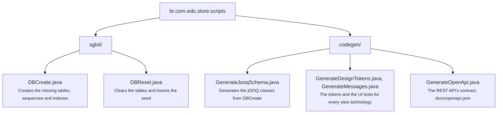

# br.com.wdc.store.scripts

The module that holds the WDC Store **database schema**: the DDL that creates it, the reference data (seed) that fills it, and the generator that derives the jOOQ classes of `persistence.impl` from that DDL.

## Structure



## DBCreate — the schema

`DBCreate` is the **single source of truth** of the schema. It runs its DDL through jOOQ (`dsl.execute(...)`) and detects the dialect from the JDBC URL — PostgreSQL for `jdbc:postgresql:`/`jdbc:pgsql:`, H2 otherwise:

```java
new DBCreate()
        .withConnection(connection)
        .withReset()        // optional: reseed even when every table exists
        .run();
```

`run()`:

1. initializes the dialect's JSON support (`JsonDialect.of(dialect).initialize(connection)`);
2. creates each table that does not exist yet — `EN_USER`, `EN_PRODUCT`, `EN_PURCHASE`, `EN_PURCHASEITEM` — with its sequence (`SQ_USER`, `SQ_PRODUCT`, `SQ_PURCHASE`, `SQ_PURCHASEITEM`) and its indexes;
3. runs `DBReset` when it created any table or `withReset()` was requested — unless `withSkipReset()` was called.

Each index sits next to its table with a comment naming the `OrderBy` of the criteria it serves (e.g. `IX_PRODUCT_PRICE` for `CHEAPEST_FIRST` and `MOST_EXPENSIVE_FIRST`): a new ordering comes in together with the index that supports it.

Column types that differ between the databases are chosen per dialect: in `EN_PRODUCT`, `NAME` is `VARCHAR_IGNORECASE` on H2 and `TEXT` on PostgreSQL, and `IMAGE` is `VARBINARY` on H2 and `BYTEA` on PostgreSQL.

`DBCreate` is called by the backend at startup (`BusinessContext`, after `StoreRepositoryBootstrap.initialize`, with `withReset()` when `database.reset = true`) and by the development endpoint `DevDbResetController`.

## DBReset — the seed

`DBReset.run()` deletes every row of the four tables and inserts the reference data through the repositories (`UserRepository.BEAN`, `ProductRepository.BEAN`, `PurchaseRepository.BEAN`) and the module's `StoreDSLContext.BEAN` — so it runs after `StoreRepositoryBootstrap.initialize`. It restarts each sequence at the next free id.

| Data | Content |
|------|---------|
| Users | `admin` (John Smith, ADMIN), `jdoe` (John Doe, CUSTOMER), `jroe` (Jane Roe, CUSTOMER) — the password equals the user name |
| Products | Italian Design Coffee Maker, Wilson Ball, Thread Seal Tape, 2GB Flash Drive — images read from the classpath at `/META-INF/images/*.png` (resources of `persistence.impl`) |
| Purchases | Two purchases of `admin` |

The generated ids are exposed as public static fields (`DBReset.ADMIN_ID`, `DBReset.COFFEE_MAKER_ID`, `DBReset.ADMIN_FIRST_PURCHASE_ID`, ...), which the tests use in their assertions.

## GenerateJooqSchema — the jOOQ classes

`GenerateJooqSchema` creates an in-memory H2 database, runs `DBCreate` on it and invokes the jOOQ code generator against its `PUBLIC` schema. The output goes to `src/main/java` of `persistence.impl`, in the package `br.com.wdc.store.persistence.impl.scheme` (`Tables`, `Sequences`, `tables.EnProduct`, ...), and each generated file gets `// @formatter:off` at the top.

Run it from `fontes/` after changing the DDL:

```bash
mvn exec:java -pl br.com.wdc.store/br.com.wdc.store.scripts \
    -Dexec.mainClass="br.com.wdc.store.scripts.codegen.GenerateJooqSchema"
```

## GenerateDesignTokens and GenerateMessages — the tokens and the UI texts

`GenerateDesignTokens` reads `br.com.wdc.store.design/src/main/tokens/tokens.json` (W3C Design Tokens) and `GenerateMessages` reads `br.com.wdc.store.i18n/src/main/catalog/<language>/*.json`; each writes its generated code for every view technology (Java, Codename One's Java 8 copy, Sass, TypeScript, Dart, CSS — see the two modules' READMEs). The generated files are committed; `DesignTokensTest` and `MessagesCatalogTest` fail while they are stale.

Run them from `fontes/` after changing the tokens or a catalog:

```bash
mvn exec:java -pl br.com.wdc.store/br.com.wdc.store.scripts \
    -Dexec.mainClass="br.com.wdc.store.scripts.codegen.GenerateDesignTokens"
mvn exec:java -pl br.com.wdc.store/br.com.wdc.store.scripts \
    -Dexec.mainClass="br.com.wdc.store.scripts.codegen.GenerateMessages"
```

## GenerateOpenApi — the REST API's contract

`GenerateOpenApi` writes the OpenAPI document of the REST API (`RepositoryApiDocs`, in `persistence.rest`) to `docs/openapi.json`, at the repository's root. The file is the API's contract, committed: a change to the API, including a field removed from the domain and from its documentation at once, shows there as a diff. `OpenApiSpecTest` fails while the file does not match the code; after reviewing the change, generate it again from `fontes/`:

```bash
mvn exec:java -pl br.com.wdc.store/br.com.wdc.store.scripts \
    -Dexec.mainClass="br.com.wdc.store.scripts.codegen.GenerateOpenApi"
```

## Dependencies

| Artifact | Role |
|----------|------|
| `persistence.impl` | Generated jOOQ classes, `StoreDSLContext`, repositories used by `DBReset`, seed images |
| `persistence.rest` | `RepositoryApiDocs`, the OpenAPI document `GenerateOpenApi` writes |
| `framework-jooq` | `JsonDialect` |
| `jooq-codegen` | Code generator used by `GenerateJooqSchema` |
| `h2` | Database driver (in-memory database of the generator, local database) |
| `logback-classic` | Logging |
| `br.com.wdc.store.presentation` | Declared in the pom; no class of this module imports it |
