# br.com.wdc.store.tests

The **automated tests** module of the WDC Store application. It contains tests that exercise everything from business services to complete workflows in the presentation layer, with no need for an HTTP server or browser.

## Structure

```mermaid
graph TD
    root["test/"]

    root --> repository["repository/ — CRUD tests"]
    repository --> AbstractTests["Abstract*RepositoryTest (bases)<br/><small>Product(38) Purchase(34) PurchaseItem(26) User(28)</small>"]
    repository --> LocalTests["*RepositoryTest<br/><small>jOOQ repositories (H2)</small>"]
    repository --> RestTests["Rest*RepositoryTest<br/><small>REST via API</small>"]

    root --> LoginTest["StoreLoginTest.java<br/><small>Login flow</small>"]
    root --> CallTest["StoreCallTest.java<br/><small>Presentation calls</small>"]
    root --> WorkflowTest["StoreWorkflowTest.java<br/><small>Complete workflow (presentation)</small>"]
    root --> PlaceKeys["PlaceKeysTest.java<br/><small>Place keys and intents</small>"]
    root --> CartRestore["CartRestoreTest.java (7)<br/><small>Cart kept in the session scope and restored on reload</small>"]
    root --> RoleTestN["RoleTest.java (1)<br/><small>Role permissions (data:all)</small>"]
    root --> Policy["DataPolicyTest (12), UserDataPolicyRestTest (8)<br/><small>Data access policy: rules, and the user API with authentication on</small>"]
    root --> Wire["EntityGraphRecursionTest, RelationKeyProjectionTest,<br/>FetchByIdEndpointTest, OrderByWireCompatibilityTest,<br/>OpenApiSpecTest<br/><small>Codecs, projections, REST API</small>"]
    root --> Tx["TransactionServiceJtaTest,<br/>RemoteTransactionCoordinatorJtaTest,<br/>RemoteTransactionRestTest<br/><small>Transactions (JTA, remote)</small>"]

    root --> mock["mock/"]
    mock --> AppMock["StoreApplicationMock.java"]
    mock --> viewimpl["viewimpl/ — View mocks"]
    viewimpl --> AbstractVM["AbstractViewMock (base)"]
    viewimpl --> ViewMocks["Root, Login, Home, Cart,<br/>Product, ProductsPanel,<br/>PurchasesPanel, Receipt"]

    root --> util["util/ — Test setup"]
    util --> BaseBusiness["BaseBusinessTest<br/><small>H2 in-memory + jOOQ repos</small>"]
    util --> BaseRest["BaseRestApiTest<br/><small>Javalin + REST client</small>"]
    util --> BasePresentation["BasePresentationTest<br/><small>+ ApplicationMock</small>"]
    util --> Rules["ResetDatabaseRule, TestEnvironment"]
    util --> Executors["ScheduledExecutorForTest*<br/><small>Sync/Async/Delayed</small>"]
```



## Approach

### Repository tests (`repository/`)

The repository tests follow an **Abstract → Concrete** hierarchy:

- **`Abstract*RepositoryTest`** — defines all test scenarios (insert, update, delete, fetch, projections, pagination, criteria, edge cases)
- **`*RepositoryTest`** — extends the abstract class using the jOOQ repositories (`TestEnvironment` in `LOCAL` mode, H2 in-memory)
- **`Rest*RepositoryTest`** — extends the abstract class using the HTTP repositories (`TestEnvironment` in `REST` mode: OkHttp + domain codecs → Javalin → jOOQ → H2)

This guarantees that both implementations (jOOQ and REST) pass exactly the same contract tests. The one difference is in the concrete classes: the alternative groups (`anyOf`) are server-side only, so `UserRepositoryTest` tests their translation and `RestUserRepositoryTest` tests that the client and the server refuse them.

Covered scenarios:

- **Projections** (`ProjectionValues`) to verify that only the requested fields are returned
- **Filter criteria** (`Criterion` operators by ID, by specific fields, by FK)
- **Pagination** (`fetch(criteria, offset, limit)`, `fetchPage`) and **ordering** (the `OrderBy` entries, e.g.: `NEWEST_FIRST`, `NAME_A_TO_Z`)
- **Edge cases**: nonexistent IDs, delete with no results, FK constraints

Each test starts from a clean database with seed data (`ResetDatabaseRule` → `DBCreate` with reset), guaranteeing determinism.

| Base class | Repository | Tests | Implementations |
|---|---|---|---|
| `AbstractUserRepositoryTest` | `UserRepository` | 28 | jOOQ, REST |
| `AbstractProductRepositoryTest` | `ProductRepository` + `fetchImage` | 38 | jOOQ, REST |
| `AbstractPurchaseRepositoryTest` | `PurchaseRepository` | 34 | jOOQ, REST |
| `AbstractPurchaseItemRepositoryTest` | `PurchaseItemRepository` | 26 | jOOQ, REST |

### Call tests (`StoreCallTest`)

They directly exercise the presentation calls (`CredentialsCheck`, `ProductQuery`, `ReceiptQuery`, `PurchasesPageQuery`, a `ResourceCreate` that fails and rolls back) and the domain repositories over an in-memory H2 database populated with seed data (`DBReset`).

### Presentation tests (`StoreLoginTest`, `StoreWorkflowTest`)

They simulate user interaction **at the presentation level** using view mocks. Each view mock exposes the `scope` it draws, making it possible to:

1. Fire the scope's actions as the user would (e.g.: `loginView.scope.onEnter.run("admin", "admin")`)
2. Inspect the resulting scope (e.g.: `homeView.scope.errorCode.get()`)
3. Navigate between screens, verifying transitions (e.g.: login → home → product → cart → receipt)

#### Example: complete purchase workflow

```java
public class StoreWorkflowTest extends BasePresentationTest {

    @Test
    public void testBuyProduct() {
        new LoginKeys(this.app).flip();
        var rootView = this.app.getRootView();

        // Sign in
        var loginView = LoginViewMock.cast(this.app.viewOf(rootView.scope.content.get()));
        loginView.scope.onEnter.run("admin", "admin");

        // Navigate to the product (the action belongs to the home's products panel)
        var homeView = HomeViewMock.cast(this.app.viewOf(rootView.scope.content.get()));
        homeView.getProductsPanelScope().onOpenProduct.run(DBReset.FLASH_DRIVE_2GB_ID);

        // Add to cart
        var productView = ProductViewMock.cast(this.app.viewOf(homeView.scope.content.get()));
        productView.scope.onAddToCart.run(1);

        // Check out
        var cartView = CartViewMock.cast(this.app.viewOf(homeView.scope.content.get()));
        cartView.scope.onBuy.run();

        // Verify the receipt
        var receiptView = ReceiptViewMock.cast(this.app.viewOf(homeView.scope.content.get()));
        Assert.assertNotNull(receiptView.scope.receipt.get());
    }
}
```

The full test (`testBuyProduct`) navigates through **5 screens** (login → home → product → cart → receipt), exercising real presenters with real repositories — only the views are mocks.

## Test infrastructure

### `BaseBusinessTest`

- Creates an Agroal pool over an in-memory H2 database (`jdbc:h2:mem:wedocode-store`)
- Configures `StoreConfig` directories, `ScheduledExecutor.BEAN`, `CryptoProvider.BEAN` and `StoreRepositoryBootstrap.initialize(...)` (jOOQ `DSLContext`, repository `BEAN`s, `StoreTransactions.BEAN`)
- In each test's `@Before`, runs `DBCreate` with reset (a clean database for every test)

### `TestEnvironment` and `ResetDatabaseRule`

`TestEnvironment` is a JUnit `@ClassRule` with two modes: `LOCAL` exposes the jOOQ repositories; `REST` also starts an embedded Javalin with `RepositoryApiRoutes` and the `RemoteTransactions.COORDINATOR`, and exposes `Http*Repository` clients over an `OkHttpTransport`. `withSecurity()` turns authentication on, as the backend does with a JWT secret; each test then logs in with its own transport against `baseUrl()` (`UserDataPolicyRestTest`). `ResetDatabaseRule` resets the database before each test.

### `BasePresentationTest`

Extends `BaseBusinessTest` and instantiates `StoreApplicationMock`, which hands the application a `ScopeViews` catalog with one view mock per scope class (`register(CartScope.class, CartViewMock::new)`). `getRootView()` returns the root scope's view (`viewOf(getRootPresenter().scope)`); the others are obtained with `app.viewOf(...)` on the scope the parent holds (`scope.content.get()`).

### View mocks

Each mock (`LoginViewMock`, `CartViewMock`, etc.) extends `AbstractViewMock<S extends Scope>`, is constructed with `(app, scope)` (`new CartViewMock(app, scope)`) and exposes:
- `scope` — the scope the view draws (reading its values and firing the actions, as the user would)
- `app` — the `StoreApplicationMock`, for requesting the views of inner scopes (`app.viewOf(...)`)
- `cast(CubeView)` — static method to get the mock with a type assertion

## Dependencies

- `persistence.impl` — real jOOQ repositories
- `br.com.wdc.store.presentation` — real presenters and calls
- `br.com.wdc.store.scripts` — `DBCreate` / `DBReset` for database setup
- `persistence.rest` — REST controllers (for the REST tests)
- `persistence.client` — REST client (OkHttp)
- Agroal + Narayana — connection pool and JTA (JTA tests)
- H2 Database — in-memory database
- Javalin — embedded HTTP server for the REST tests
- JUnit 4 — test framework
- Logback — logging in the tests
