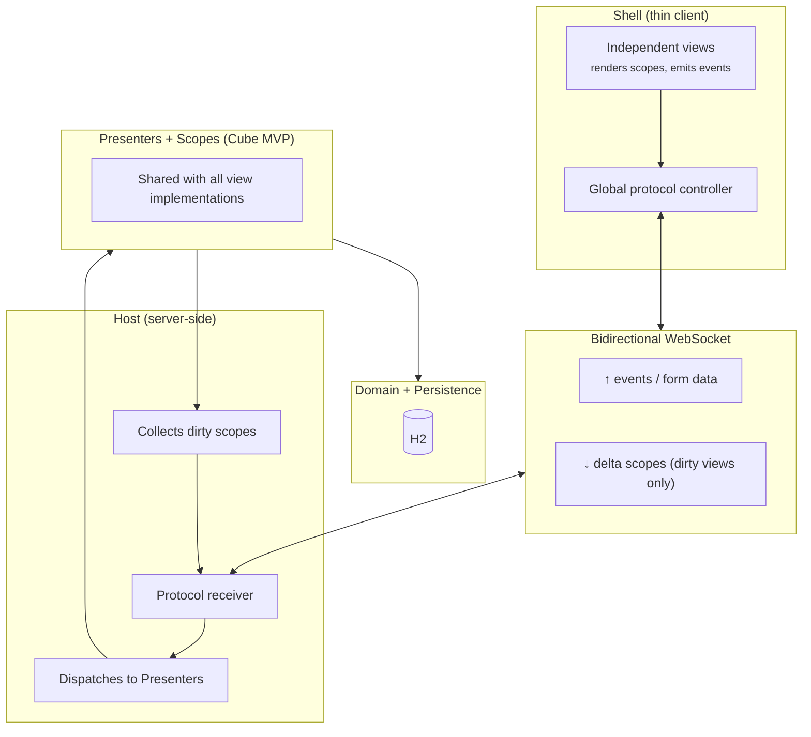
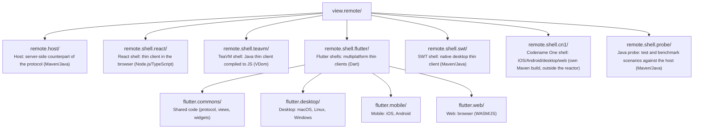
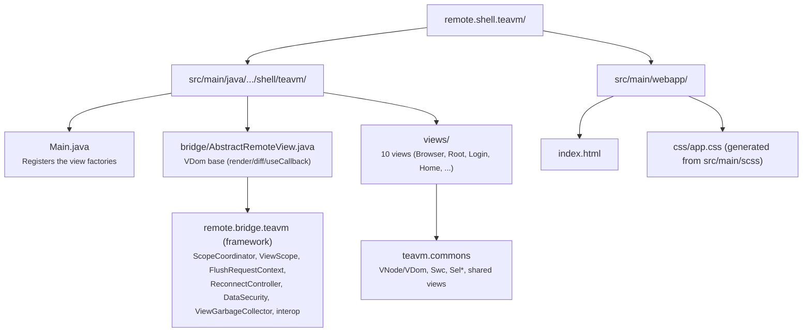
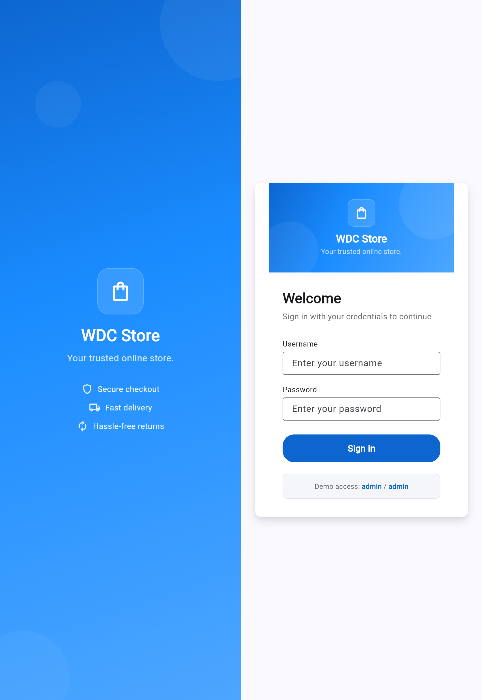
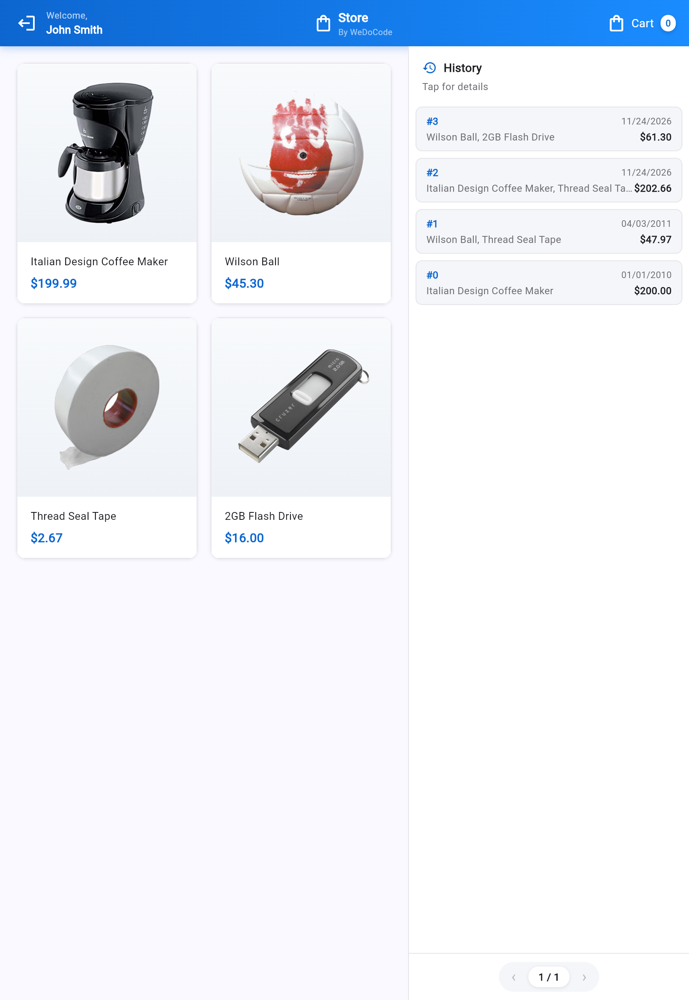
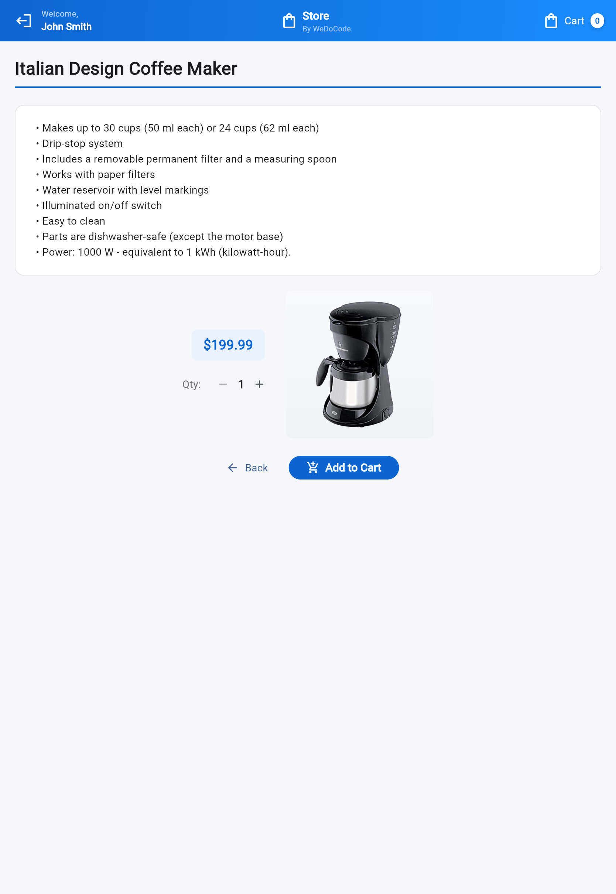
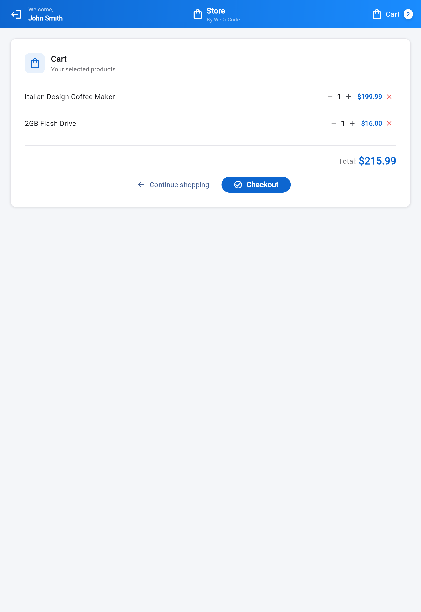
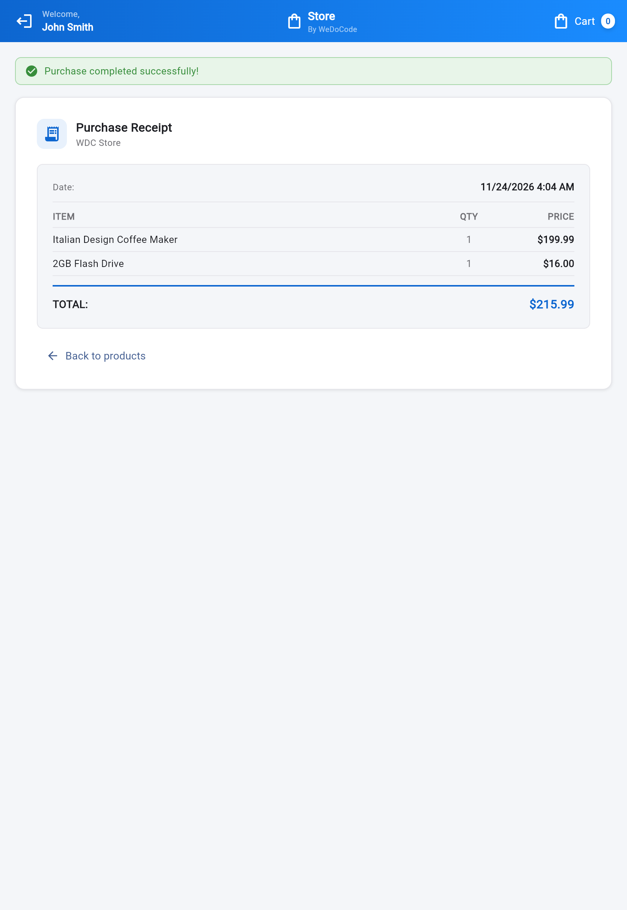

# br.com.wdc.store.view.remote

Implementation of the **Remote Presentation** technique for the **WDC Store** application, based on the **Cube MVP** pattern.

## Concept

The module implements a proprietary **remote presentation** protocol — a concept analogous to Remote Desktop, but operating at the application's data layer instead of pixels. The server holds all business logic and the scopes — the view state each presenter publishes for its view; the client is a thin shell that only renders the scopes it receives and emits user interaction events.

### How it works

1. **The client (shell)** has no business logic. It contains only the views, each one independent of the others. User interaction events are sent directly from these views. A global controller in the app uses the proprietary protocol to forward requests to the server and receive back the new scopes of the views that were modified on the backend — only the portions of data that became "dirty".

2. **The server (host)** is the counterpart of this protocol. It receives the requests coming from the client and forwards them to the presentation layer, invoking the methods on the Presenters that correspond to each view existing on the client side. After processing, it collects the scopes that changed and serializes only the deltas back.

The reference client is a browser (React), but the architecture supports any rendering technology — it could be a native desktop app, a mobile app, or any other surface capable of rendering components and capturing events.



## Comparison with the other view implementations

| Aspect | Remote (this module) | Vaadin (server-side) | SWT (desktop) | TeaVM (multiplatform) |
|---------|---------------------|----------------------|---------------|------------------------|
| **Where the UI runs** | Remote browser (thin shell) | Browser via Server Push | Local JVM | Browser / WebView (Tauri) |
| **Model** | Server-driven (delta scopes) | Server-driven (component tree) | Direct in-memory access | Client-side (SPA) |
| **Transport** | WebSocket (JSON delta) | Atmosphere (WebSocket/Push) | N/A (in-process) | REST (XMLHttpRequest) |
| **Security** | Key per connection (ECDH + AES-GCM) + URL signing | HMAC-SHA256 URL signing | N/A (local process) | HMAC + JWT |
| **Scalability** | Virtual Threads (~1K per connection); several instances behind a proxy, a tab's socket kept on one ([running-several-instances.md](../../../docs/running-several-instances.md)) | Automatic Server Push | Single instance | Client-side (SPA) |
| **UI code** | TypeScript (React) / Dart (Flutter) / Java (TeaVM, SWT, Codename One) | Java | Java | Java (compiled to JS) |
| **Presenters** | Same | Same | Same | Same |
| **Scopes** | Same | Same | Same | Same |

## Submodule structure



Future clients will follow the `remote.shell.<technology>` pattern.

### remote.host (Maven)

Server of the remote presentation protocol — receives events from the shell, dispatches them to the Presenters and returns the modified scopes. The module wires the WDC Store application into the framework's `remote.backend`:

| Class | Responsibility |
|--------|------------------|
| `StoreApplicationImpl` | Concrete `StoreApplication` + `RemoteApplication`: delegates the protocol to `RemoteApplicationSupport`, which draws every scope with a `RemoteViewImpl` found by its `CLASS_ID` |
| `RemoteHostBootstrap` | Registers the remote routes on the backend's Javalin configuration and starts the application registry |

Generic pieces, in framework `remote.backend` (`br.com.wdc.framework.cube.remote`):

| Class | Responsibility |
|--------|------------------|
| `RemoteApplicationSupport` | Dirty views, event dispatch, JSON response generation |
| `RemoteApplicationRegistry` | Registry of per-session instances, lifecycle and cleanup |
| `RemoteViewImpl` | Remote view of a scope: `syncClientToServer()`, scope writing (`writeScope()`), the scope's skeleton |
| `RemoteBrowserPresenter` | Coordinates navigation and intent dispatch |
| `RemoteAppSecurity` | HMAC-SHA256 signing of session ids and navigation URLs |
| `RemoteDataSecurity` | The connection's key (agreed by ECDH P-256 + HKDF) and AES-GCM for sensitive data, an IV per value |
| `ScopeSerializer` | Serialization of the scopes' `Prop` fields to JSON |
| `javalin/DispatcherController` | WebSocket endpoint `/dispatcher/{id}` |

### remote.shell.react (Node.js — Parcel)

Thin client that acts as the rendering surface in the browser:

- **React 19** + **Spectrum Web Components** (`@swc-react`) for visual components
- Bidirectional **WebSocket** for communication with the host
- **No business logic** — each view renders the received scope and emits interaction events
- **Independent views** — each component is self-sufficient, with no coupling between views
- Built with **Parcel 2.13** — output in `work/frontend/remote.shell.react/`, served by the backend

### remote.shell.teavm (Maven — TeaVM)

Thin client in Java compiled to JavaScript via TeaVM, using a **Virtual DOM** (VNode API) with Spectrum Web Components:

- Declarative **VNode API** — `render()` returns a virtual tree, the framework does an efficient diff
- Bidirectional **WebSocket** for communication with the host (same protocol as the React shell)
- **No business logic** — each view adapts the scope received via `ViewScope` and delegates rendering to a `teavm.commons` shared view
- **useCallback(key, listener)** — cache of parameterized listeners for reference stability in the diff
- **Stable fields** — parameterless listeners extracted into `final` fields (zero cost in the diff)
- **Compact Sel** — aliases (`u`/`c`/`icon`) for the `SelUtility`/`SelComponents`/`SelIcons` class catalogs
- Built with **Maven + TeaVM plugin** — output in `work/frontend/remote.shell.teavm/`



### remote.shell.flutter (Maven + Flutter/Dart)

Multiplatform Flutter shells — thin clients in Dart that share code via `flutter.commons`:

- **flutter.commons** — shared library: WebSocket protocol, the channel security (ECDH + AES-GCM), views, widgets and design tokens
- **flutter.desktop** — native macOS/Linux/Windows app; built via `build.sh` (auto-detects the platform)
- **flutter.mobile** — iOS/Android app deployed via `deploy.sh` (supports simulators, emulators and physical devices)
- **flutter.web** — web app via Flutter WASM/JS

### remote.shell.swt (Maven/Java)

Native desktop thin client with SWT widgets: reuses the views of `swt.commons`, fed from `ScopeSnapshot`s received through `HostClient` (`remote.bridge.java`).

### remote.shell.cn1 (Codename One)

Thin client in Java for Codename One (iOS, Android, desktop, web), reimplementing the protocol with CN1 APIs. A complete Codename One project with its own parent; it is not in this module's `<modules>`.

### remote.shell.probe (Maven/Java)

Runs programmatic scenarios against the remote host — used for throughput benchmarks, per-session memory measurement and behavioral validation:

- **`ConcurrentThroughputScenario`** — measures throughput with multiple parallel sessions
- **`MemoryPerSessionScenario`** — measures memory consumption per active session
- **`BuyProductScenario`** — validates the full purchase flow via the remote protocol
- Uses `remote.bridge.java` (framework) as the base for connecting to the host

## Communication flow

```
1. Shell connects: ws://host/dispatcher/{sessionId}
2. Security handshake (protocol 1), on every connection:
   - Shell → Host: { protocol: 1, clientKey }   (ephemeral P-256 public key)
   - Host → Shell: { protocol: 1, serverKey }   (both derive the AES-256 key: ECDH + HKDF-SHA256)
3. Request/response cycle:
   - Shell → Host: { requestId, eventCode, formData }
   - Host:
     a. syncClientToServer() — updates form data in the views
     b. submit() — dispatches the event to the correct Presenter
     c. Presenter updates the scope → marks views dirty
     d. commitComputedState() — propagates derived state
     e. Serializes only dirty views → JSON delta
   - Host → Shell: { requestId, uri, scopes: [...] }
4. Shell applies the delta to the components (React reconciliation)
```

Only **modified (dirty) views** are sent in each response — minimal transfer, analogous to a Remote Desktop sending only the screen regions that changed.

## Security

### Layer 1: Navigation signing
- Each URL/intent includes a `sign` parameter = Base62 of the first 16 bytes of `HMAC-SHA256(signingKey, intent)`
- The server validates it before navigating — prevents URL tampering

### Layer 2: Encryption of sensitive data
- AES-256 key agreed per connection by ephemeral ECDH P-256 and HKDF-SHA256 — no long-lived ciphering key, so a recorded connection cannot be deciphered later
- Sensitive fields (passwords, stored tokens) are AES-GCM encrypted in transit, each with an IV of its own
- Each connection has its own key — compromising one does not affect the others

## Prerequisites

- **Java 25** (Temurin or Microsoft JDK)
- **Maven 3.9+**
- **Node.js 20+** (to build the client)

## Build

```bash
# 1. Maven build (host + backend), from the repository root
cd fontes && mvn -q -DskipTests clean install && cd ..

# 2. Web shells (React, Flutter web, TeaVM) → work/frontend/<name>
./work/bin/build-frontends.sh            # or: ./work/bin/build-frontends.sh react
```

## Running

```bash
# Via script, from the repository root (port 8080 by default)
./work/bin/start-server.sh

# Or directly, with the work directory (--workdir= or STORE_WORKDIR; there is no default)
java -jar fontes/br.com.wdc.cube.backend/target/br.com.wdc.cube.backend-1.0.0.jar --workdir=work
```

### Configuration

File `work/config/application.toml`:

```toml
[database]
# url = "jdbc:h2:file:..."
# username = "sa"
# password = "sa"
# reset = false

[server]
# port = 8080
```

### Shell development

```bash
cd remote.shell.react
npm run watch   # Parcel in watch mode, output in work/frontend/remote.shell.react
```

## Virtual Threads

This module uses Virtual Threads (Java 21+) for HTTP and WebSocket handlers, reducing memory consumption per connection from ~1MB to ~1KB. Full details in [VIRTUAL_THREADS_STRATEGY.md](VIRTUAL_THREADS_STRATEGY.md).

## Screenshots

The Flutter shell (web build) at iPad portrait size (834×1210).

| Screen | Preview |
|------|---------|
| Login |  |
| Home / Products |  |
| Product Detail |  |
| Cart |  |
| Receipt |  |
| History |  |

## Conclusion

This module validates that the Cube MVP pattern supports **remote presentation**: all logic stays server-side in the **host**, and the **shell** is an interchangeable thin client that renders serialized scopes and captures interactions. The host/shell separation ensures that the same protocol infrastructure can feed different frontend technologies — all it takes is a new `remote.shell.<technology>` that implements scope rendering and event emission.
