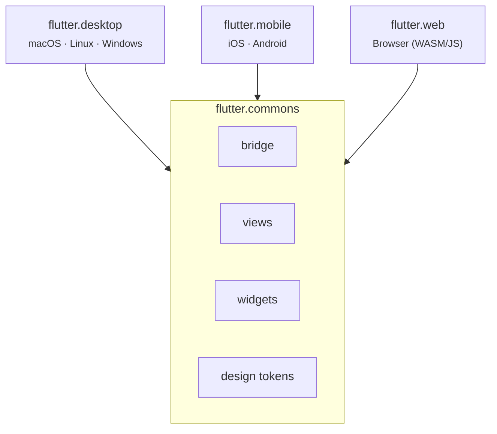

# remote.shell.flutter

Flutter shells for the **WeDoCode Store** application — implementations of the Remote Presentation thin client in Dart/Flutter for multiple platforms.

## Overview

All Flutter shells share the same codebase (`flutter_commons`) and differ only in target platform and deployment configuration. Each one is a thin client with no business logic — it renders ViewStates and emits events over WebSocket.

## Modules

| Module | Platforms | Description |
|--------|-------------|-----------|
| `flutter.commons` | — | Shared library: WS protocol, security, views, widgets |
| `flutter.desktop` | macOS, Linux, Windows | Native desktop app ("WDC Store") |
| `flutter.mobile` | iOS, Android | Mobile app ("WDC Store") with an F badge |
| `flutter.web` | Browser (WASM/JS) | Web app (Flutter alternative to the React shell) |

## Architecture



## Prerequisites

- **Flutter 3.44+**
- **Dart SDK 3.12+**
- Backend running (port 8080 by default)

## Quick start

```bash
# Desktop (macOS/Linux/Windows)
cd flutter.desktop && ./run.sh

# Mobile — iOS simulators
cd flutter.mobile && ./deploy.sh run ios-sim      # iPhone Simulator
cd flutter.mobile && ./deploy.sh run ipad-sim     # iPad Simulator

# Mobile — Android emulators
cd flutter.mobile && ./deploy.sh run android-emu         # phone emulator
cd flutter.mobile && ./deploy.sh run android-tablet-emu  # tablet emulator

# Mobile — physical devices
cd flutter.mobile && ./deploy.sh run ios
cd flutter.mobile && ./deploy.sh run android

# Web
cd flutter.web && flutter run -d chrome --dart-define=WDC_ENDPOINT=http://localhost:8080
```

## Build via Maven (desktop)

The `remote.shell.flutter` module has a `pom.xml` that integrates the desktop build into the Maven lifecycle:

```bash
# From the fontes/ directory — runs flutter pub get + flutter build desktop
mvn compile -pl br.com.wdc.store/br.com.wdc.store.view.remote/remote.shell.flutter -am
```

The `exec-maven-plugin` automatically runs:
1. `flutter pub get` (`initialize` phase)
2. `flutter.desktop/build.sh` — auto-detects macOS/Linux/Windows (`compile` phase)

## Dependency structure

```yaml
# Each shell references flutter.commons as a path dependency:
dependencies:
  flutter_commons:
    path: ../flutter.commons
```
