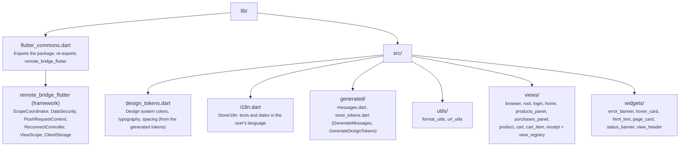

# flutter_commons

Shared library for the Flutter shells (desktop, mobile, web) of the **WDC Store** application.

It contains all the infrastructure any Flutter shell needs to work as a thin client of the Remote Presentation protocol — no business logic, only protocol, rendering and interaction.

## Modules



The protocol client (WebSocket, protocol version 1 handshake with a key agreed per connection — ECDH P-256 + HKDF-SHA256 + AES-256-GCM —, reconnection backoff, client storage) is the framework package `remote_bridge_flutter`; this package holds the WDC Store views and widgets.

## Usage

Referenced as a path dependency in the shells:

```yaml
dependencies:
  flutter_commons:
    path: ../flutter.commons
```

## External dependencies

| Package | Purpose |
|---------|-----|
| `remote_bridge_flutter` | Remote protocol client (framework, path dependency) |
| `web_socket_channel` | WebSocket communication with the host |
| `pointycastle` | ECDH P-256, HKDF-SHA256 and AES-256-GCM (used through the bridge) |
