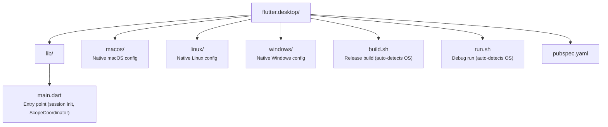

# WDC Store — Flutter Desktop

Desktop shell (macOS, Linux, Windows) for the **WDC Store** application, using the **Remote Presentation** protocol. The app is a thin client that renders scopes received from the server over WebSocket.

## Features

- **App name:** WDC Store
- **Platforms:** macOS, Linux, Windows
- **Protocol:** Bidirectional WebSocket, protocol version 1: each connection agrees on its own key (ECDH P-256 + HKDF-SHA256) and ciphers sensitive values with AES-256-GCM
- **Session persistence:** SharedPreferences for the persistent scope and, under a `sec.` key prefix, the secure scope (tokens, auto-login) — kept in SharedPreferences because the Keychain needs an entitlement the macOS sandbox build does not have
- **Shared code:** Uses `flutter_commons` for protocol, views and widgets

## Prerequisites

- **Flutter 3.44+** (`flutter --version`)
- **Backend running** on port 8080 (or the configured endpoint)

## Running

```bash
# Run (automatic OS detection)
./run.sh

# Release build
./build.sh

# Or with a custom endpoint
WDC_ENDPOINT=http://server:8080 ./run.sh
```

## Build via Maven

The parent module `remote.shell.flutter` integrates this build into the Maven lifecycle:

```bash
# From fontes/ — runs pub get + release build
mvn compile -pl br.com.wdc.store/br.com.wdc.store.view.remote/remote.shell.flutter -am
```

## Structure



## Dependencies

| Package | Purpose |
|---------|-----|
| `flutter_commons` | WS protocol, views, widgets, security |
| `shared_preferences` | Persistent and secure scopes, app id, request sequence |
