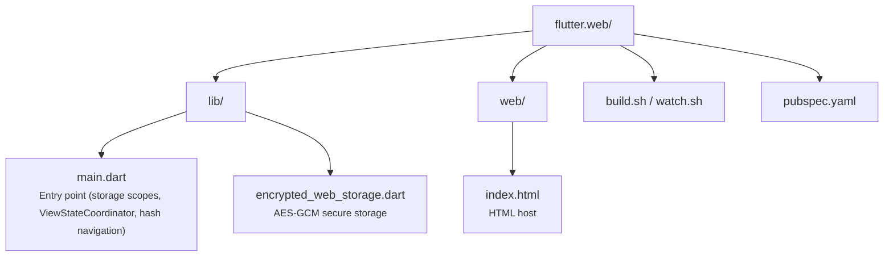

# WDC Store — Flutter Web

Web shell for the **WDC Store** application, using the **Remote Presentation** protocol via Flutter compiled to WebAssembly/JS. A thin client that renders ViewStates received from the server over WebSocket.

## Features

- **Platform:** Browser (WebAssembly or JS)
- **Protocol:** Bidirectional WebSocket with RSA + AES-GCM encryption
- **Shared code:** Uses `flutter_commons` for protocol, views and widgets
- **Alternative to the React shell** — same functionality, implemented in Dart/Flutter

## Prerequisites

- **Flutter 3.44+** (`flutter --version`)
- **Backend running** on port 8080 — it serves the app and issues the session cookies (`app_id`, `app_skey`)

## Running

The app is served by the backend from `work/frontend/remote.shell.flutter/` and connects back to the host that served the page (`window.location.host`), so it is built rather than run with `flutter run`:

```bash
# Release build (WASM) → work/frontend/remote.shell.flutter/
./build.sh
SOURCE_MAPS=true ./build.sh     # with source maps

# Rebuild on change in lib/ or ../flutter.commons/lib/ (requires fswatch) + browser reload
./watch.sh

# Or, from the repository root
./work/bin/build-frontends.sh flutter
```

Open `http://localhost:8080/remote.shell.flutter/`.

## Client storage

- **session** scope → `window.sessionStorage` (survives a page reload, so the cart does too)
- **persistent** scope → `window.localStorage`
- **persistent-secure** scope → `EncryptedWebStorage`: AES-GCM with a non-extractable key kept in IndexedDB, entries under `~rf:sec.` and kept out of the plain scopes

## Structure



## Dependencies

| Package | Purpose |
|---------|-----|
| `flutter_commons` | WS protocol, views, widgets, security |
| `web` | Browser APIs (storage, cookies, history, Web Crypto) |
