# WDC Store — React Client

SPA frontend for the WDC Store system, built with **React 19**, **TypeScript** and **MUI 9**. It communicates with the Java backend over a **bidirectional WebSocket**, receiving serialized states from the presenters and sending events back.

## Stack

| Technology        | Version | Purpose                   |
| ----------------- | ------- | ------------------------- |
| React             | 19      | Reactive UI               |
| TypeScript        | ES2024  | Static typing             |
| MUI (Material UI) | 9       | Visual components         |
| Emotion           | 11      | CSS-in-JS (MUI engine)    |
| Parcel            | 2.13.3  | Bundler                   |
| Prettier          | 3.8.2   | Code formatting           |
| history           | 5.3.0   | Hash-based navigation     |
| universal-cookie  | 7.2.2   | Cookie management         |

## Project Structure

```mermaid
graph TD
    src["src/"]
    src --> indexHtml["index.html"]
    src --> scripts["scripts/"]

    scripts --> indexTsx["index.tsx<br/><small>Bootstrap: theme, registration, render</small>"]
    scripts --> AppTsx["App.tsx<br/><small>Application facade</small>"]

    scripts --> bridge["bridge/ — Infrastructure"]
    bridge --> VSCoord["ViewStateCoordinator.ts<br/><small>Views, forms, WebSocket</small>"]
    bridge --> Flush["FlushRequestContext.ts<br/><small>WS communication</small>"]
    bridge --> Reconnect["ReconnectController.ts<br/><small>Progressive backoff</small>"]
    bridge --> DataSec["DataSecurity.ts<br/><small>RSA + AES-GCM</small>"]
    bridge --> ViewScope["ViewScope.ts<br/><small>Reactive state</small>"]
    bridge --> ViewGC["ViewGarbageCollector.ts"]
    bridge --> constants["constants.ts + types.ts"]

    scripts --> utils["utils/ — Utilities"]
    utils --> ViewUtils["ViewUtils.tsx<br/><small>Base classes</small>"]
    utils --> CryptoUtils["RSA.ts, Base64.ts, BigIntUtils.ts"]
    utils --> FormatUtils["DateUtils.ts, NumberUtils.ts"]
    utils --> OtherUtils["LangUtils.ts, EndpointUtils.ts, UTF8.ts"]

    scripts --> views["views/ — Components"]
    views --> BrowserView["BrowserView.tsx<br/><small>Connection, alerts, loading</small>"]
    views --> RootView["RootView.tsx<br/><small>Auth container</small>"]
    views --> SlotView["SlotView.tsx<br/><small>Generic slot</small>"]
    views --> LoginView["LoginView.tsx"]
    views --> HomeView["HomeView.tsx"]
    views --> ProductView["ProductView.tsx"]
    views --> CartView["CartView.tsx"]
    views --> ReceiptView["ReceiptView.tsx"]
    views --> home["home/<br/><small>HeaderPanel, ContentPanel,<br/>ProductsPanel, PurchasesPanel</small>"]
```



## How It Works

### Lifecycle

1. **Bootstrap** (`index.tsx`): Creates the MUI theme, registers all views and renders the `BrowserView`
2. **Connection** (`BrowserView`): On mount, calls `app.onStart()`, which opens the WebSocket
3. **Receiving state**: The backend sends serialized `ViewStates` over WebSocket → `Application.applyViewStates()` updates the `ViewScope`s → React re-renders
4. **Sending events**: User actions call `app.submit(vsid, eventId)`, which sends the event to the corresponding presenter on the backend over WebSocket

### View Pattern

Each view is a class that extends `BaseViewClass<Props, State>` and is converted into a Functional Component via `BaseViewClass.FC()`:

```typescript
class LoginViewClass extends BaseViewClass<ViewProps, LoginScope> {
  override render({ className }: ViewProps): React.ReactNode {
    const { state } = this
    // ... rendering based on the state received from the backend
  }
}

export default BaseViewClass.FC(LoginViewClass, "c677cda52d14")
```

- The **state** (`state`) comes from the backend (presenter); it is not managed locally
- **Events** are sent to the backend via `app.submit(vsid, eventId)`
- **Form data** is attached via `app.setFormField(vsid, field, value)` before the submit
- Each view is identified by a unique **VIEW_ID** (hash) that maps to the presenter on the backend

### WebSocket Communication

- **Protocol**: WebSocket with the `wdc` subprotocol
- **Keep-alive**: Automatic every 15 seconds to keep the connection alive
- **Reconnection**: Progressive backoff (2s, 4s, 6s, ... up to 120s) with an option to reconnect immediately
- **Security**: Sensitive data encrypted with AES-GCM; key exchanged via RSA in the handshake

### Activity Indicator

A `LinearProgress` (MUI) appears at the top of the page during user submits. Characteristics:

- `position: fixed` — does not affect the layout
- 50ms debounce — does not flicker on fast operations
- 15s timeout — clears itself if the response does not arrive
- Only for user actions — keep-alive and ping are silent

## Import Alias

The `@root/*` alias maps to `./src/scripts/*`:

```typescript
import app from "@root/App"
import { BaseViewClass } from "@root/utils/ViewUtils"
```

Configured in `package.json` (Parcel) and `tsconfig.json` (TypeScript/IDE).

## Build Output

The compiled assets are generated directly into the `skeleton` module:

```
../remote.host/src/main/resources/META-INF/resources/
```

This lets the Javalin server serve the static files automatically via the classpath.

## Commands

```bash
# Install dependencies
npm install

# Development (watch mode with hot reload)
npm run watch

# Production build
npm run build

# Format code
npm run format

# Check formatting
npm run format:check
```

## Formatting (Prettier)

| Rule            | Value       |
| --------------- | ----------- |
| Semicolons      | No          |
| Quotes          | Single      |
| Trailing comma  | All         |
| Width           | 120 columns |
| Indentation     | 2 spaces    |
