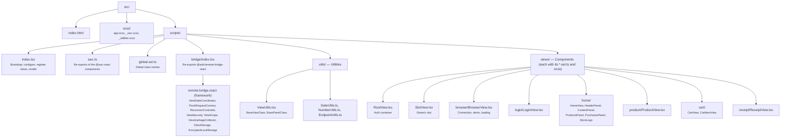

# WDC Store — React Client

SPA frontend for the WDC Store system, built with **React 19**, **TypeScript** and **Spectrum Web Components** (`@swc-react`). It communicates with the Java backend over a **bidirectional WebSocket**, receiving serialized states from the presenters and sending events back.

## Stack

| Technology                          | Version | Purpose                   |
| ----------------------------------- | ------- | ------------------------- |
| React                               | 19      | Reactive UI               |
| TypeScript                          | ES2024  | Static typing             |
| Spectrum Web Components (@swc-react) | 1.12    | Visual components         |
| Bootstrap Icons                     | 1.11.3  | Icons (`bi bi-*` classes) |
| Sass (@parcel/transformer-sass)     | 2.16    | View stylesheets          |
| Parcel                              | 2.13.3  | Bundler                   |
| Prettier                            | 3.8.2   | Code formatting           |
| universal-cookie                    | 7.2.2   | Cookie management         |

The protocol client (coordinator, WebSocket, crypto, storage) is the framework module `remote.bridge.react`, imported through the `@wdc/remote-bridge-react` alias.

## Project Structure



## How It Works

### Lifecycle

1. **Bootstrap** (`index.tsx`): Calls `bridge.configure("~rr:")`, registers all views with `bridge.registerComponents(...)` and renders `bridge.createBrowserView()` inside the Spectrum `<Theme>`
2. **Connection** (`BrowserView`): On mount, calls `bridge.onStart()`, which opens the WebSocket
3. **Receiving state**: The backend sends serialized states over WebSocket → `applyViewStates()` updates the `ViewScope`s → React re-renders
4. **Sending events**: User actions call `bridge.submit(vsid, eventId)`, which sends the event to the corresponding presenter on the backend over WebSocket

### View Pattern

Each view is a class that extends `BaseViewClass<Props, State>` and is converted into a Functional Component via `BaseViewClass.FC()`:

```typescript
class LoginViewClass extends BaseViewClass<ViewProps, LoginViewState> {
  override render({ className }: ViewProps) {
    const { state } = this
    // ... rendering based on the state received from the backend
  }
}

export default BaseViewClass.FC(LoginViewClass, "c677cda52d14")
```

- The **state** (`state`) comes from the backend (presenter); it is not managed locally
- **Events** are sent to the backend via `bridge.submit(vsid, eventId)`
- **Form data** is attached via `bridge.setFormField(vsid, field, value)` before the submit
- Each view is identified by its **VIEW_ID**, the `CLASS_ID` of the scope it draws on the backend

### WebSocket Communication

- **Protocol**: WebSocket with the `wdc` subprotocol
- **Keep-alive**: Automatic every 15 seconds to keep the connection alive
- **Reconnection**: Progressive backoff (2s, 4s, 6s, ... up to 120s) with an option to reconnect immediately
- **Security**: Sensitive data encrypted with AES-GCM; key exchanged via RSA in the handshake

### Activity Indicator

While a user submit is in flight (`state.submitting` of the browser view), `BrowserView` shows a thin animated bar (`browser.scss`, `&__loading-bar`) with `position: fixed` at the top of the page, so it does not affect the layout. It appears only if the response takes more than 200 ms and clears itself after 15 s; keep-alives do not trigger it.

## Import Alias

The `@root/*` alias maps to `./src/scripts/*`:

```typescript
import bridge from "@root/bridge"
import { BaseViewClass } from "@root/utils/ViewUtils"
```

Configured in `package.json` (Parcel) and `tsconfig.json` (TypeScript/IDE).

## Build Output

The compiled assets are generated into:

```
work/frontend/remote.shell.react/
```

The backend serves that folder (plus the copied `context.html`) at `/remote.shell.react/`.

## Commands

```bash
# Install dependencies
npm install

# Development (watch mode; re-injects externals after each rebuild)
npm run watch

# Production build
npm run build

# Format code
npm run format

# Check formatting
npm run format:check
```

From the repository root, `./work/bin/build-frontends.sh react` runs this module's `build.sh` (clean build).

## Formatting (Prettier)

| Rule            | Value       |
| --------------- | ----------- |
| Semicolons      | No          |
| Quotes          | Double      |
| Trailing comma  | All         |
| Width           | 120 columns |
| Indentation     | 2 spaces    |
