# Remote Shell TeaVM

Java thin client compiled to JavaScript via **TeaVM 0.16.0**, using a **Virtual DOM** (VNode API) with Spectrum Web Components. It communicates with `remote.host` over WebSocket — **no local business logic**.

## Concept

This module is an alternative implementation of the shell (thin client) of the Remote Presentation architecture. It replaces React as the rendering engine while keeping the same bidirectional WebSocket protocol:

- Receives serialized **scopes** (the view state of each presenter) from the host (deltas/dirty only)
- Renders using a Virtual DOM (efficient diff → real DOM)
- Emits user **interaction events** back to the host

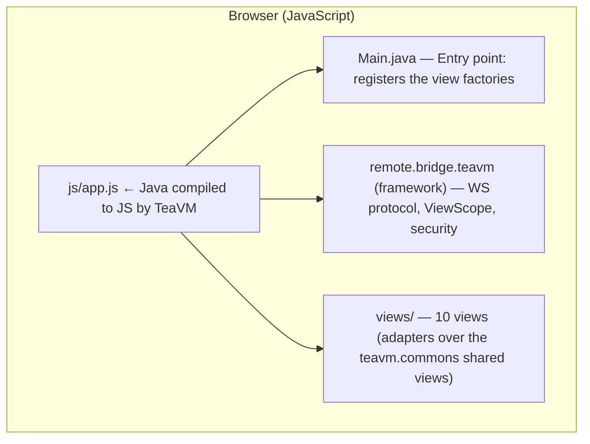

## Architecture

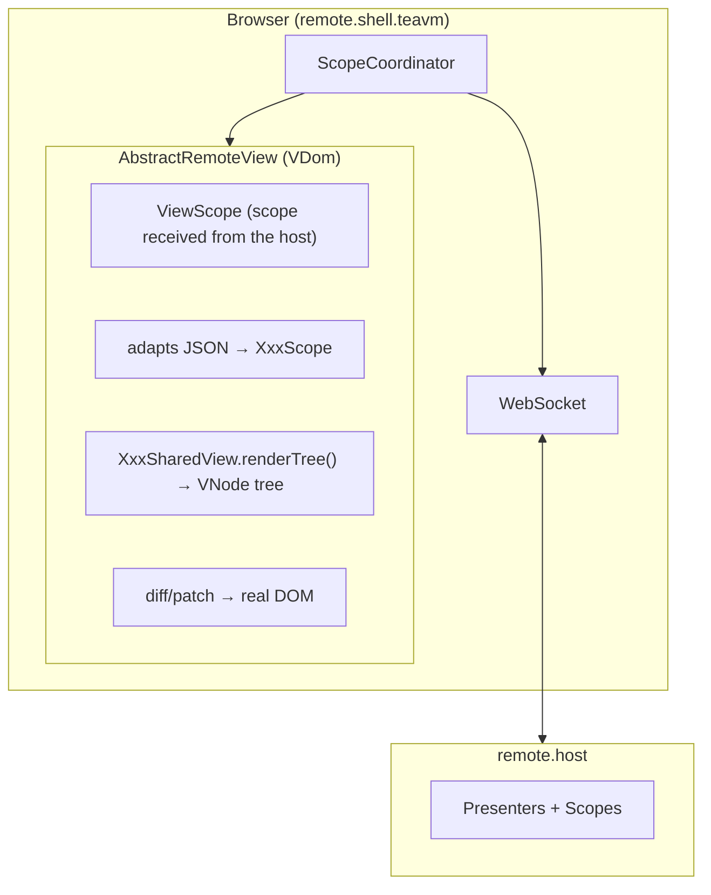

The protocol infrastructure (`ScopeCoordinator`, `ViewScope`, `FlushRequestContext`, `ReconnectController`, `DataSecurity`, `Handshake`, `EncryptedLocalStorage`, `JsonParser`, `ViewGarbageCollector`) lives in the framework module `remote.bridge.teavm`; the VDom engine, the Spectrum Web Components DSL, the `Sel*` class catalogs and the shared views live in `teavm.commons` (also used by `teavm.web`).

## Project Structure

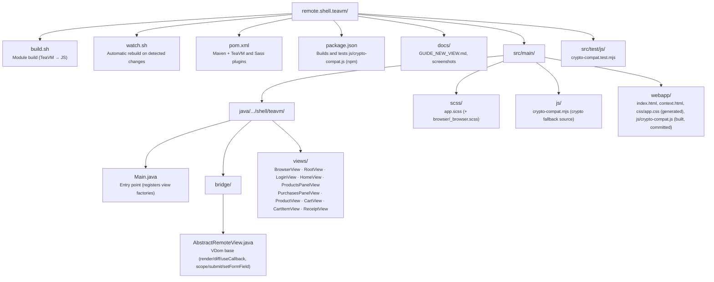

## Virtual DOM

Views extend `AbstractRemoteView` and implement `render()`, returning a `VNode` tree. Most of them delegate to a shared view, after adapting the JSON scope into the presentation scope type (`CartView`):

```java
public CartView(String vsid) {
    super(vsid);

    this.shared = new CartSharedView();
    this.shared.scopeSupplier = this::adaptScope;
    this.shared.onBack = () -> submit(ON_BACK);
    this.shared.onBuy = () -> submit(ON_BUY);
    this.shared.rowElements = this::rowElements;
}

@Override
protected VNode render() {
    return shared.renderTree();
}

private CartScope adaptScope() {
    ViewScope scope = scope();
    adaptedScope.errorMessage.set(scope.getString("errorMessage"));
    adaptedScope.total.set(scope.getDouble("total"));
    return adaptedScope;
}
```

`BrowserView` and `RootView` render directly:

```java
@Override
protected VNode render() {
    var scope = scope();
    var contentEl = getChildViewElement(scope.getString("contentViewId"));
    return spTheme("light", "medium", "spectrum").cls(Sel.ROOT).children(
      slot(contentEl).cls(Sel.CONTENT));
}
```

### Reference Optimizations

The event listener diff compares by **reference identity**:

1. **Stable fields** — listeners without parameters:
   ```java
   private final EventListener<Event> backListener = evt -> onBack.run();
   ```

2. **`useCallback(key, listener)`** — cached parametric listeners:
   ```java
   .on("click", useCallback("open-" + key, mkOnOpenProduct(product.id)))
   ```

### Compact Sel

```java
@SuppressWarnings({"java:S1214", "static-access"})
private interface Sel {
    SelUtility u = SelUtility.INSTANCE;
    SelComponents c = SelComponents.INSTANCE;
    SelIcons icon = SelIcons.INSTANCE;

    String ROOT = u.PAGE_SCROLL_ROOT;
    String ERROR_VISIBLE = clsx(c.ALERT_ERROR, u.MB_12);
}
```

## Difference vs. teavm.web

| Aspect | remote.shell.teavm | teavm.web |
|---------|-------------------|----------------------|
| **Business logic** | None (thin client) | Complete (standalone SPA) |
| **Communication** | Bidirectional WebSocket | REST (XMLHttpRequest) |
| **Scope** | Received from the host (`ViewScope`) | Managed locally (Presenters) |
| **Presenters** | Server-side (remote.host) | Client-side (compiled together) |
| **Rendering** | `teavm.commons` shared views | `teavm.commons` shared views |

## Build

```bash
# Recommended (from the repository root)
./work/bin/build-frontends.sh teavm.shell

# Module script: reinstalls teavm.commons, then compiles (--full also installs the framework)
JAVA25_HOME=<path-to-jdk-25> ./build.sh
```

TeaVM compiles against the `presentation` JAR in `~/.m2`, not against the reactor: without `mvn install` after a presentation change, the shell silently ships the previous scopes. `build-frontends.sh` reinstalls the modules by default.

### Output

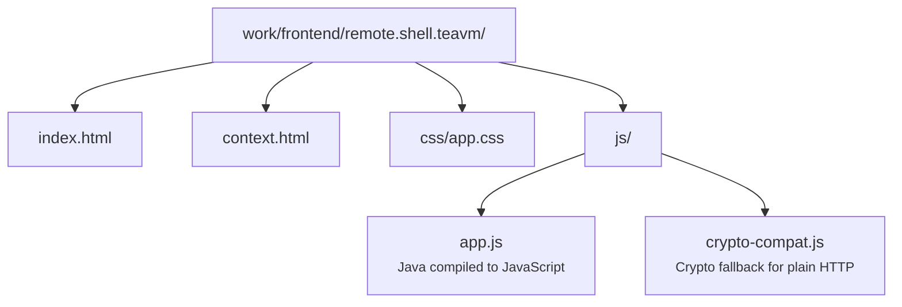

### Crypto fallback (plain HTTP)

Each connection agrees on its own key with the host (remote protocol version 1: P-256 ECDH, HKDF-SHA256, AES-256-GCM; see the [bridge README](../../../br.com.wdc.framework/br.com.wdc.framework.cube.remote/remote.bridge.teavm/README.md#protocol-version-1)). Over plain HTTP outside `localhost` the browser has no `crypto.subtle`, so `index.html` loads `js/crypto-compat.js`, which defines `wdcCryptoFallback` with the same primitives from @noble. The bundle is committed; the Maven build only copies it. To rebuild or check it (Node, from this module):

```bash
npm install
npm run build:crypto-compat   # src/main/js/crypto-compat.mjs → src/main/webapp/js/crypto-compat.js
npm run test:crypto-compat    # RFC 5869 HKDF vector, ECDH agreement and AES-GCM against Web Crypto, tamper refusal
```

If the host refuses the protocol version (`unsupported-protocol`, close `4002`), the page does not reconnect: `BrowserView` shows "This page is out of date. Reload it to continue.", and its OK reloads the page.

## Development

```bash
# Watch mode — automatic rebuild on save
./watch.sh
```

Changes in `src/` and `teavm.commons/src/` are detected by `DevWatcher` (teavm.commons, `-Pwatch` profile); after each rebuild the script notifies the backend (`/__dev/notify`, requires `devMode = true`) so the open page reloads.

## Running

The shell is served as a static resource by the backend:

```
http://localhost:8080/remote.shell.teavm
```

## Guides

- [How to create a new View](docs/GUIDE_NEW_VIEW.md) — step by step to implement a view in this project

## Screenshots

### Login

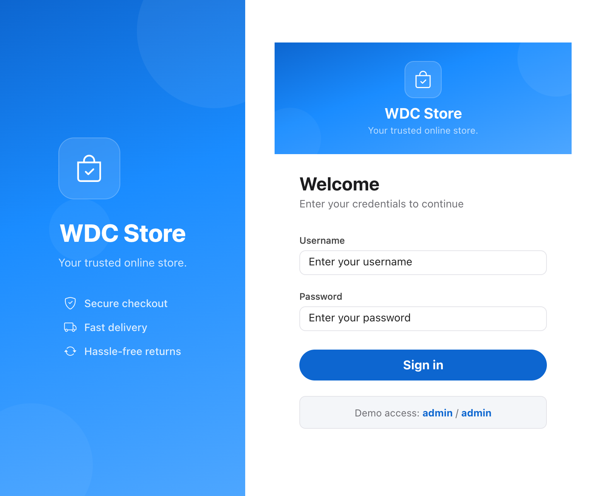

### Product List

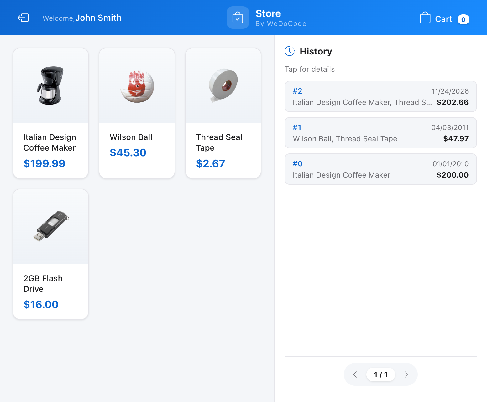

### Product Detail

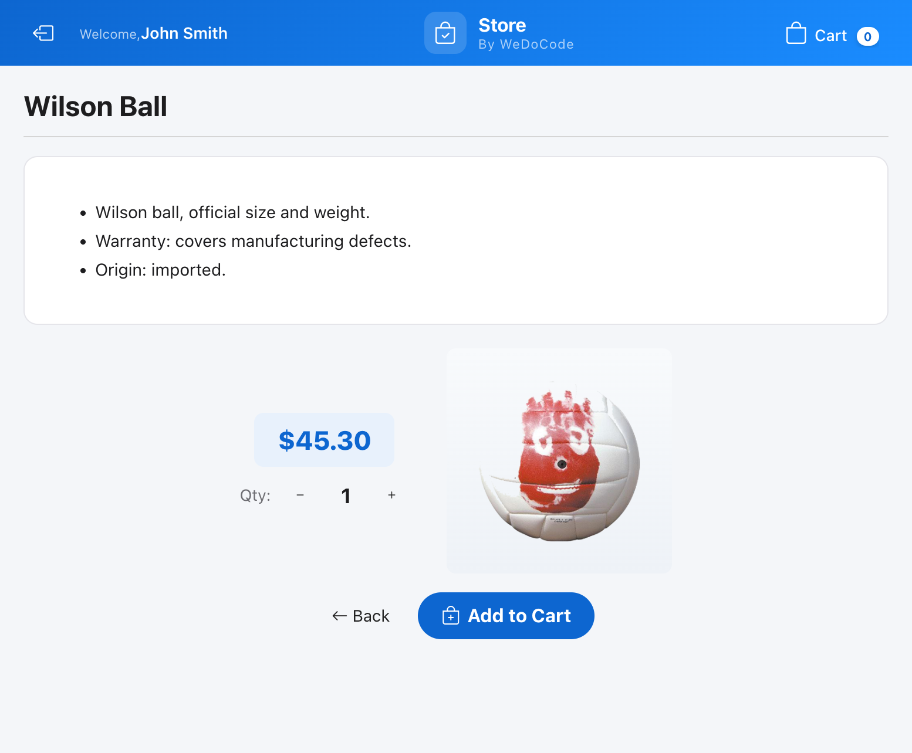

### Cart

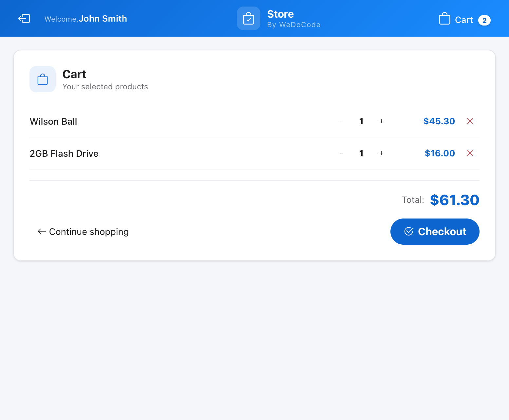

### Empty Cart

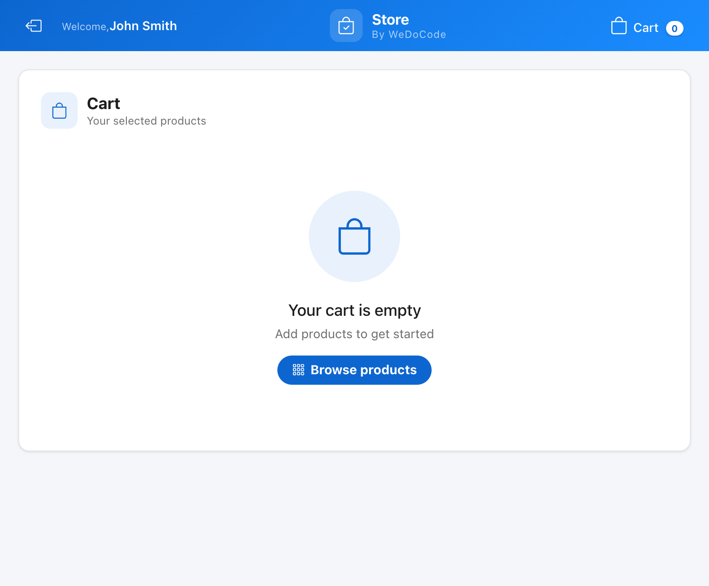

### Receipt

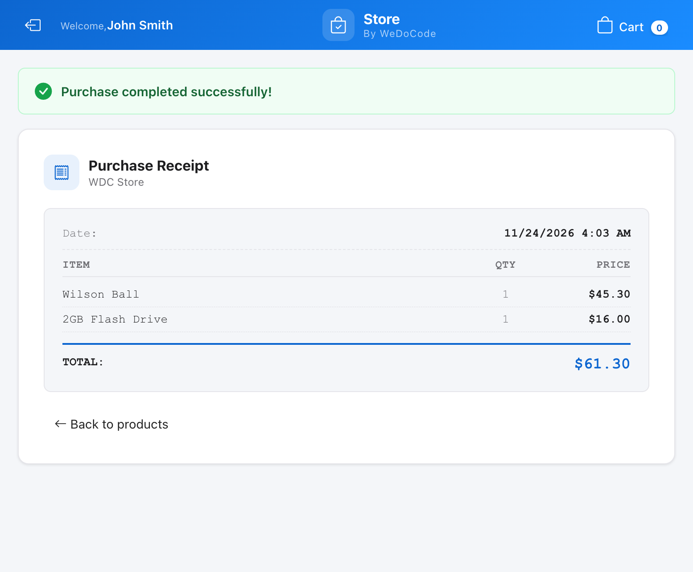

### Purchase History

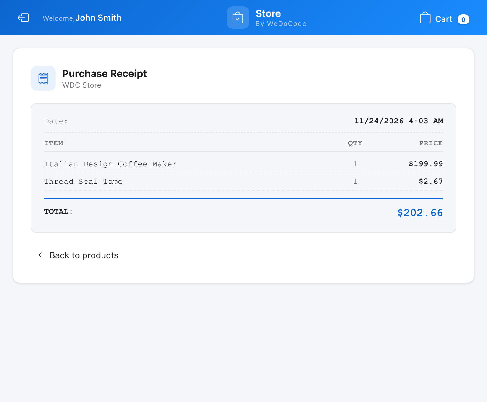
