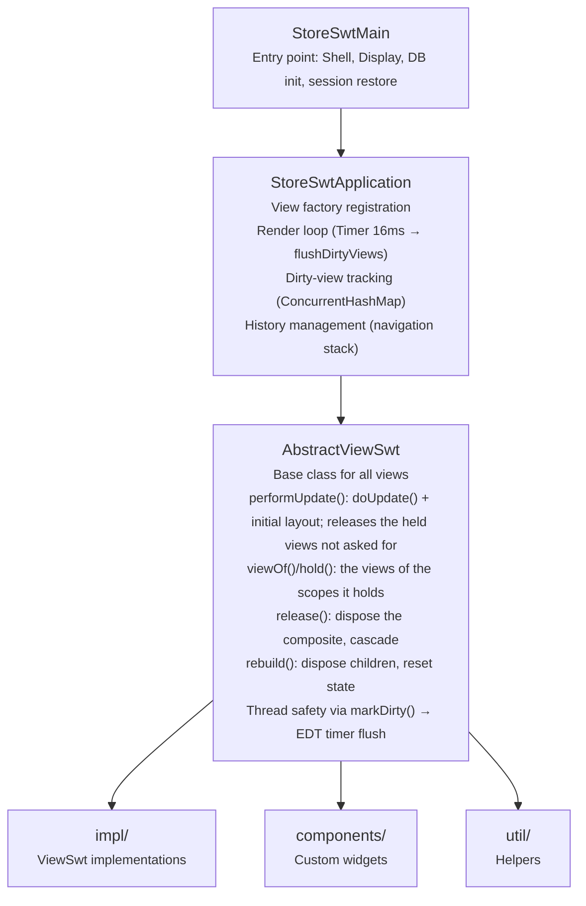
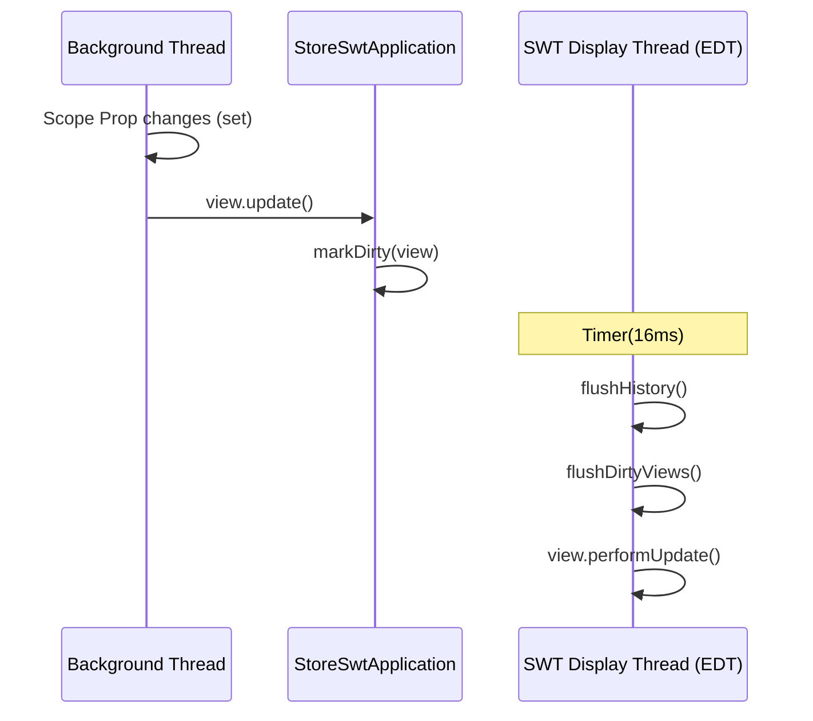
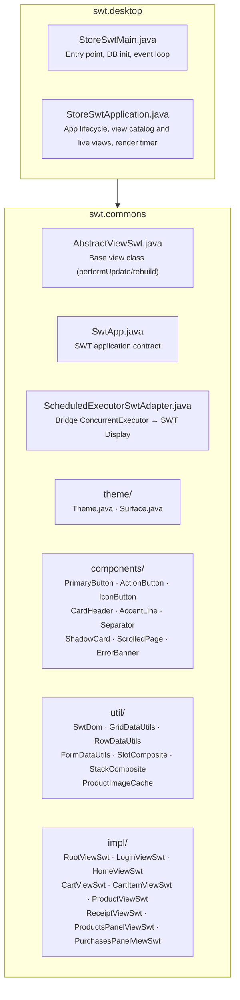
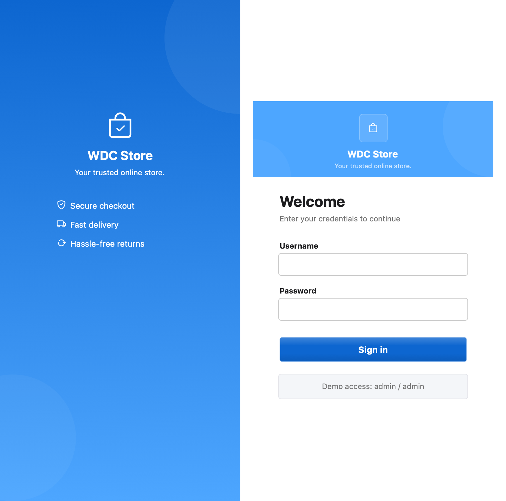
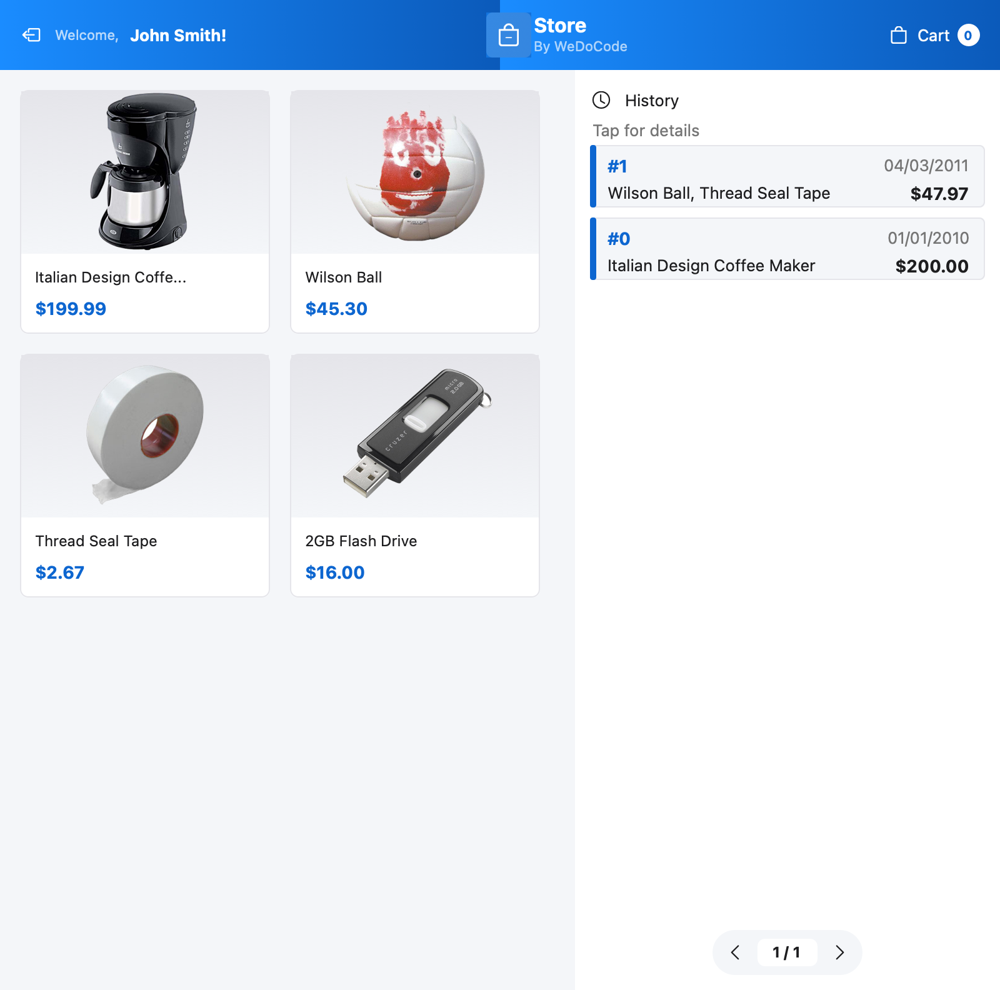
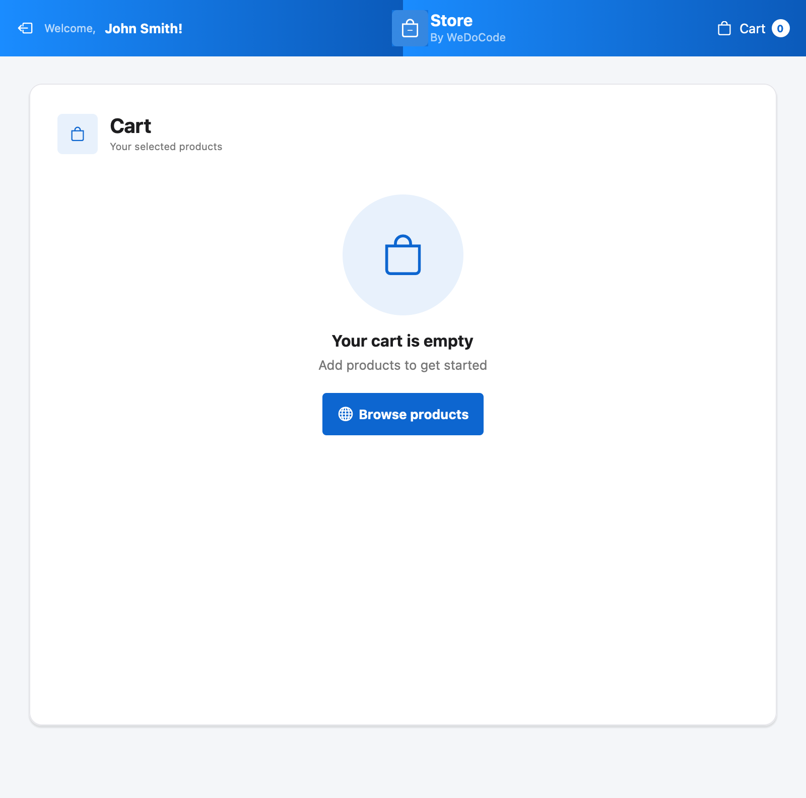
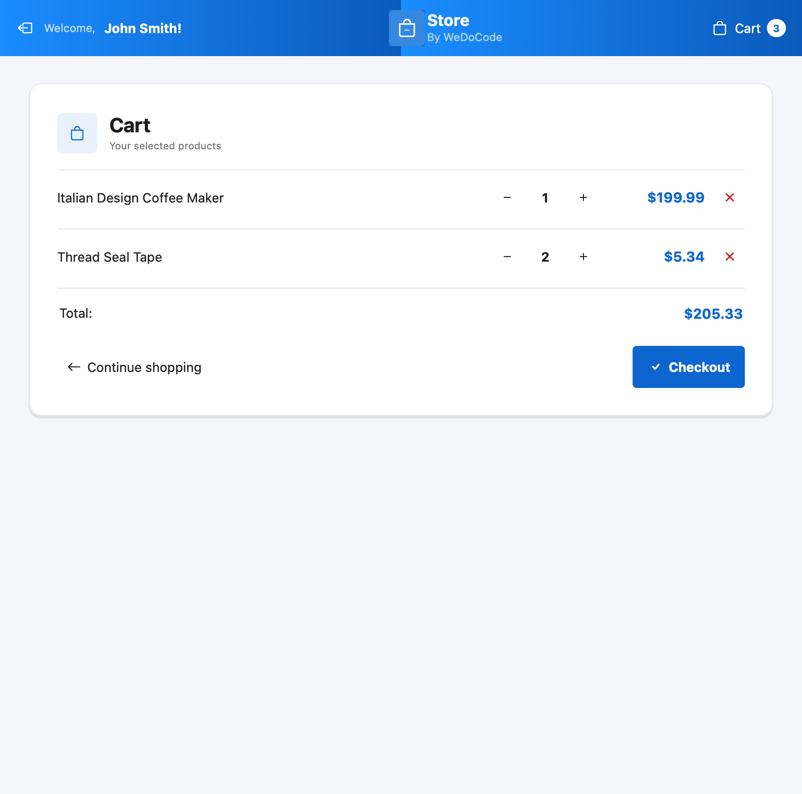
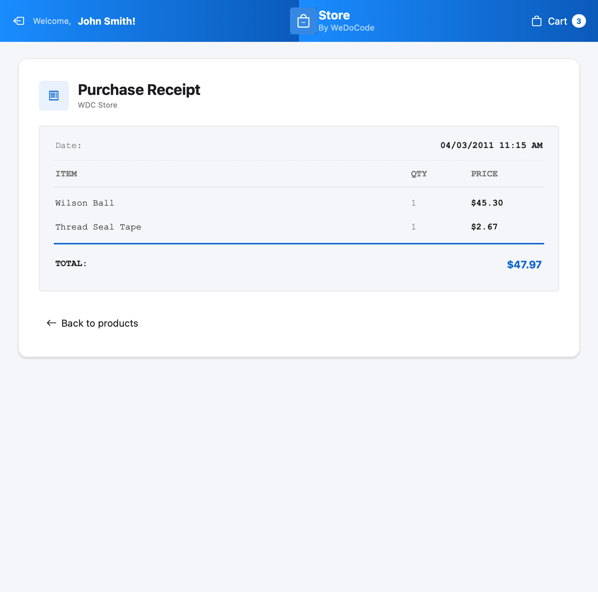
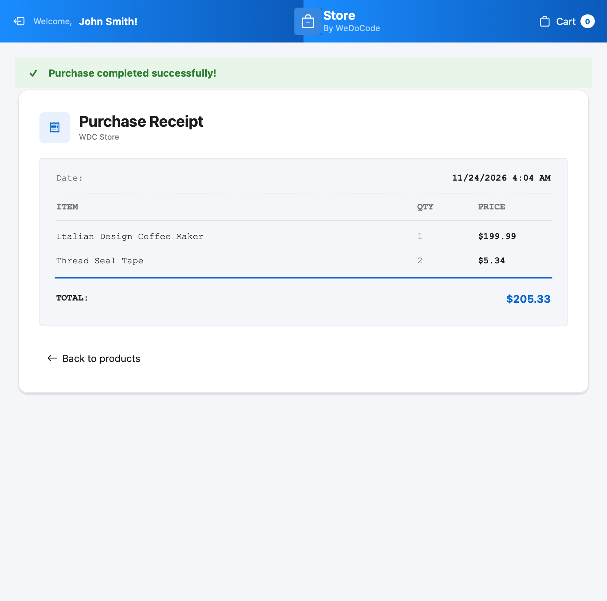

# WDC Store — SWT Desktop View

Native desktop implementation of WDC Store using **Eclipse SWT 3.135.0** (Cocoa/macOS aarch64).
It shares the same presentation layer (Cube MVP) with the other views (TeaVM, React, Flutter, Vaadin).

## Architecture



### Render Loop



### Package Structure

The module is an aggregator of two Maven modules that share the package `br.com.wdc.store.view.swt`: `swt.commons` (the views, also reused by the remote shell `remote.shell.swt`) and `swt.desktop` (the local app's entry point and wiring).



### Views of the held scopes

`SwtApp` is the contract the views share with the two applications that run them: `viewOf(scope)` gives the view that draws a scope, `viewLeft(view)` is told when no view holds a view any more, and `forgetView(view)` when one is released. A view asks for the views of the scopes it holds with its own `viewOf(...)` (or takes one it already has with `hold(...)`, like the cart's `rowViews`) while it draws; after `performUpdate()`, the held views it did not ask for are let go. `StoreSwtApplication` (local) releases a view no one holds: its updater is taken back (`scope.clearUpdater`) and its composite is disposed on the UI thread, with the views it held in turn. The remote shell waits for the host instead, which says which views are gone (`releasedViews`). The presenters never release a view.

## Main Dependencies

| Dependency | Version | Purpose |
|-------------|--------|-----------|
| Eclipse SWT (Cocoa macOS aarch64) | 3.135.0 | Native GUI toolkit |
| br.com.wdc.store.presentation | 1.0.0 | Presenters and scopes (Cube MVP) — via `swt.commons` |
| persistence.impl | 1.0.0 | Repositories (jOOQ) — `swt.desktop` only |
| br.com.wdc.store.scripts | 1.0.0 | DDL and seed data (`DBCreate`/`DBReset`) — `swt.desktop` only |
| H2 Database / PostgreSQL driver | — | Database (H2 file by default) |
| Logback | — | Logging |

## Build

```bash
cd fontes
JAVA_HOME=$JAVA25_HOME mvn clean package -DskipTests -pl br.com.wdc.store/br.com.wdc.store.view.swt/swt.desktop -am
```

`swt.desktop` produces a fat JAR, `target/swt.desktop-1.0.0.jar` (main class `StoreSwtMain`), with the SWT of the active platform profile.

## Running

```bash
cd fontes/br.com.wdc.store/br.com.wdc.store.view.swt/swt.desktop
# -XstartOnFirstThread is required on macOS (SWT/Cocoa runs the UI on the main thread)
$JAVA25_HOME/bin/java -XstartOnFirstThread -jar target/swt.desktop-1.0.0.jar --workdir=work
```

> The application includes an embedded backend (H2 file database in `swt.desktop/work/data` + repositories) and requires no external server. It does not start without a work directory (`--workdir=<folder>` or `STORE_WORKDIR`); the module's own is `swt.desktop/work/`, with `config/application.toml`.

## Screenshots

### Login



### Home



### Cart (empty)



### Cart (with products)



### Receipt (history)



### Receipt (after purchase)


