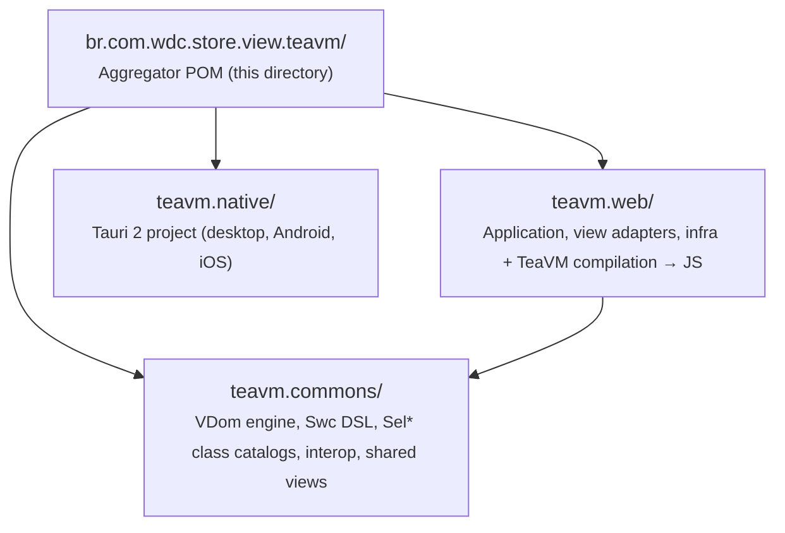

# WDC Store — View TeaVM

**Cross-platform** implementation of the **WDC Store** application using [TeaVM](https://teavm.org/) — an ahead-of-time compiler that converts Java to JavaScript. The Java code (views, presenters, domain, HTTP repositories) is compiled into an SPA that runs directly in the browser, and from it can be packaged as a native application for **desktop**, **Android** and **iOS** via [Tauri 2](https://tauri.app/).

## Motivation

TeaVM enables a real **"write once, run anywhere"** strategy starting from Java:

1. **Write the UI in Java** — declarative `VNode` trees (Virtual DOM) rendered with Spectrum Web Components
2. **Compile to JavaScript** — TeaVM generates a single `app.js`
3. **Run anywhere** — in the browser as an SPA, or packaged as a native app via Tauri

This makes it possible to reach **4 platforms** (Web, macOS, Android, iOS) with **a single UI codebase**, sharing the same Presenters and Scopes of the Cube MVP pattern.

| Platform | Packaging | Runtime | Distribution |
|------------|---------------|---------|-------------|
| **Web** | SPA served by Javalin | Browser (JS engine) | URL |
| **macOS** | Tauri → `.app` bundle | WebView (WKWebView) | DMG / App Store |
| **Android** | Tauri → APK | WebView (Chrome/System) | APK / Play Store |
| **iOS** | Tauri → `.app` Simulator/Device | WebView (WKWebView) | Xcode / TestFlight |

## Module Structure



### [teavm.commons](teavm.commons/) — Shared Rendering

The Virtual DOM (`VNode`, `VDom`), the Spectrum Web Components DSL (`Swc`), the CSS class catalogs (`SelUtility`, `SelComponents`, `SelIcons`), JSO interop and the shared views (`XxxSharedView extends SharedVDomView`) with their `.scss` partials. The shared views are also used by `remote.shell.teavm`.

### [teavm.web](teavm.web/) — Application + Compilation

The application (`StoreTeaVMApplication`), the 9 views (thin adapters over the shared views), the browser infrastructure (HTTP transport, crypto, storage) and the repository bootstrap over `persistence.client`, plus the TeaVM Maven plugin that compiles everything into `app.js`. The output is a complete SPA in `work/frontend/teavm.web/` that can be served by any HTTP server or embedded in a native wrapper.

### [teavm.native](teavm.native/) — Native Packaging

A [Tauri 2](https://tauri.app/) project that packages the SPA generated by the web module into native applications. Tauri uses the OS's native WebView (no embedded Chromium), resulting in lightweight binaries. It supports desktop (macOS), Android and iOS from a single `build.sh`.

## Technologies

| Component | Technology | Version |
|------------|-----------|--------|
| AOT compiler | [TeaVM](https://teavm.org/) | 0.16.0 |
| UI components | [Spectrum Web Components](https://opensource.adobe.com/spectrum-web-components/) | 0.40.1 (bundle) |
| Icons | [Bootstrap Icons](https://icons.getbootstrap.com/) | 1.11.3 |
| Native wrapper | [Tauri](https://tauri.app/) | 2.x |
| Language (views) | Java 25 | — |
| Language (native) | Rust | — |

## How TeaVM Works

TeaVM compiles the Java classes into a single JavaScript file (`app.js`). The compiler performs:

- **Dead code elimination** — removes unused classes/methods
- **Direct interop** — calls to browser APIs (DOM, XMLHttpRequest, Web Crypto, IndexedDB) via JSO annotations, without a heavy bridge

The views describe their DOM as a `VNode` tree, and the VDom applies only the differences between renders (from `ProductsPanelSharedView`):

```java
return div("product-card").key(key)
  .on("click", useCallback("open-" + key, mkOnOpenProduct(product.id)))
  .children(
    div(Sel.CARD_IMAGE_WRAP).children(
      img().attr("alt", name).attr("src", imageUrl).cls(Sel.CARD_IMAGE)),
    div(Sel.CARD_BODY).children(
      p(Sel.CARD_NAME).text(name),
      span(Sel.CARD_PRICE).text(price)));
```

## Build

```bash
./work/bin/build-frontends.sh teavm.web
```

TeaVM compiles against the JARs in `~/.m2`, not against the reactor; `build-frontends.sh` reinstalls the modules first so the app never ships a stale domain. For the native packages, see [teavm.native](teavm.native/).
