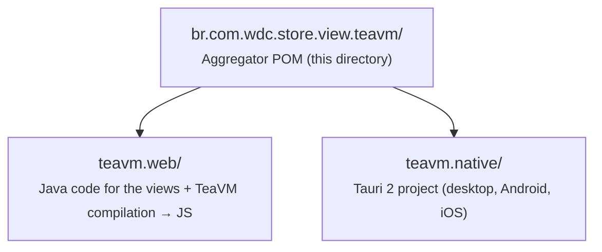

# WDC Store — View TeaVM

**Cross-platform** implementation of the **WeDoCode Store** application using [TeaVM](https://teavm.org/) — an ahead-of-time compiler that converts Java to JavaScript. The Java code (views, presenters, domain, api-client) is compiled into an SPA that runs directly in the browser, and from it can be packaged as a native application for **desktop**, **Android** and **iOS** via [Tauri 2](https://tauri.app/).

## Motivation

TeaVM enables a real **"write once, run anywhere"** strategy starting from Java:

1. **Write the UI in Java** — using the `HtmlDom` API, which generates native HTML with Bootstrap 5
2. **Compile to JavaScript** — TeaVM generates a single optimized `app.js`
3. **Run anywhere** — in the browser as an SPA, or packaged as a native app via Tauri

This makes it possible to reach **4 platforms** (Web, macOS, Android, iOS) with **a single UI codebase**, sharing the same Presenters and ViewStates of the Cube MVP pattern.

| Platform | Packaging | Runtime | Distribution |
|------------|---------------|---------|-------------|
| **Web** | SPA served by Javalin | Browser (JS engine) | URL |
| **macOS** | Tauri → `.app` bundle | WebView (WKWebView) | DMG / App Store |
| **Android** | Tauri → APK | WebView (Chrome/System) | APK / Play Store |
| **iOS** | Tauri → `.app` Simulator/Device | WebView (WKWebView) | Xcode / TestFlight |

## Module Structure



### [teavm.web](teavm.web/) — Views + Compilation

Contains all the Java code of the view layer (8 views, JS interop, Bootstrap theme, REST repositories) and the TeaVM Maven plugin that compiles everything into `app.js`. The output is a complete SPA (`index.html` + `app.js`) that can be served by any HTTP server or embedded in a native wrapper.

### [teavm.native](teavm.native/) — Native Packaging

A [Tauri 2](https://tauri.app/) project that packages the SPA generated by the web module into native applications. Tauri uses the OS's native WebView (no embedded Chromium), resulting in lightweight binaries. It supports desktop (macOS), Android and iOS from a single `build.sh`.

## Technologies

| Component | Technology | Version |
|------------|-----------|--------|
| AOT compiler | [TeaVM](https://teavm.org/) | 0.16.0 |
| UI Framework | [Bootstrap](https://getbootstrap.com/) | 5.3.3 |
| Icons | [Bootstrap Icons](https://icons.getbootstrap.com/) | 1.11.3 |
| Native wrapper | [Tauri](https://tauri.app/) | 2.x |
| Language (views) | Java 25 | — |
| Language (native) | Rust | — |

## How TeaVM Works

TeaVM compiles the Java classes into a single JavaScript file (`app.js`). The compiler performs:

- **Dead code elimination** — removes unused classes/methods
- **Minification** — optimizes the bundle size
- **Direct interop** — calls to browser APIs (DOM, Fetch, Crypto) via JSO annotations, without a heavy bridge

The `HtmlDom` class provides a fluent API for building HTML elements in Java:

```java
dom.div("d-flex align-items-center gap-2", container -> {
    dom.button("btn btn-primary", btn -> {
        dom.icon(BsIcons.CART);
        dom.span(null, txt -> txt.setTextContent("Add"));
        btn.addEventListener("click", evt -> state.onAddToCart.run(1));
    });
});
```

This generates native HTML with Bootstrap classes, with no Virtual DOM or additional JavaScript framework.
