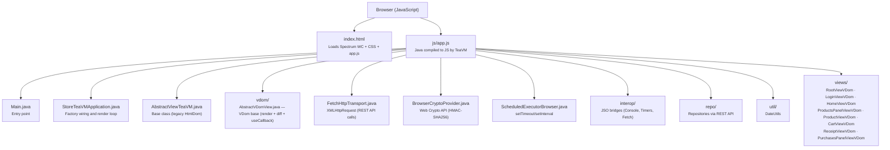
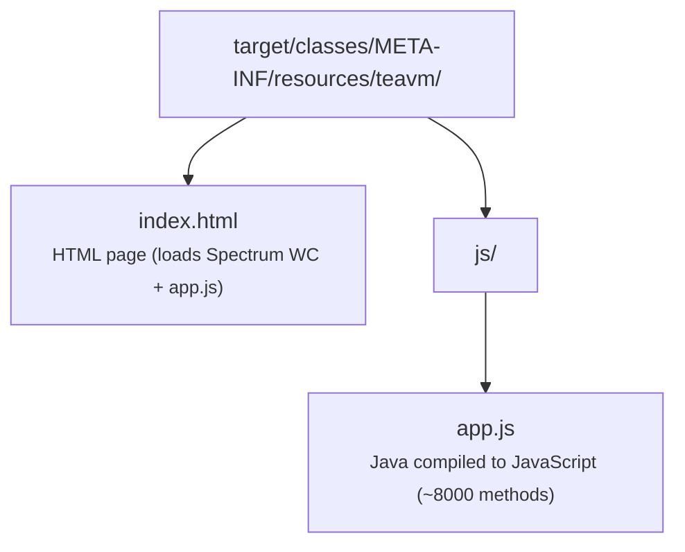
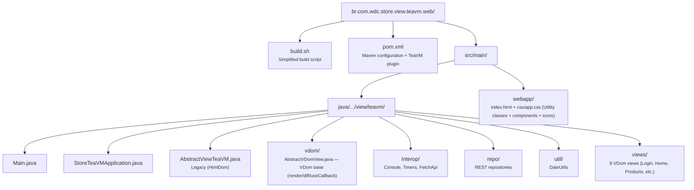
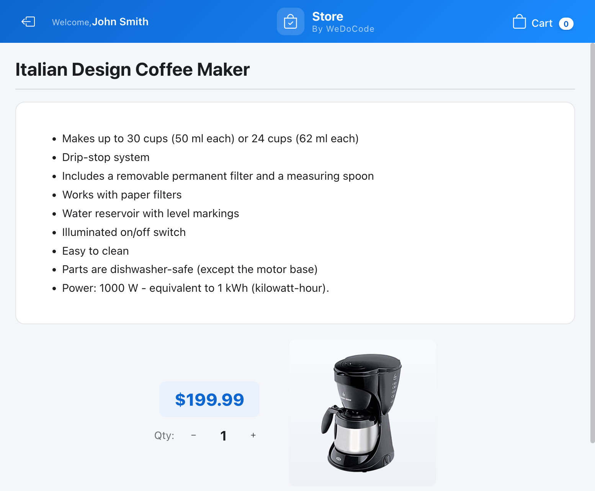
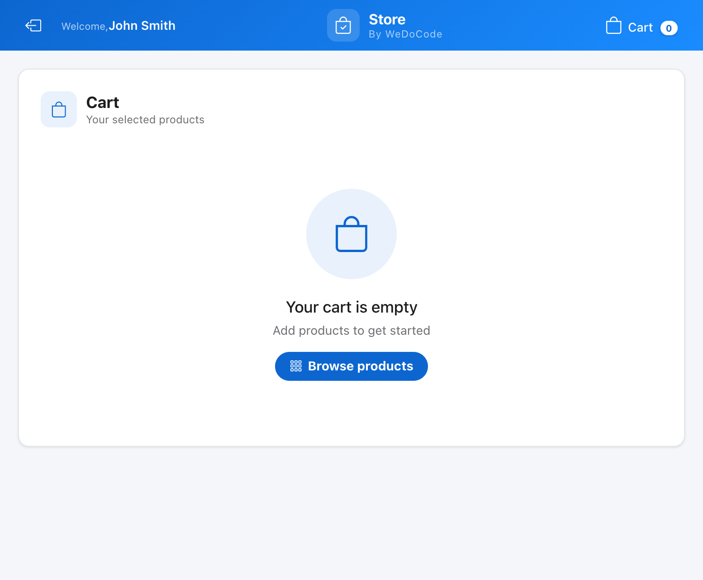
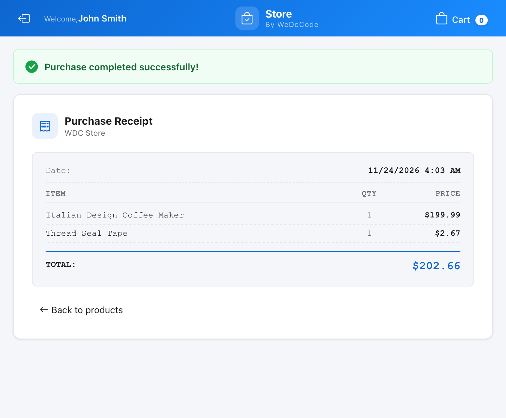

# WDC Store — TeaVM Web

Java source code of the TeaVM views and their compilation to JavaScript. This module contains the complete UI implementation using a **Virtual DOM** (VNode API) with Spectrum Web Components, which TeaVM compiles into an SPA that runs in the browser.

## Architecture



## Virtual DOM

The views use the `VNode` API to build virtual trees declaratively. The framework performs an efficient diff between renders, applying only the necessary mutations to the real DOM:

```java
@Override
protected VNode render() {
    return div(Css.ROOT).children(
      div(Css.WRAPPER).children(
        h5(Css.TITLE).text(state.product.name),
        spButton("accent")
          .boolAttr("disabled", state.items.isEmpty())
          .children(span(Css.ICON_ADD), span().text("Add"))
          .on("click", onAddToCart)));
}
```

### Reference Optimizations

The event listener diff compares by **reference identity** — same reference = zero DOM cost. Two techniques ensure stability:

1. **Stable fields** — parameterless listeners extracted into `final` fields:
   ```java
   private final EventListener<Event> onBack = evt -> state.onOpenProducts.run();
   ```

2. **`useCallback(key, listener)`** — cache for parameterized listeners (analogous to React's `useCallback`):
   ```java
   .on("click", useCallback("remove-" + itemId, mkOnRemove(itemId)))
   ```
   Returns the cached instance if the key already exists; after each render, unused keys are discarded automatically.

### Compact Css Pattern

Each view defines a private `Css` interface with compact aliases for the framework classes:

```java
@SuppressWarnings({"java:S1214", "static-access"})
private interface Css {
    CssUtility u = CssUtility.INSTANCE;
    CssComponents c = CssComponents.INSTANCE;
    CssIcons icon = CssIcons.INSTANCE;

    String ROOT = u.PAGE_SCROLL_ROOT;
    String ERROR = clsx(c.ALERT_ERROR, u.MB_12);
    String ICON_ADD = clsx(icon.BAG_PLUS, u.MR_6);
}
```

This lets you write `Css.ROOT` instead of `CssUtility.PAGE_SCROLL_ROOT`, keeping the render method clean and readable.

## Communication with the Server

The views communicate with the Javalin backend via REST API using `XMLHttpRequest` (implemented in `FetchHttpTransport`). Authentication uses HMAC-SHA256 via the Web Crypto API (`BrowserCryptoProvider`).

## Responsiveness

The layout adapts to small screens (iPhone SE) using responsive utility classes. In the header, auxiliary text is hidden on narrow screens, keeping only the essential icons.

## Build

```bash
# Via script (recommended)
JAVA25_HOME=<path-to-jdk-25> bash build.sh

# Or directly with Maven
JAVA_HOME=$JAVA25_HOME mvn process-classes -DskipTests
```

### Output



## Run

The module has no server of its own. The SPA is served as a static resource by the Javalin server (`backend`) or embedded by the `teavm.native` module (Tauri):

```
http://localhost:8080/teavm.web/index.html
```

In the browser, the app calls the API on the same origin that served `index.html` (the build leaves the `api-base-url` meta empty), so it works on any backend port. `teavm.native` builds with `-Dapi.base.url=<url>`, because there the page is not served by the backend.

## Project Structure



## Screenshots

### Login


### Product List


### Product Detail



### Cart


### Empty Cart



### Receipt



### Purchase History


## Guides

- [How to create a new View](docs/GUIDE_NEW_VIEW.md) — step-by-step guide to implementing a VDom view in this project
