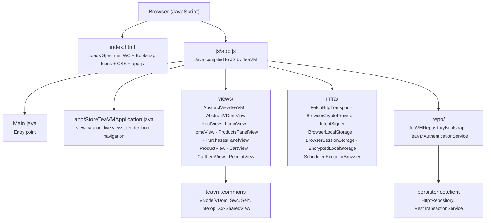
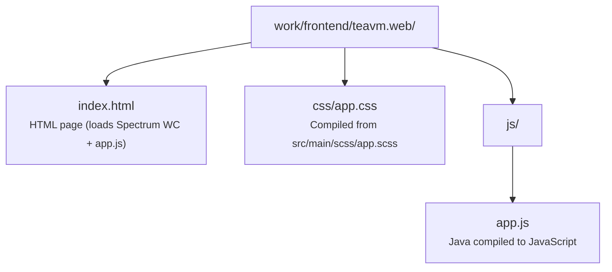
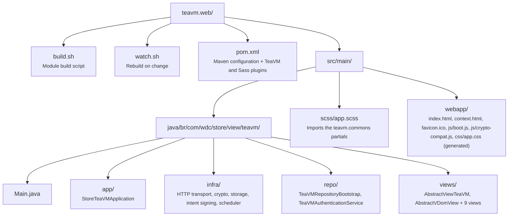
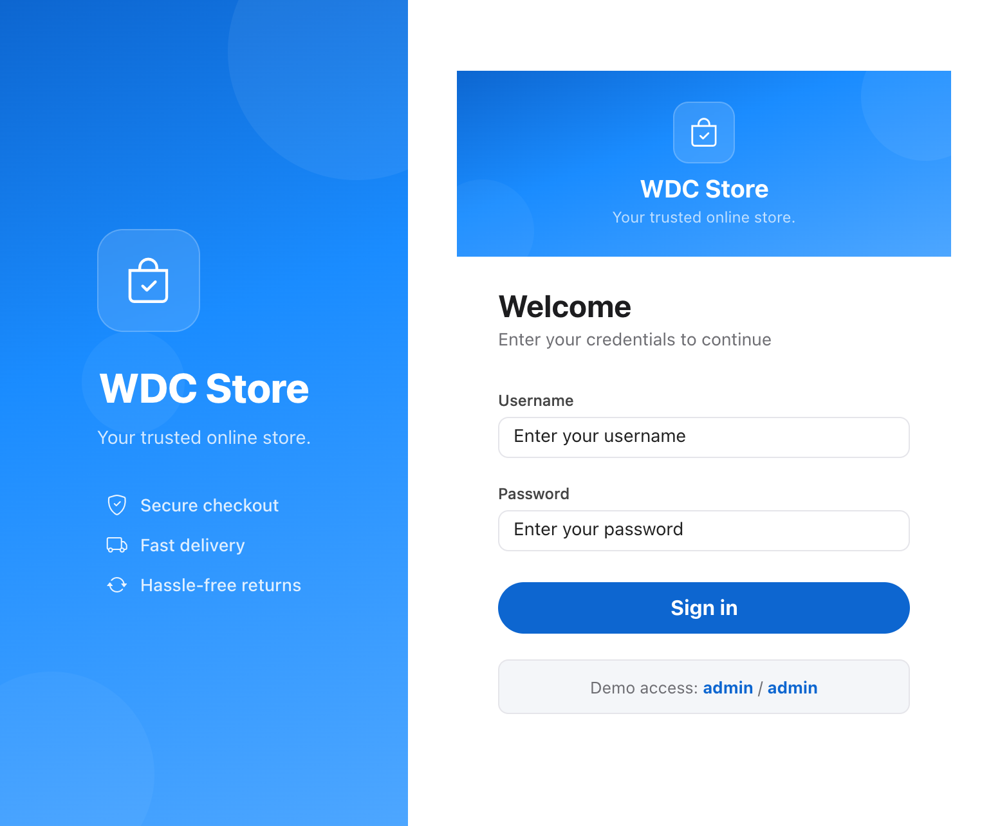
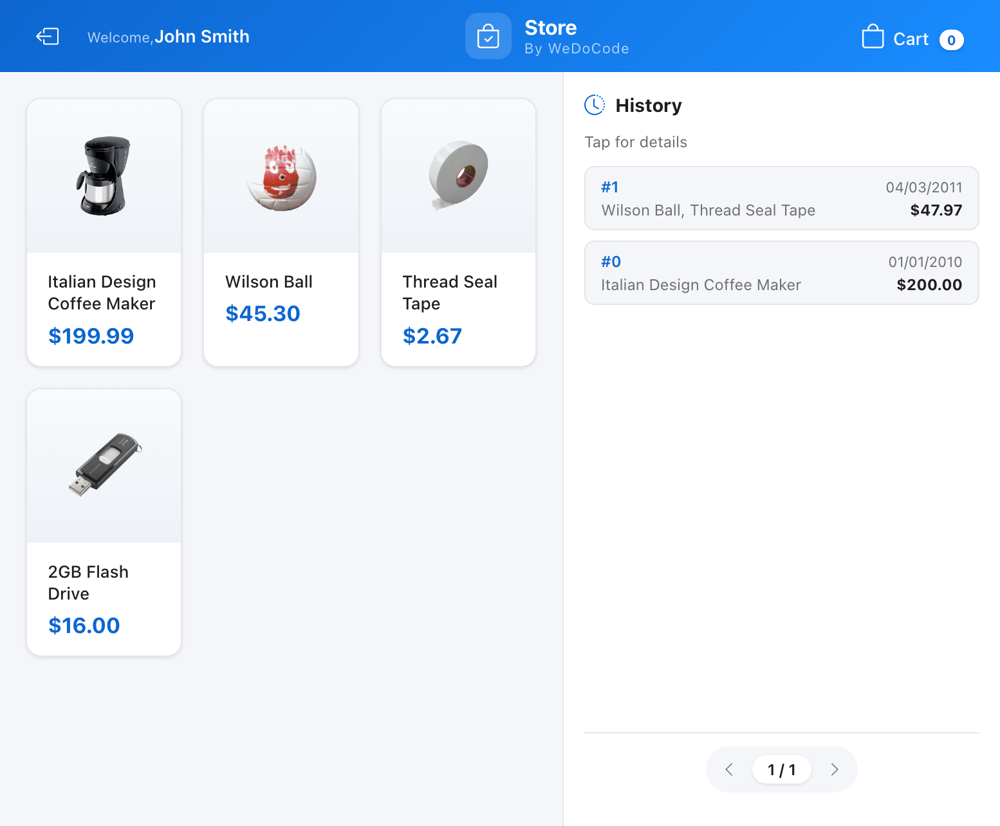
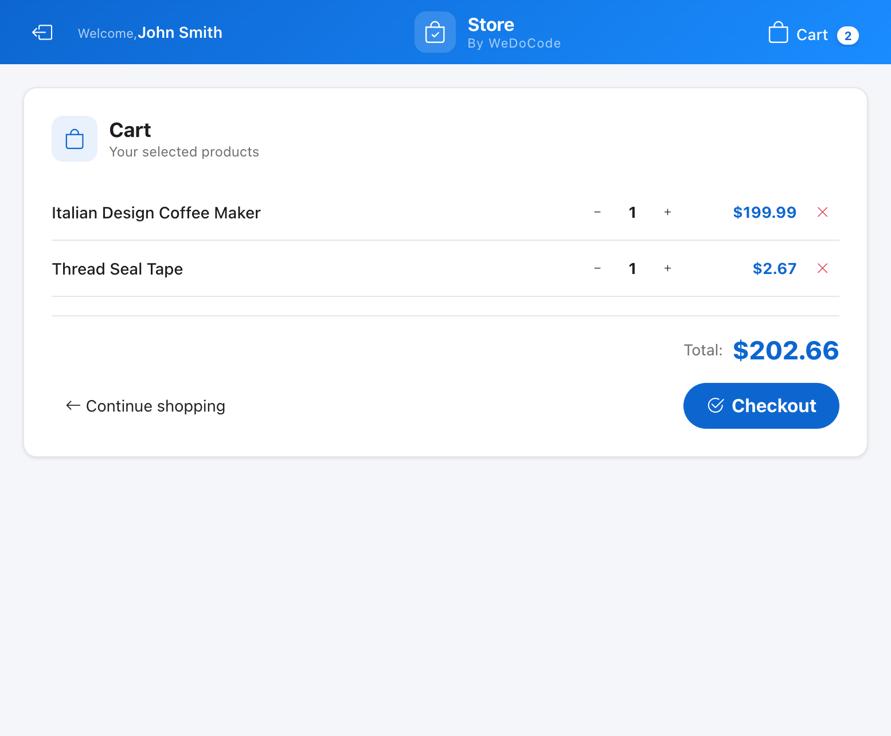
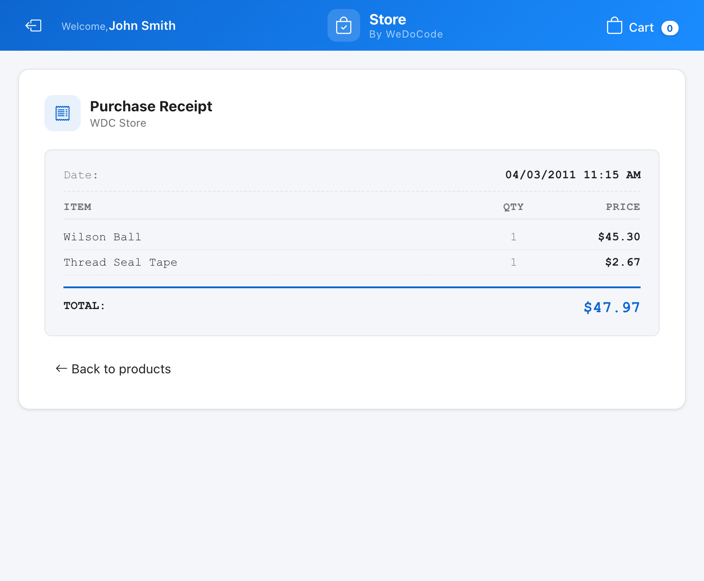

# WDC Store — TeaVM Web

Java source code of the TeaVM views and their compilation to JavaScript. This module contains the complete UI implementation using a **Virtual DOM** (VNode API) with Spectrum Web Components, which TeaVM compiles into an SPA that runs in the browser.

## Architecture



The presenters run in the browser. Each view extends `AbstractVDomView<XxxScope>` and delegates rendering to a shared view from `teavm.commons` (`XxxSharedView`), which `remote.shell.teavm` also uses; the view supplies the scope and wraps each action in `safeAction(...)`.

## Virtual DOM

The shared views use the `VNode` API (`br.com.wdc.store.view.teavm.commons`) to build virtual trees declaratively. The VDom performs a diff between renders, applying only the necessary mutations to the real DOM (from `CartSharedView`):

```java
@Override
public VNode render() {
    var scope = scopeSupplier.get();
    // ...
    return div(Sel.ROOT).children(
      div(Sel.WRAPPER).children(
        div(Sel.CARD).children(
          // ...
          spButton("accent", "l")
            .boolAttr("disabled", empty)
            .children(span(Sel.ICON_FINALIZE), span().text("Checkout"))
            .on("click", buyListener))));
}
```

### Reference Optimizations

The event listener diff compares by **reference identity** — same reference = zero DOM cost. Two techniques ensure stability:

1. **Stable fields** — parameterless listeners extracted into `final` fields:
   ```java
   private final EventListener<Event> backListener = evt -> onBack.run();
   ```

2. **`useCallback(key, listener)`** — cache for parameterized listeners (analogous to React's `useCallback`):
   ```java
   .on("click", useCallback("open-" + key, mkOnOpenProduct(product.id)))
   ```
   Returns the cached instance if the key already exists; after each render, unused keys are discarded automatically.

### Compact Sel Pattern

Each shared view defines a private `Sel` interface with compact aliases for the `teavm.commons` class catalogs:

```java
@SuppressWarnings({"java:S1214", "static-access"})
private interface Sel {
    SelUtility u = SelUtility.INSTANCE;
    SelComponents c = SelComponents.INSTANCE;
    SelIcons icon = SelIcons.INSTANCE;

    String ROOT = u.PAGE_SCROLL_ROOT;
    String ERROR_VISIBLE = clsx(c.ALERT_ERROR, u.MB_12);
    String ICON_FINALIZE = clsx(icon.CHECK2_CIRCLE, u.MR_6);
}
```

This lets you write `Sel.ROOT` instead of `SelUtility.PAGE_SCROLL_ROOT`, keeping the render method clean and readable.

## Communication with the Server

The repositories are the HTTP clients of `persistence.client` (`HttpProductRepository`, `HttpUserRepository`, ...), registered in the domain BEANs by `TeaVMRepositoryBootstrap`, over `FetchHttpTransport` (asynchronous `XMLHttpRequest` through TeaVM coroutines). Authentication uses HMAC-SHA256 computed in pure JavaScript (`BrowserCryptoProvider`) and is handled by `TeaVMAuthenticationService`; transactions spanning several REST calls go through `RestTransactionService`.

Client storage: `BrowserSessionStorage` (session scope), `BrowserLocalStorage` (persistent scope) and `EncryptedLocalStorage` (the persistent scope's `secure()` view: AES-GCM with a non-extractable key kept in IndexedDB, entries under the `<shellId>:sec.` prefix and kept out of the plain scope).

## Responsiveness

The layout adapts to small screens (iPhone SE) using responsive utility classes. In the header, auxiliary text is hidden on narrow screens, keeping only the essential icons.

## Build

```bash
# Recommended (from the repository root)
./work/bin/build-frontends.sh teavm.web

# Or the module script (--full also installs the framework and the store modules it depends on)
JAVA25_HOME=<path-to-jdk-25> ./build.sh --full
```

TeaVM compiles against the JARs in `~/.m2`, not against the reactor: without reinstalling `presentation`/`persistence.client` first, the app silently ships the previous version of the domain. `build-frontends.sh` reinstalls them by default.

### Output



## Run

The module has no server of its own. The SPA is served as a static resource by the Javalin server (`backend`) or embedded by the `teavm.native` module (Tauri):

```
http://localhost:8080/teavm.web/index.html
```

In the browser, the app calls the API on the same origin that served `index.html` (the build leaves the `api-base-url` meta empty), so it works on any backend port. `teavm.native` builds with `-Dapi.base.url=<url>`, because there the page is not served by the backend.

## Project Structure



## Screenshots

### Login



### Product List



### Product Detail


### Cart



### Empty Cart


### Receipt


### Purchase History



## Guides

- [How to create a new View](docs/GUIDE_NEW_VIEW.md) — step-by-step guide to implementing a VDom view in this project
