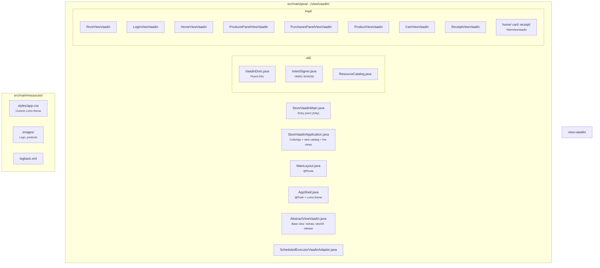
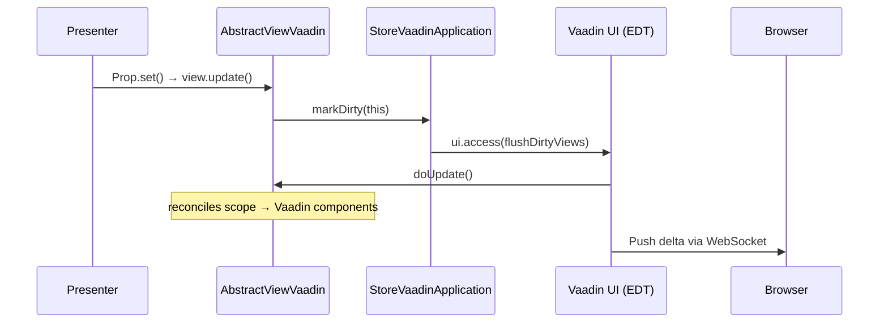
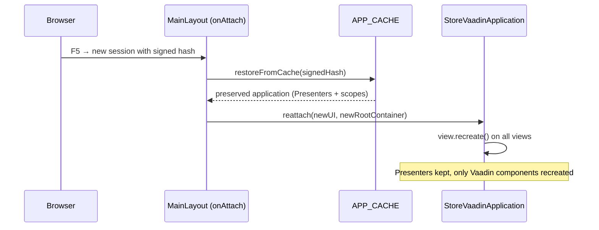
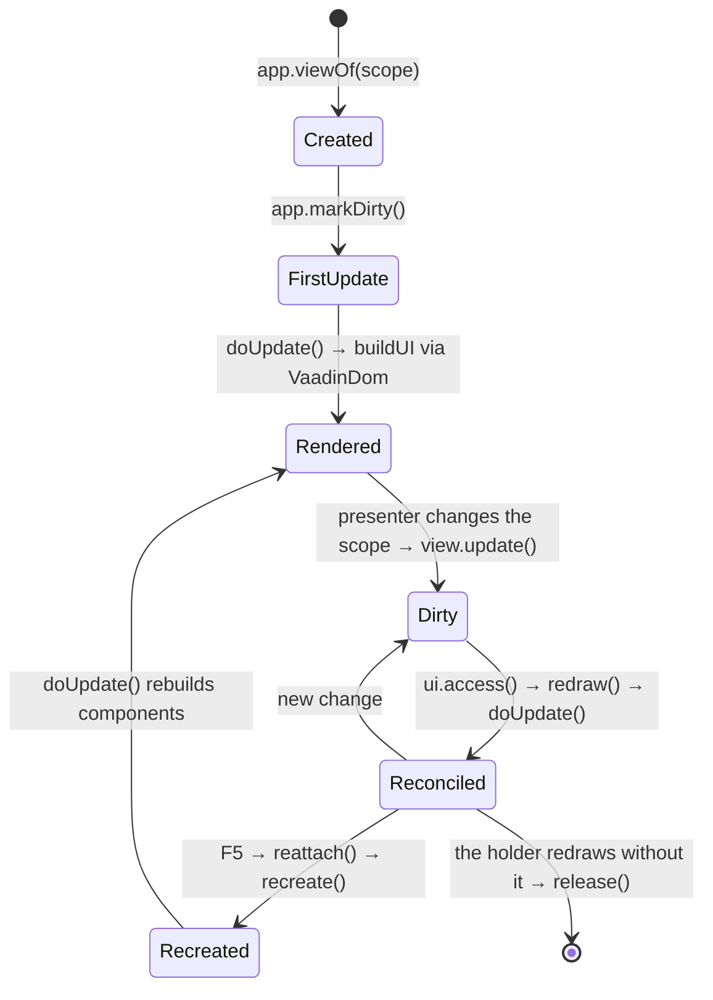
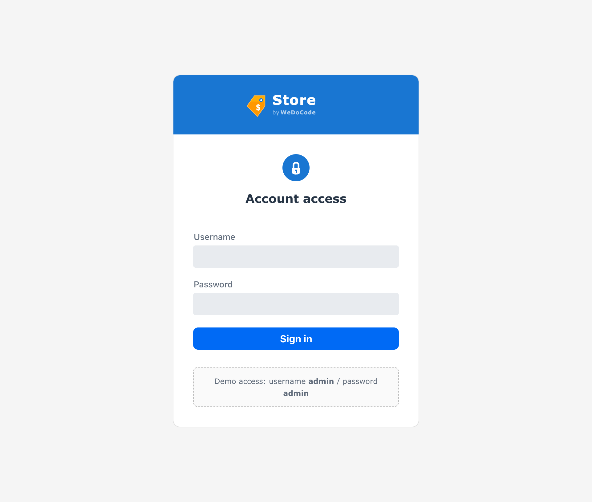
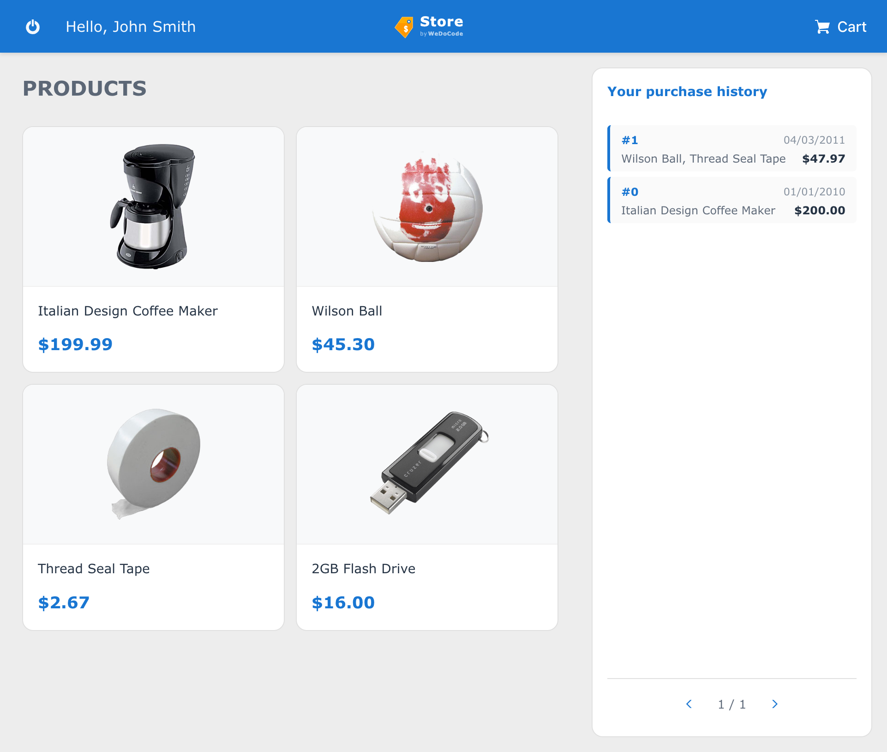
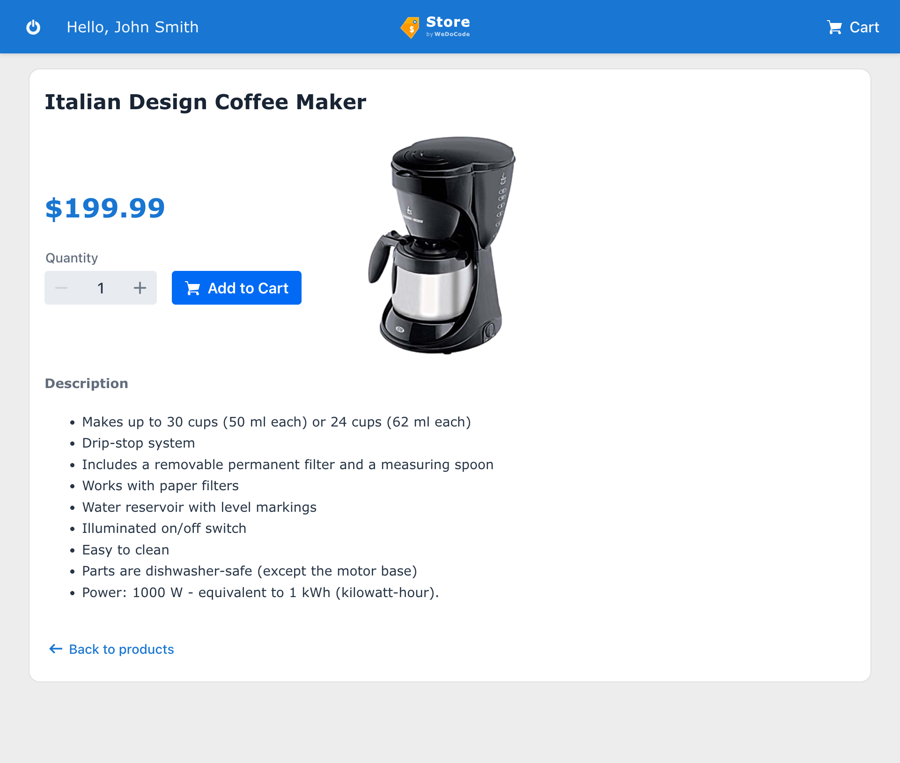
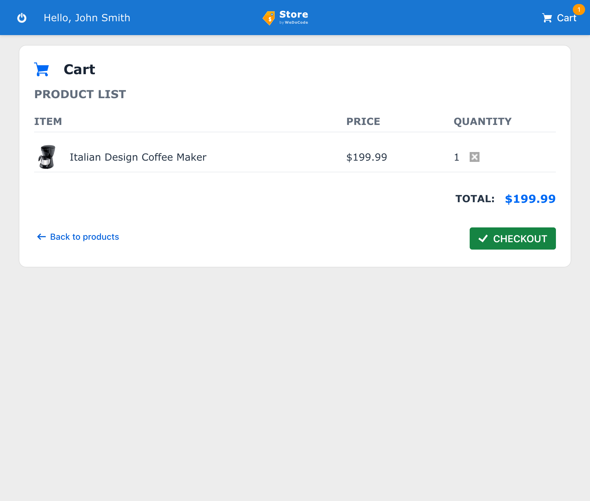
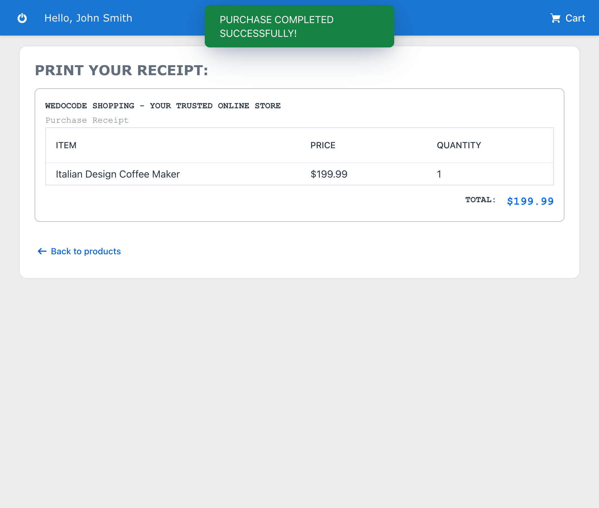

# br.com.wdc.store.view.vaadin

Web implementation (Vaadin 25) of the **WDC Store** application, demonstrating the **independence between view and presentation logic** in the **Cube MVP** pattern.

## Motivation

The Cube MVP architecture strictly separates the **Presenters** (which control navigation and publish the scopes) from the **Views** (which render the interface). The Presenters expose **Scopes** — objects whose `Prop` fields hold the data the view needs to display — and each Vaadin view (`AbstractViewVaadin`) installs itself as its scope's updater to connect to the update cycle; the view layer, not the presenters, decides when a view goes away.

This module uses **Vaadin Flow** — a server-side framework that renders native components in the browser without any custom JavaScript/TypeScript code. The UI runs entirely on the server (Java), and Vaadin handles the transport via Atmosphere (WebSocket/Push) to keep the browser in sync.

## How it works

### Navigation and URLs

Unlike a typical Vaadin project that uses `@Route` for navigation, this module uses a **single route** (`@Route("")` in `MainLayout`) and delegates all navigation to the Cube MVP framework via `CubeNavigation.execute(intent)`.

The URLs use hash-based navigation with an HMAC-SHA256 signature:

```
http://localhost:8090/#intent?sign=abc123
```

The `IntentSigner` class generates and validates signatures using Base62, ensuring that URLs cannot be forged.

### State restoration (F5)

When F5 is pressed, the complete application state is preserved:

1. `StoreVaadinApplication` keeps a static `APP_CACHE` (ConcurrentHashMap) indexed by the URL signature
2. In `MainLayout`'s `onAttach`, if there is a cache entry for the current signature:
   - The presenters are preserved (they hold the business state)
   - Only the Vaadin components are recreated via `view.recreate()`
   - The navigation hierarchy is rebuilt via `go(location)`

### Native Vaadin components

The UI is built programmatically using native Vaadin components:

- **TextField** + **Button** for the login form
- **Grid** for the receipt items; the cart draws one row view per `CartScope.CartItemScope` (`CartItemViewVaadin`)
- **IntegerField** with step buttons for quantity
- **Notification** for error/success messages
- **Badge** for the cart counter
- **Icon** (VaadinIcon) on action buttons
- **ButtonVariant** (LUMO_PRIMARY, LUMO_TERTIARY, LUMO_SMALL) for styles
- **Scroller** for the scrollable content area
- **H2, H3, H4** for semantic headings

The CSS theme uses **Lumo design tokens** (`var(--lumo-*)`) to keep Vaadin's native look.

### DSL for building the UI

The `VaadinDom` class provides a fluent DSL for building components programmatically:

```java
VaadinDom.render(rootLayout, (dom, pane) -> {
    dom.h3(h -> h.setText("Title"));
    dom.horizontalLayout(row -> {
        dom.image(img -> img.setSrc("images/product.png"));
        dom.verticalLayout(col -> {
            dom.span(label -> label.setText("Description"));
            dom.button(btn -> {
                btn.setText("Buy");
                btn.addThemeVariants(ButtonVariant.LUMO_PRIMARY);
            });
        });
    });
});
```

### View Catalog

```java
private static final Map<Class<?>, BiFunction<StoreVaadinApplication, Scope, AbstractViewVaadin<?>>> VIEWS = Map.of(
        RootScope.class, (app, s) -> new RootViewVaadin(app, (RootScope) s),
        LoginScope.class, (app, s) -> new LoginViewVaadin(app, (LoginScope) s),
        HomeScope.class, (app, s) -> new HomeViewVaadin(app, (HomeScope) s),
        // ... product, cart, receipt, segments and rows (ProductsPanelScope, PurchasesPanelScope, CartItemScope)
        CartScope.CartItemScope.class, (app, s) -> new CartItemViewVaadin(app, (CartScope.CartItemScope) s));
```

Each View constructor receives the application and the scope it draws — `public CartViewVaadin(StoreVaadinApplication app, CartScope scope)`. The Presenter never knows which UI technology is in use: it only fills in the scope.

## Structure



## Main dependencies

| Dependency | Version | Use |
|-------------|--------|-----|
| Vaadin (vaadin-core) | 25.3.5 | Server-side UI framework |
| Jetty (jetty-ee10-webapp) | 12.1.15 | Embedded server |
| H2 Database | (managed) | Embedded database |
| SLF4J + Logback | (managed) | Logging |

## Prerequisites

- **Java 25** (Temurin or Microsoft JDK)
- **Maven 3.9+**

## Build

```bash
export JAVA_HOME=<path-to-jdk-25>  # e.g.: /Library/Java/JavaVirtualMachines/temurin-25.jdk/Contents/Home
export PATH="$JAVA_HOME/bin:$PATH"

# Full build (from the project root)
cd fontes && mvn -q -DskipTests clean install

# Build only the Vaadin module
cd fontes && mvn -DskipTests package -pl br.com.wdc.store/br.com.wdc.store.view.vaadin -am
```

## Running

The build produces a fat JAR (`target/br.com.wdc.store.view.vaadin-1.0.0.jar`, main class `StoreVaadinMain`). The config file is resolved relative to the working directory, so point to the module's own:

```bash
cd fontes/br.com.wdc.store/br.com.wdc.store.view.vaadin
java -Dstore.config.file=work/config/application.toml \
  -jar target/br.com.wdc.store.view.vaadin-1.0.0.jar
```

Or via the IDE, running `StoreVaadinMain` with the same `-Dstore.config.file` (or with `work/` as the working directory).

Open: **http://localhost:8090** (default of `server.port`)

## Configuration

The module's `work/config/application.toml` lets you configure:

```toml
[app]
basedir = ".."   # required; resolved relative to the config file's directory

[server]
# port = 8090

[database]
# url = "jdbc:h2:file:..."   # default: H2 file database in work/data
# username = "sa"
# password = "sa"
# reset = false
```

## Technical notes

### Jetty and class scanning

The classes come from the classpath, not from a WAR: the `WebAppContext` points to an empty WAR directory, and the `ContainerIncludeJarPattern` limits annotation scanning to the Vaadin/Flow/Atmosphere JARs and to this module's location (`target/classes` or the fat JAR). This scan is what registers the `AppShell` and the `MainLayout` route.

### Theme

Starting with Vaadin 25, the default theme is Aura. The `AppShell` declares Lumo (`@StyleSheet(Lumo.STYLESHEET)`), because `styles/app.css` uses the `--lumo-*` variables. The app shell is a separate class: Vaadin does not accept a component (such as `MainLayout`) in that role.

### Server Push

The `@Push(PushMode.AUTOMATIC)` on `AppShell` enables push via Atmosphere/WebSocket, allowing scope updates in the Presenters to be reflected automatically in the browser.

## Cube MVP Integration Architecture

The integration between Vaadin and the presentation layer (Cube MVP) solves the challenge of connecting a push-based server-side framework to the Cube update cycle:

### 1. View catalog by scope

`StoreVaadinApplication` keeps its own catalog (`VIEWS`: scope class → view factory) and the map of live views. It creates each view the first time it is requested with `viewOf(scope)`, installs it as the scope's updater (`scope.setUpdater(view.updater)`) and marks it dirty for its first drawing: the host requests the root scope's view (`viewOf(getRootPresenter().scope)` in `updateHistory`), and each view requests those of the scopes it holds with its own `viewOf(...)` while it draws — `HomeViewVaadin`, for example, calls `this.viewOf(scope.content.get())` for the content and `this.viewOf(scope.productsPanel.get())` for the panel.

The flush draws each view with `redraw()`, which wraps `doUpdate()`: a view it held and did not ask for in that drawing is the view of a scope that left, and it is released once no view holds it — its updater taken back (`scope.clearUpdater`), its component removed from its parent, and the views it held released in turn. The presenters never release a view.

### 2. Flush via ui.access() (Server Push)

Vaadin does not use periodic polling. Instead, it uses **server push** via `@Push(PushMode.AUTOMATIC)` to send updates to the browser on demand:



`markDirty` schedules a `ui.access()` that runs `flushDirtyViews()` inside Vaadin's session lock, ensuring thread safety without the need for a timer. All dirty views are processed at once, and Vaadin automatically sends the DOM differences to the browser via Atmosphere/WebSocket.

| Aspect | Detail |
|---------|--------|
| **Trigger** | On-demand `ui.access()` (not periodic) |
| **UI thread** | Vaadin session lock |
| **Transport** | WebSocket push (Atmosphere) |
| **Throttling** | No throttling — immediate push after each flush |

### 3. Incremental reconciliation (doUpdate)

Each view compares the previous value with the current one field by field and only mutates the Vaadin component when there is a difference:

```java
@Override
public void doUpdate() {
    if (this.notRendered) {
        VaadinDom.render(this.element, this::buildUI);
        this.notRendered = false;
    }

    if (!Objects.equals(this.oldNickName, this.scope.nickName.get())) {
        this.nickNameElm.setText(this.scope.nickName.get());
        this.oldNickName = this.scope.nickName.get();
    }
}
```

### 4. VaadinDom — UI Building DSL

Analogous to `SwtDom` and `HtmlDom` (TeaVM), `VaadinDom` provides a fluent DSL for building Vaadin components, with an implicit parent-container stack:

```java
VaadinDom.render(rootLayout, (dom, pane) -> {
    dom.horizontalLayout(row -> {
        dom.h3(h -> h.setText("Title"));
        dom.button(btn -> {
            btn.setText("Buy");
            btn.addThemeVariants(ButtonVariant.LUMO_PRIMARY);
            btn.addClickListener(e -> safeAction("Buy", this.scope.onBuy::run));
        });
    });
});
```

| Aspect | SwtDom | VaadinDom |
|---------|----------|-----------|
| Containers | `Composite` + GridLayout | `VerticalLayout`, `HorizontalLayout` |
| Components | `Label`, `Button` (SWT) | `Span`, `Button`, `Grid` |
| HTML semantics | — | `H2`, `H3`, `H4`, `Div` |
| Spacers | GridData hints | `FlexLayout` / expand |

### 5. List Synchronization (newListSlot)

The `newListSlot` mechanism synchronizes a data list (from the Scope) with child views (Vaadin components), reusing existing instances:

```java
this.contentSlot = this.newListSlot(container, this::newItemView, this::updateItem);

// In doUpdate:
this.contentSlot.accept(this.scope.products.get(), this.itemViewList);
```

Vaadin's `container.remove(view.getElement())` and `container.add(view.getElement())` operations are O(1) on the server; the delta is sent to the browser via push.

### 6. safeAction — Error Handling in Callbacks

```java
protected void safeAction(String context, Runnable action) {
    try {
        action.run();
    } catch (Exception caught) {
        this.app.alertUnexpectedError(LOG, context, caught);
    }
}
```

It catches exceptions from the Vaadin listener's own code and shows `Notification.show()` with the error message. A failure of a presenter action does not reach this point: the action is guarded in the presenter (`action(...)`).

### 7. State Restoration (F5 / refresh)

In Vaadin's server-side model, pressing F5 makes the browser destroy the WebSocket, and the Java components are left disconnected. The solution:



- The `APP_CACHE` (static ConcurrentHashMap) stores the application indexed by the URL's HMAC signature
- On `reattach`, each view runs `recreate()` — it resets the `notRendered` flag and creates new Vaadin components
- The Presenters and their scopes are preserved intact

### 8. URL Navigation with HMAC-SHA256

The `IntentSigner` class generates hash-based URLs with a cryptographic signature:

```
http://localhost:8090/#intent?sign=<Base62>
```

- Prevents the user from forging navigation URLs
- Enables state restoration via the cache
- Blocks URLs with an invalid signature (`handleBrowserNavigation` rejects them and restores the valid URL)

### View Lifecycle



## Conclusion

The Vaadin module demonstrates that the Cube MVP pattern integrates naturally with a push-based server-side framework: the **Presenters control navigation and publish the scopes**, the **Scopes expose data** and the **Vaadin Views reconcile components** — all connected by the `markDirty → ui.access → doUpdate → push` cycle.

## Screenshots

### Login


### Home (Products + Purchase History)


### Product Detail


### Shopping Cart


### Receipt

